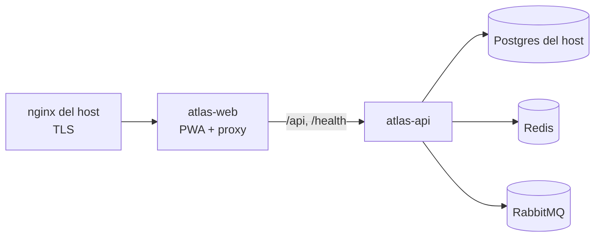

# deploy · Despliegue

Atlas se despliega en **qa** (rama `staging`, namespace `atlas-qa` en la VPS 177, `qa.atlas.flitsas.com`) y **pdn** (rama `release`, `atlas-pdn` en la 169, `atlas.flitsas.com`). `develop` no despliega (ATLAS-ADR-0019).

Los manifiestos viven en `flitsas/flit-gitops` (`services/atlas-qa/`), igual que los de FLIT 2.0 y los satélites, y Argo CD los sincroniza. Aquí no van secretos, IPs ni rutas de SealedSecrets (ATLAS-ADR-0006).

## Imágenes

| Imagen | Dockerfile | Contenido |
|---|---|---|
| `ghcr.io/flitsas/flit-atlas/atlas-api` | `services/api/Dockerfile` (`--target api`) | .NET 10.0.13 «chiseled» (sin shell), usuario `app` |
| `ghcr.io/flitsas/flit-atlas/atlas-migrador` | `services/api/Dockerfile` (`--target migrador`) | Aplica las migraciones y termina; corre como initContainer de `atlas-api` |
| `ghcr.io/flitsas/flit-atlas/atlas-web` | `apps/web/Dockerfile` | Build de Vite en nginx sin privilegios; reenvía el BFF a `atlas-api` (mismo origen) |

Las imágenes base están fijadas por digest. El CI construye las tres en cada PR (job `imagenes`); `.github/workflows/cd.yml` las publica en GHCR al integrar en `staging` o `release` y fija los digests en `flit-gitops`.

## Flujo



El nginx del host envía `Host` y `X-Forwarded-Proto`; atlas-web los pasa a la API, que los acepta solo desde `Atlas__Proxy__RedesConfiables` (la red de pods). Con ellos arma la redirect URI de Entra ID y valida el `Origin`.

## Requisitos del GitHub Environment

`staging` (y `production` para pdn) necesitan el secreto `GITOPS_TOKEN`, con permiso de escritura solo en `flitsas/flit-gitops`.

## Cuenta de administrador de emergencia

Para el arranque de un ambiente (nadie tiene aún `atlas.superadmin` para crear los mapeos de grupos de Entra) o si Entra ID no responde (ATLAS-ADR-0027). La cuenta no tiene contraseña por defecto: se activa así.

1. Con acceso al clúster, corre el comando dentro de atlas-api (la imagen no tiene shell; si el pod tiene más de un contenedor, agrega `-c <contenedor>`):

   ```bash
   kubectl -n atlas-qa exec -it deploy/atlas-api -- dotnet Flit.Atlas.Api.dll emergencia activar
   ```

   En pdn, el mismo comando con `-n atlas-pdn`. El comando crea la cuenta si no existe (`admin.emergencia@atlas.local`, o la de `Identidad__Emergencia__Correo`), le quita los factores, cierra sus sesiones e imprime un enlace `https://qa.atlas.flitsas.com/emergencia#…`.
2. **Abre el enlace de inmediato**, en el navegador donde vas a usar la cuenta: sirve una sola vez y vence en 1 h. No lo pegues en chats, tickets ni documentos; el enlace solo existe en la salida del comando (no queda en el log).
3. Registra una passkey (preferida) o una contraseña de 12+ caracteres con una aplicación de autenticación, y guarda los códigos de recuperación fuera de línea.
4. Entra por la pantalla de ingreso de Atlas (`https://qa.atlas.flitsas.com/`), en la sección de cuentas locales («passkey» o correo, contraseña y código). El shell muestra «Cuenta de emergencia».
5. Haz solo lo que falta y cierra la sesión. Para el arranque, el paso es mapear el grupo de Entra de administración a `atlas.superadmin`, desde la PWA: **Más → Asignación de roles** (`/administracion/roles`) → **Nuevo mapeo**, con el object id del grupo (Entra ID → Grupos → el grupo → Id. de objeto), su nombre y el rol Superadministrador. La reautenticación lo exige en los 10 minutos siguientes al ingreso; si la pantalla pide confirmar tu identidad, usa «Salir y volver a entrar».

   Como alternativa (sin la pantalla), desde la consola del navegador en la pestaña de Atlas, en esos mismos 10 minutos:

   ```js
   await fetch('/api/v1/plataforma/mapeos-grupos-entra', {
     method: 'POST',
     headers: { 'Content-Type': 'application/json', 'X-Atlas-Csrf': '1' },
     body: JSON.stringify({ grupoId: '<object id del grupo en Entra>', grupoNombre: '<nombre del grupo>', rol: 'atlas.superadmin' }),
   }).then((r) => r.status); // 201
   ```

   Las personas del grupo reciben el rol en su siguiente ingreso con Microsoft. Después revisa la auditoría (`identidad.emergencia.*`).

Volver a correr el comando invalida el enlace anterior y la cuenta queda sin factores: así se recupera o se corta si alguien más la usó.

## Sincronización de personas con Microsoft Graph

Atlas sincroniza a diario (05:00, hora de Bogotá) el nombre, cargo, área, teléfono, foto y estado de los empleados (ATLAS-ADR-0030). No pide permisos de Graph nuevos. Pasos del líder, por ambiente:

1. En el registro de la app «Flit Atlas» de Entra ID, confirma que `User.Read.All` y `GroupMember.Read.All` son permisos **de aplicación** con consentimiento de administrador (los mismos que ya usa el ingreso para cargo, área y grupos).
2. Sin configurar nada, el origen es `enlazadas`: solo se refresca a quien ya entró a Atlas. Para que el directorio muestre a todo el equipo, elige el grupo de Entra de los empleados y agrega al ConfigMap de atlas-api en `flit-gitops` (no son secretos):

   ```yaml
   Identidad__Personas__Origen: grupo
   Identidad__Personas__GrupoEmpleados: "<object id del grupo en Entra>"
   # Opcional: Identidad__Personas__Hora: "05:00"
   ```

3. Después del despliegue, entra como superadmin a **Equipo** (`/equipo`) y pulsa **Sincronizar ahora**; revisa los conteos en la tarjeta y en la auditoría (`identidad.personas_sincronizadas`). Si aparecen deshabilitaciones **retenidas** por el freno, revisa el tenant y el grupo antes de la corrida siguiente.

## Responsables: importar el documento (HU 2.3, ATLAS-ADR-0031)

1. Asegúrate de que los empleados del documento existan en Atlas: con el origen `grupo` de la sincronización (arriba) y **Sincronizar ahora**, o pidiendo que cada uno entre una vez. Los productos y módulos los trae la semilla del catálogo.
2. Entra con `atlas.equipo.gestionar` (líder técnico) a **Responsables → Importar** (`/equipo/responsables?vista=importar`), sube `docs/atlas/insumos/Responsables_Productos_FLIT_2026-10-20.md` y pulsa **Ver la vista previa**.
3. Si algo quedó **sin enlazar** (una persona que no está en el directorio o un nombre distinto al de Entra, un producto que no está en el catálogo), resuélvelo (sincroniza, corrige el nombre en el documento o escribe el correo de la persona en su celda) y vuelve a revisar. Nada se inventa.
4. Elige si los secundarios quedan **habilitados** o **en acompañamiento** y confirma: se crea la versión 5 con su fecha, quien la definió, las definiciones de los roles y la revisión del 20/01/2027. Revisa la auditoría (`equipo.reparto_importado`).
5. Opcional, para comparar los CODEOWNERS reales: un token de solo lectura o la GitHub App en un SealedSecret (`Plataforma__GitHub__*`, ver `services/api/README.md`).

## Soporte en Microsoft 365: calendario, Teams y feeds (HU 2.10, ATLAS-ADR-0033)

Sin estos pasos todo se apaga limpio y la pantalla **Soporte → Outlook y calendarios** dice por qué; los feeds .ics funcionan igual. Pasos del líder, por ambiente:

1. **Buzón compartido** en Exchange Online para el calendario (p. ej. `soporte-sabados@<dominio>`, nombre «Soporte TI sábados»; no necesita licencia). Es el organizador de los eventos.
2. **Permiso solo sobre ese buzón** con RBAC para aplicaciones de Exchange Online (reemplaza a las políticas de acceso de aplicaciones). Con `Connect-ExchangeOnline` y el rol Organization Management:

   ```powershell
   New-ServicePrincipal -AppId <client id de «Flit Atlas»> -ObjectId <object id de la aplicación empresarial> -DisplayName "Flit Atlas <ambiente>"
   New-ManagementScope -Name "Atlas soporte sábados" -RecipientRestrictionFilter "PrimarySmtpAddress -eq '<buzón compartido>'"
   New-ManagementRoleAssignment -App <object id> -Role "Application Calendars.ReadWrite" -CustomResourceScope "Atlas soporte sábados"
   Test-ServicePrincipalAuthorization -Identity <object id> -Resource <buzón compartido>
   ```

   **No** consientas `Calendars.ReadWrite` en Entra ID: se suma al de Exchange y daría acceso a todos los buzones. El cambio tarda de 30 min a 2 h en aplicarse.
3. **Canal de Teams**: en el canal del soporte, Workflows → «Publicar en un canal cuando se recibe una solicitud de webhook» (los conectores de Office 365 ya no funcionan desde mayo de 2026). Crea el flujo con una cuenta de servicio o del equipo y guarda la URL del disparador **solo** en el SealedSecret de atlas-api: `Plataforma__Teams__Canales__soporte`. Si se filtra, borra el flujo y crea otro.
4. **ConfigMap** de atlas-api en `flit-gitops` (no son secretos): `Soporte__M365__Buzon: "<buzón compartido>"` y `Atlas__UrlPublica` si aún no está (botones de los avisos y URL de los feeds). Opcionales en `services/api/README.md`.
5. Después del despliegue, las dos tarjetas de **Soporte → Outlook y calendarios** deben decir «Activo». Crea un turno de prueba tuyo, revisa el evento en tu Outlook y en Teams, y cancélalo.

## Probar las imágenes en local

```bash
docker build -f services/api/Dockerfile --target api -t atlas-api .
docker build -f services/api/Dockerfile --target migrador -t atlas-migrador .
docker build -t atlas-web apps/web
```

En la cadena de Postgres usa `Gss Encryption Mode=Disable`: la imagen no trae Kerberos y Npgsql lo intenta por defecto.
