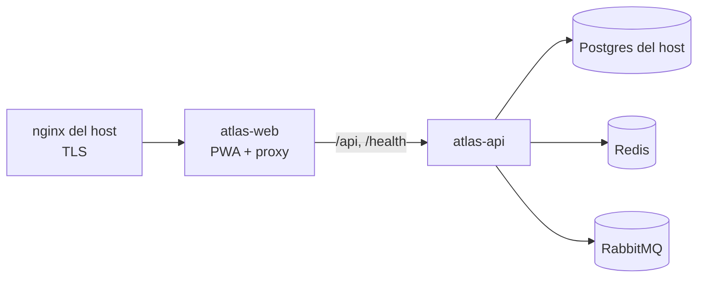

# deploy · Despliegue

Atlas se despliega en **qa** (rama `staging`, namespace `atlas-qa` en la VPS 177, `qa.atlas.flitsas.com`) y **pdn** (rama `release`, `atlas-pdn` en la 169, `atlas.flitsas.com`). `develop` no despliega (ATLAS-ADR-0019).

Los manifiestos viven en `flitsas/flit-gitops` (`services/atlas-qa/`), igual que los de FLIT 2.0 y los satélites, y Argo CD los sincroniza. Aquí no van secretos, IPs ni rutas de SealedSecrets (ATLAS-ADR-0006).

## Imágenes

| Imagen | Dockerfile | Contenido |
|---|---|---|
| `ghcr.io/flitsas/flit-atlas/atlas-api` | `services/api/Dockerfile` (`--target api`) | .NET 10.0.13 «chiseled» (sin shell), usuario `app` |
| `ghcr.io/flitsas/flit-atlas/atlas-migrador` | `services/api/Dockerfile` (`--target migrador`) | Aplica las migraciones y termina; corre como initContainer de `atlas-api` |
| `ghcr.io/flitsas/flit-atlas/atlas-web` | `apps/web/Dockerfile` | Build de Vite en nginx sin privilegios; reenvía el BFF a `atlas-api` (mismo origen) |

Las imágenes base están fijadas por digest. El CI construye las tres en cada PR (job `imagenes`); `.github/workflows/cd.yml` las publica en GHCR al integrar en `staging` o `release` y fija los digests en `flit-gitops`.

## Flujo



El nginx del host envía `Host` y `X-Forwarded-Proto`; atlas-web los pasa a la API, que los acepta solo desde `Atlas__Proxy__RedesConfiables` (la red de pods). Con ellos arma la redirect URI de Entra ID y valida el `Origin`.

## Requisitos del GitHub Environment

`staging` (y `production` para pdn) necesitan el secreto `GITOPS_TOKEN`, con permiso de escritura solo en `flitsas/flit-gitops`.

## Probar las imágenes en local

```bash
docker build -f services/api/Dockerfile --target api -t atlas-api .
docker build -f services/api/Dockerfile --target migrador -t atlas-migrador .
docker build -t atlas-web apps/web
```

En la cadena de Postgres usa `Gss Encryption Mode=Disable`: la imagen no trae Kerberos y Npgsql lo intenta por defecto.
