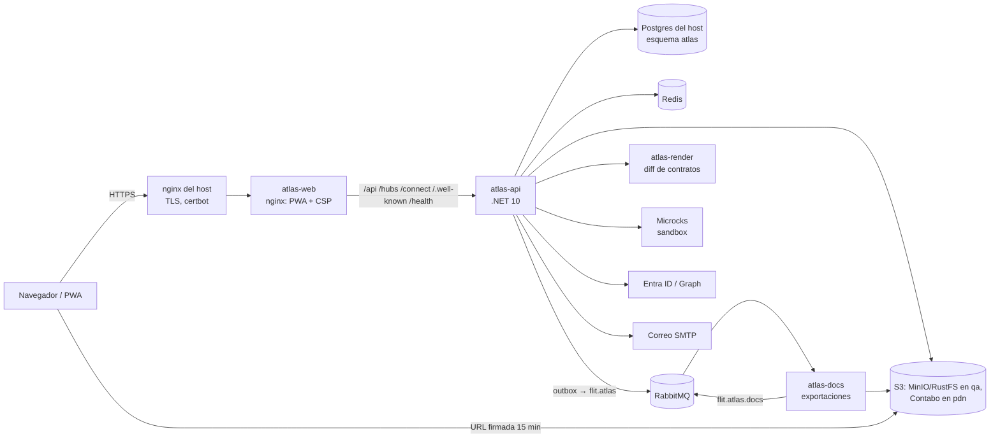

# Runbook de operación de Flit Atlas (borrador)

> **Estado:** borrador de la HU 4.10 (ATLAS-ADR-0048), 24/10/2026. Se lleva a `flit-gitops/docs` en la ola 4 de F4 (HU 4.11).
> Aquí no van secretos, IPs, rutas de SealedSecrets ni datos personales: los secretos se nombran, nunca se copian.
> Lo marcado **[por verificar]** depende de manifiestos o decisiones que aún no están en `flit-gitops`.

## 1. Arquitectura desplegada

| Ambiente | Rama | Namespace y VPS | Host público |
|---|---|---|---|
| qa | `staging` | `atlas-qa` en la 177 | `qa.atlas.flitsas.com` |
| pdn | `release` | `atlas-pdn` en la 169 **[confirmar namespace]** | `atlas.flitsas.com` |

`develop` no despliega (ATLAS-ADR-0019). Argo CD sincroniza `flit-gitops/services/atlas-<ambiente>/`; el CD de este repo
publica las imágenes en GHCR y escribe sus **digests** en el `kustomization.yaml` del ambiente.

## 2. Piezas

| Pieza | Imagen (`ghcr.io/flitsas/flit-atlas/…`) | Puerto qa / pdn | Qué hace | Estado en qa |
|---|---|---|---|---|
| `atlas-api` | `atlas-api` | 5031 / 6031 | BFF de la PWA, identidad (Entra, cuentas externas, OpenIddict), módulos, outbox, consumidor de resultados | desplegado |
| migrador | `atlas-migrador` | — | initContainer de atlas-api: aplica las migraciones de todos los módulos, siembra permisos y banderas y concede los permisos del rol de la aplicación (ATLAS-ADR-0050), con el rol `flit_atlas_migrador`; si falla, atlas-api no arranca | desplegado (**[por verificar]** con su propio rol) |
| `atlas-web` | `atlas-web` | 5032 / 6032 | nginx sin privilegios: la PWA, el visor de contratos y el reenvío del BFF; pone la CSP y las cabeceras | desplegado |
| `atlas-docs` | `atlas-docs` | 5035 / 6035 | Genera las exportaciones (cola `atlas.docs.exportaciones`, concurrencia 1 por pod) | **[por verificar]** Deployment y variables |
| `atlas-render` | `atlas-render` | 5033 / 6033 | Diff de contratos con oasdiff (ATLAS-ADR-0036) | **[por verificar]** |
| `atlas-ia` | `atlas-ia` | 5034 / 6034 | Asistente (F7); aún sin uso en el MVP | no desplegado |
| Microcks | imagen oficial fijada por digest | — | Sandbox nivel 1 (HU 4.7), solo en la 177 al inicio | **[por verificar]** |

## 3. Dependencias

| Dependencia | Detalle |
|---|---|
| Postgres 16 del host | Base del ambiente, esquema `atlas` y **dos roles** (ATLAS-ADR-0050, ver «Roles de la base» abajo): `flit_atlas_migrador`, dueño del esquema y de las tablas, que solo usa el migrador, y `flit_atlas`, el de atlas-api, sin propiedad, sin superusuario y sin `BYPASSRLS` (solo `atlas` en su `search_path`); `vector` y `unaccent` creados por el administrador en `atlas`. RLS en las tablas con organización: ninguno de los dos se la salta y la aplicación no puede apagarla |
| Redis | Caché y llaves de Data Protection compartidas entre réplicas; con contraseña |
| RabbitMQ | vhost `atlas`; exchanges `flit.atlas` (publica atlas-api) y `flit.atlas.docs` (publica atlas-docs). **Un usuario por servicio** con permisos solo sobre sus exchanges y colas (ATLAS-ADR-0044) **[por verificar en flit-gitops]** |
| S3 | Bucket `atlas` por ambiente (MinIO o RustFS en qa, Contabo en pdn). Dos hosts: el **interno** (`Plataforma__Almacenamiento__Endpoint`, para subir y borrar) y el **público** (`…__EndpointPublico`), con el que se **firman** las URL de descarga: la firma incluye el host, así que debe ser el que alcanza el navegador. El bucket necesita **CORS `GET` desde el origen de Atlas** (compartir el archivo desde el móvil lo baja con `fetch`, HU 4.6) y una regla de ciclo de vida para entradas huérfanas bajo `exportaciones/` **[por verificar]** |
| Entra ID | App «Flit Atlas» por ambiente: plataforma Web, redirect `https://<host>/api/auth/callback/azure-ad`, claim opcional `auth_time`, permisos de aplicación de Graph con consentimiento (`User.Read.All`, `GroupMember.Read.All`, calendario del soporte) |
| Correo | SMTP de Office 365 con STARTTLS (o Graph `sendMail`), remitente configurado; sin él, atlas-api arranca pero no salen invitaciones ni recuperaciones |
| GitHub Actions | Emisor OIDC de la publicación de contratos (`token.actions.githubusercontent.com`), audiencia = URL pública del ambiente |

### Roles de la base (ATLAS-ADR-0050)

Hasta F4, `flit_atlas` era dueño del esquema y de las tablas: con `FORCE ROW LEVEL SECURITY` RLS le aplicaba, pero una
inyección SQL podía hacer `ALTER TABLE … NO FORCE ROW LEVEL SECURITY` (hallazgo F4-SEC-10). Ahora el dueño es otro rol y
la aplicación solo tiene los permisos de datos. Lo hace el **administrador de la base** (DBA), una vez por ambiente;
nombres de los roles, nunca sus contraseñas (van en los SealedSecrets de §4):

1. Crear el rol del migrador, dueño del esquema (el script de flit `servicio-con-esquema-propio.sql` crea `flit_atlas`;
   este paso es adicional): `CREATE ROLE flit_atlas_migrador LOGIN NOSUPERUSER NOBYPASSRLS NOCREATEDB NOCREATEROLE
   NOREPLICATION PASSWORD '…';` y `GRANT CONNECT ON DATABASE <base> TO flit_atlas_migrador;`.
2. Pasarle la propiedad de lo que ya existe (en una base que ya tenía Atlas): `ALTER SCHEMA atlas OWNER TO
   flit_atlas_migrador;` y `REASSIGN OWNED BY flit_atlas TO flit_atlas_migrador;` (dentro de la base del ambiente; mueve
   tablas, secuencias y funciones de `atlas`). Las extensiones `vector` y `unaccent` siguen siendo del administrador.
3. Dejar a `flit_atlas` sin privilegios: `ALTER ROLE flit_atlas NOSUPERUSER NOBYPASSRLS NOCREATEDB NOCREATEROLE;`,
   `REVOKE CREATE ON SCHEMA atlas FROM flit_atlas;` y `REVOKE CREATE ON SCHEMA public FROM flit_atlas;`.
4. Configurar el initContainer del migrador con su propia cadena (`ConnectionStrings__atlas` con `flit_atlas_migrador`,
   en `atlas-migrador-secrets`) y, si el rol de la aplicación no se llama `flit_atlas`,
   `Atlas__BaseDeDatos__RolAplicacion`. atlas-api sigue con la de `flit_atlas` (`atlas-api-secrets`).

Los permisos de `flit_atlas` los concede **el migrador** al final de cada corrida (`RolesBaseDeDatos.Sql`, idempotente;
el log dice «Permisos concedidos al rol de la aplicación flit_atlas»):

| Sobre | `flit_atlas` recibe |
|---|---|
| Esquema `atlas` | `USAGE` (sin `CREATE`) |
| Tablas de `atlas` | `SELECT, INSERT, UPDATE, DELETE` (sin `TRUNCATE`, `REFERENCES` ni `TRIGGER`) |
| `plataforma_auditoria`, `identidad_evento_seguridad` | solo `SELECT, INSERT` (de solo inserción) |
| `__ef_migraciones_*` | nada (solo el migrador) |
| Secuencias y funciones de `atlas` (las de RLS) | `USAGE, SELECT` y `EXECUTE` |
| Lo que creen migraciones siguientes | lo mismo, con `ALTER DEFAULT PRIVILEGES IN SCHEMA atlas` del migrador |

Verificación: `/health/ready` de atlas-api incluye el chequeo `rol-base-de-datos`, que en dev, qa y pdn falla (la
réplica no recibe tráfico) si su rol es superusuario, tiene `BYPASSRLS` o es dueño de alguna tabla de `atlas`; en local
solo avisa en el log. A mano: `SELECT rolsuper, rolbypassrls FROM pg_roles WHERE rolname = 'flit_atlas';` (los dos en
falso) y `SELECT count(*) FROM pg_tables WHERE schemaname = 'atlas' AND tableowner = 'flit_atlas';` (cero).

**Orden del despliegue que separa los roles:** pasos 1 a 3 del DBA → nueva cadena del migrador en flit-gitops → desplegar
la versión con ATLAS-ADR-0050. Si se despliega antes, el migrador avisa que corre con el rol de la aplicación y atlas-api
queda no lista fuera de local (no hay corte del servicio que ya corría: la versión anterior sigue sirviendo).

## 4. Configuración

### atlas-api (ConfigMap, no secretos)

`Atlas__Ambiente`, `Atlas__UrlPublica`, `Atlas__Proxy__RedesConfiables` y `Atlas__Proxy__Limite`,
`Identidad__Entra__TenantId`, `Identidad__Entra__ClientId`, `Identidad__Entra__ClientCredentials__0__SourceType`,
`Identidad__Tokens__Emisor`, `Identidad__Tokens__Certificados__Firma` y `…__Cifrado` (rutas de los `.pfx` montados),
`Identidad__ProteccionDatos__Certificado`, `Identidad__Personas__Origen` (y `…__GrupoEmpleados`),
`Plataforma__Correo__*` (proveedor, remitente, host, puerto, seguridad, usuario), `Plataforma__Almacenamiento__Endpoint`,
`…__EndpointPublico`, `…__Bucket`, `…__Region`, `OTEL_EXPORTER_OTLP_ENDPOINT`, `OTEL_SERVICE_NAME`.
`Identidad__Simulado__Habilitado` **nunca** en qa ni pdn (atlas-api no arranca con él).

Ajustes de operación con buenos valores por defecto (solo si hace falta): `Identidad__LimiteTasa__*` (§9),
`Contratos__Exportaciones__MaximoEnCursoPorOrganizacion`, `…__MaximoEnCursoPorPersona`, `…__Retencion` (7 días),
`…__TiempoMaximo` (2 h), `Plataforma__Mensajeria__Consumo__MaximoIntentos` (5).

### Secretos (SealedSecrets; nombres de las claves, nunca sus valores)

| Secret | Claves |
|---|---|
| `atlas-migrador-secrets` **[por verificar: crearlo en flit-gitops]** | `ConnectionStrings__atlas` con el rol `flit_atlas_migrador` (solo el initContainer del migrador) |
| `atlas-api-secrets` | `ConnectionStrings__atlas` (rol `flit_atlas`), `ConnectionStrings__redis`, `ConnectionStrings__rabbitmq`, `Identidad__Entra__ClientCredentials__0__ClientSecret`, `Identidad__ProteccionDatos__ClaveCertificado` (más `RABBITMQ_DEFAULT_USER`/`_PASS` y `REDIS_PASSWORD` para sus servicios) |
| `atlas-tokens` | `firma.pfx`, `cifrado.pfx` y `clave` (certificados de OpenIddict) |
| `atlas-correo` | `Plataforma__Correo__Smtp__Clave` |
| almacenamiento **[por verificar]** | `Plataforma__Almacenamiento__Usuario`, `…__Clave`; para atlas-docs `ATLAS_DOCS_S3_ACCESS_KEY` y `ATLAS_DOCS_S3_SECRET_KEY` |
| atlas-docs **[por verificar]** | `ATLAS_DOCS_RABBITMQ_URL` (con su usuario propio) |
| `ghcr-pull` | credencial de lectura de GHCR |

Los SealedSecrets los generan los scripts del host en `flit-gitops/docs/host-<vps>/`, como root en la VPS.

### atlas-web (ConfigMap)

`ATLAS_WEB_PORT`, `ATLAS_API_URL`, `ATLAS_VISOR_CONEXIONES` (hosts de QA y sandbox para «Probar»),
`ATLAS_HSTS` (por defecto un año con subdominios; vacío la quita) y `ATLAS_S3_PUBLICO` (el origen de
`Plataforma__Almacenamiento__EndpointPublico`, para `connect-src`) **[por verificar: agregarla en flit-gitops]**.

### atlas-docs

`ATLAS_AMBIENTE`, `ATLAS_DOCS_S3_ENDPOINT`, `…_BUCKET`, `ATLAS_DOCS_RABBITMQ_URL`, `ATLAS_DOCS_AUTH_JWKS_URL`,
`ATLAS_DOCS_AUTH_EMISOR`, `ATLAS_DOCS_AUTH_AUDIENCIA` (`atlas-docs`) y `ATLAS_DOCS_AUTH_SCOPE` (ATLAS-ADR-0044).

## 5. Sondas

| Pieza | Arranque | Listo | Vivo |
|---|---|---|---|
| atlas-api | `/health/live`, cada 5 s, 60 fallos (5 min: migraciones y llaves) | `/health/ready` (Postgres, Redis, RabbitMQ y el rol de la base sin privilegios, ATLAS-ADR-0050), cada 10 s, timeout 5 s, 3 fallos | `/health/live`, cada 30 s, timeout 5 s, 6 fallos |
| atlas-web | — | `/healthz` cada 10 s | `/healthz`, retraso 10 s, cada 30 s, timeout 5 s, 5 fallos |
| atlas-docs | — | `/health/ready` (bucket) | `/health/live` |

Tiempos holgados a propósito (tormenta de reinicios de la 169 en septiembre, §14): no los acortes sin medir. Una
caída de RabbitMQ deja atlas-api **no listo** (no recibe tráfico) pero vivo: no lo reinicia.

## 6. Desplegar y hacer rollback

- **Desplegar:** integrar en `staging` (qa) o `release` (pdn). `cd.yml` construye, publica y abre el cambio de digests
  en `flit-gitops`; Argo sincroniza. Verificación: `kubectl -n atlas-qa get pods`, los logs del migrador («esquema al
  día» por módulo), `curl -fsS https://qa.atlas.flitsas.com/health/ready` y
  `curl -fsSI https://qa.atlas.flitsas.com/ | grep -i content-security-policy`.
- **Rollback:** revertir el commit del CD en `flit-gitops` (vuelve a los digests anteriores) o, en una urgencia, poner
  a mano el digest anterior en `images:` del `kustomization.yaml`. Nunca etiquetas mutables.
- **Migraciones:** son solo hacia adelante y corren en el initContainer antes de cada versión. Un rollback de imagen
  **no** deshace el esquema: toda migración debe ser compatible con la versión anterior (agregar antes de quitar). Si una
  migración falla, el pod queda en `Init:CrashLoopBackOff` y la versión anterior sigue sirviendo; corrige con una
  migración nueva, nunca editando una aplicada.

## 7. Cuenta de emergencia (ATLAS-ADR-0027)

Para el arranque de un ambiente o si Entra ID no responde: el procedimiento está en `deploy/README.md` («Cuenta de
administrador de emergencia»). Resumen: `kubectl -n atlas-<ambiente> exec -it deploy/atlas-api -- dotnet Flit.Atlas.Api.dll
emergencia activar`, abrir el enlace de un solo uso (1 h) de inmediato, registrar passkey o contraseña con TOTP, hacer
solo lo necesario y cerrar la sesión. Cada uso deja `identidad.emergencia.*` en la auditoría y una advertencia en el log
(alerta en §11). Volver a correr el comando invalida el enlace anterior y deja la cuenta sin factores.

## 8. Rotaciones

- **Certificados de OpenIddict** (ATLAS-ADR-0024 §7), cada 6 meses. Firma, sin corte: generar el nuevo con inicio en el
  futuro (≥ 24 h), **agregarlo** a la lista (OpenIddict publica los dos en el JWKS), desplegar; cuando empieza su
  vigencia firma con él; retirar el viejo pasados al menos **7 días** (vida de un refresh). Cifrado: agregar el nuevo
  **primero** en la lista y retirar el viejo pasados 7 días más el margen de despliegue. Se regenera el SealedSecret
  `atlas-tokens` con el script del host.
- **Secreto de cliente de Entra:** crear el secreto nuevo en el registro de la app (sin borrar el vigente), regenerar
  `atlas-api-secrets` con el valor nuevo, desplegar, comprobar un ingreso con Microsoft y, entonces, borrar el viejo en
  Entra. Anotar el vencimiento del nuevo en el calendario de operación (aviso 30 días antes) **[por verificar dónde]**.
  Preferible: certificado de cliente en lugar de secreto.
- **Data Protection:** el certificado `Identidad__ProteccionDatos__Certificado` protege el anillo de llaves en Redis;
  perderlo o cambiarlo sin transición cierra todas las sesiones (cada persona entra de nuevo).
- **Clave del SMTP:** si FLIT 2 la rota, volver a correr el script del correo y desplegar.

## 9. Límites de tasa (ATLAS-ADR-0022 y ATLAS-ADR-0048)

Por réplica y por minuto; 429 con `Retry-After` y problem+json en español; el evento `identidad.limite_tasa` queda en la
auditoría una vez por cliente y ventana. Por defecto: identidad 20 ingresos/IP, 120/IP y 60/usuario; resto de la API 600
por empleado, 240 por externo, 600 por organización en el portal, 300 por IP sin sesión; exportaciones 5 solicitudes por
persona y 10 por organización, y a lo sumo **2 en curso** por persona y por organización; sandbox 60 por llave y 120 por
IP; informes de CSP 30/IP y 300 en total. Si una organización legítima choca con un límite, sube el valor del ambiente
en el ConfigMap (`Identidad__LimiteTasa__<Nombre>`), no lo quites.

## 10. Colas, reintentos y reprocesos

| Cola | Consume | Para qué |
|---|---|---|
| `atlas.docs.exportaciones` | atlas-docs | `atlas.contratos.exportacion_solicitada` |
| `atlas.api.exportaciones` | atlas-api | resultados `_iniciada`, `_lista`, `_fallida` desde `flit.atlas.docs` |

Cada cola tiene `<cola>.reintentos` (TTL 30 s, vuelve a la cola) y `<cola>.errores`. Un fallo se reintenta hasta 5
veces y luego queda en `.errores`; un sobre ilegible o de un tipo inesperado va directo a `.errores`. Los consumidores
son **idempotentes** (inbox en la misma transacción; atlas-docs regenera los mismos bytes en las mismas claves), así que
reprocesar es seguro.

**Reprocesar** (después de corregir la causa):

1. Mirar cuántos hay y por qué: en la consola de RabbitMQ (vhost `atlas`) → la cola `.errores` → *Get messages*
   (modo *Nack, requeue true* para no consumirlos); el log del consumidor tiene el tipo y el id del evento, nunca el
   contenido.
2. Moverlos de vuelta con un **shovel** dinámico de un solo uso de `<cola>.errores` a la cola original
   (`rabbitmqctl set_parameter shovel reproceso-<cola> '{"src-queue":"<cola>.errores","dest-queue":"<cola>","src-delete-after":"queue-length"}'`
   dentro del pod de RabbitMQ), o con *Move messages* de la consola si tiene el plugin de shovel.
3. Comprobar que la cola de errores quedó en 0 y que las exportaciones afectadas pasaron a `lista` o `fallida`.

La **outbox** de atlas-api reintenta sola si el broker no está; los eventos esperan en `plataforma_outbox` (no se
pierden). Una exportación que no termina en 2 h queda `fallida` con `tiempo_agotado` y la persona recibe el aviso.

## 11. Vencimiento de exportaciones

`VencedorExportaciones` corre cada hora: borra del S3 los archivos de las exportaciones listas tras **7 días** (1 día
las fallidas) y las deja `vencida` (la descarga responde 410); corta las pendientes de más de 2 h. Cada cambio es
condicional (seguro con varias réplicas). Las URL firmadas viven 15 minutos. Las entradas que quedan huérfanas (falla
la base después de subir, o el tope de exportaciones en curso rechaza dentro de la transacción) las limpia la regla de
ciclo de vida del bucket **[por verificar]**.

## 12. Alertas recomendadas (Loki y métricas)

| Alerta | Consulta orientativa | Severidad |
|---|---|---|
| Uso de la cuenta de emergencia | `{namespace="atlas-pdn", app="atlas-api"} \|= "emergencia."` (advertencias de `identidad.emergencia.*`) | alta, de inmediato |
| Violación de la CSP que bloquea | `{app="atlas-api"} \|= "Violación de CSP (bloqueada)"`, más de 5 en 10 min | media (puede ser un ataque o una regresión de la PWA) |
| 5xx de atlas-api | tasa de respuestas 5xx > 1 % durante 5 min (métricas de ASP.NET Core por OpenTelemetry) | alta |
| Colas de errores con mensajes | `rabbitmq_queue_messages{queue=~".*\\.errores"} > 0` durante 10 min | media |
| Muchos 429 | `identidad.limite_tasa` en la auditoría o 429 > 5 % de las respuestas en 10 min | baja (revisar si es abuso o un límite corto) |
| atlas-api no listo | sonda de `/health/ready` fallando > 5 min | alta |
| Exportaciones atascadas | exportaciones `pendiente`/`procesando` de más de 30 min | media |

Sin datos personales en las alertas: los mensajes ya los excluyen. **[por verificar]** Dónde se configuran (Grafana de
FLIT) y a qué canal llegan.

## 13. Respuesta a incidentes

### Fuga entre organizaciones (alguien ve lo de otra organización)

1. **Contener:** revocar las comparticiones implicadas desde la PWA (paquete → «Compartido con» → Revocar) o por la API
   (`DELETE /api/v1/contratos/paquetes/{id}/comparticiones/{comparticionId}`, con reautenticación). La revocación corta
   el portal, la descarga de exportaciones ya hechas y el sandbox en la siguiente petición.
2. **Cerrar sesiones:** suspender a las personas externas implicadas (`POST /api/v1/identidad/admin/personas/{id}/suspender`)
   o cerrar todas sus sesiones (`…/sesiones/cerrar`): el sello de seguridad cambia y la sesión muere en la siguiente
   petición. Si hay duda del alcance, apagar la bandera del módulo de contratos para la organización.
3. **Preservar evidencia:** la auditoría (`plataforma_auditoria`, solo inserción) registra cada vista del portal,
   búsqueda, exportación y descarga con persona, organización e IP; exportar las filas del periodo antes de tocar nada.
4. **Medir:** qué paquetes, contratos y exportaciones (hash del contenido) vio o bajó cada persona.
5. **Corregir y probar:** agregar el caso a `AislamientoPortalTests` (que debe fallar sin el arreglo), desplegar.
6. **Avisar:** al líder y al responsable de protección de datos (Ley 1581) con el informe; a la organización afectada
   según lo que decida el líder.

### Credenciales o llaves comprometidas

- Token de OpenIddict o certificado: rotar los certificados (§8) retirando el comprometido de inmediato (corta todos los
  tokens firmados con él) y revocar las autorizaciones del cliente afectado.
- Secreto de Entra: rotarlo (§8) y revisar los inicios de sesión en Entra.
- Cuenta de emergencia usada sin aviso: volver a correr el comando de emergencia (deja la cuenta sin factores e invalida
  el enlace), revisar `identidad.emergencia.*` y lo que hizo la sesión en la auditoría.

### Ataque de fuerza bruta o abuso

Los límites de tasa responden 429 y dejan `identidad.limite_tasa`; el bloqueo progresivo de las cuentas locales duplica
la espera por cada bloqueo de las últimas 24 h. Si una IP insiste, bloquearla en el nginx del host.
