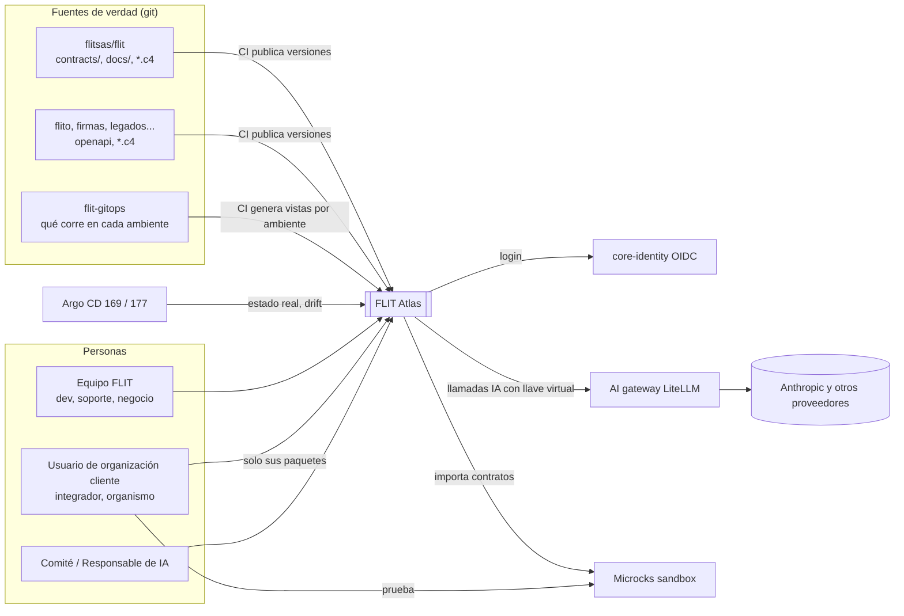
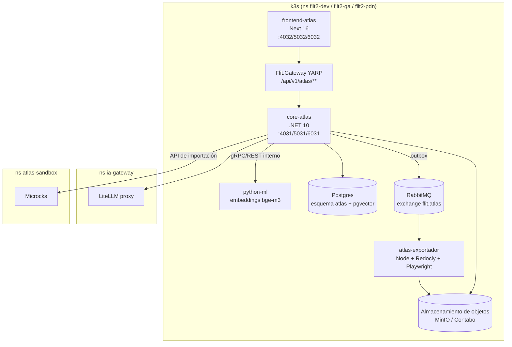
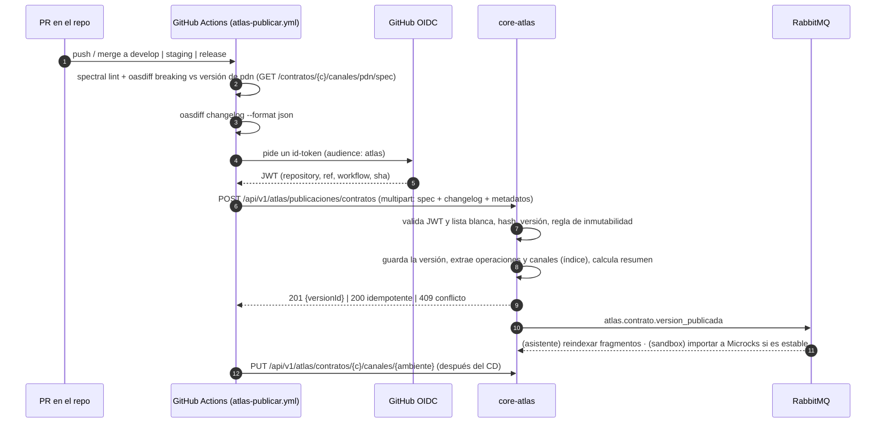
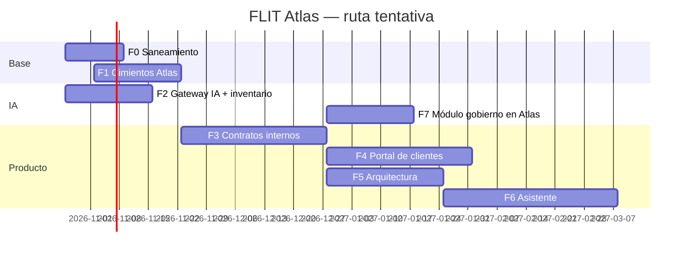

# FLIT Atlas — Plan maestro de la plataforma central de conocimiento

> **Versión:** 1.0 · **Fecha:** 2026-10-20 · **Autor:** Jorman Copete (con Claude Code)
> **Estado:** propuesta para iniciar la implementación
> **Nombre de trabajo:** *FLIT Atlas*. Se puede cambiar; si se cambia, se reemplaza en todo el paquete de documentos.

Paquete de documentos (todos en esta misma carpeta):

| # | Documento | Contenido |
|---|---|---|
| 00 | **00-plan-maestro-plataforma-central.md** (este) | Visión, diagnóstico, decisiones, arquitectura general, módulo de **contratos** completo, despliegue, fases del programa y arranque |
| 01 | 01-plan-diagramas-arquitectura-flit-flito.md | Arquitectura como código (LikeC4), vistas de FLIT 2.0 y FLITO, vistas por ambiente generadas desde `flit-gitops`, drift, saneamiento de ADR |
| 02 | 02-plan-gobernanza-ia.md | Gobierno de IA: organización, políticas, inventario, AI gateway (LiteLLM), migración app por app, módulo de gobierno en Atlas |
| 03 | 03-plan-arquitectura-agente-experto.md | Asistente Atlas (evolución de Dr. FLIT): RAG híbrido con pgvector, herramientas, permisos, evaluación, contenido funcional |

---

## 0. Cómo usar este documento en una sesión nueva de Claude

1. Copia la carpeta `plataforma-central-flit/` a `flit/docs/atlas/` en una rama nueva (`feature/atlas-cimientos`), para que viva versionada junto al código.
2. Abre Claude Code en la raíz del monorepo `flit` y usa el prompt de la **§19 (Arranque)**.
3. Cada fase de la §16 tiene historias de usuario (HU) con **criterios de aceptación** que se pueden comprobar. Trabaja una HU por PR.
4. Las decisiones de la §4 se formalizan como ADR en la carpeta única de ADR que define el documento 01 (§ saneamiento de ADR), **antes** de escribir código del módulo correspondiente.
5. Todo lo marcado **[por verificar]** debe confirmarse en el código o con el líder antes de darlo por cierto.

---

## 1. Resumen ejecutivo

FLIT tiene unos 40 repos y más de 25 servicios en producción: la plataforma nueva FLIT 2.0 (monorepo `flit`), FLITO, firmas, scheduler, certify, maps y 27 microservicios legados. El conocimiento sobre cómo funcionan y cómo se integran está **disperso**:

- los contratos de integración solo están maduros en FLIT 2.0;
- los diagramas están hechos a mano y se desactualizan;
- hay 73 ADR en 4 carpetas, con números repetidos;
- el asistente Dr. FLIT solo conoce el manual de Trámites;
- hay 4 integraciones de IA independientes, cada una con su propia llave y sin control central.

**FLIT Atlas** es una aplicación propia de FLIT que centraliza cuatro capacidades:

1. **Contratos de integración versionados.** Los contratos (OpenAPI, AsyncAPI y proto) se publican desde CI como versiones inmutables, con historial, diferencias entre versiones, guías editables y restauración. Se comparten con clientes por **paquetes** en un portal con login, se exportan (OpenAPI filtrado, Postman, PDF y HTML) y se prueban en un **sandbox**.
2. **Arquitectura viva por ambiente.** Hay un modelo C4 como código en cada repo, y las vistas de dev, qa y pdn se generan desde `flit-gitops`. Se guardan snapshots versionados y se detecta el drift entre lo declarado y lo desplegado.
3. **Asistente experto para usuarios de negocio.** Explica cómo funciona cada aplicativo con ejemplos y diagramas. Cita sus fuentes y respeta los permisos de quien pregunta.
4. **Gobierno de IA.** Un gateway único de llaves (LiteLLM) con presupuestos y enmascaramiento de PII, más inventario de casos de uso, políticas, control de las herramientas del equipo y evidencia de cumplimiento ante la SIC.

**Principio rector:** *git es la fuente de verdad; Atlas es la vitrina, el control de acceso y la memoria versionada.* Los contratos y los modelos **no se editan en Atlas**: Atlas los recibe desde CI. Lo único que se edita en Atlas es lo que no vive en el código: guías de integración, paquetes de clientes, fichas de gobierno de IA y la configuración del asistente. Todo eso también queda versionado y se puede restaurar.

**Construir el producto, no los motores.** La capa de producto se construye en casa: portal multicliente, consolidado, paquetes, asistente y consola de gobierno. Los motores se adoptan de proyectos probados:

| Para qué | Motor |
|---|---|
| Renderizar OpenAPI | Scalar (MIT) |
| Mocks del sandbox | Microcks (CNCF) |
| Diferencias entre contratos | oasdiff |
| Diagramas | LikeC4 y Mermaid |
| Gateway de IA | LiteLLM |
| Embeddings y búsqueda | pgvector |

---

## 2. Diagnóstico del estado actual (verificado el 2026-10-20)

### 2.1 Inventario de aplicativos

| Grupo | Repos y servicios | Tecnología | Dónde corre |
|---|---|---|---|
| **FLIT 2.0** (monorepo `flitsas/flit`, **PÚBLICO**) | `services/core-api` (incluye `Flit.Gateway` YARP), `core-identity` (OIDC/OpenIddict), `core-consultas`, `core-notificaciones`, `core-comparendos`, `core-ict`, `python-ml`; `frontend`, `frontend-hub`, `frontend-comparendos`; `core-diagnostico` y `frontend-diagnostico` (solo README); `packages/{auth,brand,shell,ui}`; `core-plantilla` | .NET 10, Next 16, Python 3.13 | dev y qa en k3s de la 177; pdn en k3s de la 169 (ns `flit2-pdn`) |
| **FLITO** (`D:\FLIT\Code\flito`) | Monorepo npm: Express, Drizzle, React y Vite | Node/TypeScript | `operaciones.flitsas.com` (145); `flito-dev` y `flito-qa` en k3s de la 177 |
| **Satélites** | `flit-firmas` (Bun, Hono, Zod), `flit-scheduler` (.NET + Hangfire), `flit-certify` (Node + Next), `flit-egress` (Go), `flitsas-maps` (Next + Prisma, **remoto personal**), `flit-infra-studio` (incluye el Panel Vigía) | varias | k3s y systemd |
| **Legados V1** | 27 repos `Back*` y `FrontNextJS` | Node, Express, **tsoa** (Swagger generado), un servicio .NET con gRPC | k3s (`flit-gitops/apps/*`) |
| **Infraestructura** | `flit-gitops`, que es el inventario real de lo que corre en cada ambiente y en qué VPS | Argo CD app-of-apps, Sealed Secrets | 169, 145 y 177 |

### 2.2 Contratos

**Lo que hay en FLIT 2.0**

- En `contracts/openapi/`:
  - `core-api.v1.yaml`: unas 19.200 líneas y alrededor de 240 rutas.
  - `external-api.v1.json`: la API para clientes, `info.version` 3.2.0.
  - `core-ict.v1.yaml`, `platform.v1.yaml` y `python-ml.v1.yaml`.
- En `contracts/asyncapi/`: 5 especificaciones de eventos de RabbitMQ más un sobre común.
- En `contracts/proto/flit/*/v1`: 13 archivos `.proto`.
- Una colección Postman.
- CI en `.github/workflows/contracts.yml`: lint de Redocly, parser de AsyncAPI, `buf lint` y `buf breaking`.
- Guías escritas: `docs/integraciones/external-api-tramites-sync.md` (v3.3), `docs/contratos-reportes-v2.md` y `docs/suite/contrato-plataforma-v1.md`.

**Lo que falta**

- No se detectan breaking changes en OpenAPI ni en AsyncAPI (solo en proto).
- Nada está publicado y no hay vista consolidada.
- `docker-compose.prod.yml` pone `FLIT_SWAGGER_ENABLED=true` por defecto **[por verificar si está expuesto en qa y pdn]**.
- Legados: 23 de los 27 generan `swagger.json` con tsoa, pero con títulos genéricos (`api_express_typescript_boilerplate`) y sin versión semántica. Los `BackApiExternal*` (Auth, Transact, Status, WebHook, Attachments, Log, ValiQueryExt) **son la API que hoy usan los clientes**.
- FLITO, firmas, maps, certify y scheduler no tienen ningún contrato publicado.

### 2.3 Arquitectura y documentación

- **ADR:** 73 archivos en 4 carpetas (`services/core-api/docs/adr` con 61, `docs/decisions` con 8, `docs/suite/adr-borradores` con 3, `services/core-ict/docs/adr` con 1). Hay **números repetidos**: 0023 ×3, 0029 ×3, 0024, 0030, 0033, 0036, 0050, 0053, 0057, 0066 y 0070.
- **Diagramas:** solo Mermaid, unos 45 bloques en 26 archivos más 5 `.mmd` del manual. No hay modelo C4.
- **Documentos clave:** `docs/suite/mapa-y-banderas.md`, `docs/despliegue-y-puertos.md`, `docs/contexto-funcional-flit.md` (700 líneas) y `flit-gitops/docs/*` (manuales de instalación, migración y operación). El README de `flit-gitops` está desactualizado.
- **FLITO:** 13 ADR y Mermaid en 18 archivos.

### 2.4 IA

- **Dr. FLIT** (`services/core-api/src/Flit.DrFlit.*`, `/api/v1/dr-flit`, ADR-0060):
  - Mete en el prompt el catálogo del manual (`manual-catalog.generated.json`).
  - Usa `claude-haiku-4-5`, con 30 mensajes por día, consentimientos y escalamiento a Azure DevOps.
- **Router multiproveedor** en `Infrastructure/Ai/` (ADR-0070, Ddl/130):
  - Proveedores: Anthropic más los compatibles con OpenAI (OpenAI, Kimi, DeepSeek), con failover.
  - Pantalla de SuperAdmin.
- **OCR por LLM:** en core-api, y en core-comparendos con prompts versionados.
- **Integraciones separadas con su propia llave:** FLITO (Anthropic), maps (Anthropic) y Panel Vigía (Anthropic con tools).
- **Herramientas del equipo:** Claude Code y Cursor (`.cursor/` con 12 agentes y 26 skills).

### 2.5 Riesgos que bloquean o condicionan el proyecto

| ID | Riesgo | Impacto en Atlas | Acción |
|---|---|---|---|
| R-01 | `flitsas/flit` es **público** (verificado con `gh`) | Los contratos, documentos y ADR ya están expuestos, así que restringir lo compartido por cliente no protege nada mientras el repo siga abierto | Decisión P-01 (§18). Recomendado: hacerlo **privado**; los runners propios de la 177 absorben los minutos de Actions |
| R-02 | Credenciales reales versionadas: `.env` en los 27 legados, `gcp-json-key.json` en `BackCrudInfractionOcr`, `.pfx` en maps | Seguridad y cumplimiento | Fase 0: rotar, purgar el historial con `git filter-repo` y activar gitleaks en todos los repos |
| R-03 | `flitsas-maps` está en un remoto personal | El activo queda fuera del gobierno de la empresa | Transferirlo a la organización `flitsas` |
| R-04 | Cuatro llaves de IA sueltas y sin presupuesto | Costos y fuga de datos | Gateway de IA (documento 02) |
| R-05 | Falta documentación funcional fuera de Trámites | El asistente no tiene qué responder | Estrategia de contenido (documento 03) |

---

## 3. Objetivos, alcance y lo que queda fuera

### 3.1 Objetivos medibles (a 6 meses del arranque)

| Objetivo | Indicador | Meta |
|---|---|---|
| Contratos centralizados | Contratos de APIs expuestas a clientes publicados en Atlas con versión semántica | 100 % de `external-api`, `core-ict` y `BackApiExternal*`; 80 % del resto de las APIs HTTP |
| Contratos seguros | PR que cambian un contrato y pasan por `oasdiff breaking` | 100 % de los repos con contrato |
| Clientes autónomos | Clientes con portal activo y paquete compartido | Todos los integradores activos |
| Arquitectura viva | Ambientes con vista generada y snapshot diario | dev, qa y pdn de FLIT 2.0 y FLITO |
| Asistente útil | Respuestas con valoración positiva sobre el conjunto dorado | ≥ 80 % de aciertos y 0 respuestas sin fuente |
| IA gobernada | Llamadas a LLM que pasan por el gateway | 100 % (cero llaves de proveedor fuera del gateway) |
| Cumplimiento | Casos de uso de IA con ficha y evaluación de riesgo aprobada | 100 % |

### 3.2 Dentro del alcance

- Los 4 módulos (contratos, arquitectura, asistente y gobierno de IA) más un **catálogo** común de aplicativos.
- Usuarios internos de FLIT y **usuarios externos de organizaciones cliente** con acceso restringido a lo compartido.
- Ambientes dev, qa y pdn.

### 3.3 Fuera del alcance (por ahora)

- Gestionar el tráfico de las APIs, como hace un API gateway de producción. Eso sigue en YARP y nginx.
- Monetizar o facturar las APIs.
- Editar contratos en Atlas (se editan en git).
- Reemplazar Azure DevOps o el manual de usuario que vive dentro de cada app.
- Backstage (se reevalúa cuando haya varios equipos).

---

## 4. Decisiones de arquitectura (cada una se convierte en un ADR)

| ID | Decisión | Alternativas descartadas y por qué |
|---|---|---|
| **D-01** | Atlas es una **app propia** dentro del monorepo `flit`: `services/core-atlas` (.NET 10, generado desde `core-plantilla`) y `frontend-atlas` (Next 16, con `packages/{auth,brand,shell,ui}`) | **Backstage:** 1-2 personas de mantenimiento y poco ajuste al portal de clientes. **SaaS** (Redocly, Bump, IcePanel): costo por puesto y datos fuera. **Repo aparte:** perdería la plantilla, el SDK, el CI y los paquetes compartidos |
| **D-02** | **Git es la fuente de verdad.** CI publica en Atlas versiones **inmutables** (contratos y modelos de arquitectura). Atlas solo edita guías, paquetes, fichas y configuración, con historial y restauración | Editar en Atlas crearía dos verdades y drift con el código |
| **D-03** | **Un servicio = un esquema** (regla de `docs/suite/servicio-nuevo.md`). core-atlas usa el esquema `atlas` (usuario `flit_atlas`) en el Postgres de FLIT de cada ambiente. Los módulos se separan por prefijo de tabla: `catalogo_*`, `contrato_*`, `arq_*`, `asistente_*` y `gia_*` | Varios esquemas o una base aparte rompen la regla de plataforma y el script `servicio-con-esquema-propio.sql` |
| **D-04** | Autenticación con **core-identity (OIDC)**. Los permisos de Atlas se registran como **manifiesto de permisos**, igual que core-comparendos (`RegistroManifiesto`). Los usuarios externos se dan de alta como usuarios de su organización cliente | Un login propio duplicaría la identidad |
| **D-05** | La publicación desde CI se autentica con el **token OIDC de GitHub Actions** (`token.actions.githubusercontent.com`). Atlas valida `repository`, `ref` y `workflow` contra una lista blanca por aplicativo. **Sin secretos en los repos** | Un token estático por repo exige guardar, rotar y proteger secretos |
| **D-06** | Renderizado de OpenAPI con **Scalar** (componente React, MIT) dentro de `frontend-atlas`. AsyncAPI se muestra con `@asyncapi/react-component`, y proto con una vista propia simple | Redoc es solo lectura y sin consola de pruebas; Swagger UI es menos usable |
| **D-07** | Diferencias y detección de breaking changes con **oasdiff** (binario de Go dentro de la imagen de core-atlas y en CI) más **Spectral** para estilo. Para AsyncAPI se hace un diff estructural propio hasta que haya herramienta madura; para proto, `buf breaking` | Optic quedó archivado en 2026 |
| **D-08** | **Sandbox** en dos niveles. Nivel 1: **Microcks** genera mocks desde el OpenAPI y el AsyncAPI publicados. Nivel 2: credenciales de prueba contra **QA real** para clientes que ya pasaron el nivel 1 | Montar un ambiente aislado por cliente es demasiado costoso |
| **D-09** | Las exportaciones las genera un worker `atlas-exportador` (Node + Redocly CLI + Playwright para el PDF), invocado de forma asíncrona por RabbitMQ. Los archivos van al almacenamiento de objetos del ambiente con URL firmada | Generar PDF dentro del proceso .NET implica librerías pesadas o de pago |
| **D-10** | Arquitectura como código con **LikeC4**; las vistas por ambiente se generan desde `flit-gitops` (ver documento 01) | Structurizr: Lite es para un solo usuario y hay incertidumbre con su versión en la nube. Diagramas a mano: se desactualizan |
| **D-11** | Toda llamada a un LLM pasa por el **AI gateway LiteLLM**, con versión fijada por digest (≥ 1.83.0). Las apps usan llaves virtuales y alias de modelo (ver documento 02) | Llaves directas en cada app (situación actual) |
| **D-12** | El asistente usa **RAG híbrido** en Postgres (pgvector + `tsvector` en español con fusión RRF), embeddings **bge-m3** locales en `python-ml` y filtros de permisos en la consulta (ver documento 03) | Meter todo el catálogo en el prompt, como hoy, no escala. Una base vectorial aparte sería un componente más que operar |
| **D-13** | Hosts propuestos: `dev.atlas.flitsas.online`, `qa.atlas.flitsas.online` y `atlas.flitsas.com`. Puertos: core-atlas 4031/5031/6031 y frontend-atlas 4032/5032/6032. El gRPC interno, si se necesita, se asigna con el líder **[confirmar con el líder y registrar en `docs/despliegue-y-puertos.md`]** | — |
| **D-14** | La API REST de Atlas sale por el gateway YARP bajo `/api/v1/atlas/**`, siguiendo el patrón de comparendos **[confirmar el prefijo con el contrato de plataforma]** | Exponer core-atlas directo saltaría la política de borde. **Ojo:** YARP corta a los 30 s, antes que nginx. Para el streaming SSE del asistente, la ruta `/api/v1/atlas/asistente/**` necesita `ActivityTimeout` ≥ 120 s (documento 03 §12) |

---

## 5. Arquitectura general

### 5.1 Contexto



### 5.2 Contenedores



### 5.3 Estructura del código

```
flit/
├─ services/core-atlas/                    # generado con: dotnet new flit-servicio -n Atlas -o core-atlas
│  ├─ src/Flit.Atlas.Api/
│  │  ├─ Program.cs                        # migraciones de su esquema, manifiesto de permisos, módulos
│  │  ├─ Persistence/AtlasDb.cs            # HasDefaultSchema("atlas"), snake_case
│  │  ├─ Modulos/
│  │  │  ├─ Catalogo/                      # aplicativos, organizaciones, responsables
│  │  │  ├─ Contratos/                     # publicaciones, versiones, diff, guías, paquetes, exportes, sandbox
│  │  │  ├─ Arquitectura/                  # documento 01
│  │  │  ├─ Asistente/                     # documento 03
│  │  │  └─ GobiernoIa/                    # documento 02
│  │  ├─ Publicacion/GithubOidcValidator.cs
│  │  └─ Herramientas/oasdiff              # binario copiado en el Dockerfile (versión fijada)
│  └─ tests/Flit.Atlas.Tests/
├─ services/atlas-exportador/              # Node 22: redocly build-docs, playwright pdf, consumidor RabbitMQ
├─ frontend-atlas/                         # Next 16 App Router
│  ├─ app/(interno)/...                    # catálogo, contratos, arquitectura, asistente, gobierno
│  ├─ app/(portal)/...                     # portal de clientes: mis paquetes, exportes, sandbox, asistente
│  └─ components/{contratos,arquitectura,asistente,gobierno}/
├─ contracts/openapi/atlas.v1.yaml         # el contrato de Atlas (sí, Atlas se publica a sí mismo)
├─ contracts/asyncapi/atlas-events.v1.yaml # exchange flit.atlas
└─ .github/workflows/atlas-publicar.yml    # workflow reutilizable (se mueve a flit-ci para los otros repos)
```

---

## 6. Seguridad y modelo de acceso

### 6.1 Tipos de usuario y permisos (manifiesto de permisos de Atlas)

| Permiso | Admin Atlas | Editor (líder técnico) | Lector interno | Usuario cliente | Gobierno de IA |
|---|---|---|---|---|---|
| `atlas.catalogo.ver` | ✔ | ✔ | ✔ | — (solo ve lo de sus paquetes) | ✔ |
| `atlas.catalogo.gestionar` | ✔ | — | — | — | — |
| `atlas.contratos.ver_internos` | ✔ | ✔ | ✔ | — | — |
| `atlas.contratos.publicar_manual` (excepción; lo normal es CI) | ✔ | ✔ | — | — | — |
| `atlas.contratos.guias.editar` | ✔ | ✔ | — | — | — |
| `atlas.paquetes.gestionar` (crear y compartir con clientes) | ✔ | ✔ | — | — | — |
| `atlas.portal.ver` (sus paquetes, exportar, sandbox) | — | — | — | ✔ | — |
| `atlas.arquitectura.ver` | ✔ | ✔ | ✔ | — | — |
| `atlas.asistente.usar` | ✔ | ✔ | ✔ | ✔ (solo sobre sus paquetes) | ✔ |
| `atlas.asistente.configurar` | ✔ | — | — | — | — |
| `atlas.gia.ver` / `atlas.gia.gestionar` / `atlas.gia.auditar` | ✔ | ver | — | — | ✔ |

### 6.2 Reglas de aislamiento para clientes

1. Todo usuario externo pertenece a **una** `catalogo_organizacion` de tipo `cliente`.
2. Un cliente solo ve los **paquetes** compartidos con su organización y, dentro de ellos, solo las **operaciones y canales seleccionados** en la **versión fijada** del paquete.
3. Los specs que se entregan al cliente (para verlos, exportarlos o llevarlos a Microcks) se generan **podados**: solo con las rutas permitidas y los componentes que esas rutas referencian. Nunca se entrega el spec completo.
4. Los filtros de permisos se aplican **en la consulta SQL** con un predicado obligatorio por organización (y RLS como defensa en profundidad **[decidir si se usa RLS; flit2-pdn ya usa PgBouncer en modo session por RLS]**), no en el frontend.
5. El asistente recibe la lista de paquetes del usuario y filtra la recuperación por ella (documento 03).
6. Auditoría: cada visualización, exportación y pregunta de un usuario externo queda en `catalogo_auditoria` (quién, qué, versión, cuándo, IP).

### 6.3 Otros controles

- Las exportaciones van a almacenamiento de objetos privado, con URL firmada de 15 minutos y marca de agua opcional en el PDF (organización y fecha).
- La publicación desde CI se valida con el OIDC de GitHub (D-05), con una lista blanca `catalogo_fuente_publicacion` (repo, rama permitida, aplicativo).
- La API de Atlas pasa por el gateway con JWT, y los endpoints de publicación tienen su propia política (token de GitHub).
- Un límite de peticiones por usuario externo.

---

## 7. Módulo Catálogo (base común)

Es la tabla maestra que usan los demás módulos. Se siembra con todos los aplicativos del §2.1.

```sql
-- Referencia. Las migraciones reales se generan con EF Core (snake_case) en el esquema atlas.
create table atlas.catalogo_aplicativo (
  id              uuid primary key,
  codigo          text not null unique,          -- 'flit2-core-api', 'flito', 'legado-back-crud-transfer'
  nombre          text not null,
  descripcion     text,
  grupo           text not null,                 -- 'flit2' | 'flito' | 'satelite' | 'legado'
  estado          text not null,                 -- 'activo' | 'en_retiro' | 'retirado' | 'planeado'
  repo_url        text,
  ruta_en_repo    text,                          -- 'services/core-api'
  responsable_tecnico   text,                    -- correo
  responsable_funcional text,                    -- correo (clave para el asistente)
  criticidad      text not null default 'media', -- 'alta' | 'media' | 'baja'
  maneja_datos_personales boolean not null default false,
  etiquetas       text[] not null default '{}',
  creado_en       timestamptz not null default now(),
  actualizado_en  timestamptz not null default now()
);

create table atlas.catalogo_organizacion (
  id            uuid primary key,
  tipo          text not null,                 -- 'interna' | 'cliente'
  nombre        text not null,
  nit           text,
  empresa_identity_id uuid,                    -- enlace con la empresa en core-identity [por verificar el modelo]
  activa        boolean not null default true,
  creado_en     timestamptz not null default now()
);

create table atlas.catalogo_fuente_publicacion (   -- lista blanca para el OIDC de GitHub (D-05)
  id              uuid primary key,
  aplicativo_id   uuid not null references atlas.catalogo_aplicativo(id),
  repositorio     text not null,               -- 'flitsas/flito'
  ramas_permitidas text[] not null,            -- '{release,staging,develop}'
  workflow        text,                        -- '.github/workflows/atlas-publicar.yml' (opcional)
  tipos           text[] not null              -- '{openapi,asyncapi,proto,likec4,docs}'
);

create table atlas.catalogo_auditoria (
  id            bigserial primary key,
  ocurrido_en   timestamptz not null default now(),
  usuario_sub   text,
  organizacion_id uuid,
  accion        text not null,                 -- 'ver_contrato' | 'exportar' | 'preguntar' | 'publicar' ...
  objeto_tipo   text, objeto_id text, detalle jsonb, ip inet
);
```

**Semilla inicial:** un script idempotente (`Modulos/Catalogo/Semilla/aplicativos.json`) con los servicios de FLIT 2.0, FLITO, los satélites y los 27 legados. La lista completa de legados sale de `flit-gitops/apps/` y `flit-gitops/services/`.

---

## 8. Módulo Contratos (detallado)

### 8.1 Conceptos

| Concepto | Qué es | Ejemplo |
|---|---|---|
| **Contrato** | Una interfaz de un aplicativo, de un tipo dado | `external-api` (openapi) del aplicativo `flit2-core-api` |
| **Versión** | Una publicación **inmutable** de un contrato, con versión semántica, hash, commit y fecha | `external-api` **3.3.0**, sha256 `ab12…`, commit `828c9fe` |
| **Canal** | Qué versión corre hoy en cada ambiente | dev → 3.4.0-dev.828c9fe, qa → 3.3.0, pdn → 3.2.0 |
| **Guía** | Documentación editable en Atlas (Markdown) asociada al contrato, con revisiones | «Cómo sincronizar trámites», «Firmas de webhooks» |
| **Paquete** | Selección curada para compartir: contratos y versiones fijadas, operaciones o canales incluidos, guías incluidas | «Paquete Integradores Trámites 2026-10» |
| **Compartición** | Un paquete otorgado a una organización cliente, con vigencia y permisos (ver, exportar, sandbox) | Paquete X → Organismo Y, hasta 2027-06-30 |
| **Exportación** | Un artefacto generado a partir de un paquete o una versión | `paquete-x-v3.zip` (OpenAPI podado, Postman, PDF, HTML) |

### 8.2 Reglas de versionado

1. **La versión la decide el repo.** Para OpenAPI se toma de `info.version`, para AsyncAPI de `info.version` y para proto se usa la versión del paquete (`v1`) más el commit.
2. **Breaking change = MAJOR.** El workflow de CI corre `oasdiff breaking <publicada-en-pdn> <nueva> --fail-on ERR`. Si hay un breaking change y la MAJOR no subió, **falla el PR**. Si se acepta el breaking change de forma consciente, se sube la MAJOR y la ruta pasa a `/api/v2/...` **o** se documenta la excepción en un ADR.
3. **Prerelease por rama.** `develop` publica `X.Y.Z-dev.<sha7>`, `staging` publica `X.Y.Z-rc.<sha7>` y `release` publica `X.Y.Z`. Solo las versiones estables se pueden poner en paquetes de clientes.
4. **Inmutabilidad.** Si se publica de nuevo la misma `(contrato, versión)` con el mismo hash, la respuesta es **200 idempotente**. Si el hash es distinto, la respuesta es **409** y hay que subir la versión.
5. **Canales.** Cuando el CD despliega en un ambiente, el workflow llama a `PUT /canales/{ambiente}` con la versión. Así Atlas sabe qué versión corre en dev, qa y pdn, lo que conecta con el pedido de tener la información **por ambiente**.
6. **Volver en el tiempo:**
   - Toda versión queda consultable para siempre, salvo que se purgue explícitamente.
   - Hay diff entre dos versiones cualesquiera, generado por oasdiff en el servidor y cacheado.
   - Las guías tienen revisiones y la acción «restaurar revisión N» crea una revisión nueva igual a la N, sin reescribir la historia.
   - Los paquetes fijan versiones. «Volver» un paquete significa fijar una versión anterior, y queda auditado.
7. **Deprecación.** Una versión se puede marcar `deprecada` con fecha de retiro. El portal muestra un aviso y Atlas avisa por correo a las organizaciones con paquetes que la usan (vía core-notificaciones).

### 8.3 Flujo de publicación desde CI



**Workflow reutilizable** (vive en `flit-ci` para que lo usen todos los repos; en `flit` se puede llamar local):

```yaml
# .github/workflows/atlas-publicar.yml (borrador)
name: atlas-publicar
on:
  workflow_call:
    inputs:
      aplicativo:   { type: string, required: true }   # código del catálogo
      contrato:     { type: string, required: true }   # 'external-api'
      tipo:         { type: string, required: true }   # openapi | asyncapi | proto
      ruta:         { type: string, required: true }   # 'contracts/openapi/external-api.v1.json'
      atlas_url:    { type: string, required: true }   # https://atlas.flitsas.com/api/v1/atlas
      runner:       { type: string, default: 'ubuntu-latest' }
permissions:
  id-token: write
  contents: read
jobs:
  publicar:
    runs-on: ${{ inputs.runner }}
    steps:
      - uses: actions/checkout@v4
      - name: Spectral
        if: inputs.tipo == 'openapi'
        run: npx -y @stoplight/spectral-cli@6 lint "${{ inputs.ruta }}" --ruleset .spectral.yaml --fail-severity error
      - name: Spec publicada en pdn (base de comparación)
        run: curl -sf "${{ inputs.atlas_url }}/publico/contratos/${{ inputs.contrato }}/canales/pdn/spec" -o base.spec || echo "sin base"
      - name: oasdiff breaking
        if: inputs.tipo == 'openapi'
        run: |
          [ -f base.spec ] || exit 0
          docker run --rm -v "$PWD:/w" tufin/oasdiff:<VERSION_FIJADA> breaking /w/base.spec "/w/${{ inputs.ruta }}" --fail-on ERR
      - name: Changelog
        if: inputs.tipo == 'openapi'
        run: |
          [ -f base.spec ] && docker run --rm -v "$PWD:/w" tufin/oasdiff:<VERSION_FIJADA> changelog /w/base.spec "/w/${{ inputs.ruta }}" -f json > changelog.json || echo '[]' > changelog.json
      - name: Token OIDC
        id: oidc
        run: |
          T=$(curl -s -H "Authorization: bearer $ACTIONS_ID_TOKEN_REQUEST_TOKEN" "$ACTIONS_ID_TOKEN_REQUEST_URL&audience=flit-atlas" | jq -r .value)
          echo "::add-mask::$T"; echo "token=$T" >> "$GITHUB_OUTPUT"
      - name: Publicar
        run: |
          curl -sf -X POST "${{ inputs.atlas_url }}/publicaciones/contratos" \
            -H "Authorization: Bearer ${{ steps.oidc.outputs.token }}" \
            -F aplicativo=${{ inputs.aplicativo }} -F contrato=${{ inputs.contrato }} -F tipo=${{ inputs.tipo }} \
            -F rama=${GITHUB_REF_NAME} -F commit=${GITHUB_SHA} \
            -F spec=@"${{ inputs.ruta }}" -F changelog=@changelog.json
```

> **Nota:** el endpoint `/publico/.../spec` que se usa como base de comparación solo debe devolver specs que ya son públicas o internas para CI. Mientras el repo `flit` sea público no hay diferencia. Si se hace privado, ese GET también exige el token OIDC.

### 8.4 Modelo de datos

```sql
create table atlas.contrato (
  id             uuid primary key,
  aplicativo_id  uuid not null references atlas.catalogo_aplicativo(id),
  codigo         text not null,                -- 'external-api'
  tipo           text not null,                -- 'openapi' | 'asyncapi' | 'proto'
  nombre         text not null,
  descripcion    text,
  visibilidad    text not null default 'interna', -- 'interna' | 'compartible'  (solo 'compartible' entra a paquetes)
  creado_en      timestamptz not null default now(),
  unique (aplicativo_id, codigo)
);

create table atlas.contrato_version (
  id              uuid primary key,
  contrato_id     uuid not null references atlas.contrato(id),
  version         text not null,                -- semver con prerelease
  es_estable      boolean not null,
  sha256          text not null,
  commit_sha      text not null,
  rama            text not null,
  repositorio     text not null,
  publicado_por   text not null,                -- 'github:flitsas/flit@release' o usuario
  publicado_en    timestamptz not null default now(),
  spec_objeto     text not null,                -- clave en almacenamiento de objetos (el spec completo)
  spec_jsonb      jsonb,                        -- copia normalizada para consultas (opcional si el spec es enorme)
  changelog       jsonb not null default '[]',  -- salida de oasdiff changelog
  tiene_breaking  boolean not null default false,
  estado          text not null default 'vigente', -- 'vigente' | 'deprecada' | 'retirada'
  retiro_en       date,
  unique (contrato_id, version)
);

create table atlas.contrato_operacion (         -- índice de operaciones/canales para selección, búsqueda y el asistente
  id              uuid primary key,
  version_id      uuid not null references atlas.contrato_version(id) on delete cascade,
  clave           text not null,                -- 'GET /api/v1/tramites/{id}' | 'channel:tramites.radicado' | 'rpc:flit.tramites.v1.TramitesService/Get'
  metodo          text, ruta text, operation_id text, resumen text, etiquetas text[],
  publica         boolean not null default false, -- x-public: true en el spec, o etiqueta 'public'
  unique (version_id, clave)
);

create table atlas.contrato_canal (             -- qué versión corre en cada ambiente
  contrato_id     uuid not null references atlas.contrato(id),
  ambiente        text not null,                -- 'dev' | 'qa' | 'pdn'
  version_id      uuid not null references atlas.contrato_version(id),
  desplegado_en   timestamptz not null,
  primary key (contrato_id, ambiente)
);
create table atlas.contrato_canal_historial (like atlas.contrato_canal including all);
-- (quitar la PK en el historial; agregar id bigserial)

create table atlas.contrato_guia (
  id              uuid primary key,
  contrato_id     uuid references atlas.contrato(id),   -- null = guía transversal
  titulo          text not null,
  slug            text not null unique,
  visibilidad     text not null default 'interna'
);
create table atlas.contrato_guia_revision (
  id              uuid primary key,
  guia_id         uuid not null references atlas.contrato_guia(id),
  numero          int not null,
  contenido_md    text not null,
  nota            text,                         -- mensaje del cambio
  autor_sub       text not null,
  creado_en       timestamptz not null default now(),
  restaurada_de   int,                          -- si es restauración
  unique (guia_id, numero)
);

create table atlas.contrato_paquete (
  id              uuid primary key,
  nombre          text not null,
  descripcion     text,
  estado          text not null default 'borrador', -- 'borrador' | 'publicado' | 'archivado'
  creado_por      text not null,
  creado_en       timestamptz not null default now()
);
create table atlas.contrato_paquete_revision (  -- cada cambio del paquete es una revisión (volver en el tiempo)
  id              uuid primary key,
  paquete_id      uuid not null references atlas.contrato_paquete(id),
  numero          int not null,
  definicion      jsonb not null,  -- [{contratoId, versionId, operaciones:[clave...], guias:[guiaId@revision]}]
  nota            text, autor_sub text not null, creado_en timestamptz not null default now(),
  unique (paquete_id, numero)
);
create table atlas.contrato_comparticion (
  id              uuid primary key,
  paquete_id      uuid not null references atlas.contrato_paquete(id),
  organizacion_id uuid not null references atlas.catalogo_organizacion(id),
  revision_fijada int,                 -- null = sigue la última revisión publicada
  puede_exportar  boolean not null default true,
  puede_sandbox   boolean not null default false,
  vigente_desde   date not null default current_date,
  vigente_hasta   date,
  otorgado_por    text not null,
  revocado_en     timestamptz,
  unique (paquete_id, organizacion_id)
);

create table atlas.contrato_exportacion (
  id              uuid primary key,
  solicitado_por  text not null,
  organizacion_id uuid,
  origen          jsonb not null,      -- {paqueteId, revision} | {versionId}
  formatos        text[] not null,     -- '{openapi,postman,pdf,html,zip}'
  estado          text not null,       -- 'pendiente' | 'listo' | 'fallido'
  objeto          text,                -- clave en almacenamiento de objetos
  error           text,
  creado_en       timestamptz not null default now(),
  listo_en        timestamptz
);

create table atlas.contrato_sandbox (
  id              uuid primary key,
  organizacion_id uuid not null references atlas.catalogo_organizacion(id),
  paquete_id      uuid not null references atlas.contrato_paquete(id),
  nivel           int not null,        -- 1 = Microcks, 2 = QA real
  microcks_service text,               -- nombre/versión importado
  credencial_ref  text,                -- nivel 2: referencia al cliente de prueba en QA (nunca el secreto)
  creado_en       timestamptz not null default now(),
  expira_en       timestamptz
);
```

### 8.5 API REST (`/api/v1/atlas/...`, contrato en `contracts/openapi/atlas.v1.yaml`)

| Método y ruta | Permiso | Descripción |
|---|---|---|
| `POST /publicaciones/contratos` | OIDC de GitHub + lista blanca | Publica una versión. Responde 201, 200 (idempotente), 409 o 422 (spec inválida) |
| `PUT /contratos/{id}/canales/{ambiente}` | OIDC de GitHub | Marca la versión desplegada en el ambiente |
| `GET /aplicativos` · `GET /aplicativos/{codigo}` | `catalogo.ver` | Catálogo con sus contratos |
| `GET /contratos?aplicativo=&tipo=&q=` | `contratos.ver_internos` | Búsqueda en el **consolidado** de todos los aplicativos |
| `GET /contratos/{id}/versiones` | idem | Historial |
| `GET /contratos/{id}/versiones/{v}/spec?formato=json\|yaml` | idem | Spec completo (solo uso interno) |
| `GET /contratos/{id}/diff?desde=&hasta=` | idem | Diff y changelog entre dos versiones (oasdiff, cacheado) |
| `GET /contratos/{id}/canales` | idem | Versiones por ambiente |
| `POST /contratos/{id}/versiones/{v}/deprecar` | `contratos.publicar_manual` | Depreca y fija la fecha de retiro |
| `GET/POST /guias` · `GET /guias/{id}/revisiones` · `POST /guias/{id}/revisiones` · `POST /guias/{id}/restaurar/{n}` | `guias.editar` | Guías versionadas |
| `GET/POST /paquetes` · `POST /paquetes/{id}/revisiones` · `POST /paquetes/{id}/publicar` | `paquetes.gestionar` | Arma y versiona paquetes |
| `POST /paquetes/{id}/comparticiones` · `DELETE .../{compId}` | `paquetes.gestionar` | Comparte o revoca con una organización |
| `GET /portal/paquetes` | `portal.ver` | **Consolidado del cliente**: sus paquetes, de todos los aplicativos |
| `GET /portal/paquetes/{id}/spec/{contratoId}` | `portal.ver` | Spec **podado** a lo compartido |
| `POST /exportaciones` · `GET /exportaciones/{id}` | interno o portal (según `puede_exportar`) | Exportación asíncrona; devuelve una URL firmada cuando está lista |
| `POST /portal/sandbox` · `GET /portal/sandbox` | `portal.ver` + `puede_sandbox` | Activa el sandbox y devuelve la URL base del mock y sus instrucciones |

### 8.6 Poda de specs (núcleo de seguridad del portal)

Implementación en `Modulos/Contratos/Poda/PodadorOpenApi.cs`:

1. Cargar el spec con `Microsoft.OpenApi` (versión 2.x, compatible con OpenAPI 3.1) **[verificar la versión que ya usa Swashbuckle 10.2.2 en el repo]**.
2. Conservar solo los `paths` y métodos de la selección.
3. Recorrer en cierre transitivo todos los `$ref` alcanzables desde esas operaciones (schemas, parameters, responses, requestBodies, headers y securitySchemes usados) y **eliminar los componentes no alcanzados**.
4. Eliminar `x-internal`, `servers` internos y los ejemplos marcados `x-interno`.
5. Reescribir `servers` con las URL públicas del ambiente: sandbox, qa o pdn.
6. Para AsyncAPI se hace lo mismo sobre `channels` y `operations` (v3) con un recorrido de `$ref` en JSON genérico.

**Pruebas obligatorias:** propiedades de la poda con specs reales (`external-api.v1.json`, `core-api.v1.yaml`). Ninguna operación fuera de la selección y ningún schema huérfano. Toda `$ref` del resultado debe resolver.

### 8.7 Exportaciones (worker `atlas-exportador`)

- Entrada: el mensaje `atlas.exportacion.solicitada` con `{exportacionId, specs podados (claves de objeto), guías renderizadas, formatos}`.
- Formatos que genera:
  - **openapi:** el spec podado en YAML y en JSON.
  - **postman:** `openapi-to-postmanv2`, con variables `{{baseUrl}}` y `{{token}}`.
  - **html:** `redocly build-docs`, un HTML autocontenido.
  - **pdf:** plantilla HTML de FLIT (portada, índice, guías, operaciones y changelog) impresa con Playwright (Chromium headless). Lleva marca de agua con la organización.
  - **zip:** todo lo anterior junto con un `LEEME.md`.
- Salida: el resultado va al almacenamiento de objetos y se publica `atlas.exportacion.lista`. core-atlas actualiza el estado y avisa al usuario.
- Recursos: el pod con Chromium pide unos 512 MiB a 1 GiB y su concurrencia debe ser 1 **[validar contra el tope de la 169]**.

### 8.8 Sandbox

- **Nivel 1 (Microcks):**
  - Al publicar una versión estable `compartible`, core-atlas la importa a Microcks por su API, con el spec completo y ejemplos.
  - El cliente recibe la URL `https://sandbox.atlas.flitsas.com/rest/{servicio}/{version}/...` **[definir el host]**. Las rutas no compartidas devuelven 404 en el borde: se configura una ruta por paquete en nginx o YARP, o se importa a Microcks el spec **podado**, que es lo más simple.
  - Los ejemplos de request y response (`examples`) del spec son los que alimentan el mock, así que **la calidad del sandbox depende de que los specs tengan ejemplos**. Esto se vuelve una regla de Spectral para los contratos compartibles.
- **Nivel 2 (QA real):**
  - Se crea un cliente de prueba de la external-api en QA para la organización, con un procedimiento de alta parecido a `docs/integraciones/runbook-alta-clientes-flito.md`.
  - Datos sintéticos, cuota baja y vencimiento.
  - Atlas solo guarda la referencia; el secreto se entrega una sola vez.

### 8.9 Pantallas

| Área | Pantalla | Contenido |
|---|---|---|
| Interna | **Consolidado** | Tabla de todos los aplicativos y contratos con su versión por ambiente (dev, qa, pdn), con alertas de desfase («pdn 3.2.0, qa 3.3.0») y breaking pendientes |
| Interna | **Contrato** | Pestañas: Documentación (Scalar o AsyncAPI), Versiones (línea de tiempo), Diff (seleccionar dos versiones), Guías, Paquetes que lo usan y Canales |
| Interna | **Guía** | Editor Markdown con vista previa (Mermaid incluido), historial, comparación de revisiones y botón Restaurar |
| Interna | **Paquetes** | Asistente de 3 pasos: elegir contratos y versiones, marcar operaciones (con filtro por etiqueta o `x-public`) y elegir guías. Luego Publicar y Compartir con organizaciones |
| Interna | **Organizaciones** | Clientes, sus usuarios (invitar), paquetes y auditoría |
| Portal | **Inicio del cliente** | Su consolidado: tarjetas por aplicativo con los contratos compartidos y avisos de deprecación |
| Portal | **Contrato compartido** | Scalar con el spec podado, guías y botones Exportar y Sandbox |
| Portal | **Asistente** | Chat que solo conoce lo compartido (documento 03) |

### 8.10 Cobertura de contratos por aplicativo (plan de incorporación)

| Aplicativo | Estado del contrato | Acción | Prioridad |
|---|---|---|---|
| FLIT 2.0 `external-api` | OpenAPI v3.2.0 | Publicar; marcar `x-public` y añadir ejemplos | **P1** |
| FLIT 2.0 `core-ict` | OpenAPI v1 | Publicar | **P1** |
| Legados `BackApiExternal*` (7) | `swagger.json` de tsoa con título genérico | Corregir `tsoa.json` (título, versión y descripción), generar en CI y publicar | **P1** (los usan clientes hoy) |
| FLIT 2.0 `core-api`, `platform`, `python-ml` | OpenAPI v1 | Publicar como internos | P2 |
| FLIT 2.0 AsyncAPI (5) y proto (13) | Existen | Publicar como internos | P2 |
| `core-comparendos` | **[por verificar si tiene OpenAPI]** | Exportar con Swashbuckle a `contracts/openapi/comparendos.v1.yaml` | P2 |
| FLITO | Sin OpenAPI | Generar desde las rutas Express: con Zod, `@asteasolutions/zod-to-openapi`; si no, spec escrita a mano **[verificar si FLITO valida con Zod]** | P2 |
| flit-firmas | Hono + Zod | `@hono/zod-openapi` | P3 |
| Otros legados `Back*` | tsoa | Publicar como internos con título y versión corregidos | P3 (si no se retiran pronto; decisión P-02) |
| certify, maps, scheduler, Panel Vigía | Sin contrato | Solo si exponen API a terceros | P4 |

---

## 9. Módulo Arquitectura (resumen; detalle en el documento 01)

- Cada repo mantiene `docs/arquitectura/*.c4` (LikeC4) con su contexto, contenedores y componentes, y lo publica a Atlas por CI (`POST /publicaciones/arquitectura`, con el mismo OIDC de GitHub).
- Un generador corre en el CI de `flit-gitops` (y de forma programada) y produce el **modelo de despliegue por ambiente y clúster**. Atlas guarda un **snapshot inmutable** con cada cambio: versión = sha de gitops más fecha.
- Atlas renderiza las vistas embebidas en Next, permite comparar snapshots («qué cambió en pdn entre el 1 y el 20 de octubre») y detecta **drift** (lo declarado contra gitops contra lo que reporta Argo).
- Cada elemento enlaza con sus contratos (módulo 8) y sus ADR. Las tablas son `atlas.arq_*`.
- **Requisito previo:** sanear los ADR (carpeta única y renumeración), según el documento 01.

## 10. Módulo Asistente (resumen; detalle en el documento 03)

- Es el **Asistente Atlas**, la evolución de Dr. FLIT, pensado para **usuarios de negocio**. Explica cómo funciona cada aplicativo con ejemplos, pasos y diagramas Mermaid, y cita la fuente y la versión.
- Usa RAG híbrido en `atlas.asistente_*` con pgvector y embeddings bge-m3 servidos por `python-ml`. Los permisos se filtran en la recuperación.
- Herramientas del agente: buscar conocimiento, consultar una operación de un contrato, consultar una vista de arquitectura, generar un diagrama y crear un caso de soporte (reutiliza el escalamiento a ADO de Dr. FLIT).
- La reindexación se dispara con los eventos `atlas.*.publicada`, nunca a mano.
- **El cuello de botella es el contenido funcional.** Hay un flujo para que la IA redacte borradores desde el código y un responsable funcional los apruebe antes de indexarlos.

## 11. Módulo Gobierno de IA (resumen; detalle en el documento 02)

- **AI gateway LiteLLM** en el ns `ia-gateway`, con:
  - llaves virtuales por aplicativo y ambiente;
  - presupuestos y límites;
  - Presidio para enmascarar cédula, placa, NIT, nombres, teléfono y correo;
  - alias de modelo (`flit-asistente-principal`, `flit-rapido`, `flit-ocr`).
- Las llaves de proveedor viven **solo** en el gateway.
- Migración app por app: el router de core-api pasa a tener el gateway como proveedor compatible con OpenAI; después siguen core-comparendos, FLITO, maps y Panel Vigía, cada uno con reversa.
- En Atlas (`atlas.gia_*`):
  - inventario de casos de uso con fichas y evaluación de riesgo;
  - políticas versionadas;
  - registro de herramientas del equipo y asientos;
  - tablero de costos y uso, leído del API de LiteLLM;
  - evidencia de «responsabilidad demostrada» (SIC, Circular 002 de 2024).

---

## 12. Eventos (AsyncAPI `contracts/asyncapi/atlas-events.v1.yaml`, exchange `flit.atlas`)

| Evento | Productor | Consumidores |
|---|---|---|
| `atlas.contrato.version_publicada` | core-atlas | asistente (reindexar), sandbox (importar a Microcks), notificaciones (avisar a quien sigue el contrato) |
| `atlas.contrato.version_deprecada` | core-atlas | notificaciones (organizaciones afectadas) |
| `atlas.contrato.canal_actualizado` | core-atlas | arquitectura (relacionar el despliegue con la versión del contrato) |
| `atlas.arquitectura.modelo_publicado` y `atlas.arquitectura.snapshot_creado` | core-atlas | asistente (reindexar) |
| `atlas.arquitectura.drift_detectado` | core-atlas | notificaciones (líder técnico) |
| `atlas.exportacion.solicitada` y `atlas.exportacion.lista` | core-atlas y exportador | exportador y core-atlas |
| `atlas.gia.presupuesto_alerta` | core-atlas (lee LiteLLM) | notificaciones |

Se usan la **outbox y la bandeja del SDK** de plataforma (regla de `servicio-nuevo.md`), con el sobre común `comun/sobre.v1.yaml`.

---

## 13. Despliegue

| Ítem | dev | qa | pdn |
|---|---|---|---|
| Clúster y namespace | k3s 177, `flit2-dev` | k3s 177, `flit2-qa` | k3s 169, `flit2-pdn` |
| Host | `dev.atlas.flitsas.online` | `qa.atlas.flitsas.online` | `atlas.flitsas.com` **[confirmar con la estrategia de dominios .com]** |
| Manifiestos | `flit-gitops/services/flit2-dev/` (agregar `core-atlas`, `frontend-atlas` y `atlas-exportador`) | `.../flit2-qa/` | `.../flit2-pdn/` |
| Secretos | SealedSecret por ambiente: `CONNECTION_STRING_ATLAS`, `SVC_ATLAS_CLIENT_SECRET`, `RABBITMQ_URL_ATLAS`, llave virtual de LiteLLM y credenciales de almacenamiento. **La llave de sealed-secrets de la 177 es distinta a la de la 169** | | |
| Base de datos | `servicio-con-esquema-propio.sql -v servicio=atlas`. **`CREATE EXTENSION vector` lo ejecuta el admin**, porque el usuario del servicio no puede | idem | idem (por PgBouncer en modo session) |
| Microcks | ns `atlas-sandbox` (solo 177 al inicio) | compartido con dev | 169 cuando haya clientes en el portal |
| LiteLLM | ns `ia-gateway` en la 177 (sirve a dev y qa con llaves distintas) | — | ns `ia-gateway` en la 169 |
| CD | Igual que el resto de FLIT 2.0: el CD escribe digests en `flit-gitops` (GitOps) | idem | idem |

Pasos de alta: seguir **`docs/suite/servicio-nuevo.md` al pie de la letra** (plantilla, contrato, cliente de servicio `svc-atlas` y scope `platform.atlas`, base, puertos, CD y CI). Documentar cada avance en `flit-gitops/docs` (manual de operación y registro de cambios).

**Prerrequisitos de infraestructura (verificar antes de la Fase 1):**

- [ ] pgvector disponible en el Postgres 16 de la 177 y de la 169 (paquete `postgresql-16-pgvector` o imagen con la extensión).
- [ ] Capacidad de CPU y memoria en la 177 y la 169 para core-atlas, el exportador (Chromium), Microcks y el gateway, recordando la tormenta de reinicios de la 169 en septiembre: sondas con tiempos holgados.
- [ ] Almacenamiento de objetos por ambiente: bucket o prefijo `atlas/` en MinIO (dev y qa) y en Contabo (pdn), con firma en cabecera o query (Contabo rechaza el POST policy).

---

## 14. Calidad, pruebas y observabilidad

- **Pruebas de core-atlas:** unitarias (reglas de versionado, poda y permisos), de integración con Postgres real (patrón `ServicioHostTests` de comparendos) y de contrato (Atlas valida su propio `atlas.v1.yaml`).
- **Pruebas de aislamiento** (bloquean el release): un usuario de la organización A nunca obtiene operaciones, specs, exportaciones ni respuestas del asistente de paquetes de la organización B. Se escriben como pruebas parametrizadas sobre todos los endpoints del portal.
- **frontend-atlas:** Vitest más Playwright E2E para los flujos de publicar, armar paquete, compartir, entrar como cliente, exportar y usar el sandbox. Se puede llevar a `flit-certify`.
- **Observabilidad:** OTel (`OTEL_EXPORTER_OTLP_ENDPOINT`), métricas de publicaciones, exportaciones, latencia del asistente y costo de IA. Health en `/health/ready`.
- **Seguridad:** gitleaks y el security-scan existentes, más una revisión de seguridad dedicada del portal antes de abrirlo a clientes.

---

## 15. Fase 0 — Saneamiento previo (bloqueante en parte)

| # | Tarea | Bloquea |
|---|---|---|
| 0.1 | **Decidir la visibilidad del repo `flit`** (P-01) y, si pasa a privado, mover a los runners propios los workflows que todavía usan `ubuntu-latest` | Portal de clientes (F4) |
| 0.2 | Rotar todas las credenciales versionadas en los 27 legados, `gcp-json-key.json` y el `.pfx` de maps; purgar con `git filter-repo`; activar gitleaks en todos los repos | — (es urgente por sí mismo) |
| 0.3 | Transferir `flitsas-maps` a la organización `flitsas` | Gobierno de IA |
| 0.4 | Verificar y apagar Swagger UI en qa y pdn (`FLIT_SWAGGER_ENABLED`) | — |
| 0.5 | Unificar los ADR en una carpeta y renumerar (documento 01) | Módulo de arquitectura |
| 0.6 | Fijar **responsables funcionales** por aplicativo (P-03) | Asistente |

---

## 16. Plan de trabajo del programa

Las estimaciones son gruesas y suponen 1 a 2 desarrolladores con Claude Code. Las fases F2 (gateway) y F0 corren en paralelo a las demás.



### F1 — Cimientos de Atlas (2-3 semanas)

| HU | Descripción | Criterios de aceptación |
|---|---|---|
| 1.1 | Generar `core-atlas` desde la plantilla y conectarlo según `servicio-nuevo.md` | `dotnet test` en verde; arranca con su esquema `atlas` (outbox e inbox); sin configuración no arranca y nombra las variables; job de CD y CI en verde |
| 1.2 | Crear `frontend-atlas` con `packages/{auth,shell,ui,brand}` y login OIDC de core-identity | Login y logout funcionan en dev; la barra de la suite se ve; las rutas `(interno)` y `(portal)` se protegen por permiso |
| 1.3 | Manifiesto de permisos de Atlas (§6.1) registrado al arrancar | Los permisos aparecen en la administración de la plataforma y se pueden asignar a roles |
| 1.4 | Módulo Catálogo: CRUD de aplicativos y organizaciones, semilla de aplicativos y auditoría | La semilla carga todos los aplicativos del §2.1 (idempotente); la pantalla del catálogo lista y filtra |
| 1.5 | Ruta en YARP `/api/v1/atlas/**`, despliegue en `flit2-dev` (k3s 177) por GitOps y host `dev.atlas.flitsas.online` | El health responde por el host público; Argo queda Synced y Healthy |
| 1.6 | `contracts/openapi/atlas.v1.yaml` y `contracts/asyncapi/atlas-events.v1.yaml` | `contracts.yml` en verde |

### F3 — Contratos internos (5 semanas)

| HU | Descripción | Criterios de aceptación |
|---|---|---|
| 3.1 | Validador del OIDC de GitHub y lista blanca de fuentes | Un token de un repo o rama fuera de la lista recibe 403; un token vencido recibe 401; hay pruebas con JWT firmados de prueba |
| 3.2 | `POST /publicaciones/contratos` con inmutabilidad e índice de operaciones | Cumple 201, 200 idempotente, 409 con hash distinto y 422 con spec inválida; `contrato_operacion` queda poblada |
| 3.3 | Workflow reutilizable `atlas-publicar.yml` con Spectral, oasdiff breaking y changelog | Un PR con breaking sin subir la MAJOR **falla**; con la MAJOR subida, pasa y publica |
| 3.4 | Canales por ambiente (`PUT /canales`) llamados desde `cd.yml` | La pantalla Consolidado muestra la versión correcta en dev, qa y pdn después de cada despliegue |
| 3.5 | Diff entre versiones (oasdiff en el servidor, cacheado) | El diff de `external-api` entre dos versiones coincide con el de la CLI |
| 3.6 | Pantallas Consolidado y Contrato (Scalar, AsyncAPI y proto) | Se ven los 5 OpenAPI, los 5 AsyncAPI y los 13 proto de FLIT 2.0 |
| 3.7 | Guías con revisiones y restauración | Editar, ver el historial, comparar y restaurar crea una revisión nueva; auditado |
| 3.8 | Incorporar `BackApiExternal*` (tsoa con título y versión corregidos) y FLITO | Contratos publicados desde el CI de cada repo |

### F4 — Portal de clientes (5 semanas)

| HU | Descripción | Criterios de aceptación |
|---|---|---|
| 4.1 | Paquetes con revisiones (asistente de 3 pasos) | Crear, revisar, publicar y fijar una revisión anterior; auditado |
| 4.2 | Poda de specs (§8.6) | Las pruebas de propiedades pasan con `external-api` y `core-api`; ningún `$ref` roto |
| 4.3 | Organizaciones cliente, invitación de usuarios y comparticiones con vigencia | Un usuario invitado entra y solo ve sus paquetes; al vencer la vigencia pierde el acceso |
| 4.4 | Portal: consolidado del cliente y contrato compartido | Las **pruebas de aislamiento** (§14) pasan en todos los endpoints |
| 4.5 | `atlas-exportador`: OpenAPI, Postman, HTML, PDF y ZIP | Exportar un paquete genera los 5 formatos; el PDF lleva la marca de agua de la organización; la URL firmada vence |
| 4.6 | Sandbox nivel 1 (Microcks) | Un cliente activa el sandbox y obtiene respuestas mock de sus operaciones; las no compartidas dan 404 |
| 4.7 | Sandbox nivel 2 (QA real) | Procedimiento de alta documentado; credencial de un solo uso; vencimiento automático |
| 4.8 | Avisos de deprecación por correo (core-notificaciones) | Deprecar una versión notifica a las organizaciones con paquetes que la usan |
| 4.9 | Revisión de seguridad y despliegue en pdn (169) | Revisión sin hallazgos altos; `atlas.flitsas.com` en servicio |

Las fases **F2 y F7** (gobierno de IA), **F5** (arquitectura) y **F6** (asistente) tienen sus HU detalladas en los documentos 02, 01 y 03.

---

## 17. Riesgos del programa

| Riesgo | Probabilidad | Impacto | Mitigación |
|---|---|---|---|
| Fuga de información entre clientes en el portal | Media | **Alto** | Poda en el servidor, predicado obligatorio por organización y RLS, pruebas de aislamiento que bloquean el release, revisión de seguridad |
| El repo sigue público y el control de acceso pierde sentido | Alta si no se decide | Alto | P-01 antes de la F4 |
| Los specs de los legados son pobres (sin ejemplos, títulos genéricos) y el sandbox o el PDF salen malos | Alta | Medio | Reglas de Spectral para lo compartible; priorizar `BackApiExternal*` |
| Capacidad de las VPS (Chromium, Microcks, embeddings) | Media | Medio | Exportador con concurrencia 1; Microcks solo en la 177 al inicio; bge-m3 con alternativa en la nube |
| Falta de contenido funcional para el asistente | Alta | Alto | Responsables funcionales (P-03) y flujo de borradores con IA más aprobación |
| Alcance demasiado grande para un equipo pequeño | Alta | Alto | Fases con valor independiente: contratos internos primero, portal después |
| Supply chain de LiteLLM (incidente de marzo de 2026) | Baja | Alto | Versión fijada por digest, revisión antes de cada actualización y red de salida restringida (flit-egress) |

## 18. Decisiones pendientes (para el líder o la gerencia)

| ID | Pregunta | Recomendación |
|---|---|---|
| **P-01** | ¿`flitsas/flit` pasa a privado? | **Sí.** Los runners propios de la 177 cubren el costo de Actions. Mientras sea público, cualquier contrato del repo es público |
| **P-02** | ¿Cuándo se retiran los 27 legados? | Si es antes de 12 meses, solo se publican los `BackApiExternal*`; el resto, como mínimo indispensable |
| **P-03** | ¿Quién es el responsable funcional de cada aplicativo? | Una persona por aplicativo, con un SLA de revisión de borradores de documentación |
| **P-04** | ¿Proveedores de IA aprobados? (hoy Anthropic, OpenAI, Kimi y DeepSeek) | Anthropic como principal; OpenAI de respaldo; **Kimi y DeepSeek suspendidos** hasta evaluar la transferencia internacional (Ley 1581, art. 26) |
| **P-05** | ¿Nombre y dominio definitivos? | «FLIT Atlas»; `atlas.flitsas.com` |
| **P-06** | ¿Los usuarios externos se crean en core-identity como usuarios de una empresa cliente? | Sí. **[Verificar si core-identity soporta invitación de usuarios externos sin acceso a productos]** |
| **P-07** | ¿El sandbox nivel 2 se ofrece a todos los clientes o por solicitud? | Por solicitud, aprobado por un editor |
| **P-08** | **ADR-0070 descartó de forma explícita un gateway externo tipo LiteLLM.** D-11 lo contradice | Escribir un ADR nuevo que reemplace parcialmente al ADR-0070: el router de core-api se conserva y el gateway entra como un proveedor más (documentos 02 y 03). Sin ese ADR aprobado no se empieza la F2 |

---

## 19. Arranque en una sesión nueva de Claude

### 19.1 Prompt sugerido

```
Contexto: vamos a implementar FLIT Atlas, la plataforma central de contratos, arquitectura, asistente experto y
gobierno de IA. El plan completo está en docs/atlas/ (00-plan-maestro, 01-diagramas, 02-gobernanza-ia,
03-agente-experto). Léelos completos antes de proponer nada.

Tarea de esta sesión: Fase 1, HU 1.1 a 1.3 del plan maestro (§16).
- Sigue docs/suite/servicio-nuevo.md al pie de la letra para crear services/core-atlas desde core-plantilla.
- Esquema único `atlas`, EF con snake_case, igual que core-comparendos.
- Manifiesto de permisos igual que RegistroManifiesto de core-comparendos, con los permisos de §6.1.
- No toques infraestructura ni flit-gitops todavía; deja en el PR la lista de pasos de VPS para el líder.
Antes de escribir código: redacta los ADR de las decisiones D-01 a D-05 en la carpeta única de ADR
(si aún no existe, pregúntame dónde) y muéstrame el plan de archivos.
Rama: feature/atlas-cimientos desde develop. Un PR por HU.
```

### 19.2 Lista de verificación de la primera sesión

- [ ] Copiar `plataforma-central-flit/*.md` a `docs/atlas/` en la rama.
- [ ] Confirmar los puertos (D-13) y registrarlos en `docs/despliegue-y-puertos.md`.
- [ ] Confirmar el prefijo de ruta en el gateway (D-14) contra `docs/suite/contrato-plataforma-v1.md`.
- [ ] Verificar pgvector en los Postgres de la 177 y la 169.
- [ ] Revisar el estado de P-01 a P-07.

---

## 20. Glosario

| Término | Significado |
|---|---|
| **Contrato** | Descripción formal de una interfaz: OpenAPI (REST), AsyncAPI (eventos) o proto (gRPC) |
| **Breaking change** | Cambio de un contrato que rompe a quien ya lo consume (quitar un campo, volverlo obligatorio, cambiar un tipo) |
| **Paquete** | Selección de contratos, operaciones y guías que se comparte con un cliente |
| **Poda** | Recortar un spec a lo compartido, sin dejar referencias rotas |
| **Canal** | La versión de un contrato que corre en un ambiente |
| **Snapshot** | Foto inmutable de la arquitectura desplegada en un ambiente, en un momento dado |
| **Drift** | Diferencia entre lo documentado y lo realmente desplegado |
| **RAG** | Recuperar fragmentos relevantes y dárselos al LLM para que responda con base en ellos |
| **AI gateway** | Proxy único por el que pasan todas las llamadas a LLM: llaves, presupuestos, PII y auditoría |
| **Llave virtual** | Llave que emite el gateway para una app o ambiente; la llave real del proveedor nunca sale del gateway |

## 21. Referencias

**Patrones y herramientas**
- Backstage (por qué no ahora): https://getdx.com/blog/port-vs-cortex-vs-backstage
- oasdiff: https://pkg.go.dev/github.com/oasdiff/oasdiff
- Microcks (CNCF incubating, mayo de 2026): https://www.cncf.io/blog/2026/05/07/microcks-becomes-a-cncf-incubating-project/
- Scalar frente a Redocly: https://scalar.com/resources/compare/redocly
- EventCatalog y AsyncAPI: https://eventcatalog.dev/integrations/asyncapi
- Llaves por cliente (Zuplo, como referencia de patrón): https://zuplo.com/docs/articles/api-key-end-users
- Structurizr (productos y Lite): https://docs.structurizr.com/products
- KubeDiagrams: https://arxiv.org/abs/2505.22879v1

**IA y cumplimiento**
- MCP en Backstage: https://backstage.io/docs/ai/mcp-actions
- LiteLLM PII: https://docs.litellm.ai/docs/proxy/pii_masking
- Incidente de supply chain de LiteLLM: https://www.netspi.com/blog/executive-blog/ai-ml-pentesting/litellm-supply-chain-compromise/
- Langfuse y OTel: https://langfuse.com/docs/opentelemetry
- SIC, Circular Externa 002 de 2024: https://sedeelectronica.sic.gov.co/sites/default/files/normativa/Circular%20Externa%20No.%20002%20del%2021%20de%20agosto%20de%202024.pdf
- CONPES 4144: https://ambitojuridico.com/sites/default/files/2025-02/Conpes-4144-2025.pdf

**Internas**
- `docs/suite/servicio-nuevo.md`
- `docs/despliegue-y-puertos.md`
- `docs/suite/contrato-plataforma-v1.md`
- `contracts/README` y `contracts/asyncapi/README.md`
- ADR-0060 (Dr. FLIT) y ADR-0070 (multiproveedor de IA)
- `flit-gitops/docs/manual-operacion-vps.md`
