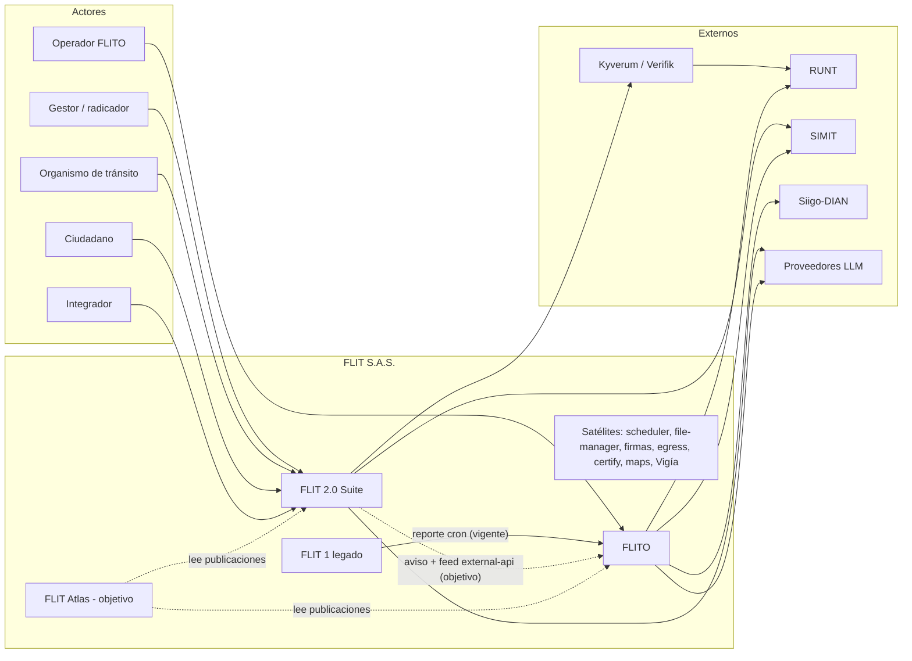
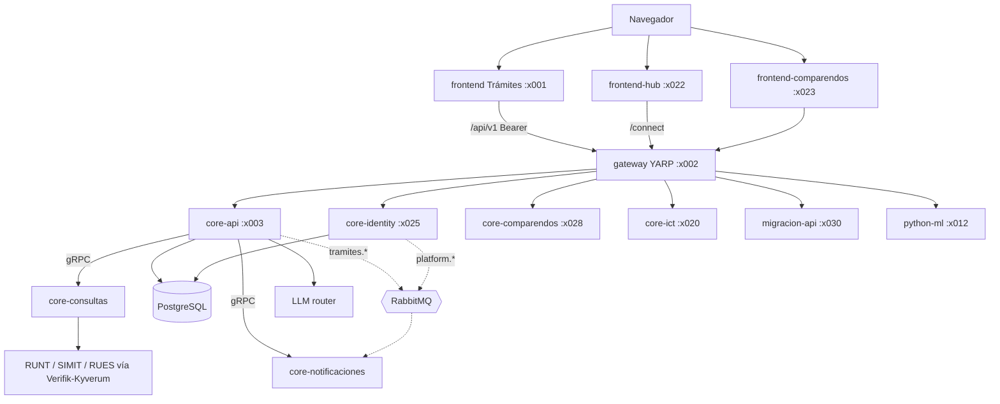
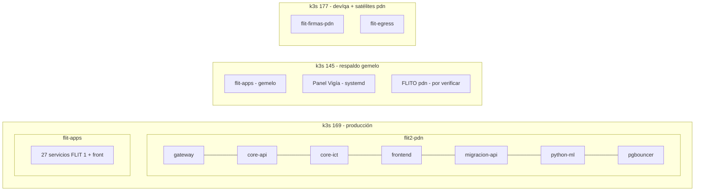
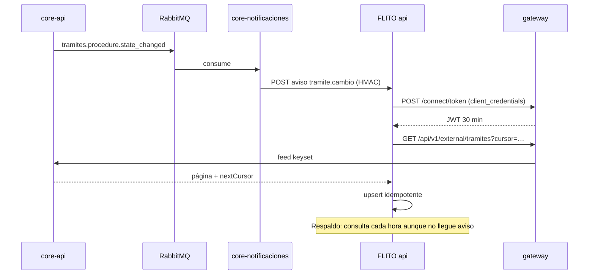

# 01 · Plan de diagramas y arquitectura de FLIT y FLITO (FLIT Atlas, pilar ②)

> **Documento de implementación.** Está escrito para que una sesión nueva de Claude (u otra persona) lo
> ejecute **sin contexto previo**. Forma parte del paquete `plataforma-central-flit/`:
>
> | Archivo | Tema |
> |---|---|
> | `00-plan-maestro-plataforma-central.md` | Visión, decisiones comunes, fases de FLIT Atlas |
> | **`01-plan-diagramas-arquitectura-flit-flito.md`** | **Este documento: arquitectura como código, diagramas por ambiente, versiones y drift** |
> | `02-…` / `03-…` | Gobierno de IA · Agente experto |
>
> Fecha de corte del análisis: **2026-10-20**. Todo lo que no se pudo confirmar leyendo código o manifiestos
> está marcado **[por verificar]**. Nada de este documento se ha implementado todavía.

---

## Índice

0. [Resumen ejecutivo](#0-resumen-ejecutivo)
1. [Decisiones comunes que este plan asume](#1-decisiones-comunes-que-este-plan-asume)
2. [Arquitectura real encontrada (línea base 2026-10-20)](#2-arquitectura-real-encontrada-línea-base-2026-10-20)
3. [Inventario C4 por nivel](#3-inventario-c4-por-nivel)
4. [Herramienta: LikeC4 (versión fijada y por qué)](#4-herramienta-likec4-versión-fijada-y-por-qué)
5. [Catálogo de vistas a producir](#5-catálogo-de-vistas-a-producir)
6. [Borrador real en LikeC4 DSL](#6-borrador-real-en-likec4-dsl)
7. [Diagramas Mermaid de muestra](#7-diagramas-mermaid-de-muestra)
8. [Convenciones](#8-convenciones)
9. [Versionado y "volver en el tiempo"](#9-versionado-y-volver-en-el-tiempo)
10. [Pipeline CI y publicación a Atlas](#10-pipeline-ci-y-publicación-a-atlas)
11. [Generador desde flit-gitops y detección de drift](#11-generador-desde-flit-gitops-y-detección-de-drift)
12. [Modelo de datos y API del módulo Arquitectura en core-atlas](#12-modelo-de-datos-y-api-del-módulo-arquitectura-en-core-atlas)
13. [Saneamiento previo (ADRs y README de gitops)](#13-saneamiento-previo-adrs-y-readme-de-gitops)
14. [Plan de trabajo por fases](#14-plan-de-trabajo-por-fases)
15. [Riesgos](#15-riesgos)
16. [Decisiones pendientes](#16-decisiones-pendientes)
17. [Cómo arrancar en una nueva sesión de Claude](#17-cómo-arrancar-en-una-nueva-sesión-de-claude)
18. [Anexos](#18-anexos)

---

## 0. Resumen ejecutivo

**Problema.** La arquitectura de FLIT existe en tres sitios que no se hablan:

- La **intención** está en prosa y en unos 45 bloques Mermaid sueltos (`docs/suite/mapa-y-banderas.md`,
  `docs/despliegue-y-puertos.md`, 73 ADR en 4 carpetas con números duplicados).
- La **realidad desplegada** está en `flit-gitops` (qué corre en cada clúster y namespace), en los
  `docker-compose.prod.yml` de cada repo y en nginx fuera de git.
- **FLITO** tiene su propia documentación (`AGENTS.md`, 13 ADR, `docs/dominio.md`) sin un solo diagrama de
  contenedores ni de cómo se conecta con FLIT.

Nada de esto está versionado como modelo, nada se ve por ambiente y nada avisa cuando el dibujo y lo desplegado
se separan. Ejemplo real del día del análisis: en `flit2-pdn` corren 6 workloads (core-api, core-ict, frontend,
gateway, migracion-api, python-ml), mientras en `flit2-qa` corren 12 (la suite completa con identity, hub,
consultas, notificaciones y comparendos). Ningún documento lo dice de forma explícita.

**Solución.**

1. **Arquitectura como código con LikeC4** (`.c4`, MIT, versión fijada **1.59.4**). Cada repo es dueño de su
   modelo (`docs/arquitectura/` en `flit` y en `flito`) y un proyecto central (`landscape`) los agrega.
2. **Vistas por ambiente generadas, no dibujadas.** Un generador lee `flit-gitops` y produce un modelo de
   despliegue LikeC4 + un snapshot JSON por ambiente (dev/qa/pdn) y por clúster (vps-177/vps-169/vps-145).
3. **FLIT Atlas guarda versiones inmutables.** Hay una publicación por release de cada repo y un snapshot por
   cada commit de `flit-gitops`. Con eso se puede "volver en el tiempo" y comparar versiones.
4. **Drift en tres capas.** Se compara lo declarado en el modelo, lo deseado en gitops y lo vivo en el clúster
   (API de Argo CD), con alertas.

**Esfuerzo grueso: 5–7 semanas-persona**, repartidas en 6 fases (§14). La primera entrega útil, el landscape
y los contenedores de FLIT y FLITO renderizados en CI, llega en ~1,5 semanas, antes de que exista Atlas.

---

## 1. Decisiones comunes que este plan asume

Vienen del documento maestro `00-plan-maestro-plataforma-central.md`. Aquí no se discuten, solo se aplican.

| Decisión | Valor |
|---|---|
| Nombre de trabajo | **FLIT Atlas** |
| Backend | `services/core-atlas` en el monorepo `flit` (.NET 10). Se crea desde `services/core-plantilla` siguiendo `docs/suite/servicio-nuevo.md` |
| Frontend | `frontend-atlas` (Next 16). Reutiliza `packages/{auth,brand,shell,ui}` |
| Persistencia | **Un solo esquema `atlas`** en la base compartida de FLIT de cada ambiente, con el usuario `flit_atlas` (regla de la plataforma: un servicio es dueño de un esquema, EF Core con `snake_case`, igual que core-comparendos). Los módulos se separan por **prefijo de tabla**: `contrato_*`, `arq_*`, `asistente_*`, `gia_*`, `catalogo_*`. **Este plan solo usa `arq_*`** y lee `catalogo_*` |
| Login | core-identity (OIDC). Código de producto propuesto: `atlas` (aud del token) **[por confirmar con el líder; requiere fila en el catálogo de productos y cambio en el contrato de plataforma §1 por PR (regla R3)]** |
| Despliegue | GitOps en `flit-gitops`: dev y qa en el k3s de la **177**, pdn en el k3s de la **169** |
| Hosts | `dev.atlas.flitsas.online`, `qa.atlas.flitsas.online`, `atlas.flitsas.com` |
| Puertos | core-atlas REST **4031/5031/6031** · frontend-atlas **4032/5032/6032** **[confirmar con el líder; actualizar `docs/despliegue-y-puertos.md` §2.d]** |
| Arquitectura como código | **LikeC4** (alternativa documentada: Structurizr DSL, §4.3) |
| Diagrama de bajo nivel (opcional) | KubeDiagrams, solo como anexo de infraestructura |

> ⚠️ **El repo `flitsas/flit` es PÚBLICO** (verificado). Todo `.c4`, export y documento que viva en él queda
> público. Regla dura de este plan: **los modelos no llevan IPs, ClusterIP, nombres de usuario de BD, rutas de
> secretos, puertos internos de administración ni hosts que no sean ya públicos.** Lo sensible (topología de
> red, IPs de VPS, nombres de SealedSecrets) vive **solo** en los snapshots que el generador manda a Atlas
> (§11), nunca en git público. El repo `flito` y `flit-gitops` **[por verificar visibilidad]**; mientras no
> se verifique, se tratan con la misma regla.

---

## 2. Arquitectura real encontrada (línea base 2026-10-20)

### 2.1 Mapa de repos y dónde vive cada cosa

| Repo / ruta local | Qué es | Despliegue |
|---|---|---|
| `flit` (monorepo) — `D:\OneDrive - INGENIA 365\AOS\Proyectos\FLIT\Code\flit` | **FLIT 2.0** (Suite: Trámites, Hub, Comparendos, Diagnóstico) | dev y qa: k3s 177 (`flit2-dev`, `flit2-qa`); pdn: k3s 169 (`flit2-pdn`). El `cd.yml` tiene además el camino SSH + `docker-compose.prod.yml` para staging/release **[por verificar cuál rige hoy en qa; memoria: QA migró a GitOps el 2026-10-18 (#604)]** |
| `flito` — `D:\FLIT\Code\flito` | **FLITO**, la plataforma de operaciones para organismos de tránsito, CEA y gestoras (`operaciones.flitsas.com`) | dev y qa: k3s 177 (`flito-dev`, `flito-qa`); pdn: VPS 145 fuera de gitops **[por verificar mecanismo exacto: docker compose / PM2 (`ecosystem.config.cjs`)]** |
| `flit-gitops` — `D:\FLIT\Code\flit-gitops` | Estado deseado de los clústeres (Argo CD app-of-apps) | — |
| 27 repos `Back*` + `FrontNextJS` | **FLIT 1 (legado)**: microservicios Node/tsoa + front Next | `apps/*.yaml` en el namespace `flit-apps`, sincronizados por `root-app` en **169 y 145** (clústeres gemelos) |
| Satélites | `flit-scheduler` (Hangfire), `file-manager-minio`, `flit-firmas`, `flit-egress` (Go, 177), `flit-certify`, Panel Vigía (145), `flitsas-maps` (177) | varios; ver memoria del equipo y `flit-gitops/docs` |

### 2.2 FLIT 2.0 — contenedores reales

Fuentes: `docs/suite/mapa-y-banderas.md`, `docs/despliegue-y-puertos.md`, `docs/suite/contrato-plataforma-v1.md`,
`services/core-api/src/Flit.Gateway/appsettings.json`, `flit-gitops/services/flit2-*/deployments.yaml`.

| Contenedor | Ruta | Tecnología | Puerto dev/qa/pdn | Responsabilidad |
|---|---|---|---|---|
| frontend-hub | `frontend-hub/` | Next.js | 4022/5022/6022 | Portada, login de la suite, inicio con productos; reenvía `/connect/*` y `/.well-known/*` |
| frontend (Trámites) | `frontend/` | Next 16 | 4001/5001/6001 | Producto Trámites; BFF `/api/v1` con `@flit/auth`; manual `/manual` y Dr. FLIT |
| frontend-comparendos | `frontend-comparendos/` | Next.js | 4023/5023/6023 | Producto Comparendos |
| frontend-diagnostico | `frontend-diagnostico/` | — | 4024/… | Reservado (solo README) |
| gateway | `services/core-api/src/Flit.Gateway` | .NET + YARP 2.2 | 4002/5002/6002 | Única entrada de la API. Rutas `/api`, `/connect`, `/.well-known`, `/hubs`, `/ml`, `/api/v1/external`, `/api/v1/comparendos`, `/api/v1/ict`, `/api/v1/migracion`; sella `X-Flit-Domain`; no valida tokens |
| core-api | `services/core-api/src/Flit.Api` (22 proyectos) | .NET 10, EF Core | 4003/5003/6003 (+gRPC 8082) | Negocio de Trámites. Hoy también hace de identidad cuando `FLIT_IDENTITY_CLUSTER_ENABLED=false`. Módulos Admin, Analytics, DrFlit, Consultas, Notificaciones, Platform, Quipux, Security, Tramites |
| core-identity | `services/core-identity` | .NET + OpenIddict | 4025/5025/6025 (gRPC 8083 propuesto) | OIDC de la suite: `/connect`, `/.well-known`, `/api/v1/auth`, `/api/v1/platform`, branding y red |
| core-consultas | `services/core-consultas` | .NET, gRPC | REST 4026 / gRPC 8084 | Consultas externas: RUNT, SIMIT, RUES, Verifik, Kyverum, validación de identidad (ADR-0065) |
| core-notificaciones | `services/core-notificaciones` | .NET, gRPC | gRPC | Correo, webhooks salientes, DLQ |
| core-comparendos | `services/core-comparendos` | .NET | 4028/5028/6028 (gRPC 8086) | GDC V2, OCR por LLM, prompts versionados |
| core-ict | `services/core-ict` | .NET + Swagger | x020 | Integración con terceros: gestores cargan trámites en lote con su token (`ict.flitsas.online`) |
| migracion-api | `services/core-api/tools/Flit.DataMigration.*` | .NET | 4030/5030/6030 | Migración FLIT 1 → FLIT 2; cluster YARP propio con timeout de 30 min |
| python-ml | `services/python-ml` | Python 3.13, FastAPI | 4012/5012/6012 | OCR/ML (esqueleto) |
| PostgreSQL | host / PgBouncer en pdn | PG16 | 5432 | Una base por ambiente, un esquema por servicio |
| RabbitMQ | `deploy/rabbitmq` (dev/qa en k3s) | RabbitMQ | — | Exchanges `flit.plataforma`, `flit.tramites`, `flit.consultas`, `flit.notificaciones` (+`flit`). En pdn **[por verificar: no aparece en `flit2-pdn`]** |
| Almacenamiento | Contabo Object Storage / MinIO | S3 | — | Adjuntos; ADR-0057 (docs/decisions) |

**Workloads por ambiente (de `flit-gitops/services/flit2-*/deployments.yaml`, 2026-10-20):**

| Workload | flit2-dev (177) | flit2-qa (177) | flit2-pdn (169) |
|---|:-:|:-:|:-:|
| core-api, core-ict, gateway, frontend, migracion-api, python-ml | ✅ | ✅ | ✅ |
| core-identity, frontend-hub | ✅ | ✅ | ❌ |
| core-consultas, core-notificaciones | ✅ | ✅ | ❌ |
| core-comparendos, frontend-comparendos | ✅ | ✅ | ❌ |
| rabbitmq | ✅ | ✅ | ❌ |
| pgbouncer, edge, certificates, ingress | — | — | ✅ |

> Este cuadro es justo lo que el generador (§11) debe producir solo, en cada commit de gitops.

**Contratos que ya existen y que se enlazan a los elementos del modelo:**

- OpenAPI (`contracts/openapi/`): `core-api.v1.yaml`, `core-ict.v1.yaml`, `platform.v1.yaml`, `python-ml.v1.yaml`, `external-api.v1.json`.
- AsyncAPI (`contracts/asyncapi/`):
  - `plataforma-events.v1.yaml`: `platform.tenant_product.changed`, `platform.user.suspended`, `platform.tenant.suspended`, `platform.roles.changed`.
  - `tramites-events.v1.yaml`: `tramites.procedure.state_changed`, `tramites.identity_validation.requested|completed`.
  - `domain-events.v1.yaml`: `ot-webhook/vehicle_state_changed`, `flito-webhook/tramite.cambio`.
  - `consultas-events.v1.yaml`, `notificaciones-events.v1.yaml`.
- Proto (`contracts/proto/flit/*/v1`): `ComparendosService`, `ConsultasService`, `ConsultasAdminService`, `FuentesComparendosService`, `ValidacionIdentidadService`, `IdentidadService`, `EmpresasService`, `NotificacionesService`, `MensajesMuertosService`, `CatalogosService`.

### 2.3 FLITO — contenedores reales

Fuentes: `flito/AGENTS.md`, `flito/docs/dominio.md`, `flito/docker-compose.prod.yml`, `flito/apps/api/src/modules/*`,
`flit-gitops/services/flito-dev/deployments.yaml`.

| Contenedor | Ruta | Tecnología | Responsabilidad |
|---|---|---|---|
| web | `apps/web` | Vite 5 + React 18.3 + react-router 6 + Tailwind 4 | SPA de operaciones; cliente único `src/lib/api.ts` (`BASE=/api`) |
| api | `apps/api` | Express 4 + TS ESM + Drizzle + Zod, pino | 42 módulos en `src/modules/` (lista en §2.3.1); crons propios (`*.cron.ts`) |
| PostgreSQL | — | PG | Esquema propio con migraciones SQL a mano (`apps/api/src/db/migrations`, runner `db:apply`) |
| Redis | `redis:7-alpine` | Redis | Caché / rate limit **[por verificar uso exacto]** |
| MinIO | `minio/minio` | S3 | Archivos (OCR, PDFs, expedientes) |
| shared-types | `packages/shared-types` | TS | **Contrato de tipos entre web y api (no hay OpenAPI)** |

#### 2.3.1 Módulos de `apps/api` (42)

- **Producto FLITO (`/api/flito/...`):** `flito-bitacora`, `flito-bolsas`, `flito-comparendos`, `flito-compuerta`, `flito-conciliacion`, `flito-derechos`, `flito-excepciones`, `flito-impuestos`, `flito-liquidacion`, `flito-logistica`, `flito-ocr`, `flito-parametrizacion`, `flito-revisiones`, `flito-soat`, `flito-sync`, `flito-tablero`, `flito-tramites`.
- **Legado y transversales:** `ai`, `auth`, `clients`, `drive`, `drivers`, `files`, `finanzas`, `firma`, `fleet`, `integraciones`, `jornadas`, `laft`, `liquidacion`, `maintenance`, `pesv`, `privacy`, `rndc`, `rum`, `runt`, `rutas`, `siigo`, `soat`, `tramites`, `users`, `vehicles`.

#### 2.3.2 Sistemas externos que toca FLITO (de las URLs del código)

| Sistema | Uso | Ruta en código |
|---|---|---|
| RUNT (portal público, `runtproapi.runt.gov.co`) | Consulta ciudadano/vehículo | `modules/runt/runt-direct.service.ts` |
| Kyverum (`runt.kyverum.com`, `cea.kyverum.com`) | Proxy RUNT, SIMIT, Fasecolda, MercadoLibre, tránsitos | `modules/integraciones/*` |
| SIMIT (`consultasimit.fcm.org.co`) + captcha FCM | Estado de cuenta / comparendos | `integraciones/simit.direct.ts`, `flito-comparendos` |
| UTS municipales | `ConsultarInfraccionFuente` por municipio | `flito-comparendos` |
| Verifik | SIMIT vía Verifik | `flito-comparendos` (doc de dominio) |
| Fasecolda | Guía de valores | `integraciones/fasecolda.direct.ts` |
| Siigo | Facturación electrónica → DIAN | `modules/siigo`, `docs/integraciones/siigo-api.md` |
| RNDC | Registro nacional de despachos de carga | `modules/rndc` |
| Supertransporte (PESV) | Programa PESV | `modules/pesv` |
| UIAF (SIREL) | Reportes LAFT | `modules/laft` |
| Google Drive API | Lectura de documentos | `modules/drive` |
| WhatsApp (Graph API de Meta) | Mensajería | **[por verificar módulo]** |
| Anthropic | OCR y health-check | `modules/ai`, `flito-ocr` |
| **FLIT** | Sincronización de trámites | `modules/flito-sync/flit-http.adapter.ts` |

#### 2.3.3 Cómo se conecta FLITO con FLIT (hallazgo importante)

- **Hoy:** `flito-sync` consume el **reporte de trámites de FLIT 1** (`FLIT_BASE_URL`, que por defecto apunta a un
  API Gateway de AWS `…execute-api.us-east-1.amazonaws.com/pdn`, `REPORT_TYPE_ID=18`) y el file-manager de
  facturas. Es de solo lectura y periódico (`flito-sync.cron.ts`). **[por verificar el valor de `FLIT_BASE_URL`
  en cada ambiente; tras la migración a VPS debería apuntar a `proxy-flit-external` / `external-*` del clúster]**.
- **Destino acordado:** la **API externa de FLIT 2** (`docs/integraciones/external-api-tramites-sync.md` v3.3,
  ADR-0067, ADR-0068, ADR-0071):
  - `client_credentials` → JWT RS256 de 30 minutos, con scopes `external.tramites.read`, `.pii.read` y `.attachments.write`.
  - Feed `GET /api/v1/external/tramites` con un cursor keyset opaco.
  - Webhook firmado `flito-webhook/tramite.cambio` por la plataforma de mensajería (aviso; el feed es la verdad).
  - `POST /api/v1/external/tramites/{id}/adjuntos` (implementado, HU #13263).
  - Estado del feed: "Acordado, sin implementar" según la cabecera del documento.
- El modelo debe dibujar **las dos relaciones** con un tag de estado: `#vigente` para FLIT 1 → FLITO y `#objetivo`
  para FLIT 2 external-api → FLITO. Así queda explícita la migración pendiente.

### 2.4 FLIT 1 (legado), solo como contexto

Son 27 Applications en `flit-gitops/apps/` (namespace `flit-apps`, en 169 y 145): `appraisal`, `authentication`,
`connection-runt`, `connection-runtesp`, `document-generation`, `external-attachments`, `external-auth`,
`external-log`, `external-transact`, `external-transactattach`, `external-transactstatus`,
`external-transactwebhook`, `external-valiqueryext`, `filemanager`, `infraction`, `infraction-ocr`, `migration`,
`otherservice`, `pdfservice-grpc`, `processes-sp`, `proxy-flit-external`, `quipux`, `resolution`,
`scraping-taxes`, `sibga`, `smart-cloud`, `transfer`, y además `front` (FrontNextJS).

En el landscape aparecen como **un sistema `flit1`** con 4 grupos (API externa, núcleo de trámites, integraciones,
documentos). No se modelan por componente: solo se agrupan y se enlazan a su `swagger.json` (tsoa).

---

## 3. Inventario C4 por nivel

La columna **Responsable** usa roles, no personas. Los nombres se asignan en la fase 0 (§16, D-6).

### 3.1 Nivel 1 — Contexto: actores

| Id LikeC4 | Actor | Usa | Notas |
|---|---|---|---|
| `ciudadano` | Ciudadano / propietario / comprador | Trámites (firma, validación de identidad), consultas | Titular de datos personales (Ley 1581) |
| `gestor` | Gestor / tramitador / radicador de empresa cliente | Trámites, ICT (carga en lote), FLITO | Roles `Radicador`, etc. |
| `organismo` | Organismo de tránsito (secretaría) | Trámites (bandeja OT), FLITO | `entity_type = TRANSIT_OFFICE` |
| `cea` | Centro de enseñanza automovilística | FLITO | Vía Kyverum CEA |
| `cliente_empresa` | Empresa cliente (renting, concesionario, concesión, marca blanca) | Suite / marca blanca | `tenant_type` del token |
| `admin_compania` | Administrador de compañía | Hub (productos, usuarios) | `AdminCompany` |
| `superadmin` | Administrador FLIT | Todo; parametrización global; IA | `SuperAdmin` (bypass) |
| `operador_flito` | Operador / finanzas FLITO | FLITO | Roles de `USER_ROLES` en `packages/shared-types/src/permissions.ts` |
| `integrador` | Sistema de un cliente que consume la API | `api.flitsas.com`, external-api, ICT | Primer consumidor: FLITO |

### 3.2 Nivel 1 — Contexto: sistemas externos

| Id | Sistema | Lo usa | Interfaz |
|---|---|---|---|
| `runt` | RUNT | FLIT 2 (core-consultas, Verifik/Kyverum), FLITO, FLIT 1 | HTTP |
| `simit` | SIMIT (FCM) | core-consultas, FLITO, FLIT 1 | HTTP (bloqueo geográfico → `flit-egress`) |
| `rues` | RUES | core-consultas | HTTP (async) |
| `verifik` | Verifik | core-api/core-consultas, FLITO | HTTP, token |
| `kyverum` | Kyverum (RUNT, CEA, firma de certificados, webhooks) | core-consultas, core-api (webhook `/api/v1/webhooks`), FLITO | HTTP |
| `quipux` | Quipux (bandeja de OT) | core-api (módulo Quipux) | HTTP |
| `idsecure` | IdSecure (validación de identidad) | core-api (`/api/public/idsecure`) | HTTP |
| `siigo` | Siigo → DIAN | FLITO | HTTP |
| `rndc` | RNDC | FLITO | HTTP |
| `uiaf` | UIAF SIREL | FLITO (LAFT) | archivo/portal |
| `fasecolda` | Fasecolda | FLITO | HTTP |
| `anthropic` / `openai` / `kimi` / `deepseek` / `gemini` | Proveedores LLM | core-api (router IA), core-comparendos, FLITO | HTTP |
| `ado` | Azure DevOps | Dr. FLIT (escalamiento de soporte) | HTTP |
| `smtp` | Proveedor de correo | core-notificaciones | SMTP |
| `objstore` | Contabo Object Storage / MinIO | core-api, FLITO | S3 |
| `google_drive`, `whatsapp` | Google / Meta | FLITO | HTTP |

### 3.3 Nivel 2 — Contenedores (tabla de responsabilidad)

| Elemento (id) | Repo / ruta | Tecnología | Responsable (rol) | PII | Criticidad |
|---|---|---|---|:-:|---|
| `flit2.hub` | flit / `frontend-hub` | Next.js | Líder FLIT 2.0 – frente Plataforma | no | alta |
| `flit2.tramites_web` | flit / `frontend` | Next 16 | Líder FLIT 2.0 – Trámites | sí | crítica |
| `flit2.comparendos_web` | flit / `frontend-comparendos` | Next.js | Líder Comparendos | sí | media |
| `flit2.gateway` | flit / `services/core-api/src/Flit.Gateway` | .NET YARP | Líder FLIT 2.0 – Plataforma | no | crítica |
| `flit2.core_api` | flit / `services/core-api` | .NET 10 | Líder FLIT 2.0 – Trámites | sí | crítica |
| `flit2.core_identity` | flit / `services/core-identity` | .NET OpenIddict | Frente A (identidad) | sí | crítica |
| `flit2.core_consultas` | flit / `services/core-consultas` | .NET gRPC | Frente C | sí | alta |
| `flit2.core_notificaciones` | flit / `services/core-notificaciones` | .NET gRPC | Frente C | sí | alta |
| `flit2.core_comparendos` | flit / `services/core-comparendos` | .NET | Líder Comparendos | sí | media |
| `flit2.core_ict` | flit / `services/core-ict` | .NET | Líder Integraciones | sí | alta |
| `flit2.migracion_api` | flit / `services/core-api/tools/Flit.DataMigration.*` | .NET | Líder Migración | sí | media (temporal) |
| `flit2.python_ml` | flit / `services/python-ml` | FastAPI | Líder IA | sí (imágenes) | baja |
| `flit2.db` | — | PostgreSQL 16 (+PgBouncer en pdn) | DevOps | sí | crítica |
| `flit2.bus` | flit / `deploy/rabbitmq` | RabbitMQ | DevOps / Frente C | sí (payloads) | alta |
| `flit2.storage` | — | S3 (Contabo) | DevOps | sí | alta |
| `flito.web` | flito / `apps/web` | Vite + React | Líder FLITO | sí | alta |
| `flito.api` | flito / `apps/api` | Express + Drizzle | Líder FLITO | sí | crítica |
| `flito.db` / `flito.redis` / `flito.minio` | flito / compose | PG / Redis / MinIO | DevOps | sí/no/sí | alta/media/alta |
| `atlas.core_atlas` / `atlas.web` | flit / `services/core-atlas`, `frontend-atlas` | .NET / Next | Líder Plataforma Central | no | media |

### 3.4 Nivel 3 — Componentes de los servicios clave

Solo se modelan componentes donde aportan. El resto queda en nivel 2.

**`flit2.core_api`** (proyectos en `services/core-api/src`):

| Componente | Proyecto | Nota |
|---|---|---|
| `api_host` | `Flit.Api` | Endpoints minimal API, OpenAPI Swashbuckle |
| `tramites` | `Flit.Tramites.Application/Domain` | Ciclo de vida (ADR-0022, ADR-0033 subsanación) |
| `admin` | `Flit.Admin.Application/Domain` | Parametrización, tenants, IA (`/api/v1/admin/plataforma/ai`) |
| `security` | `Flit.Modules.Security.*` | Roles, permisos, JWT legacy |
| `platform` | `Flit.Modules.Platform`, `Flit.Suite.AspNetCore` | Productos, manifiesto, emisores |
| `consultas_mod` | `Flit.Modules.Consultas`, `Flit.Queries.Domain` | Cliente hacia core-consultas |
| `notificaciones_mod` | `Flit.Modules.Notificaciones` | Publicación hacia core-notificaciones |
| `quipux` | `Flit.Modules.Quipux.*` | Bandeja OT (ADR-0051 docs/decisions) |
| `drflit` | `Flit.DrFlit.Application`, `Infrastructure/DrFlit` | Asistente (ADR-0060 core-api) |
| `ia_router` | `Flit.Infrastructure/Ai` | Router multiproveedor (ADR-0070 core-api) |
| `ocr` | `Infrastructure/Ocr`, `Tramites.Application/Ocr` | OCR con Anthropic |
| `analytics` | `Flit.Analytics.Application` | Reportes 2.0 (`docs/contratos-reportes-v2.md`) |
| `external_api` | endpoints `/api/v1/external` | ADR-0067/0068/0071 |
| `grpc_ict` | `Flit.Tramites.Grpc.Contracts` | gRPC 8082 |
| `sdk` | `Flit.Platform.Sdk` | SDK de plataforma para servicios nuevos |

**`flit2.gateway`**: `routes` (YARP), `domain_seal` (`DomainSealTransform`), `rate_limit`, `cors`.

**`flito.api`**: un componente por grupo funcional (`flito_tramites`, `flito_soat`, `flito_comparendos`,
`flito_liquidacion` + `siigo`, `flito_sync`, `integraciones`, `runt`, `pesv`, `laft`/`privacy`, `ocr`/`ai`,
`auth`/`users`). No se modelan los 42 módulos uno por uno.

---

## 4. Herramienta: LikeC4 (versión fijada y por qué)

### 4.1 Estado verificado (consulta a npm y likec4.dev, 2026-10-20)

| Capacidad | Estado | Evidencia |
|---|---|---|
| Licencia | **MIT** (`likec4`, `@likec4/core`, `@likec4/diagram`, `@likec4/generators`, `@likec4/language-server`) | registry.npmjs.org |
| Última versión | `1.60.0` (2026-10-15). **Se fija `1.59.4` (2026-09-21)** por la política de usar versiones con al menos 2 semanas; se sube a 1.60.x en la fase 5 | registry.npmjs.org/likec4 |
| Modelo C4 + especificación propia de tipos | Sí (`specification { element … }`) | likec4.dev/dsl/specification |
| Vistas dinámicas | Sí (`dynamic view`) | likec4.dev/dsl/views/dynamic |
| **Modelo de despliegue** | Sí: `deployment { environment … { node … { instanceOf … } } }` y `deployment view` | likec4.dev/dsl/deployment/model, …/views |
| Multi-proyecto | Sí (`likec4.config.json` por proyecto) | likec4.dev/dsl/config/multi-projects |
| Validación | `likec4 validate`: errores de sintaxis y layout drift, sale con código ≠ 0 | likec4.dev/tooling/cli |
| Export | `export png|jpg` (necesita Playwright), `export json`, `export drawio`; `gen mermaid|mmd|plantuml|d2|dot|react`; `build` genera sitio estático | likec4.dev/tooling/cli |
| Embebido en React/Next | Exporta `likec4/react` y `likec4/vite-plugin`, y `gen react` genera componentes | `exports` del paquete `likec4` |
| **Servidor MCP** | `@likec4/mcp` (bin `likec4-mcp`) o `likec4 mcp --stdio` / `--http <dir>` (puerto 33335). 20 herramientas: `search-element`, `read-element`, `read-deployment`, `read-view`, `find-relationship-paths`, `query-by-metadata`, `query-by-tags`, `element-diff`… | likec4.dev/tooling/ai-tools |
| Importar elementos entre proyectos | **[por verificar en 1.59.4]**: la documentación de multi-proyecto lo menciona; probarlo en la fase 1 (T1.2). Si no sirve, el landscape usa la opción B del §8.1 |

> El MCP de LikeC4 es la pieza que conecta este plan con el **agente experto** (documento 03): el agente
> consulta el modelo vigente con `read-element`, `find-relationship-paths` y `read-deployment` en lugar de
> adivinar desde prosa.

### 4.2 Por qué LikeC4 y no otras

| Criterio | LikeC4 | Structurizr DSL | Mermaid suelto |
|---|---|---|---|
| Modelo único → muchas vistas | ✅ | ✅ | ❌ |
| Despliegue por ambiente | ✅ | ✅ | ❌ |
| Embebible en Next (Atlas) sin servidor Java | ✅ (React) | ❌ (Lite es Java; el servicio en la nube anunció su cierre) | ✅ |
| Export a Mermaid (render en GitHub/MkDocs/agente) | ✅ | ✅ (vía CLI) | — |
| MCP oficial para IA | ✅ | ❌ **[por verificar]** | ❌ |
| Toolchain Node (el mismo de los fronts y de FLITO) | ✅ | ❌ (JVM) | ✅ |

### 4.3 Alternativa documentada: Structurizr DSL

Si LikeC4 falla en algo bloqueante (por ejemplo multi-proyecto o rendimiento con más de 300 elementos), se cambia a
Structurizr DSL con `structurizr-cli export -format mermaid|plantuml|json`. El modelo es casi 1 a 1:
`softwareSystem` ↔ `system`, `container` ↔ `container`, `deploymentEnvironment` ↔ `environment`. El generador de
gitops (§11) produce JSON intermedio precisamente para no casarse con el DSL: cambiar de herramienta implica
reescribir solo el emisor de texto.

---

## 5. Catálogo de vistas a producir

| # | Id de vista | Tipo | Proyecto | Contenido | Fase |
|---|---|---|---|---|---|
| V01 | `landscape` | estática | landscape | FLIT 2.0, FLIT 1, FLITO, satélites (scheduler, file-manager, firmas, egress, certify, maps, Vigía, Atlas), actores y externos | 1 |
| V02 | `flit2_contexto` | estática | flit | Sistema FLIT 2.0 con actores y externos | 1 |
| V03 | `flito_contexto` | estática | flito | Sistema FLITO con actores y externos | 1 |
| V04 | `flit2_contenedores` | estática | flit | Todos los contenedores de §2.2 y sus relaciones | 1 |
| V05 | `flito_contenedores` | estática | flito | web, api, PG, Redis, MinIO, externos | 1 |
| V06 | `flit2_core_api_componentes` | estática | flit | Componentes de §3.4 | 3 |
| V07 | `flito_api_componentes` | estática | flito | Grupos funcionales | 3 |
| V08 | `flujo_radicacion_tramite` | dinámica | flit | Radicador → Trámites (BFF) → gateway → core-api (validaciones CF-01/CF-03, mandatario) → DB → evento `tramites.procedure.state_changed` → notificaciones/webhook | 2 |
| V09 | `flujo_sync_flito_flit` | dinámica | landscape | Estado objetivo: aviso `flito-webhook/tramite.cambio` → FLITO → token `client_credentials` → feed por cursor → upsert → adjunto del comprobante. Variante `#vigente`: cron FLITO → reporte FLIT 1 | 2 |
| V10 | `flujo_ocr_ia` | dinámica | flit | Trámites → gateway → core-api OCR → router IA → Anthropic (failover OpenAI/Kimi/DeepSeek) → auditoría; variante core-comparendos | 2 |
| V11 | `flujo_login_oidc_suite` | dinámica | flit | Flujo de `mapa-y-banderas.md` §2: PKCE, hub, `/connect/authorize`, `/connect/token`, cookie cifrada | 2 |
| V12 | `flujo_login_marca_blanca` | dinámica | flit | Host de red → branding → emisor por dominio (`OidcIssuerRegistry`) → token con `dom` | 2 |
| V13 | `flujo_consulta_runt` | dinámica | flit | core-api → gRPC `ConsultasService` → core-consultas → Verifik/Kyverum → RUNT; caché TTL (ADR 10878); evento `consultas` | 2 |
| V14 | `eventos_rabbitmq` | estática filtrada (`#async`) | flit | Exchanges `flit.*`, publicadores y consumidores según AsyncAPI | 2 |
| V15 | `despliegue_dev` | despliegue | generado | Clúster 177, ns `flit2-dev` + `flito-dev` + satélites dev | 4 |
| V16 | `despliegue_qa` | despliegue | generado | Clúster 177, ns `flit2-qa` + `flito-qa` + `flit-firmas-qa` | 4 |
| V17 | `despliegue_pdn` | despliegue | generado | Clúster 169 (`flit2-pdn`, `flit-apps`), 145 (`flit-apps` gemelo, Vigía, FLITO pdn), 177 (`flit-firmas-pdn`, egress, maps) | 4 |
| V18 | `infra_k8s_<ns>` (opcional) | imagen KubeDiagrams | generado | Pods/servicios/ingress por namespace (solo en Atlas, nunca en el repo público) | 5 |

---

## 6. Borrador real en LikeC4 DSL

> Es un borrador para **arrancar**: compila conceptualmente, pero la sesión de implementación debe correr
> `likec4 validate` y ajustar la sintaxis a la versión fijada. Los ids van en `snake_case`. No contiene IPs ni
> secretos (el repo es público).

### 6.1 `landscape/specification.c4` (compartida por los tres proyectos)

```likec4
specification {
  // ── Elementos ─────────────────────────────────────────────
  element actor {
    style { shape person; color secondary }
  }
  element system {
    style { color primary }
  }
  element external {
    notation 'Sistema externo'
    style { color muted }
  }
  element container
  element webapp {
    notation 'Aplicación web'
    style { shape browser }
  }
  element service {
    notation 'Servicio / API'
  }
  element database {
    style { shape storage }
  }
  element queue {
    style { shape queue }
  }
  element bucket {
    style { shape storage; color muted }
  }
  element component

  // ── Relaciones ───────────────────────────────────────────
  relationship sync  { line solid }
  relationship async { line dashed; color amber }
  relationship grpc  { line solid; color indigo }

  // ── Tags (ver §8.3) ──────────────────────────────────────
  tag pii
  tag critico
  tag legado
  tag objetivo      // existe en el diseño, aún no en producción
  tag vigente
  tag temporal
  tag ia
  tag externo_publico
  tag suite

  // ── Nodos de despliegue (los usa el generador, §11) ─────
  deploymentNode environment
  deploymentNode vps {
    notation 'VPS'
  }
  deploymentNode cluster {
    technology 'k3s'
  }
  deploymentNode namespace {
    notation 'Namespace k8s'
  }
  deploymentNode host_service {
    notation 'Servicio en el host (systemd / docker)'
  }
}
```

### 6.2 `landscape/model.c4`, el landscape de la empresa

```likec4
model {
  // ── Actores ──────────────────────────────────────────────
  ciudadano = actor 'Ciudadano / propietario' {
    description 'Firma, valida identidad y consulta el estado de su trámite'
    #pii
  }
  gestor = actor 'Gestor / radicador' {
    description 'Usuario de empresa cliente que radica y sigue trámites'
  }
  organismo = actor 'Organismo de tránsito' {
    description 'Secretaría que recibe, revisa y aprueba trámites (bandeja OT)'
  }
  cea = actor 'CEA'
  admin_compania = actor 'Administrador de compañía'
  superadmin = actor 'Administrador FLIT (SuperAdmin)'
  operador_flito = actor 'Operador / finanzas FLITO'
  integrador = actor 'Integrador (sistema del cliente)' {
    #externo_publico
  }

  // ── Sistemas FLIT ────────────────────────────────────────
  flit2 = system 'FLIT 2.0 (Suite)' {
    description 'Trámites, Hub, Comparendos, Diagnóstico. Monorepo flitsas/flit'
    link https://github.com/flitsas/flit 'Repositorio'
    metadata {
      owner 'Líder técnico FLIT 2.0'
      repo 'flitsas/flit'
      criticidad 'critica'
      datos_personales 'si'
    }
    #critico #pii #suite
  }

  flit1 = system 'FLIT 1 (legado)' {
    description '27 microservicios Node/tsoa + FrontNextJS. En retiro progresivo hacia FLIT 2.0'
    metadata {
      owner 'DevOps / mantenimiento legado'
      repo 'flitsas/Back* (27) + FrontNextJS'
      criticidad 'alta'
      datos_personales 'si'
    }
    #legado #pii
  }

  flito = system 'FLITO (Operaciones)' {
    description 'Operación para organismos, CEA y gestoras: SOAT, impuestos, derechos, comparendos, liquidación y facturación'
    link https://github.com/flitsas/flito 'Repositorio'
    metadata {
      owner 'Líder FLITO'
      repo 'flitsas/flito'
      criticidad 'critica'
      datos_personales 'si'
    }
    #critico #pii
  }

  atlas = system 'FLIT Atlas' {
    description 'Plataforma central: contratos, arquitectura, agente experto, gobierno de IA'
    metadata { owner 'Líder Plataforma Central'; repo 'flitsas/flit (services/core-atlas)'; criticidad 'media'; datos_personales 'no' }
    #objetivo
  }

  scheduler = system 'flit-scheduler' {
    description 'Hangfire: reemplaza 33 Lambdas con jobs HTTP declarados en YAML'
    metadata { owner 'DevOps'; repo 'flitsas/flit-scheduler'; criticidad 'media'; datos_personales 'no' }
  }
  file_manager = system 'File manager (MinIO)' {
    metadata { owner 'DevOps'; repo 'flitsas/flit-file-manager-minio'; criticidad 'alta'; datos_personales 'si' }
    #pii
  }
  firmas = system 'FLIT Firmas' {
    description 'Apalanca automáticamente firmas de trámites en borrador (Bun + Hono)'
    metadata { owner 'Líder Firmas'; repo 'flitsas/flit-firmas'; criticidad 'media'; datos_personales 'si' }
    #pii
  }
  egress = system 'flit-egress' {
    description 'Proxy de salida con lista blanca (resuelve el bloqueo geográfico de SIMIT)'
    metadata { owner 'DevOps'; repo 'flitsas/flit-egress'; criticidad 'alta'; datos_personales 'no' }
  }
  certify = system 'FLIT Certify' {
    description 'Plataforma de QA multitenant (Playwright, axe, evidencias a ADO)'
    metadata { owner 'QA'; repo 'flitsas/flit-certify'; criticidad 'baja'; datos_personales 'no' }
  }
  maps = system 'FLIT Maps' {
    description 'Mapas e inteligencia de comparendos'
    metadata { owner '[por definir]'; repo '[remoto personal: migrar a flitsas]'; criticidad 'baja'; datos_personales 'si' }
    #pii #ia
  }
  vigia = system 'Panel Vigía' {
    description 'Observabilidad de las VPS con chat operativo (Anthropic, humano en el bucle)'
    metadata { owner 'DevOps'; repo 'flitsas/flit-infra-studio (panel-vigia)'; criticidad 'media'; datos_personales 'no' }
    #ia
  }

  // ── Externos ─────────────────────────────────────────────
  runt = external 'RUNT'
  simit = external 'SIMIT (FCM)'
  rues = external 'RUES'
  verifik = external 'Verifik'
  kyverum = external 'Kyverum'
  quipux = external 'Quipux'
  idsecure = external 'IdSecure'
  siigo = external 'Siigo → DIAN'
  rndc = external 'RNDC'
  uiaf = external 'UIAF (SIREL)'
  fasecolda = external 'Fasecolda'
  llm = external 'Proveedores LLM' {
    description 'Anthropic (principal), OpenAI, Kimi, DeepSeek, Gemini'
    #ia
  }
  ado = external 'Azure DevOps'
  correo = external 'Proveedor SMTP'
  objstore = external 'Contabo Object Storage'

  // ── Relaciones de contexto ───────────────────────────────
  gestor -> flit2 'Radica y sigue trámites'
  organismo -> flit2 'Revisa y aprueba (bandeja OT)'
  ciudadano -> flit2 'Firma y valida identidad'
  admin_compania -> flit2 'Administra usuarios y productos'
  superadmin -> flit2 'Parametriza la plataforma'
  integrador -> flit2 'API externa / ICT' { #externo_publico }

  operador_flito -> flito 'Opera SOAT, impuestos, liquidación'
  organismo -> flito 'Consulta y gestiona'
  cea -> flito 'Consulta y gestiona'

  flit1 -> flito 'Reporte de trámites (cron, solo lectura)' { #vigente }
  flit2 -[async]-> flito 'Aviso tramite.cambio (webhook firmado)' { #objetivo }
  flito -> flit2 'Feed external-api por cursor + adjuntos' { #objetivo }

  flit2 -> runt 'Consulta (vía Verifik/Kyverum)'
  flit2 -> simit 'Consulta (vía egress)'
  flit2 -> rues 'Consulta empresa'
  flit2 -> verifik 'RUNT/SIMIT'
  flit2 -> kyverum 'RUNT, firma de certificados'
  kyverum -[async]-> flit2 'Webhooks'
  flit2 -> quipux 'Bandeja OT'
  flit2 -> idsecure 'Validación de identidad'
  flit2 -> llm 'OCR, Dr. FLIT' { #ia }
  flit2 -> ado 'Escala casos de soporte'
  flit2 -> correo 'Notificaciones'
  flit2 -> objstore 'Adjuntos'

  flito -> runt 'Consulta directa / Kyverum'
  flito -> simit 'Estado de cuenta, comparendos'
  flito -> kyverum 'CEA, Fasecolda, RUNT'
  flito -> siigo 'Emisión electrónica'
  flito -> rndc 'Despachos'
  flito -> uiaf 'Reportes LAFT'
  flito -> fasecolda 'Guía de valores'
  flito -> llm 'OCR' { #ia }

  scheduler -> flit1 'Dispara jobs HTTP'
  firmas -> flit2 'Firma trámites en borrador'
  egress -> simit 'Salida con lista blanca'
  maps -> llm 'Inteligencia' { #ia }
  vigia -> llm 'Chat operativo' { #ia }
  atlas -> flit2 'Lee contratos y modelos publicados' { #objetivo }
  atlas -> flito 'Lee contratos y modelos publicados' { #objetivo }
}
```

### 6.3 `flit/docs/arquitectura/model.c4`, contenedores de FLIT 2.0

> Si el import entre proyectos de LikeC4 funciona (T1.2), este archivo **extiende** `flit2` con `extend flit2 { … }`.
> Si no funciona, el proyecto `flit` redeclara `flit2` y el landscape lo referencia (§8.1, opción B).

```likec4
model {
  extend flit2 {
    hub = webapp 'Hub de la suite' {
      technology 'Next.js'
      description 'Portada, login, inicio con productos'
      metadata { repo_path 'frontend-hub'; k8s_workload 'frontend-hub'; puerto '4022/5022/6022' }
    }
    tramites_web = webapp 'Trámites (web + BFF)' {
      technology 'Next 16, @flit/auth'
      description 'Producto Trámites; BFF /api/v1; manual y Dr. FLIT'
      metadata { repo_path 'frontend'; k8s_workload 'frontend'; puerto '4001/5001/6001' }
      #pii #critico
    }
    comparendos_web = webapp 'Comparendos (web)' {
      technology 'Next.js'
      metadata { repo_path 'frontend-comparendos'; k8s_workload 'frontend-comparendos' }
    }
    gateway = service 'Gateway' {
      technology '.NET, YARP 2.2'
      description 'Única entrada de la API; enruta y sella X-Flit-Domain; rate limit; no valida tokens'
      metadata { repo_path 'services/core-api/src/Flit.Gateway'; k8s_workload 'gateway'; config 'appsettings.json#ReverseProxy' }
      #critico
    }
    core_api = service 'core-api' {
      technology '.NET 10, EF Core'
      description 'Negocio de Trámites; identidad mientras FLIT_IDENTITY_CLUSTER_ENABLED=false'
      metadata {
        repo_path 'services/core-api'
        k8s_workload 'core-api'
        openapi 'contracts/openapi/core-api.v1.yaml'
        openapi_externo 'contracts/openapi/external-api.v1.json'
        asyncapi 'contracts/asyncapi/tramites-events.v1.yaml'
        adr 'ADR-0022, ADR-0060, ADR-0067, ADR-0068, ADR-0070, ADR-0071'
      }
      #pii #critico
    }
    core_identity = service 'core-identity' {
      technology '.NET, OpenIddict'
      metadata { repo_path 'services/core-identity'; k8s_workload 'core-identity'; proto 'contracts/proto/flit/identidad/v1/identidad.proto'; adr 'ADR-0062, ADR-0063' }
      #pii #critico
    }
    core_consultas = service 'core-consultas' {
      technology '.NET, gRPC'
      metadata { repo_path 'services/core-consultas'; k8s_workload 'core-consultas'; proto 'contracts/proto/flit/consultas/v1'; asyncapi 'contracts/asyncapi/consultas-events.v1.yaml'; adr 'ADR-0065' }
      #pii
    }
    core_notificaciones = service 'core-notificaciones' {
      technology '.NET, gRPC'
      metadata { repo_path 'services/core-notificaciones'; k8s_workload 'core-notificaciones'; proto 'contracts/proto/flit/notificaciones/v1'; asyncapi 'contracts/asyncapi/notificaciones-events.v1.yaml' }
      #pii
    }
    core_comparendos = service 'core-comparendos' {
      technology '.NET'
      metadata { repo_path 'services/core-comparendos'; k8s_workload 'core-comparendos'; proto 'contracts/proto/flit/comparendos/v1/comparendos.proto' }
      #pii #ia
    }
    core_ict = service 'core-ict' {
      technology '.NET, Swagger'
      description 'Carga de trámites en lote por terceros con su token'
      metadata { repo_path 'services/core-ict'; k8s_workload 'core-ict'; openapi 'contracts/openapi/core-ict.v1.yaml' }
      #pii #externo_publico
    }
    migracion_api = service 'migracion-api' {
      technology '.NET'
      description 'Migración FLIT 1 → FLIT 2 (cluster YARP con timeout de 30 min)'
      metadata { repo_path 'services/core-api/tools'; k8s_workload 'migracion-api' }
      #temporal #pii
    }
    python_ml = service 'python-ml' {
      technology 'Python 3.13, FastAPI'
      metadata { repo_path 'services/python-ml'; k8s_workload 'python-ml'; openapi 'contracts/openapi/python-ml.v1.yaml' }
      #ia
    }
    db = database 'PostgreSQL' {
      technology 'PostgreSQL 16 (+PgBouncer en pdn)'
      description 'Una base por ambiente; un esquema por servicio'
      #pii #critico
    }
    bus = queue 'RabbitMQ' {
      technology 'RabbitMQ'
      description 'Exchanges flit.plataforma, flit.tramites, flit.consultas, flit.notificaciones'
      metadata { repo_path 'deploy/rabbitmq'; k8s_workload 'rabbitmq' }
    }
  }

  // Relaciones internas
  gestor -> flit2.tramites_web 'Usa'
  ciudadano -> flit2.tramites_web 'Firma / valida'
  admin_compania -> flit2.hub 'Administra'
  flit2.tramites_web -> flit2.hub 'Login OIDC (redirección)'
  flit2.hub -> flit2.gateway '/connect, /.well-known'
  flit2.tramites_web -> flit2.gateway '/api/v1 con Bearer (BFF)'
  flit2.comparendos_web -> flit2.gateway '/api/v1/comparendos'
  integrador -> flit2.gateway 'api.flitsas.com /api/v1/external' { #externo_publico }
  integrador -> flit2.core_ict 'ict.flitsas.online' { #externo_publico }

  flit2.gateway -> flit2.core_api '/api/**, /hubs/**'
  flit2.gateway -> flit2.core_identity '/connect, /api/v1/auth, /api/v1/platform (con bandera)'
  flit2.gateway -> flit2.core_comparendos '/api/v1/comparendos'
  flit2.gateway -> flit2.core_consultas '/api/v1/consultas/avisos'
  flit2.gateway -> flit2.core_ict '/api/v1/ict'
  flit2.gateway -> flit2.migracion_api '/api/v1/migracion'
  flit2.gateway -> flit2.python_ml '/ml/**'

  flit2.core_api -[grpc]-> flit2.core_consultas 'ConsultasService'
  flit2.core_api -[grpc]-> flit2.core_notificaciones 'NotificacionesService'
  flit2.core_api -[grpc]-> flit2.core_identity 'IdentidadService / EmpresasService'
  flit2.core_ict -[grpc]-> flit2.core_api 'gRPC 8082'
  flit2.core_api -> flit2.db 'EF Core'
  flit2.core_identity -> flit2.db 'identity.*, platform.*'
  flit2.core_api -[async]-> flit2.bus 'Publica tramites.*'
  flit2.core_identity -[async]-> flit2.bus 'Publica platform.*'
  flit2.bus -[async]-> flit2.core_notificaciones 'Consume y entrega webhooks'
  flit2.core_notificaciones -[async]-> flito 'flito-webhook/tramite.cambio' { #objetivo }

  flit2.core_consultas -> verifik 'RUNT/SIMIT'
  flit2.core_consultas -> kyverum 'RUNT'
  flit2.core_consultas -> rues 'RUES'
  flit2.core_api -> llm 'OCR, Dr. FLIT (router IA)' { #ia }
  flit2.core_comparendos -> llm 'OCR comparendos' { #ia }
  flit2.core_notificaciones -> correo 'SMTP'
  flit2.core_api -> objstore 'S3'
  flit2.core_api -> quipux 'Bandeja OT'
  flit2.core_api -> ado 'Casos de soporte Dr. FLIT'
}
```

### 6.4 `flito/docs/arquitectura/model.c4`, contenedores de FLITO

```likec4
model {
  extend flito {
    web = webapp 'FLITO web' {
      technology 'Vite 5, React 18.3, Tailwind 4'
      metadata { repo_path 'apps/web'; k8s_workload 'web' }
    }
    api = service 'FLITO api' {
      technology 'Express 4, TypeScript ESM, Drizzle, Zod'
      description '42 módulos; producto bajo /api/flito/*; crons propios'
      metadata {
        repo_path 'apps/api'
        k8s_workload 'api'
        contrato 'packages/shared-types (sin OpenAPI)'
        adr 'flito ADR-0001..0013'
      }
      #pii #critico

      flito_tramites = component 'flito-tramites'
      flito_soat = component 'flito-soat / soat'
      flito_comparendos = component 'flito-comparendos' { description 'Ingesta SIMIT Verifik + UTS; sync bajo demanda' }
      flito_liquidacion = component 'flito-liquidacion + siigo' { description 'Facturar (congelar) y emitir a Siigo/DIAN' }
      flito_sync = component 'flito-sync' { description 'Sincroniza trámites desde FLIT' }
      integraciones = component 'integraciones' { description 'SIMIT, Fasecolda, MercadoLibre, impuesto vehicular, proxy CEA' }
      runt_mod = component 'runt'
      pesv = component 'pesv'
      cumplimiento = component 'laft + privacy' { description 'Ley 1581, pii_access_log, SIREL' }
      ocr = component 'flito-ocr + ai' { #ia }
    }
    db = database 'PostgreSQL FLITO' { technology 'PostgreSQL, migraciones SQL manuales'; #pii }
    redis = database 'Redis' { technology 'Redis 7' }
    minio = bucket 'MinIO' { technology 'MinIO S3'; #pii }
  }

  operador_flito -> flito.web 'Usa'
  flito.web -> flito.api '/api (token en localStorage)'
  flito.api -> flito.db 'Drizzle'
  flito.api -> flito.redis 'Caché / rate limit'
  flito.api -> flito.minio 'Archivos'

  flito.api.flito_sync -> flit1 'Reporte REPORT_TYPE_ID=18' { #vigente }
  flito.api.flito_sync -> flit2.gateway 'GET /api/v1/external/tramites (cursor)' { #objetivo }
  flito.api.flito_liquidacion -> siigo 'Factura electrónica'
  flito.api.flito_comparendos -> simit 'Estado de cuenta'
  flito.api.flito_comparendos -> verifik 'SIMIT'
  flito.api.integraciones -> kyverum 'CEA, Fasecolda, RUNT'
  flito.api.runt_mod -> runt 'Consulta directa'
  flito.api.cumplimiento -> uiaf 'Reportes LAFT'
  flito.api -> rndc 'Despachos'
  flito.api.ocr -> llm 'OCR Anthropic' { #ia }
}
```

### 6.5 Vistas (`views.c4` en cada proyecto)

```likec4
views {
  view landscape {
    title 'Landscape FLIT S.A.S.'
    include *
    exclude element.tag = #legado -> *   // opcional: ocultar el detalle del legado
    style element.tag = #objetivo { opacity 40% }
  }

  view flit2_contexto of flit2 {
    title 'FLIT 2.0 — Contexto'
    include *
  }

  view flit2_contenedores of flit2 {
    title 'FLIT 2.0 — Contenedores'
    include flit2.*, -> flit2.* ->
  }

  view flito_contenedores of flito {
    title 'FLITO — Contenedores'
    include flito.*, -> flito.* ->
  }

  dynamic view flujo_sync_flito_flit {
    title 'Sincronización FLIT 2 → FLITO (estado objetivo, external-api v3.3)'
    flit2.core_api -> flit2.bus 'tramites.procedure.state_changed'
    flit2.bus -> flit2.core_notificaciones 'consume'
    flit2.core_notificaciones -> flito.api 'POST aviso tramite.cambio (firmado)'
    flito.api -> flit2.gateway 'POST /connect/token (client_credentials)'
    flito.api -> flit2.gateway 'GET /api/v1/external/tramites?cursor=…'
    flit2.gateway -> flit2.core_api 'feed keyset'
    flito.api -> flito.db 'upsert idempotente'
    flito.api -> flit2.gateway 'POST /external/tramites/{id}/adjuntos'
  }

  dynamic view flujo_login_oidc_suite {
    title 'Login OIDC de la suite (PKCE)'
    gestor -> flit2.tramites_web 'GET /tramites sin sesión'
    flit2.tramites_web -> flit2.hub '302 /connect/authorize (PKCE)'
    flit2.hub -> flit2.gateway '/connect/authorize'
    flit2.gateway -> flit2.core_identity 'valida producto y rol'
    flit2.tramites_web -> flit2.gateway 'POST /connect/token (servidor a servidor)'
    flit2.tramites_web -> gestor 'cookie cifrada flit_session_tramites'
  }
}
```

Las vistas de despliegue (`despliegue_dev|qa|pdn`) **no se escriben a mano**. Las emite el generador en
`gen/deployment.<ambiente>.c4` (§11.3).

---

## 7. Diagramas Mermaid de muestra

Sirven para ver el resultado antes de montar LikeC4 y como formato que el agente experto puede devolver.

### 7.1 Landscape (resumen)



### 7.2 Contenedores de FLIT 2.0



### 7.3 Despliegue pdn, como lo emitiría el generador (2026-10-20)



### 7.4 Secuencia de sync FLITO ↔ FLIT (objetivo v3.3)



---

## 8. Convenciones

### 8.1 Estructura de carpetas

```
flit/                                   (repo PÚBLICO)
└── docs/arquitectura/
    ├── likec4.config.json              { "name": "flit" }
    ├── specification.c4                ← copia sincronizada de landscape (o import)
    ├── model.c4                        ← contenedores FLIT 2.0
    ├── componentes/
    │   ├── core-api.c4
    │   └── gateway.c4
    ├── dinamicas/
    │   ├── radicacion.c4
    │   ├── login-oidc.c4
    │   ├── ocr-ia.c4
    │   ├── consulta-runt.c4
    │   └── eventos.c4
    ├── views.c4
    └── README.md                       ← cómo editar, validar y previsualizar

flito/
└── docs/arquitectura/                  (misma forma; likec4.config.json { "name": "flito" })

flit/  (o repo nuevo flitsas/flit-arquitectura, ver D-1)
└── arquitectura/landscape/
    ├── likec4.config.json              { "name": "landscape" }
    ├── specification.c4                ← FUENTE de la especificación común
    ├── model.c4                        ← sistemas, actores, externos
    └── views.c4

<generados por CI, nunca a mano, NO se commitean en repos públicos>
gen/
├── deployment.dev.c4
├── deployment.qa.c4
├── deployment.pdn.c4
└── snapshot.<ambiente>.json
```

**Opción A (preferida):** cada proyecto importa la especificación y los sistemas del landscape con el import entre
proyectos de LikeC4.

**Opción B (respaldo):** se compone un "workspace" en CI que concatena `landscape/*.c4` + `flit/docs/arquitectura/*.c4`
+ `flito/docs/arquitectura/*.c4` en una sola carpeta y valida todo junto. La especificación se copia con un check que
falla si las copias divergen.

### 8.2 Nombres

| Cosa | Regla | Ejemplo |
|---|---|---|
| Id de sistema | `snake_case`, corto | `flit2`, `flito`, `flit1` |
| Id de contenedor | igual al workload k8s con `-` → `_` | `core_api` ↔ `core-api` |
| Título | Nombre humano en español | `'core-api'`, `'Hub de la suite'` |
| Vista | `<sistema>_<nivel>` o `flujo_<caso>` | `flit2_contenedores`, `flujo_login_oidc_suite` |
| Relación | Verbo + objeto, en español, ≤ 60 caracteres | `'Publica tramites.*'` |
| Archivo | kebab-case `.c4` | `consulta-runt.c4` |

### 8.3 Tags

| Tag | Significado | Efecto visual sugerido |
|---|---|---|
| `#pii` | Toca datos personales (Ley 1581) | borde rojo |
| `#critico` | Su caída detiene operación de clientes | grosor mayor |
| `#legado` | FLIT 1 o código a retirar | gris |
| `#objetivo` | Diseñado y aprobado, aún no en producción | opacidad 40 % |
| `#vigente` | Camino actual que será reemplazado | línea punteada |
| `#temporal` | Existe por una migración (p. ej. migracion-api) | ámbar |
| `#ia` | Usa un LLM (lo consume el inventario del documento 02) | icono / color violeta |
| `#externo_publico` | Expuesto a terceros fuera de FLIT | borde azul |
| `#suite` | Parte de la FLIT Suite (OIDC común) | — |

### 8.4 Propiedades obligatorias (`metadata`)

Validadas en CI con un script propio (`tools/arquitectura/validar-metadata.mjs`) sobre `likec4 export json`.

| Clave | Obligatoria en | Valores |
|---|---|---|
| `owner` | system, container | Rol responsable (y en Atlas se mapea a persona) |
| `repo` | system | `org/repo` |
| `repo_path` | container | Ruta relativa en el repo |
| `criticidad` | system, container | `critica` \| `alta` \| `media` \| `baja` |
| `datos_personales` | system, container | `si` \| `no` (debe ser coherente con `#pii`) |
| `k8s_workload` | container desplegable | Nombre exacto del Deployment o StatefulSet. **Es la llave del drift** |
| `ambientes` | container (opcional) | `dev,qa,pdn`: dónde **debería** estar. Si se omite = todos |
| `openapi` / `asyncapi` / `proto` | container con contrato | Ruta en `contracts/` |
| `adr` | cualquiera | Lista `ADR-NNNN` (numeración unificada, §13) |

### 8.5 Enlaces a ADRs y contratos

- **En el DSL:** `metadata { adr 'ADR-0067'; openapi 'contracts/openapi/external-api.v1.json' }` más
  `link https://github.com/flitsas/flit/blob/develop/docs/adr/ADR-0067-….md 'ADR-0067'`.
- **En los ADR (MADR):** front-matter con `elementos: [flit2.core_api, flit2.gateway]`. Un check en CI verifica que
  cada id exista en el modelo.
- **En Atlas:** al publicar, core-atlas resuelve `openapi`/`asyncapi` contra el módulo Contratos (`contrato_*`) y
  muestra en la ficha del elemento la **versión del contrato vigente en ese release**.

### 8.6 Estilos

Tema base de LikeC4 con un `specification` común. Colores: primario = sistemas FLIT, muted = externos, rojo = `#pii`.
Nada de colores HEX sueltos por vista: todo por tag (equivale a la regla anti-drift visual de FLITO).

---

## 9. Versionado y "volver en el tiempo"

### 9.1 Dos ejes de versión

| Eje | Qué versiona | Disparador | Identificador | Inmutable |
|---|---|---|---|---|
| **Modelo lógico** (por repo) | `docs/arquitectura/**` de `flit`, `flito` y landscape | Merge a `develop` (borrador) y a `release` (publicado) | `repo@sha` + etiqueta semántica `arq-vMAJOR.MINOR.PATCH` | Sí, al publicar desde `release` |
| **Despliegue** (por ambiente) | Lo que dice `flit-gitops` (+ lo vivo en Argo) | Cada commit a `main` de `flit-gitops` y cada sync de Argo | `gitops@sha` + `fecha UTC` + `ambiente` | Sí |

Versión semántica del modelo lógico:

- **MAJOR:** se elimina o renombra un sistema o contenedor, o cambia un id (rompe enlaces).
- **MINOR:** contenedor, relación o vista nuevos.
- **PATCH:** descripciones, metadatos, estilos.

El CI calcula la propuesta comparando `export json` contra la última publicación (§10.4) y la registra; el humano
puede subirla.

### 9.2 Volver en el tiempo

- **Desde git:** `git checkout <sha> -- docs/arquitectura && npx likec4@1.59.4 serve docs/arquitectura`.
- **Desde Atlas:**
  - Selector de fecha en cada vista. Atlas busca la publicación del modelo vigente a esa fecha (la última con
    `publicado_en <= fecha`) y el snapshot de cada ambiente vigente a esa fecha.
  - URL estable: `/arquitectura/{proyecto}/vistas/{vista}?en=2026-10-11T23:12Z&ambiente=pdn`.
  - Pregunta del tipo "¿qué corría en pdn el 2026-10-11 a las 23:12 UTC?": la responde el snapshot de pdn
    vigente en ese instante.

### 9.3 Diffs entre versiones

- **Modelo:** diff estructural sobre `export json`, con elementos y relaciones añadidos, quitados o modificados, y
  cambios de metadata. Se publica como comentario del PR y se guarda en `arq_publicacion.diff`. El MCP de LikeC4
  ofrece `element-diff` para comparar elementos.
- **Despliegue:** diff entre snapshots consecutivos (workloads, imágenes/digests, réplicas, ingress hosts).
  Ejemplo: "pdn 2026-10-11: +core-api sha-abc…, ingress +app.flitsas.com".
- **Visual:** Atlas renderiza ambas versiones lado a lado y resalta altas en verde y bajas en rojo, usando los
  ids del diff.

---

## 10. Pipeline CI y publicación a Atlas

### 10.1 Workflow `arquitectura.yml` (en `flit` y en `flito`)

```yaml
name: arquitectura
on:
  pull_request:
    paths: ['docs/arquitectura/**', 'contracts/**']
  push:
    branches: [develop, release]
    paths: ['docs/arquitectura/**', 'contracts/**']
jobs:
  validar:
    runs-on: ${{ vars.RUNNER || 'ubuntu-latest' }}   # runners propios de la 177 cuando aplique
    steps:
      - uses: actions/checkout@v4
        with: { fetch-depth: 0 }
      - uses: actions/setup-node@v4
        with: { node-version: '22' }
      - name: Validar DSL
        run: npx -y likec4@1.59.4 validate docs/arquitectura
      - name: Export JSON
        run: npx -y likec4@1.59.4 export json -o out/modelo.json docs/arquitectura
      - name: Validar metadatos y enlaces (owner, k8s_workload, contratos y ADR existen)
        run: node tools/arquitectura/validar-metadata.mjs out/modelo.json
      - name: Generar Mermaid (para PR y para el agente)
        run: npx -y likec4@1.59.4 gen mermaid -o out/mermaid docs/arquitectura
      - name: Diff contra la última publicación
        if: github.event_name == 'pull_request'
        run: node tools/arquitectura/diff.mjs --base origin/${{ github.base_ref }} --head out/modelo.json > out/diff.md
      - name: Comentar diff en el PR
        if: github.event_name == 'pull_request'
        uses: marocchino/sticky-pull-request-comment@v2   # fijar a SHA en la implementación
        with: { path: out/diff.md }
      - uses: actions/upload-artifact@v4
        with: { name: arquitectura, path: out/ }

  publicar:
    needs: validar
    if: github.event_name == 'push'
    runs-on: ${{ vars.RUNNER || 'ubuntu-latest' }}
    environment: ${{ github.ref_name == 'release' && 'production' || 'develop' }}
    permissions: { id-token: write, contents: read }   # token OIDC de GitHub, sin secretos (plan maestro D-05)
    steps:
      - uses: actions/download-artifact@v4
        with: { name: arquitectura, path: out }
      - name: Token OIDC para Atlas
        id: oidc
        run: |
          T=$(curl -s -H "Authorization: bearer $ACTIONS_ID_TOKEN_REQUEST_TOKEN" "$ACTIONS_ID_TOKEN_REQUEST_URL&audience=flit-atlas" | jq -r .value)
          echo "::add-mask::$T"; echo "token=$T" >> "$GITHUB_OUTPUT"
      - name: Publicar en Atlas
        env:
          ATLAS_URL: ${{ vars.ATLAS_URL }}
          ATLAS_TOKEN: ${{ steps.oidc.outputs.token }}
        run: |
          node tools/arquitectura/publicar.mjs \
            --proyecto flit --rama ${{ github.ref_name }} --sha ${{ github.sha }} \
            --modelo out/modelo.json --mermaid out/mermaid
```

> El PNG (`export png`) necesita Playwright. **No se genera en CI**: Atlas renderiza en vivo con `likec4/react`
> desde el JSON publicado. El PNG se genera solo bajo demanda para exportar a PDF.

### 10.2 Endpoint de publicación

`POST /api/v1/atlas/publicaciones/arquitectura` en core-atlas (alineado con el plan maestro, D-05 y D-14).

- **Autenticación:** **token OIDC de GitHub Actions** (`permissions: id-token: write`, audience `flit-atlas`),
  sin secretos guardados en los repos. Atlas valida `repository`, `ref` y `workflow` contra la lista blanca
  `atlas.catalogo_fuente_publicacion` (tipo `likec4`). Un repo solo puede publicar en el proyecto de su repo.
  El generador desde `flit-gitops` usa el mismo mecanismo (tipo `despliegue`).
- **Cuerpo (multipart o JSON):**

```json
{
  "proyecto": "flit",
  "tipo": "modelo",
  "rama": "release",
  "commitSha": "828c9fe8e…",
  "versionPropuesta": "arq-v1.3.0",
  "generadoEn": "2026-10-20T15:00:00Z",
  "herramienta": { "nombre": "likec4", "version": "1.59.4" },
  "modelo": { "...": "salida de likec4 export json" },
  "mermaid": { "flit2_contenedores": "flowchart TB …" }
}
```

- **Respuestas:**
  - `201` con `{ "publicacionId", "version", "diff": { "altas", "bajas", "cambios" } }`.
  - `409` si `(proyecto, commitSha, tipo)` ya existe. Es idempotente: devuelve la publicación existente.
  - `422` si el JSON no pasa la validación de metadatos.
- Las publicaciones desde `develop` quedan como `estado = borrador`; las de `release`, como `publicado`. **Nunca
  se editan ni se borran** (solo se marcan `retirado`).

### 10.3 Snapshot de despliegue (`tipo = despliegue`)

Mismo endpoint, `tipo: "despliegue"`, `ambiente: "dev|qa|pdn"`, `cluster`, `gitopsSha`, `snapshot` (§11.3). Lo
publica el workflow de `flit-gitops` (§11).

### 10.4 Herramientas de apoyo que hay que escribir (en `flit/tools/arquitectura/`)

| Script | Entrada | Salida |
|---|---|---|
| `validar-metadata.mjs` | `modelo.json` | Código ≠ 0 si falta `owner`/`criticidad`/`datos_personales`; si `#pii` y `datos_personales` no coinciden; si `openapi`/`asyncapi`/`proto` apunta a un archivo inexistente; si un `adr` no existe; si aparece algo con forma de IP o secreto (regex) |
| `diff.mjs` | dos `modelo.json` | Markdown con altas, bajas y cambios + versión semántica propuesta |
| `publicar.mjs` | `modelo.json`, mermaid | `POST` a Atlas con reintentos y timeout |

---

## 11. Generador desde flit-gitops y detección de drift

### 11.1 Entradas

| Fuente | Qué se lee |
|---|---|
| `flit-gitops/bootstrap/*.yaml` | Raíces: `root-app` (apps/ → 169 y 145), `root-vps-169` (clusters/vps-169), `root-vps-177` (clusters/vps-177) |
| `flit-gitops/apps/*.yaml`, `clusters/*/*.yaml` | Application de Argo: `path`, `destination.namespace`, `targetRevision` |
| `flit-gitops/services/<app>/` | `kustomize build` → Deployments, StatefulSets, Services, Ingress (hosts), imágenes y digests, réplicas, CronJobs |
| Tabla de mapeo `ambiente` (en el propio generador, versionada) | `flit2-dev → dev`, `flit2-qa → qa`, `flit2-pdn → pdn`, `flito-dev → dev`, `flito-qa → qa`, `flit-firmas-qa → qa`, `flit-firmas-pdn → pdn`, `filemanager-dev|qa`, `flit-apps → pdn (legado)`, `sonarqube → herramienta` |
| Tabla `cluster → vps` | `root-vps-169 → vps-169`, `root-vps-177 → vps-177`, `root-app → [vps-169, vps-145]` |
| Servicios fuera de k3s (manual, YAML) | `fuera-de-k3s.yaml`: FLITO pdn en la 145, Panel Vigía (145, systemd), flit-egress, certify y maps (177, systemd), nginx de borde. Cada uno con `metodo: systemd|docker-compose` y `verificado_en` |
| Argo CD API (solo para drift, §11.4) | `GET /api/v1/applications` y `/api/v1/applications/{app}/resource-tree`, con un token de solo lectura (cuenta `atlas-readonly`, rol `readonly`) |

### 11.2 Lenguaje y ubicación

- **TypeScript (Node 22)**. Es el mismo toolchain de LikeC4: puede usar `likec4/model/builder` para emitir el
  modelo en lugar de concatenar texto, y `yaml` para parsear. `kustomize` se invoca como binario.
- Vive en **`flit-gitops/tools/arquitectura-gen/`** (así el workflow no necesita otro repo). El emisor de DSL se
  aísla en un archivo (`emisor-likec4.ts`) para poder cambiar a Structurizr (§4.3).
- Comando: `node dist/gen.js --repo . --salida gen/ --ambientes dev,qa,pdn`.

### 11.3 Salidas

1. **`gen/deployment.<ambiente>.c4`**: modelo de despliegue LikeC4.

```likec4
deployment {
  environment pdn {
    vps_169 = vps 'VPS 169 (producción)' {
      k3s = cluster {
        flit2_pdn = namespace 'flit2-pdn' {
          gateway = instanceOf flit2.gateway { metadata { imagen 'ghcr.io/flitsas/flitdev/gateway@sha256:…'; replicas '1' } }
          core_api = instanceOf flit2.core_api
          core_ict = instanceOf flit2.core_ict
          frontend = instanceOf flit2.tramites_web
          migracion_api = instanceOf flit2.migracion_api
          python_ml = instanceOf flit2.python_ml
        }
        flit_apps = namespace 'flit-apps' {
          legado = instanceOf flit1
        }
      }
    }
    vps_145 = vps 'VPS 145 (respaldo gemelo)' {
      k3s = cluster {
        flit_apps = namespace 'flit-apps' { legado = instanceOf flit1 }
      }
      vigia = host_service 'Panel Vigía (systemd)' { instanceOf vigia }
    }
  }
}
views {
  deployment view despliegue_pdn {
    title 'Despliegue PDN (generado desde flit-gitops@<sha>)'
    include pdn.**
  }
}
```

2. **`gen/snapshot.<ambiente>.json`**: lo que Atlas guarda. Contiene detalle sensible (por eso **no** va a repos
   públicos; viaja solo a Atlas):

```json
{
  "ambiente": "pdn",
  "gitopsSha": "abc123…",
  "generadoEn": "2026-10-20T15:02:11Z",
  "clusters": [
    {
      "id": "vps-169",
      "raiz": "root-vps-169",
      "namespaces": [
        {
          "nombre": "flit2-pdn",
          "application": "flit2-pdn",
          "workloads": [
            { "kind": "Deployment", "nombre": "core-api", "elementoModelo": "flit2.core_api",
              "imagen": "ghcr.io/flitsas/flitdev/core-api", "digest": "sha256:…", "replicas": 1 }
          ],
          "ingressHosts": ["flitsas.online", "api.flitsas.com", "ict.flitsas.online"]
        }
      ]
    }
  ],
  "fueraDeK3s": [
    { "nombre": "flito-pdn", "vps": "vps-145", "metodo": "[por verificar]", "elementoModelo": "flito" }
  ],
  "sinMapear": [ { "namespace": "flit2-pdn", "workload": "pgbouncer" } ]
}
```

3. **`gen/kubediagrams/<ns>.svg`** (opcional, fase 5): `kube-diagrams` sobre la salida de `kustomize build`. Se sube
   **solo** a Atlas.

### 11.4 Detección de drift (tres capas)

| Capa | Compara | Hallazgo típico | Severidad |
|---|---|---|---|
| **D1 modelo ↔ gitops** | Contenedores con `k8s_workload` y su `ambientes`, contra los workloads del snapshot | "core-identity declarado para pdn y ausente en flit2-pdn"; "pgbouncer desplegado sin elemento en el modelo" | media (alta si `#critico`) |
| **D2 gitops ↔ clúster** | Snapshot (deseado) contra Argo `sync.status`, `health.status` e imágenes vivas del resource-tree | "flit2-pdn OutOfSync desde hace 3 h"; "imagen viva ≠ digest en gitops" | alta |
| **D3 contrato ↔ modelo** | `openapi`/`asyncapi`/`proto` del elemento, contra lo publicado en el módulo Contratos | "el modelo apunta a core-ict.v1, pero se publicó core-ict.v2" | baja |

**Reglas:**

- `#objetivo` en el modelo + ausente en el ambiente = **no es drift** (es lo esperado). Pasa a drift si se
  marca `ambientes 'pdn'` sin `#objetivo`.
- `ambientes` excluye explícitamente lo que no debe estar (p. ej. `migracion_api` con `ambientes 'dev,qa,pdn'` y `#temporal`).
- Hay una lista de exclusiones versionada (`drift-ignorar.yaml`) para workloads de infraestructura (pgbouncer,
  edge, sealed-secrets), con justificación y fecha de revisión.

**Cuándo corre:**

- En CI de `flit-gitops`, en cada push a `main`: genera, publica el snapshot y calcula D1.
- En core-atlas: un job periódico cada 15 minutos consulta Argo (D2) por clúster. Lo dispara `flit-scheduler`, o un
  `BackgroundService` propio **[decidir, D-4]**.
- Al publicar un modelo o un contrato: recalcula D1 y D3.

**Alertas:**

- Tabla `arq_drift_hallazgo` (abierto, reconocido, resuelto, ignorado).
- Notificación por core-notificaciones (correo) al `owner` del elemento.
- Severidad alta → también al canal de DevOps **[por definir canal]**.
- Integración opcional con Panel Vigía, que ya monitorea los clústeres.
- Panel en Atlas: "Drift por ambiente", con contador y antigüedad.

> **Cuidado conocido (memoria del equipo):** ArgoCD en la 169 llegó a reportar «Synced» estando ciego varios días.
> D2 debe mirar también `status.reconciledAt` y marcar drift "Argo sin reconciliar > 30 min".

### 11.5 Workflow en `flit-gitops`

```yaml
name: arquitectura-despliegue
on:
  push: { branches: [main] }
  schedule: [{ cron: '0 */6 * * *' }]   # respaldo
  workflow_dispatch: {}
jobs:
  generar:
    runs-on: ${{ vars.RUNNER || 'ubuntu-latest' }}
    steps:
      - uses: actions/checkout@v4
      - uses: actions/setup-node@v4
        with: { node-version: '22' }
      - uses: imranismail/setup-kustomize@v2   # fijar versión/SHA
      - run: npm ci --prefix tools/arquitectura-gen && npm run build --prefix tools/arquitectura-gen
      - run: node tools/arquitectura-gen/dist/gen.js --repo . --salida gen/
      - name: Validar el DSL generado junto con el modelo lógico
        run: node tools/arquitectura-gen/dist/validar-con-modelo.js --modelo-url "$ATLAS_URL/api/v1/atlas/arquitectura/proyectos/landscape/vigente/modelo.json"
      - name: Token OIDC para Atlas   # el job necesita permissions: id-token: write
        id: oidc
        run: |
          T=$(curl -s -H "Authorization: bearer $ACTIONS_ID_TOKEN_REQUEST_TOKEN" "$ACTIONS_ID_TOKEN_REQUEST_URL&audience=flit-atlas" | jq -r .value)
          echo "::add-mask::$T"; echo "token=$T" >> "$GITHUB_OUTPUT"
      - name: Publicar snapshots
        env: { ATLAS_URL: '${{ vars.ATLAS_URL }}', ATLAS_TOKEN: '${{ steps.oidc.outputs.token }}' }
        run: for a in dev qa pdn; do node tools/arquitectura-gen/dist/publicar.js --ambiente $a; done
```

`gen/` está en `.gitignore`: los artefactos viajan a Atlas, no al repo.

---

## 12. Modelo de datos y API del módulo Arquitectura en core-atlas

Esquema `atlas`, prefijo `arq_`, EF Core con `snake_case`. Las migraciones son de core-atlas.

| Tabla | Columnas principales | Notas |
|---|---|---|
| `arq_proyecto` | `id`, `codigo` (`flit`, `flito`, `landscape`), `repo`, `owner`, `visibilidad` (`interna`/`cliente`) | Semilla con 3 filas |
| `arq_publicacion` | `id`, `proyecto_id`, `tipo` (`modelo`/`despliegue`), `ambiente` (null en modelo), `cluster`, `rama`, `commit_sha`, `version`, `estado` (`borrador`/`publicado`/`retirado`), `herramienta_version`, `publicado_en`, `publicado_por` (`repository@ref` del token OIDC de GitHub), `contenido_ref` (objeto en S3), `contenido_hash`, `diff` (jsonb) | **Inmutable**: sin UPDATE salvo `estado`. Índice único `(proyecto_id, tipo, ambiente, commit_sha)` |
| `arq_elemento_indice` | `publicacion_id`, `elemento_id` (`flit2.core_api`), `kind`, `titulo`, `tags[]`, `metadata` (jsonb), `owner`, `datos_personales`, `k8s_workload` | Proyección para búsqueda, drift y el agente |
| `arq_relacion_indice` | `publicacion_id`, `origen`, `destino`, `kind`, `titulo`, `tags[]` | |
| `arq_vista` | `publicacion_id`, `vista_id`, `tipo` (`estatica`/`dinamica`/`despliegue`), `titulo`, `mermaid` (text) | El Mermaid lo usa el agente y el export PDF |
| `arq_drift_hallazgo` | `id`, `capa` (D1/D2/D3), `ambiente`, `elemento_id`, `workload`, `descripcion`, `severidad`, `estado`, `detectado_en`, `resuelto_en`, `evidencia` (jsonb) | |
| `arq_drift_ignorar` | `patron`, `motivo`, `revisar_en` | Espejo de `drift-ignorar.yaml` |

**Endpoints** (todos bajo `/api/v1/atlas/arquitectura` por el gateway YARP; lectura con el OIDC de core-identity y permiso `atlas.arquitectura.ver`):

| Método | Ruta | Uso |
|---|---|---|
| POST | `/api/v1/atlas/publicaciones/arquitectura` | CI (token OIDC de GitHub, ver §10.2) |
| GET | `/proyectos` | Lista |
| GET | `/proyectos/{codigo}/publicaciones?tipo=&ambiente=&desde=&hasta=` | Historial |
| GET | `/proyectos/{codigo}/vigente?en=<fecha>&ambiente=` | "Volver en el tiempo" |
| GET | `/publicaciones/{id}/modelo.json` | Para el visor `likec4/react` |
| GET | `/publicaciones/{a}/diff/{b}` | Diff entre dos versiones |
| GET | `/elementos/{elementoId}?en=` | Ficha: metadata, contratos, ADR, ambientes donde corre, drift abierto |
| GET | `/drift?ambiente=&estado=` · PATCH `/drift/{id}` | Panel y gestión |
| GET | `/ambientes/{amb}/snapshot?en=` | Lo desplegado a una fecha (solo roles internos: contiene detalle sensible) |

**Frontend (`frontend-atlas`, sección Arquitectura):**

- Visor con `likec4/react` alimentado por `modelo.json`.
- Selector de proyecto, vista, ambiente y fecha.
- Ficha de elemento.
- Diff lado a lado.
- Panel de drift.
- Botón "Exportar" (PNG/PDF/Mermaid/draw.io) que lanza la generación bajo demanda.

**Permisos:**

| Rol | Puede ver |
|---|---|
| `atlas_lector_interno` | Todo menos los snapshots crudos |
| `atlas_devops` | Snapshots, drift y KubeDiagrams |
| `atlas_cliente` | Solo vistas marcadas `visibilidad=cliente` (p. ej. un contexto simplificado para un cliente con la API externa; se integra con el portal de contratos del documento 00) |

---

## 13. Saneamiento previo (ADRs y README de gitops)

### 13.1 ADRs: situación real

| Carpeta | Archivos | Rango |
|---|---|---|
| `services/core-api/docs/adr/` | 61 | 0018–0071 |
| `docs/decisions/` | 8 | 0047, 0051, 0057, 0059, 0060, 0064, 0065, 0070 |
| `docs/suite/adr-borradores/` | 3 | 0061, 0062, 0063 |
| `services/core-ict/docs/adr/` | 1 | 0001 (numeración propia) |
| suelto | 1 | `docs/adr-10878-cache-consultas-ttl.md` |

**Números duplicados verificados:**

| Número | Archivos |
|---|---|
| 0023 ×3 | catalogo-global-roles · enmienda-roles-hibridos-por-tenant · firmante-mandato-exclusividad-modelo |
| 0029 ×3 | avaluo-comercial-multiproveedor · preview-presigned-get-inline · transformaciones-color-combustible-fur |
| 0024 ×2 | endurecimiento-auditoria-config-ot · telemetria-uso-y-alertas |
| 0030 ×2 | marca-documental-compartida · persona-entidad-tenant-prevalidacion |
| 0033 ×2 | representantes-legales · subsanacion-septimo-estado |
| 0036 ×2 | mandatarios-multiples · prevalidacion-natural-tracking |
| 0050 ×2 | identidad-fuente-unica · tipo-de-tramite-fuente-unica |
| 0053 ×2 | compraventa-con-membrete · multiple-propietario |
| 0057 ×3 | banners-imagen-endpoint (core-api) · jerarquia-de-clientes (core-api) · almacenamiento-por-ambiente-contabo (decisions) |
| 0059 ×2 | estados-preasignado (core-api) · estandar-procesos-periodicos (decisions) |
| 0060 ×2 | dr-flit (core-api) · marca-blanca-identidad (decisions) |
| 0061 ×2 | modelo-del-mandatario (core-api) · suite-productos (borrador) |
| 0066 ×2 | marca-de-agua-sincronizacion · prelacion-del-mandatario |
| 0070 ×3 | motor-lotes-descarga (core-api) · multi-proveedor-ia (core-api) · grpc-entre-servicios (decisions) |

### 13.2 Propuesta

1. **Carpeta única:** `docs/adr/` en la raíz del monorepo. Los ADR de un servicio llevan el front-matter
   `ambito: core-ict`, sin carpetas aparte.
2. **Regla para los existentes, para no romper las referencias de ADO y PR:** **no se renumeran los que ya son
   únicos.** A cada duplicado se le asigna un número nuevo **desde ADR-0100** y se conserva el viejo como alias:
   - El archivo nuevo es `ADR-0100-….md`, con front-matter `alias: [ADR-0023c]` y `antes: services/core-api/docs/adr/ADR-0023-firmante-….md`.
   - En la ruta vieja queda un stub de una línea: "Movido a docs/adr/ADR-0100-…".
   - Criterio para decidir cuál conserva el número: **el más antiguo por fecha de commit** (`git log --diff-filter=A --format=%aI -- <archivo>`).
3. **Numeración futura:** un único contador. Un script `tools/adr/nuevo.mjs` toma el siguiente libre y CI
   rechaza números repetidos (`tools/adr/check-unicos.mjs`).
4. **Formato MADR 4** con front-matter:

```markdown
---
id: ADR-0072
titulo: Arquitectura como código con LikeC4
estado: propuesto | aceptado | rechazado | reemplazado | obsoleto
fecha: 2026-10-21
decisores: [rol o persona]
ambito: plataforma | core-api | core-ict | flito | …
elementos: [flit2.core_api, flit2.gateway]   # ids LikeC4; validados en CI
reemplaza: []
reemplazado_por: []
alias: []
ado: [13XXX]
---
## Contexto y problema
## Factores de decisión
## Opciones consideradas
## Decisión
## Consecuencias (positivas / negativas)
## Más información
```

5. **Actualizar la skill `.cursor/skills/flit-adr-generator`** (y su sincronización a `.claude/`) para que use la
   carpeta y el contador únicos.
6. **Estados:** la mayoría figuran como "Propuesto". Hay que hacer una revisión con el líder técnico para marcar
   "aceptado" los que ya están implementados.
7. **FLITO** conserva su propia serie (`flito/docs/adr`, ADR-0001..0013) con el prefijo de id `FLITO-ADR-NNNN`
   en Atlas, para no colisionar al consolidar.
8. Crear el primer ADR del nuevo esquema: **"ADR-0072: Arquitectura como código con LikeC4 y diagramas por ambiente
   generados desde gitops"**, que recoge este documento.

### 13.3 README de `flit-gitops` (obsoleto)

Hoy dice "clúster k3s de FLIT (srv1725979)", menciona `projects/` (no existe) e `infra/` "se poblará más adelante"
(ya tiene 32 SealedSecrets, namespaces y políticas). Reescribirlo con:

- Las tres raíces (`root-app`, `root-vps-169`, `root-vps-177`) y qué sincroniza cada una, en qué VPS y por qué
  (flit2-pdn solo en la 169 para no duplicar correos y jobs).
- La tabla de namespace → ambiente → clúster (la misma del generador, §11.1). El README debe enlazar al generador
  como fuente.
- La carpeta `tools/arquitectura-gen/` y el enlace a Atlas.
- Las carpetas reales: `apps/`, `clusters/`, `services/`, `infra/`, `docs/`, `host-169/`, `host-177/`.
- La convención del CD: solo escribe digests; un cambio en un ConfigMap o Secret no reinicia los pods.
- **Sin IPs, sin hosts internos** si el repo es o llega a ser público **[verificar visibilidad]**.

---

## 14. Plan de trabajo por fases

Estimaciones gruesas en días-persona (dp) para una persona con Claude Code. Las fases 1–3 **no dependen** de que
exista Atlas: producen valor en el repo y en los PR.

### Fase 0 — Preparación y saneamiento (3–4 dp)

| Tarea | Entregable | Criterio de aceptación |
|---|---|---|
| T0.1 Resolver decisiones D-1…D-6 (§16) | Acta corta en el ADR-0072 | Decisiones firmadas por el líder técnico |
| T0.2 Unificar ADRs (§13.2) | PR en `flit`: `docs/adr/` + stubs + `tools/adr/*` + check en CI | Cero números duplicados; CI falla si se repite uno; enlaces viejos responden con el stub |
| T0.3 Reescribir el README de `flit-gitops` | PR en `flit-gitops` | Describe las 3 raíces y la tabla de ambientes sin datos sensibles |
| T0.4 Verificar los "[por verificar]" de §2 | Tabla actualizada en este documento | FLITO pdn (método), RabbitMQ pdn, `FLIT_BASE_URL` por ambiente y visibilidad de repos resueltos |

### Fase 1 — Modelo lógico base (5–6 dp)

| Tarea | Entregable | Criterio |
|---|---|---|
| T1.1 Crear `landscape/` con la especificación y el modelo de §6.1–6.2 | Carpeta + `likec4.config.json` | `likec4 validate` en verde |
| T1.2 Probar el import entre proyectos en 1.59.4 y elegir la opción A o B (§8.1) | Nota en el ADR-0072 | Un proyecto puede referenciar `flit2` del landscape, o la composición B funciona en CI |
| T1.3 Contenedores FLIT 2.0 (§6.3) con metadata completa | `flit/docs/arquitectura/` | Cada contenedor con `owner`, `k8s_workload` y contratos válidos |
| T1.4 Contenedores FLITO (§6.4) | `flito/docs/arquitectura/` | Revisado por el líder de FLITO |
| T1.5 Vistas V01–V05 | `views.c4` | Se renderizan con `likec4 serve`, legibles sin solaparse |
| T1.6 README de arquitectura en cada repo | `docs/arquitectura/README.md` | Explica editar, validar y previsualizar en 5 pasos |

### Fase 2 — Flujos dinámicos y CI (5–6 dp)

| Tarea | Entregable | Criterio |
|---|---|---|
| T2.1 Vistas dinámicas V08–V14 | `dinamicas/*.c4` | Validadas con los dueños de cada flujo; V11 coincide con `mapa-y-banderas.md` §2 |
| T2.2 `validar-metadata.mjs`, `diff.mjs` | `tools/arquitectura/` | Pruebas con modelos de ejemplo (casos ok y casos que fallan) |
| T2.3 Workflow `arquitectura.yml` en `flit` y `flito` | PR | Un PR que toca `.c4` recibe el comentario con el diff; si `validate` falla, el check queda rojo |
| T2.4 Check de seguridad (sin IPs ni secretos en `.c4`) | Regla en `validar-metadata` | Un `.c4` con `10.43.x.x` hace fallar el CI |

### Fase 3 — Componentes (3–4 dp)

| Tarea | Entregable | Criterio |
|---|---|---|
| T3.1 Componentes de core-api y gateway (V06) | `componentes/*.c4` | Coinciden con los proyectos de `services/core-api/src` |
| T3.2 Componentes de FLITO api (V07) | | Coinciden con los grupos de `apps/api/src/modules` |
| T3.3 Enlaces a ADR (front-matter `elementos`) | Check en CI | Todo ADR aceptado referencia al menos un elemento válido |

### Fase 4 — Generador desde gitops y snapshots (6–8 dp)

| Tarea | Entregable | Criterio |
|---|---|---|
| T4.1 `tools/arquitectura-gen` (TS): parseo de raíces, Applications y `kustomize build` | Código + pruebas con fixtures de gitops | Reproduce exactamente la tabla de workloads de §2.2 |
| T4.2 Emisor LikeC4 de despliegue (V15–V17) + `snapshot.json` | `gen/` | `likec4 validate` del modelo lógico + generado en verde |
| T4.3 `fuera-de-k3s.yaml` | Archivo versionado (privado si el repo es público) | Cubre FLITO pdn, Vigía, egress, certify, maps |
| T4.4 D1 (modelo ↔ gitops) en CI | Reporte en el job | Detecta los casos de prueba: "core-identity ausente en pdn" (si se declara pdn) y "pgbouncer sin modelar" |
| T4.5 Workflow `arquitectura-despliegue.yml` | PR en gitops | Corre en cada push a `main` y produce los artefactos |

### Fase 5 — Integración con Atlas (8–10 dp; requiere el esqueleto de core-atlas del documento 00)

| Tarea | Entregable | Criterio |
|---|---|---|
| T5.1 Tablas `arq_*` + migración EF | core-atlas | Inmutabilidad probada (un UPDATE de contenido falla) |
| T5.2 `POST /api/v1/atlas/publicaciones/arquitectura` con token OIDC de GitHub | Endpoint + pruebas | Idempotente (409); 422 con metadata inválida; un repo no puede publicar en otro proyecto |
| T5.3 Consultas `vigente?en=`, `diff`, `elementos/{id}` | Endpoints | "Volver en el tiempo" probado con 3 publicaciones de fechas distintas |
| T5.4 Visor en `frontend-atlas` con `likec4/react` | Página Arquitectura | Selector de proyecto, vista, ambiente y fecha; ficha de elemento con contratos y ADR |
| T5.5 D2 (Argo) + D3 (contratos) + alertas | Job + panel de drift | Un OutOfSync simulado genera un hallazgo y un correo al owner |
| T5.6 Exportación PNG/PDF/Mermaid/draw.io bajo demanda | Botón Exportar | El archivo se descarga y queda auditado |
| T5.7 Subir LikeC4 a 1.60.x (o la última con ≥ 2 semanas) | PR | `validate` en verde en los 3 proyectos |
| T5.8 (Opcional) KubeDiagrams por namespace | Imágenes en Atlas (rol devops) | — |

### Fase 6 — Conexión con el agente experto (2–3 dp; coordina con el documento 03)

| Tarea | Entregable | Criterio |
|---|---|---|
| T6.1 Exponer el MCP de LikeC4 (`likec4 mcp --http`) sobre el modelo **vigente publicado**, de solo lectura, detrás de Atlas | Servicio interno | El agente responde "¿qué servicios tocan RUNT?" con `find-relationships` |
| T6.2 Indexar `arq_vista.mermaid` y las fichas de elementos en el RAG del agente | Job de indexación | El agente devuelve el diagrama Mermaid correcto de "login de la suite" |

**Total aproximado: 32–41 dp (≈ 5–7 semanas-persona).**

---

## 15. Riesgos

| # | Riesgo | Prob. | Impacto | Mitigación |
|---|---|---|---|---|
| R1 | **Repo `flit` público:** se filtra la topología en los `.c4` | Alta | Alto | Regla dura §1, check de IPs y secretos en CI (T2.4), snapshots solo en Atlas |
| R2 | El modelo se desactualiza (nadie edita los `.c4`) | Alta | Alto | Drift D1 automático; un PR que agrega un Deployment en gitops sin elemento queda señalado; owner por elemento; revisión trimestral |
| R3 | El import entre proyectos de LikeC4 no sirve en 1.59.4 | Media | Medio | Opción B de composición en CI (§8.1) |
| R4 | Cambios incompatibles entre versiones de LikeC4 | Media | Medio | Versión fijada; subida controlada (T5.7); JSON intermedio propio |
| R5 | Servicios fuera de k3s (FLITO pdn, Vigía, maps, egress) quedan invisibles | Alta | Medio | `fuera-de-k3s.yaml` con `verificado_en`; alerta si pasan más de 90 días sin verificar |
| R6 | Argo reporta «Synced» estando ciego (ya pasó en la 169) | Media | Alto | D2 revisa `reconciledAt` (§11.4) |
| R7 | Renumerar ADR rompe enlaces en ADO y PR | Media | Bajo | Solo se renumeran duplicados, con alias y stubs (§13.2) |
| R8 | Mezclar el estado objetivo con el vigente confunde (sync FLITO) | Media | Medio | Tags `#objetivo`/`#vigente` y estilos distintos; vistas separadas |
| R9 | Carga del equipo pequeño | Alta | Medio | Las fases 1–3 dan valor sin Atlas; Claude Code genera el primer borrador desde este documento |

---

## 16. Decisiones pendientes

| Id | Decisión | Opciones | Recomendación |
|---|---|---|---|
| D-1 | ¿Dónde vive el `landscape`? | (a) `flit/arquitectura/landscape` (público) · (b) repo nuevo `flitsas/flit-arquitectura` **privado** | **(b)**: el landscape cruza todos los sistemas y es el que más tienta a meter detalle |
| D-2 | ¿Mostrar FLIT 1 componente a componente? | Sistema único con grupos · 27 contenedores | Sistema único + grupos; detallar solo `external-*` (los usan clientes) |
| D-3 | Código de producto `atlas` en el contrato de plataforma | Sí / no (app interna fuera de la suite) | Sí, para reutilizar OIDC y RBAC por producto |
| D-4 | ¿Quién dispara D2 periódicamente? | flit-scheduler · `BackgroundService` en core-atlas | `BackgroundService` (menos acoplamiento); flit-scheduler si se quiere tener todos los jobs en un panel |
| D-5 | Visibilidad de `flit-gitops` | pública / privada | Privada **[verificar estado actual]** |
| D-6 | Owners nominales por sistema y contenedor | — | Asignar en la fase 0 (tabla §3.3) |
| D-7 | Puertos de Atlas 4031/4032 (y 50xx/60xx) | — | Confirmar con el líder y registrar en `docs/despliegue-y-puertos.md` |

---

## 17. Cómo arrancar en una nueva sesión de Claude

### 17.1 Prompt sugerido (copiar tal cual)

```text
Vas a implementar el pilar "Diagramas y arquitectura" de FLIT Atlas.

Lee COMPLETO, en este orden:
1. C:\Users\Jorman\Downloads\plataforma-central-flit\00-plan-maestro-plataforma-central.md
2. C:\Users\Jorman\Downloads\plataforma-central-flit\01-plan-diagramas-arquitectura-flit-flito.md

Repos:
- flit (monorepo FLIT 2.0, PÚBLICO): D:\OneDrive - INGENIA 365\AOS\Proyectos\FLIT\Code\flit
- flito: D:\FLIT\Code\flito
- flit-gitops: D:\FLIT\Code\flit-gitops

Reglas:
- Nada sensible en .c4 ni en docs de repos públicos (IPs, ClusterIP, usuarios de BD, nombres de secretos).
- LikeC4 fijado a 1.59.4 (npx -y likec4@1.59.4 …).
- Una rama por fase desde develop (flit) / develop (flito, convención HU/CHORE/DOCS de su AGENTS.md) /
  main vía PR (flit-gitops). No mergear a staging/release.
- Antes de cada fase, verifica los "[por verificar]" que la afectan y actualiza el documento 01.

Empieza por la Fase 0 (T0.4 y T0.2) y la Fase 1. Al final de cada tarea, muestra la salida real
de `likec4 validate` y el diff del PR.
```

### 17.2 Primeros comandos

```bash
# 1. Comprobar la herramienta
npx -y likec4@1.59.4 --version

# 2. Crear rama y carpeta (monorepo flit)
cd "/d/OneDrive - INGENIA 365/AOS/Proyectos/FLIT/Code/flit"
git switch develop && git pull
git switch -c chore/arquitectura-likec4-fase1
mkdir -p docs/arquitectura

# 3. Copiar los borradores de §6 de este documento a .c4 y validar
npx -y likec4@1.59.4 validate docs/arquitectura
npx -y likec4@1.59.4 serve docs/arquitectura      # previsualizar en el navegador

# 4. Inventario real para contrastar con el modelo
ls services frontend* packages
grep -E '"[a-z-]+-route"' services/core-api/src/Flit.Gateway/appsettings.json
grep -E '^  name:' /d/FLIT/Code/flit-gitops/services/flit2-{dev,qa,pdn}/deployments.yaml

# 5. ADR duplicados (para T0.2)
ls services/core-api/docs/adr docs/decisions docs/suite/adr-borradores services/core-ict/docs/adr \
  | grep -oE 'ADR-[0-9]{4}' | sort | uniq -d

# 6. FLITO
cd /d/FLIT/Code/flito && git switch develop && git pull
ls apps/api/src/modules
grep -n FLIT_BASE_URL -r apps/api/src
```

### 17.3 Definición de "terminado" por fase

- `likec4 validate` en verde en los tres proyectos.
- El CI del repo, en verde.
- El documento 01 actualizado: marcar tareas hechas y cerrar los "[por verificar]" resueltos.
- Captura o enlace de la vista renderizada en el PR.
- Sin datos sensibles (el check T2.4 pasa).

---

## 18. Anexos

### 18.1 Fuentes leídas para este documento

- `flit/docs/suite/mapa-y-banderas.md`, `flit/docs/despliegue-y-puertos.md`, `flit/docs/suite/contrato-plataforma-v1.md` (§1–2)
- `flit/docs/integraciones/external-api-tramites-sync.md` (v3.3)
- `flit/services/core-api/src/Flit.Gateway/appsettings.json` (rutas YARP)
- `flit/contracts/asyncapi/*.yaml`, `flit/contracts/proto/flit/*/v1/*.proto`, `flit/deploy/rabbitmq/definitions.json`
- Listados de ADR de las 4 carpetas
- `flito/AGENTS.md`, `flito/docs/dominio.md`, `flito/docker-compose.prod.yml`, `flito/apps/api/src/modules/*`, `flito/apps/api/src/modules/flito-sync/flit-http.adapter.ts`
- `flit-gitops/README.md`, `bootstrap/`, `apps/`, `clusters/vps-169|vps-177/`, `services/flit2-{dev,qa,pdn}/deployments.yaml`, `services/flito-dev/deployments.yaml`, `services/flit2-pdn/ingress.yaml`
- LikeC4: registry.npmjs.org (`likec4`, `@likec4/mcp`, `@likec4/*`), likec4.dev (`/tooling/cli`, `/tooling/ai-tools`, `/dsl/deployment/model`, `/dsl/deployment/views`, `llms.txt`)

### 18.2 Pendientes de verificación consolidados

1. Mecanismo de despliegue de FLITO pdn en la VPS 145 (compose, PM2 o systemd).
2. RabbitMQ en pdn: no aparece en `flit2-pdn`. ¿Hay bus en pdn o los eventos aún no están en producción?
3. Valor de `FLIT_BASE_URL` de FLITO por ambiente tras la migración de AWS a VPS.
4. Visibilidad de los repos `flito` y `flit-gitops`.
5. Si `cd.yml` de staging/release todavía despliega por SSH + compose, o ya solo por GitOps.
6. Import entre proyectos en LikeC4 1.59.4 (T1.2).
7. Uso exacto de Redis en FLITO y módulo de WhatsApp.
8. Owners nominales (D-6).
