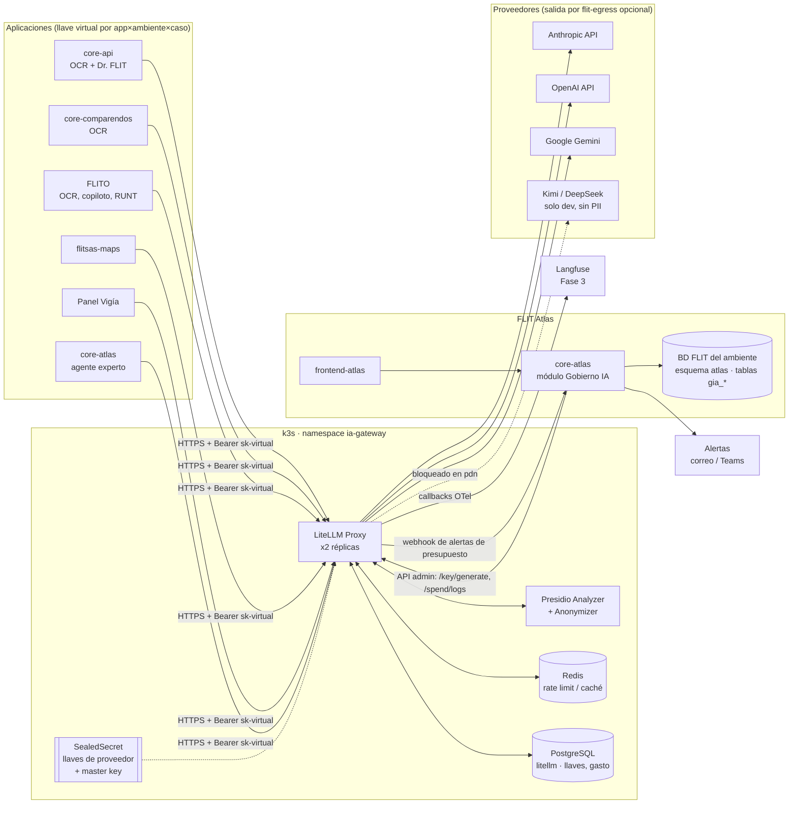
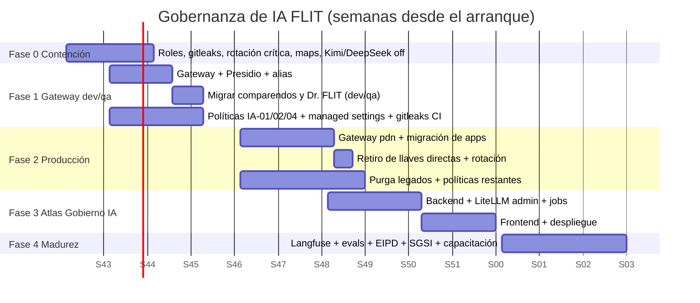

# 02 · Plan de trabajo de Gobernanza de IA — FLIT

| Campo | Valor |
|---|---|
| Documento | 02-plan-gobernanza-ia.md |
| Serie | Plataforma Central FLIT («FLIT Atlas») — ver `00-plan-maestro-plataforma-central.md` |
| Versión | 1.0 (borrador para implementación) |
| Fecha | 2026-10-20 |
| Autor | Jorman Copete (con Claude Code) |
| Estado | Propuesto — pendiente de aprobación del Comité de IA |
| Convención | Lo marcado **[por verificar]** no se confirmó al escribir este documento; verifíquelo antes de ejecutar. |

---

## Índice

1. [Resumen ejecutivo](#1-resumen-ejecutivo)
2. [Objetivos y alcance](#2-objetivos-y-alcance)
3. [Diagnóstico: estado actual de la IA en FLIT](#3-diagnóstico-estado-actual-de-la-ia-en-flit)
4. [Modelo organizacional (roles y RACI)](#4-modelo-organizacional)
5. [Marco normativo aplicado a FLIT](#5-marco-normativo-aplicado-a-flit)
6. [Políticas a redactar](#6-políticas-a-redactar)
7. [Inventario de casos de uso de IA](#7-inventario-de-casos-de-uso-de-ia)
8. [Evaluación de riesgo e impacto](#8-evaluación-de-riesgo-e-impacto)
9. [Arquitectura técnica: AI Gateway](#9-arquitectura-técnica-ai-gateway)
10. [Plan de migración aplicación por aplicación](#10-plan-de-migración-aplicación-por-aplicación)
11. [Módulo Gobierno IA (`gia_*`) en FLIT Atlas](#11-módulo-gobierno-ia-gia_-en-flit-atlas)
12. [Control de herramientas de IA del equipo](#12-control-de-herramientas-de-ia-del-equipo)
13. [Observabilidad y evaluación](#13-observabilidad-y-evaluación)
14. [Saneamiento urgente de secretos](#14-saneamiento-urgente-de-secretos)
15. [Indicadores (KPI)](#15-indicadores-kpi)
16. [Plan de trabajo por fases](#16-plan-de-trabajo-por-fases)
17. [Riesgos y decisiones pendientes](#17-riesgos-y-decisiones-pendientes)
18. [Cómo arrancar en una nueva sesión de Claude](#18-cómo-arrancar-en-una-nueva-sesión-de-claude)
19. [Anexos](#19-anexos)

---

## 1. Resumen ejecutivo

FLIT ya usa IA en producción en al menos **cinco aplicaciones**: Flit 2.0 (`core-api` y `core-comparendos`), FLITO, flitsas-maps, Panel Vigía y el legado `BackCrudInfractionOcr` (Google Document AI). Cada una integra al proveedor por su cuenta, con su propia llave en variables de entorno, sin registro central de casos de uso, sin presupuestos por aplicación y sin enmascaramiento de datos personales antes de enviarlos al proveedor. El equipo usa además asistentes de código (Claude Code, Cursor) sin una política formal.

Lo que ya existe y sirve de base:

- En Flit 2.0, un **router multiproveedor** con failover, auditoría de transiciones y pantalla de SuperAdmin (ADR-0070, Feature #13508).
- Prompts versionados con evaluación previa a la publicación en `core-comparendos`.
- Consentimientos y cuotas en Dr. FLIT.
- En `flit-infra-studio`, un **SGSI ISO 27001** con políticas de clasificación (POL-SGSI-02), criptografía y llaves, nube, proveedores TIC (POL-20), logging (SGSI-POL-A815) y habeas data (POL-18).

La gobernanza de IA **se monta sobre ese SGSI**; no se crea un sistema paralelo.

La propuesta tiene cuatro piezas:

1. **Organización y políticas.** Comité de IA, Responsable de IA, Oficial de Protección de Datos y dueños de caso de uso, con siete políticas nuevas integradas al SGSI.
2. **AI Gateway único**: LiteLLM Proxy en k3s, namespace `ia-gateway`. Las llaves de los proveedores solo viven allí; las aplicaciones usan llaves virtuales por aplicación y ambiente, con presupuesto, límite de tasa, alias de modelo y Presidio para enmascarar PII colombiana.
3. **Módulo Gobierno IA (`gia_*`) en FLIT Atlas** (`services/core-atlas` + `frontend-atlas`). Contiene el inventario de casos de uso, las evaluaciones de riesgo, las políticas y aceptaciones, la gestión de llaves virtuales (vía la API admin de LiteLLM), los costos y el inventario de herramientas del equipo.
4. **Control de asistentes de código y saneamiento de secretos.** `managed-settings.json` de Claude Code, reglas de Cursor, gitleaks en todos los repos, y rotación y purga de las credenciales versionadas en los 27 repos legados.

Esfuerzo estimado: **8–12 semanas** con 1 persona técnica principal y apoyo parcial (Responsable de IA y Oficial de Datos). La Fase 0 (secretos) y la Fase 1 (gateway) pueden arrancar de inmediato.

---

## 2. Objetivos y alcance

### 2.1 Objetivo general

Que todo uso de IA en FLIT sea **conocido, autorizado, trazable, con costo controlado y conforme a la Ley 1581/2012**, y que se pueda demostrar ante clientes (organismos de tránsito), auditores ISO 27001 y la SIC.

### 2.2 Los cuatro frentes

| # | Frente | Objetivo | Resultado verificable |
|---|---|---|---|
| F1 | **Llaves y costos** | Ninguna aplicación tiene llaves de proveedor. Todo el consumo pasa por el gateway con presupuesto. | 100 % del tráfico LLM por el gateway; costo mensual por aplicación y ambiente visible en Atlas; alertas al 80 % del presupuesto. |
| F2 | **Cumplimiento y datos** | Cada caso de uso tiene base legal, clasificación de datos, evaluación de riesgo y control de PII. | Inventario completo con ficha aprobada; registro de transferencias internacionales; Presidio activo en los casos con PII. |
| F3 | **Herramientas del equipo** | Saber quién usa qué asistente, con qué plan, sobre qué repos y con qué restricciones. | Inventario de asientos; política firmada; `managed-settings.json` desplegado; gitleaks en todos los repos. |
| F4 | **IA dentro de los productos** | Las funciones de IA que FLIT ofrece a clientes son transparentes, tienen humano en el bucle cuando aplica y se evalúan antes de cambiar el prompt o el modelo. | Ficha del caso de uso publicada; evals en CI para prompts críticos; avisos de transparencia en la UI. |

### 2.3 Dentro del alcance

- Todas las llamadas a LLM y servicios de IA en la nube (Anthropic, OpenAI, Kimi, DeepSeek, Google Gemini y Google Document AI).
- Todos los repos de la organización `flitsas`, más los repos de la empresa alojados en cuentas personales (flitsas-maps).
- Los ambientes dev, qa y pdn de los clústeres k3s 177 (dev/qa) y 169 (pdn), la VPS 145 (Panel Vigía, FLITO) y los servidores docker que queden.
- Los asistentes de código y chats de IA usados por empleados y contratistas.

### 2.4 Fuera del alcance (por ahora)

- Entrenar o afinar modelos propios.
- Certificarse en ISO/IEC 42001 (se usa como referencia; se certifica solo si un cliente lo exige).
- La IA de proveedores SaaS que FLIT consume sin integrarla (Office, Google Workspace). Basta con inventariarla.

---

## 3. Diagnóstico: estado actual de la IA en FLIT

### 3.1 Integraciones encontradas en el código (2026-10-20)

| # | Aplicación / repo | Dónde | Proveedor / modelo | Cómo obtiene la llave | Controles existentes |
|---|---|---|---|---|---|
| 1 | **Flit 2.0 · core-api · OCR de documentos** | `services/core-api/src/Flit.Infrastructure/Ocr/Anthropic*.cs`, prompts en `Tramites.Application/Ocr/DocumentOcrPrompts.cs`, endpoints `/ocr/{tipo}` y `/ocr/lote` | Anthropic `claude-haiku-4-5` por defecto; router con failover a OpenAI, Kimi y DeepSeek | Variables `ANTHROPIC_API_KEY`, `OPENAI_API_KEY`, `KIMI_API_KEY`, `DEEPSEEK_API_KEY` (`AiApiKeyEnvironmentProbe.cs`); SealedSecret en flit2-dev/qa/pdn | Router (`AiProviderRouter`, `AiProviderQueue`); tablas `admin.ai_tool_provider_settings`, `admin.ai_provider_transitions`, `admin.ai_failover_alerts` (Ddl/130); pantalla SuperAdmin `/api/v1/admin/plataforma/ai`; ADR-0070 |
| 2 | **Flit 2.0 · core-api · Dr. FLIT** | `services/core-api/src/Flit.DrFlit.Application/`, `Infrastructure/DrFlit/` (`AnthropicDrFlitChatModel`, `RoutedDrFlitChatModel`), `/api/v1/dr-flit` | Anthropic Haiku 4.5 (catálogo del manual dentro del prompt) | Igual que el anterior | Cuota de 30 mensajes por día; consentimiento (`dr_flit.*`, DDL 119–121); escalamiento de casos a ADO; ADR-0060 |
| 3 | **Flit 2.0 · core-comparendos · OCR de comparendos** | `services/core-comparendos/.../Modulos/Ocr/ProveedorOcr.cs`, `PromptsOcrEndpoints.cs`, semilla `PromptOcrSemilla.cs` | Anthropic `claude-haiku-5-5` (semilla); admite ANTHROPIC, OPENAI y GEMINI por prompt | Variables de entorno **[por verificar el nombre exacto]** | **Prompts versionados con evaluación antes de publicar** (la mejor práctica actual de FLIT) |
| 4 | **FLITO · OCR de documentos e identidad** | `D:\FLIT\Code\flito\apps\api\src\modules\tramites\ocr-docs.routes.ts`, `identidad.routes.ts`, `drive/procesador.service.ts`, `runt/runt.routes.ts` | Anthropic `claude-haiku-4-5-20251001` y `claude-sonnet-4-6` (en `config/env.ts`) | Variable de entorno; SealedSecret en flito-dev/qa; PDN en la VPS 145 | Health-check de Anthropic; pruebas del pipeline de OCR |
| 5 | **FLITO · copiloto del checklist** | `apps/api/src/modules/tramites/copiloto.ts` | Anthropic Haiku 4.5 | Igual | **Humano en el bucle, sin PII en el prompt, salida validada con Zod, descarte de ítems alucinados, aviso legal.** Es el modelo a seguir para F4. |
| 6 | **FLITO · SOAT, impuestos y RUNT** | `runt.routes.ts` y módulos de SOAT e impuestos **[por verificar las rutas exactas]** | Anthropic Sonnet 4.6 / Haiku 4.5 | Igual | — |
| 7 | **flitsas-maps · inteligencia de comparendos** | `D:\FLIT\Code\flitsas-maps\src\app\api\inteligencia\ai\route.ts` | Anthropic `claude-haiku-4-5-20251001` | `process.env.ANTHROPIC_API_KEY` | **Ninguno.** Repo en cuenta personal (`juan-gomez-flitio`); `.pfx` y `comparendos.xlsx` versionados; app sin autenticación por decisión previa. |
| 8 | **flitsas-maps · normalización de ubicaciones** | `src/app/api/locations/process/route.ts` | Anthropic | Igual | Ninguno |
| 9 | **Panel Vigía · chat operativo** | `D:\FLIT\Code\flit-infra-studio\panel-vigia\backend\chat.py` | Anthropic (SDK con *adaptive thinking*); modo `api` con `ANTHROPIC_API_KEY` o perfil de CLI | Variable de entorno o perfil local de Anthropic | **Whitelist de comandos como tools y humano en el bucle** (el modelo propone y el humano ejecuta) |
| 10 | **Legado · BackCrudInfractionOcr** | `D:\FLIT\Code\BackCrudInfractionOcr\src\infrastructure\proxies\gcpApiProxy.ts` | **Google Document AI** (procesador en `us`, proyecto 744152990081) | **`gcp-json-key.json` con llave privada VERSIONADA en git**; `.env` versionado | Ninguno. Riesgo crítico. |
| 11 | **Asistentes de código** | `.cursor/` en flit (12 agentes, 26 skills, 6 reglas, `sync-to-claude.ps1` hacia `.claude/`); `.claude/agents/*` en flit-infra-studio (11 agentes); `CLAUDE.md`/`AGENTS.md` en varios repos | Claude Code, Cursor y Antigravity (`.antigravity/` en flit-infra-studio) **[por verificar el inventario de asientos y planes]** | Cuentas personales o de equipo **[por verificar]** | Sin política formal ni managed settings |
| 12 | **Agentes de infraestructura** | `flit-infra-studio/orquestadores/`, `subagentes/`, `AgenterAWS/`, `.agents/skills/*` | Claude (Claude Code) **[por verificar si alguno llama a la API directamente]** | — | Algunos tienen usuarios de BD dedicados con privilegios mínimos (por ejemplo agent_DBA_VPS) |

### 3.2 Hallazgos clave

1. **Fragmentación de llaves.** La misma llave de Anthropic (o varias, **[por verificar]**) está repartida entre al menos 4 sistemas y 3 servidores. No se sabe cuánto gasta cada aplicación y rotar una llave obliga a tocar varios despliegues.
2. **Modelos fijados en el código.** FLITO y maps tienen nombres de modelo (`claude-haiku-4-5-20251001`, `claude-sonnet-4-6`) escritos en el código. Cambiar de modelo exige un despliegue y conviven tres generaciones de modelos (4.5, 4.6 y 5.5).
3. **Datos personales hacia el proveedor sin enmascarar.** El OCR de cédulas, licencias, tarjetas de propiedad y comparendos envía imágenes con PII a EE. UU. Es inherente al caso de uso y por eso exige base legal, aviso y registro de transferencia, no solo enmascaramiento. Presidio solo aplica al **texto**: para imágenes, el control es contractual (retención cero o mínima del proveedor) y de minimización.
4. **Proveedores de alto riesgo habilitados.** Kimi (Moonshot) y DeepSeek están en el catálogo del router de Flit 2.0 (`AiProviderCodes`). Enviarles PII de ciudadanos colombianos implica transferencia a China, sin declaración de conformidad de la SIC **[por verificar]**, y sin contrato de transmisión.
5. **Credenciales versionadas.** Hay `.env` en los 27 repos legados, la llave GCP de Document AI y el `.pfx` de maps. Ver §14.
6. **Buenas prácticas aisladas que conviene volver estándar:** prompts versionados con evals (comparendos), humano en el bucle con salida validada (copiloto de FLITO), whitelist de tools (Vigía), consentimiento y cuota (Dr. FLIT), y failover auditado (router de Flit 2.0).
7. **El SGSI ya existe pero no menciona la IA** **[por verificar el contenido de POL-SGSI-02, POL-18, POL-20 y MAT-01]**. Se deben extender la matriz legal MAT-01, la política de proveedores POL-20 y la de clasificación POL-SGSI-02.

---

## 4. Modelo organizacional

FLIT es una empresa mediana con un equipo técnico pequeño, así que los roles se **acumulan** en pocas personas. Lo importante es que cada responsabilidad tenga nombre propio.

### 4.1 Roles

| Rol | Quién (propuesta) | Responsabilidades | Dedicación |
|---|---|---|---|
| **Comité de IA** | Gerencia (preside), Responsable de IA, Oficial de Protección de Datos, Líder de Seguridad/SGSI, un representante de producto | Aprueba políticas, proveedores y casos de uso de riesgo **alto**; revisa KPI y costos cada trimestre; decide sobre incidentes graves. | 1 h al mes, más sesiones extraordinarias |
| **Responsable de IA** (AI Owner) | Líder técnico de plataforma **[definir persona]** | Opera el gateway y el módulo Gobierno IA de Atlas; mantiene el inventario; aprueba casos de riesgo **bajo/medio**; emite y revoca llaves virtuales; presupuestos; evals. | 15–20 % |
| **Oficial de Protección de Datos** (OPD) | Quien ya tenga el rol de habeas data (POL-18) **[definir]** | Valida la base legal, el aviso de privacidad, las transferencias internacionales y la evaluación de impacto en privacidad; atiende consultas y reclamos de titulares relacionados con IA. | 5–10 % |
| **Líder de Seguridad / SGSI** | Responsable actual del SGSI (Panel Vigía / Daniel Mejía **[confirmar]**) | Integra la IA en el SGSI (SoA, MAT-01, riesgos); gestión de incidentes; revisión de secretos; managed settings. | 5–10 % |
| **Dueño de caso de uso** | Líder funcional o técnico de cada aplicación (Flit 2.0, FLITO, maps, Vigía, legado) | Llena y mantiene la ficha; define métricas de calidad; aprueba cambios de prompt o modelo; responde por los incidentes del caso. | Según el caso |
| **Desarrolladores y usuarios** | Todo el personal y los contratistas | Cumplir la política de uso aceptable; reportar incidentes; no usar llaves de proveedor directas. | — |

### 4.2 Matriz RACI

R = ejecuta · A = rinde cuentas (aprueba) · C = consultado · I = informado

| Actividad | Comité | Resp. IA | OPD | Seguridad | Dueño caso | Desarrollo |
|---|---|---|---|---|---|---|
| Aprobar políticas de IA | A | R | C | C | I | I |
| Aprobar un proveedor o modelo nuevo | A | R | C | C | C | I |
| Registrar un caso de uso nuevo | I | C | C | C | **A/R** | C |
| Aprobar un caso de riesgo bajo/medio | I | **A** | C | C | R | I |
| Aprobar un caso de riesgo alto | **A** | R | C | C | R | I |
| Evaluación de impacto en privacidad | I | C | **A** | C | R | I |
| Emitir o rotar una llave virtual | I | **A/R** | I | C | C | I |
| Rotar una llave de proveedor | I | R | I | **A** | I | I |
| Cambiar el prompt o modelo de un caso en pdn | I | C | I | I | **A** | R |
| Definir y vigilar el presupuesto | C | **A/R** | I | I | C | I |
| Gestionar un incidente de IA | I (A si es grave) | R | C (R si hay datos) | **A** | R | C |
| Inventario de asientos de asistentes | I | **A/R** | I | C | I | I |
| Capacitación anual en IA | A | R | C | R | I | I |

### 4.3 Cadencias

- **Semanal:** el Responsable de IA revisa las alertas de costo y errores del gateway (15 min).
- **Mensual:** reporte automático de Atlas (costo por aplicación, casos vencidos de revisión, llaves sin uso) al Comité.
- **Trimestral:** reunión del Comité con KPI, revisión de proveedores e incidentes.
- **Anual:** revisión completa de políticas, recertificación de casos de uso y capacitación.

---

## 5. Marco normativo aplicado a FLIT

### 5.1 Normas exigibles

| Norma | Qué exige | Cómo aplica a FLIT | Evidencia en Atlas |
|---|---|---|---|
| **Ley 1581 de 2012 y Decreto 1377 de 2013** (incorporado en el Decreto 1074 de 2015) | Principios de finalidad, libertad, veracidad, transparencia, acceso, seguridad y confidencialidad; autorización del titular; aviso de privacidad; política de tratamiento; registro de bases en el RNBD | El OCR de cédulas, licencias y comparendos trata datos personales (algunos sensibles: foto y firma, que son datos biométricos **[por verificar con el OPD si la imagen facial en la cédula se trata como biométrico]**). Hay que revisar si las finalidades declaradas en la política actual (POL-18) cubren el procesamiento por IA. | Ficha de caso: base legal, finalidad, categorías de datos, referencia a la autorización |
| **Ley 1581, art. 26 (transferencia internacional)** | Prohíbe transferir datos a países sin nivel adecuado de protección, salvo excepciones (consentimiento expreso, contratos, etc.). La SIC publica la lista de países adecuados. La **transmisión** a un encargado se rige por el Decreto 1377, art. 25 (contrato de transmisión). | Anthropic y OpenAI procesan en EE. UU. (la SIC lo reconoce como país adecuado **[por verificar la lista vigente]**). Google Document AI en región `us`. **Kimi y DeepSeek (China): no adecuado → requiere contrato de transmisión y probablemente declaración de conformidad; recomendación: prohibirlos para datos personales.** | Registro de transferencias por proveedor; contrato o DPA del proveedor adjunto |
| **Ley 1266 de 2008** (habeas data financiero) | Aplica a datos de crédito | Aplica si algún caso de uso toca información financiera o crediticia (por ejemplo impuestos en FLITO) **[por verificar]**. | Marca en la ficha |
| **SIC – Circular Externa 002 del 21-ago-2024** | Instrucciones sobre el tratamiento de datos personales en sistemas de IA: idoneidad, necesidad, razonabilidad y proporcionalidad; evaluar riesgos antes de diseñar o desarrollar; responsabilidad demostrada (identificar, medir, controlar y monitorear riesgos); privacidad desde el diseño y por defecto; medidas para garantizar la calidad y veracidad de los datos; abstenerse de tratar si no se pueden mitigar los riesgos **[por verificar la redacción exacta de cada numeral]** | Es **la norma central** de este plan. La ficha de caso de uso (§7) y la evaluación de riesgo (§8) están diseñadas para producir esa evidencia. | Ficha + evaluación de riesgo + registro de decisiones del Comité |
| **Ley 1712 de 2014** (transparencia) y obligaciones contractuales con entidades públicas | Los organismos de tránsito son sujetos obligados y sus contratos suelen exigir confidencialidad, ubicación de datos y seguridad | Los contratos con clientes públicos pueden **restringir** el envío de datos al exterior. | Campo «restricciones contractuales» por cliente **[revisar contratos]** |
| **ISO/IEC 27001:2022** (SGSI de FLIT, en implementación) | Controles A.5.19–A.5.23 (proveedores y nube), A.8.11 (enmascaramiento), A.8.12 (prevención de fuga), A.5.34 (privacidad y PII), A.8.15 (logging) | Los proveedores de IA son proveedores de nube y deben pasar por POL-20/PRO-20. | Vínculo con SoA (`ISO_27001_SGSI/datos/SoA_Controles_ISO27001_2022.csv`) |

### 5.2 Marcos orientadores (no vinculantes)

| Marco | Uso en FLIT |
|---|---|
| **CONPES 4144 de 2025** (Política Nacional de IA) | Orientador; alinear el lenguaje de ética, gobernanza y mitigación de riesgos. No crea obligaciones directas para privados. |
| **NIST AI RMF 1.0 + perfil GenAI (NIST AI 600-1)** | Checklist de riesgos de IA generativa: confabulación, privacidad, seguridad de la información, propiedad intelectual, contenido dañino y cadena de suministro. Las funciones GOVERN/MAP/MEASURE/MANAGE estructuran este plan. |
| **ISO/IEC 42001:2023** (sistema de gestión de IA) | Se usa como estructura de referencia, compatible con 27001 por la estructura armonizada. Certificación solo si un cliente la exige. |
| **ISO/IEC 23894** (gestión de riesgo de IA) | Referencia para la metodología de §8. |
| **OWASP Top 10 for LLM Applications (2025)** | Base de los controles técnicos: inyección de prompt, fuga de información sensible, manejo inseguro de la salida, agencia excesiva y consumo ilimitado. |
| **EU AI Act** | Solo aplica si FLIT ofrece sistemas en la UE. Hoy no aplica; revisar cada año. |

### 5.3 Correspondencia entre NIST AI RMF y este plan

| Función NIST | Secciones de este plan |
|---|---|
| GOVERN | §4 organización, §6 políticas, §12 herramientas del equipo |
| MAP | §7 inventario, §8 evaluación de riesgo |
| MEASURE | §13 observabilidad y evals, §15 KPI |
| MANAGE | §9–10 gateway y controles, §14 secretos, política de incidentes (§6.6) |

---

## 6. Políticas a redactar

Todas se integran al SGSI con la codificación existente (`POL-SGSI-xx`) y se almacenan en dos formas: **Markdown en git** (repo `flit-infra-studio/ISO_27001_SGSI/`; **no** en `flit`, porque `flitsas/flit` es público; ver D3 y D11) y **publicadas en Atlas** con versión y registro de aceptación por persona.

Numeración propuesta (se ajusta a la siguiente libre del SGSI):

| Código | Política | Extiende |
|---|---|---|
| POL-SGSI-IA-01 | Uso aceptable de IA | POL-SGSI-07 (navegación), POL-16 (software) |
| POL-SGSI-IA-02 | Clasificación de datos para IA | POL-SGSI-02 (clasificación) |
| POL-SGSI-IA-03 | Proveedores y modelos aprobados | POL-20 / PRO-20 (proveedores TIC), Política de nube |
| POL-SGSI-IA-04 | Gestión de llaves de IA | Política de criptografía y gestión de llaves; POL-SGSI-09 |
| POL-SGSI-IA-05 | Desarrollo con asistentes de código | PRO-15 (gestión de cambios DevSecOps) |
| POL-SGSI-IA-06 | Gestión de incidentes de IA | Procedimiento de incidentes del SGSI **[por verificar si existe]** |
| POL-SGSI-IA-07 | Retención de prompts, respuestas y logs | SGSI-POL-A815 (logging), POL-02 (eliminación segura) |

### 6.1 POL-SGSI-IA-01 · Uso aceptable de IA

**Índice:**
1. Objetivo y alcance (empleados, contratistas, practicantes; todas las herramientas de IA).
2. Definiciones (IA generativa, asistente, agente, prompt, dato personal, dato sensible).
3. Herramientas autorizadas (remite a la lista viva en Atlas).
4. Usos permitidos.
5. Usos prohibidos.
6. Reglas sobre datos (remite a IA-02).
7. Verificación humana y responsabilidad sobre la salida.
8. Propiedad intelectual y confidencialidad.
9. Transparencia hacia clientes y ciudadanos.
10. Reporte de incidentes.
11. Sanciones.
12. Aceptación.

**Puntos clave:**
- Solo se usan las **herramientas de la lista aprobada**, con **cuentas corporativas** (nunca cuentas personales gratuitas para datos de FLIT).
- **Prohibido** pegar en un chat de IA no aprobado: datos personales de ciudadanos, credenciales, código de repos privados, contratos, información de clientes y datos de bases de producción.
- **Prohibido** que un agente o asistente ejecute acciones irreversibles en pdn sin aprobación humana (despliegues, borrados, envíos a entidades). El patrón de Vigía (el modelo propone y el humano ejecuta) es obligatorio para agentes con herramientas sobre infraestructura.
- Quien usa la salida de la IA **responde por ella**: revisión obligatoria antes de comprometer código, documentos para clientes o decisiones sobre trámites.
- **Ninguna decisión con efecto jurídico sobre un ciudadano** (rechazo de trámite, multa, validación de identidad) puede tomarla solo la IA: humano en el bucle obligatorio.
- Uso de IA en productos: aviso visible al usuario («respuesta generada con IA; verifique»), como ya hace el copiloto de FLITO.

### 6.2 POL-SGSI-IA-02 · Clasificación de datos para IA

**Índice:**
1. Niveles de clasificación (alineados a POL-SGSI-02).
2. Matriz nivel × destino de IA.
3. Reglas de minimización.
4. Enmascaramiento obligatorio.
5. Datos de entrenamiento y retención del proveedor.
6. Excepciones.

**Matriz propuesta** (ajustar los nombres de nivel a los de POL-SGSI-02 **[por verificar]**):

| Nivel | Ejemplos FLIT | Asistentes de código / chat corporativo | Gateway, proveedor aprobado nivel A (EE. UU., retención cero o mínima) | Proveedor nivel B (Kimi, DeepSeek u otros no adecuados) |
|---|---|---|---|---|
| **Público** | Documentación pública, manual de usuario | ✅ | ✅ | ✅ |
| **Interno** | Código fuente, arquitectura, ADR | ✅ (cuenta corporativa) | ✅ | ⚠️ solo con aprobación del Comité |
| **Confidencial** | Contratos, tarifas, datos de clientes empresariales, secretos de configuración (sin valores) | ⚠️ sin documentos completos | ✅ | ❌ |
| **Dato personal** | Nombre, cédula, placa, dirección, teléfono, correo del ciudadano | ❌ | ✅ con base legal, ficha aprobada y Presidio en texto libre | ❌ |
| **Dato sensible / biométrico** | Foto facial, firma, huella, salud | ❌ | ⚠️ solo casos aprobados por el Comité con evaluación de impacto (p. ej. OCR de cédula) | ❌ |
| **Secretos** | Llaves, contraseñas, tokens, certificados | ❌ nunca | ❌ nunca | ❌ nunca |

**Reglas de minimización:**
- Enviar al modelo **solo los campos necesarios**. Ejemplo: el copiloto de FLITO envía ids y etiquetas del checklist, no datos del ciudadano.
- Recortar las imágenes a la región necesaria cuando sea viable.
- No registrar en logs propios el contenido completo con PII (ver IA-07).
- Para texto libre que va al modelo, Presidio en modo `mask` con los reconocedores colombianos de §9.6.

### 6.3 POL-SGSI-IA-03 · Proveedores y modelos aprobados

**Índice:**
1. Criterios de evaluación.
2. Niveles de proveedor.
3. Lista aprobada (viva en Atlas).
4. Proceso de alta y baja.
5. Revisión anual.
6. Salida (exit plan).

**Criterios:**
- País de procesamiento y adecuación según la SIC.
- DPA o términos de procesamiento de datos.
- Retención de entradas y salidas, y si se usan para entrenamiento.
- Certificaciones (SOC 2, ISO 27001).
- Disponibilidad de retención cero (ZDR).
- Soporte de región.
- Historial de incidentes.
- Costo.
- Calidad en evals propios.

**Lista inicial propuesta:**

| Proveedor | Nivel | Uso permitido | Notas |
|---|---|---|---|
| Anthropic (API directa) | **A** | Todos los niveles hasta sensible (con aprobación) | Proveedor principal. Verificar las condiciones comerciales de retención de datos y la opción de ZDR **[por verificar]**. |
| OpenAI (API) | A | Fallback | Mismas verificaciones. |
| Google (Gemini API / Document AI) | A | Document AI en uso legado; Gemini como opción en comparendos | Verificar región y términos del proyecto GCP 744152990081. |
| Kimi (Moonshot AI) | **B** | Solo datos públicos o internos sin PII, con aprobación | China, sin adecuación. **Recomendación: desactivar en pdn.** |
| DeepSeek | **B** | Igual que Kimi | Igual. **Recomendación: desactivar en pdn.** |
| Modelos locales (self-hosted) | A (los datos no salen) | Futuro | No hay hoy. |

**Modelos aprobados por alias** (el código solo conoce el alias; ver §9.5):

| Alias | Modelo primario | Fallback | Uso |
|---|---|---|---|
| `flit-asistente-principal` | `claude-sonnet-5-5` | `gpt-…` **[por definir]** | Agentes y chat con razonamiento (Dr. FLIT avanzado, Atlas, Vigía) |
| `flit-rapido` | `claude-haiku-5-5` | `claude-haiku-4-5` | Chat corto, clasificación, copiloto |
| `flit-ocr` | `claude-haiku-5-5` (visión) | `claude-sonnet-5-5` | OCR de documentos de tránsito |
| `flit-ocr-preciso` | `claude-sonnet-5-5` | — | Reintento en OCR de baja confianza |
| `flit-embeddings` | **[por definir]** (Anthropic no ofrece embeddings propios; evaluar Voyage AI u OpenAI `text-embedding-3-*`) | — | RAG del agente experto (documento 03) |

### 6.4 POL-SGSI-IA-04 · Gestión de llaves de IA

**Puntos clave:**
- **Las llaves de proveedor solo existen en el gateway**, como SealedSecret en `flit-gitops` (namespace `ia-gateway`). Ninguna aplicación, `.env`, appsettings o pipeline las tiene.
- Las aplicaciones usan **llaves virtuales** de LiteLLM:
  - Una por **aplicación × ambiente × caso de uso** (p. ej. `flit2-pdn-ocr`, `flito-qa-copiloto`).
  - Con presupuesto mensual, límite de tasa (RPM y TPM) y lista de alias permitidos.
- Nomenclatura: `<app>-<ambiente>-<caso>`. El alias de la llave en LiteLLM coincide con el código del caso en Atlas.
- **Rotación:**
  - Llaves de proveedor cada 90 días y ante cualquier sospecha.
  - Llaves virtuales cada 180 días, o al retirarse una persona con acceso al secreto.
- **Revocación** automática de llaves virtuales sin uso en 60 días (alerta a los 45).
- **Llaves personales de desarrolladores:** llave virtual personal en el ambiente `dev` con un presupuesto bajo (p. ej. USD 20 al mes). Nunca llaves de proveedor personales para trabajo de FLIT.
- Las llaves virtuales viven en SealedSecret por aplicación y ambiente en `flit-gitops` (como hoy `ANTHROPIC_API_KEY`), con un nombre nuevo: `FLIT_AI_GATEWAY_KEY`.
- Registro en Atlas: quién emitió, cuándo, para qué caso y el último uso. El valor se muestra **una sola vez** al crearla.

### 6.5 POL-SGSI-IA-05 · Desarrollo con asistentes de código

**Puntos clave:**
- **Herramientas autorizadas:** Claude Code (plan Team/Enterprise **[decidir]**) y Cursor (plan Business con *Privacy Mode* obligatorio **[por verificar el nombre actual del plan]**). Cualquier otra (Antigravity, Copilot, Windsurf) requiere aprobación del Responsable de IA.
- **Configuración gestionada:** `managed-settings.json` de Claude Code instalado en todos los equipos (§12.2).
- **Prohibido** que el asistente lea `.env`, `secrets/`, `*.pfx`, `*.pem`, `*-key.json` o `kubeconfig`, y que ejecute `kubectl` contra pdn, `ssh` a servidores de pdn, `git push --force` o `rm -rf`.
- **Acceso a datos de producción:** el asistente nunca se conecta a BD de pdn. Para diagnóstico se usan réplicas anonimizadas o usuarios de solo lectura con vistas sin PII (siguiendo el patrón agent_DBA_VPS de flit-infra-studio).
- **Revisión:** todo código generado pasa por PR con revisión humana. Los mensajes de commit llevan la línea `Co-Authored-By` del asistente, para trazabilidad.
- **Agentes y skills versionados:** la fuente es `.cursor/` en `flit`, sincronizada a `.claude/`. Los cambios a agentes que operen infraestructura se revisan como código.
- **Repos en cuentas personales prohibidos:** todo repo de la empresa vive en la organización `flitsas` (acción inmediata con flitsas-maps).
- **Secretos:** gitleaks como pre-commit y en CI en todos los repos (§14.4).

### 6.6 POL-SGSI-IA-06 · Gestión de incidentes de IA

**Tipos de incidente:**

| Código | Tipo | Ejemplo |
|---|---|---|
| INC-IA-01 | Fuga de datos hacia un proveedor no aprobado | Alguien pegó cédulas en un chat personal |
| INC-IA-02 | Llave de proveedor o virtual expuesta | Llave en un commit, log o captura |
| INC-IA-03 | Salida dañina o incorrecta con impacto | OCR que lee mal una placa y genera un trámite erróneo; Dr. FLIT da una instrucción falsa |
| INC-IA-04 | Inyección de prompt o abuso | Un usuario manipula a Dr. FLIT para extraer el prompt o los datos de otros |
| INC-IA-05 | Consumo anómalo / costo | Un bucle que gasta USD 500 en una hora |
| INC-IA-06 | Caída del proveedor | Anthropic indisponible y sin failover |
| INC-IA-07 | Acción indebida de un agente | Un asistente ejecuta un comando destructivo |

**Severidad y respuesta:**

| Severidad | Criterio | Tiempo de respuesta | Notifica a |
|---|---|---|---|
| S1 crítica | PII expuesta a terceros no autorizados o llave de proveedor comprometida | 1 h | Comité, OPD; evaluar reporte a la SIC (Ley 1581, deber de informar incidentes de seguridad **[por verificar el plazo vigente en el RNBD]**) |
| S2 alta | Error con impacto en trámites de ciudadanos o costo > 3× el presupuesto | 4 h | Resp. IA, Dueño del caso, Seguridad |
| S3 media | Degradación o costo anómalo contenido | 1 día hábil | Resp. IA |
| S4 baja | Hallazgo sin impacto | 1 semana | Registro |

**Playbooks mínimos:**
- **Llave expuesta:**
  1. Revocar en el gateway (llave virtual) o en la consola del proveedor (llave de proveedor).
  2. Emitir una nueva y actualizar el SealedSecret.
  3. Revisar el gasto del periodo.
  4. Purgar el historial si estaba en git (§14).
  5. Registrar en Atlas.
- **Costo anómalo:**
  1. El presupuesto del gateway bloquea automáticamente.
  2. Investigar el caso.
  3. Ajustar el límite de tasa.
- **Salida dañina:**
  1. Desactivar el caso o volver al prompt anterior. El versionado de prompts permite revertir en minutos.
  2. Notificar a los usuarios afectados.
  3. Agregar el caso a los evals.

Registro de incidentes: tabla `atlas.gia_incidente` (§11.2) enlazada al proceso de incidentes del SGSI.

### 6.7 POL-SGSI-IA-07 · Retención de prompts, respuestas y logs

| Dato | Dónde | Retención | Contenido |
|---|---|---|---|
| Metadatos de cada llamada (fecha, llave, alias, modelo, tokens, costo, latencia, estado) | BD de LiteLLM (`LiteLLM_SpendLogs`) y agregados en Atlas | 13 meses (comparación interanual) | **Sin contenido** |
| Contenido de prompt y respuesta | Langfuse (Fase 3), **solo para casos sin PII o con PII enmascarada** | 30 días en dev/qa; 30 días en pdn con muestreo (p. ej. 10 %) **[decidir]** | Enmascarado por Presidio |
| Contenido de casos con imágenes de documentos (OCR) | **No se guarda** en logs de IA; la imagen original vive en el storage de la aplicación con su propia política | — | — |
| Conversaciones de Dr. FLIT y del agente experto | BD de la aplicación, si el usuario dio consentimiento | 90 días **[decidir con el OPD]** | Lo que el usuario escribió |
| Registro de auditoría de gobierno (altas de llaves, aprobaciones, cambios de política) | Atlas `atlas.gia_auditoria` | 5 años | Quién, qué, cuándo |
| Retención en el proveedor | Según el contrato | Solicitar ZDR o la retención mínima posible | — |

Configuración de LiteLLM para no guardar contenido: `general_settings.disable_spend_logs` desactivado (se quieren los metadatos) y `litellm_settings.turn_off_message_logging: true` **[por verificar los nombres exactos en la versión instalada]**.

---

## 7. Inventario de casos de uso de IA

### 7.1 Ficha de caso de uso (campos)

Se implementa en la tabla `atlas.gia_caso_uso` (§11.2) y se presenta como formulario en Atlas.

| Sección | Campo | Tipo | Obligatorio |
|---|---|---|---|
| **Identificación** | Código (`app-caso`, p. ej. `flit2-ocr-documentos`) | texto único | ✅ |
| | Nombre | texto | ✅ |
| | Aplicación / repo | ref. catálogo de Atlas | ✅ |
| | Dueño del caso | persona | ✅ |
| | Estado: `borrador` · `en_revision` · `aprobado` · `en_produccion` · `suspendido` · `retirado` | enum | ✅ |
| | Ambientes habilitados | multi (dev, qa, pdn) | ✅ |
| **Propósito** | Descripción y problema que resuelve | texto largo | ✅ |
| | Tipo: OCR/extracción · chat/asistente · clasificación · generación · agente con herramientas · embeddings/RAG | enum | ✅ |
| | Usuarios afectados: interno · cliente empresarial · ciudadano | multi | ✅ |
| | ¿Produce decisiones con efecto sobre personas? | sí/no + descripción | ✅ |
| | Humano en el bucle: `ninguno` · `revision_posterior` · `aprobacion_previa` | enum | ✅ |
| **Datos** | Categorías de datos de entrada (público, interno, confidencial, personal, sensible) | multi | ✅ |
| | Tipos de PII (nombre, cédula, placa, dirección, teléfono, correo, foto, firma, otros) | multi | ✅ si hay PII |
| | Volumen estimado (llamadas al mes) | número | ✅ |
| | Base legal (autorización, contrato, obligación legal, interés público) y referencia | texto | ✅ si hay PII |
| | Minimización aplicada | texto | ✅ |
| | Presidio activo | sí/no + entidades | ✅ |
| **Proveedor y modelo** | Alias(es) del gateway usados | multi | ✅ |
| | Proveedores efectivos (resueltos desde el alias) | calculado | — |
| | País de procesamiento / transferencia internacional | calculado + nota | ✅ |
| | Llave(s) virtual(es) asociada(s) | ref. | ✅ |
| | Presupuesto mensual (USD) por ambiente | número | ✅ |
| **Calidad** | Métricas de calidad (p. ej. exactitud de campos del OCR ≥ 95 %) | texto | ✅ |
| | Suite de evals (ruta en el repo) | texto | ✅ si el riesgo es medio o alto |
| | Prompts versionados (dónde) | texto | ✅ |
| **Riesgo** | Evaluación de riesgo (§8): puntaje y nivel | ref. | ✅ |
| | Evaluación de impacto en privacidad (si hay PII) | ref. documento | ✅ si hay PII |
| | Controles aplicados | lista | ✅ |
| **Transparencia** | Aviso al usuario (texto y dónde aparece) | texto | ✅ si el usuario es externo |
| **Ciclo de vida** | Fecha de aprobación, aprobador | fecha / persona | — |
| | Próxima revisión (máx. 12 meses; 6 si el riesgo es alto) | fecha | ✅ |
| | ADR / historia ADO relacionada | enlaces | — |

### 7.2 Fichas prellenadas de los casos actuales

> Llenado a partir del código del 2026-10-20. El dueño de cada caso debe validarlo. «PII» = datos personales.

#### CU-01 · `flit2-ocr-documentos` — OCR de documentos de trámites (Flit 2.0)
- **Aplicación:** core-api (`Infrastructure/Ocr/Anthropic*.cs`, `DocumentOcrPrompts.cs`); endpoints `/ocr/{tipo}` y `/ocr/lote`.
- **Propósito:** extraer campos de cédulas, licencias, tarjetas de propiedad y otros soportes para prellenar trámites vehiculares.
- **Tipo:** OCR / extracción (visión).
- **Usuarios afectados:** gestores (clientes empresariales) y ciudadanos (titulares de los documentos).
- **Decisiones:** no decide; prellena campos que el gestor confirma **[verificar que siempre haya confirmación]**.
- **Humano en el bucle:** revisión posterior.
- **Datos:** **personales y sensibles** (foto, firma, número de documento, nombre, dirección, placa).
- **Proveedor actual:** Anthropic `claude-haiku-4-5` con failover a OpenAI, Kimi y DeepSeek configurable. **Riesgo: el failover podría enviar imágenes de cédulas a China.**
- **Alias propuesto:** `flit-ocr` (+ `flit-ocr-preciso`).
- **Presidio:** no aplica a imágenes. Aplicar a cualquier texto libre que acompañe.
- **Riesgo preliminar:** **ALTO** (datos sensibles, volumen, ciudadanos).
- **Controles pendientes:** retirar Kimi y DeepSeek del failover para este caso; evaluación de impacto en privacidad; aviso en la UI; evals de exactitud por tipo de documento.

#### CU-02 · `flit2-dr-flit` — Asistente Dr. FLIT
- **Aplicación:** core-api (`Flit.DrFlit.*`), `/api/v1/dr-flit`; frontend `/manual`.
- **Propósito:** responder dudas de uso del aplicativo de Trámites desde el manual; escalar casos de soporte a ADO.
- **Tipo:** chat / asistente (catálogo del manual dentro del prompt).
- **Usuarios afectados:** usuarios de clientes (gestores, funcionarios).
- **Humano en el bucle:** no aplica (informativo); el escalamiento lo crea un humano **[por verificar]**.
- **Datos:** lo que el usuario escriba (puede incluir PII sin querer). Hay consentimiento (`dr_flit.*`).
- **Proveedor:** Anthropic Haiku 4.5 vía router.
- **Alias propuesto:** `flit-rapido` (o `flit-asistente-principal` para preguntas complejas).
- **Presidio:** **sí**, sobre el mensaje del usuario (cédula, placa, teléfono, correo).
- **Cuota:** 30 mensajes por día (ya existe). Agregar presupuesto en el gateway.
- **Riesgo preliminar:** **MEDIO** (confabulación; inyección de prompt).
- **Controles pendientes:** evals de respuestas frecuentes; prueba de inyección de prompt; aviso «respuesta generada con IA». Evoluciona hacia el agente experto (documento 03).

#### CU-03 · `comparendos-ocr` — OCR de comparendos (GDC V2)
- **Aplicación:** core-comparendos (`Modulos/Ocr/ProveedorOcr.cs`, `PromptsOcrEndpoints.cs`).
- **Propósito:** extraer datos de comparendos (infractor, placa, código de infracción, fecha, lugar).
- **Tipo:** OCR / extracción.
- **Datos:** **personales** (infractor, documento, placa, dirección).
- **Proveedor:** Anthropic `claude-haiku-5-5` (semilla); admite OPENAI y GEMINI.
- **Alias propuesto:** `flit-ocr`.
- **Controles existentes:** prompts versionados con evaluación antes de publicar. **Reutilizar este patrón como estándar corporativo.**
- **Riesgo preliminar:** **ALTO** (datos personales; un comparendo mal leído tiene efecto sobre una persona).

#### CU-04 · `flito-ocr-documentos` — OCR e identidad en FLITO
- **Aplicación:** FLITO (`ocr-docs.routes.ts`, `identidad.routes.ts`, `drive/procesador.service.ts`).
- **Propósito:** OCR de documentos de trámites y validación de identidad para organismos de tránsito y CEA.
- **Datos:** **personales y sensibles**.
- **Proveedor:** Anthropic `claude-haiku-4-5-20251001` y `claude-sonnet-4-6` (escritos en el código).
- **Alias propuesto:** `flit-ocr`, `flit-ocr-preciso`.
- **Riesgo preliminar:** **ALTO**.
- **Controles pendientes:** sacar los modelos del código; gateway; evaluación de impacto en privacidad.

#### CU-05 · `flito-copiloto-checklist` — Copiloto del checklist de trámites
- **Aplicación:** FLITO (`modules/tramites/copiloto.ts`).
- **Propósito:** sugerir al gestor qué ítems pendientes priorizar.
- **Humano en el bucle:** **aprobación previa**: nunca marca ni envía nada por su cuenta; muestra un aviso legal.
- **Datos:** **sin PII** (ids, etiquetas y banderas).
- **Proveedor:** Anthropic Haiku 4.5. **Alias propuesto:** `flit-rapido`.
- **Riesgo preliminar:** **BAJO**. **Caso de referencia de buen diseño.**

#### CU-06 · `flito-runt-soat-impuestos` — Asistencia IA en RUNT, SOAT e impuestos (FLITO)
- **Aplicación:** FLITO (`runt/runt.routes.ts` y módulos de SOAT e impuestos **[verificar el propósito exacto de cada llamada]**).
- **Propósito:** interpretar respuestas o documentos de RUNT, SOAT e impuestos **[por verificar]**.
- **Datos:** personales del vehículo y del propietario; posiblemente financieros (impuestos, Ley 1266 **[por verificar]**).
- **Proveedor:** Sonnet 4.6 / Haiku 4.5.
- **Riesgo preliminar:** **MEDIO-ALTO** **[pendiente de la revisión del dueño]**.

#### CU-07 · `maps-inteligencia-comparendos` — Inteligencia de comparendos (flitsas-maps)
- **Aplicación:** flitsas-maps (`api/inteligencia/ai/route.ts`).
- **Propósito:** análisis e insights sobre datos de comparendos en el mapa **[por verificar el alcance exacto]**.
- **Datos:** comparendos (posible PII: infractor, placa, ubicación).
- **Proveedor:** Anthropic `claude-haiku-4-5-20251001`.
- **Riesgo preliminar:** **ALTO** por el contexto: repo en cuenta personal, app sin autenticación, `.pfx` y `comparendos.xlsx` versionados.
- **Controles pendientes:**
  1. Trasladar el repo a la organización.
  2. Purgar el `.xlsx` y el `.pfx`.
  3. Agregar autenticación o restringir a red interna.
  4. Gateway.
  5. Enviar al modelo solo agregados, sin PII.

#### CU-08 · `maps-normalizacion-ubicaciones` — Normalización de direcciones (flitsas-maps)
- **Aplicación:** flitsas-maps (`api/locations/process/route.ts`).
- **Propósito:** normalizar o geocodificar direcciones de comparendos **[por verificar]**.
- **Datos:** direcciones (dato personal si se asocian a una persona).
- **Proveedor:** Anthropic.
- **Riesgo preliminar:** **MEDIO**. Enviar solo la dirección, sin nombre ni documento.

#### CU-09 · `vigia-chat-operativo` — Chat operativo de Panel Vigía
- **Aplicación:** flit-infra-studio/panel-vigia (`backend/chat.py`).
- **Propósito:** asistente de operación de las VPS; propone comandos de una whitelist; el humano ejecuta.
- **Tipo:** **agente con herramientas**.
- **Usuarios:** internos (operación y seguridad).
- **Datos:** salidas de comandos de infraestructura (pueden contener IP, usuarios, fragmentos de logs con PII).
- **Proveedor:** Anthropic (API o perfil de CLI).
- **Alias propuesto:** `flit-asistente-principal`.
- **Riesgo preliminar:** **MEDIO** (agencia: mitigada por la whitelist y el humano en el bucle; fuga de secretos en las salidas de comandos).
- **Controles pendientes:** redactar secretos en las salidas antes de enviarlas al modelo; prohibir el modo «perfil personal de CLI» en el servidor; llave virtual propia.

#### CU-10 · `legado-infraction-ocr-documentai` — OCR de infracciones con Google Document AI (legado)
- **Aplicación:** BackCrudInfractionOcr (`gcpApiProxy.ts`; procesadores en `us-documentai.googleapis.com`, proyecto 744152990081).
- **Propósito:** OCR de infracciones y VIN.
- **Tipo:** OCR (modelo de Google, no LLM).
- **Datos:** personales.
- **Proveedor:** Google Cloud (EE. UU.).
- **Credenciales:** **`gcp-json-key.json` con llave privada en git. CRÍTICO.**
- **Riesgo preliminar:** **ALTO** hasta rotar la llave.
- **Decisión pendiente:** ¿se mantiene o se reemplaza por CU-03 (comparendos en Flit 2.0)? Mientras siga, se registra y se controla. Document AI no pasa por LiteLLM: se gobierna con una cuenta de servicio dedicada, rotación y cuota en GCP.

#### CU-11 · `equipo-asistentes-codigo` — Asistentes de código del equipo
- **Herramientas:** Claude Code, Cursor, Antigravity **[por verificar]**.
- **Datos:** código fuente (interno), configuración; riesgo de leer `.env` con secretos reales (27 repos legados).
- **Riesgo preliminar:** **MEDIO**.
- **Controles:** §12.

#### CU-12 · `equipo-agentes-infra` — Agentes de infraestructura y seguridad (flit-infra-studio)
- **Componentes:** `.claude/agents/*` (dba-sentinel, netsec-agent, patch-agent, security-auditor, sentinel-waf, vps-vigia…), `orquestadores/`, `subagentes/`, `AgenterAWS/`.
- **Datos:** configuración e infraestructura, credenciales de BD de agentes.
- **Riesgo preliminar:** **MEDIO-ALTO** (agencia sobre infraestructura).
- **Controles:** usuarios de BD con privilegio mínimo (ya existen para algunos); managed settings con `deny` de comandos destructivos; ejecución solo desde equipos con la política instalada.

#### CU-13 (futuro) · `atlas-agente-experto` — Agente experto en el funcionamiento de los aplicativos
- Ver el documento `03-plan-agente-experto.md`. Se registra desde el diseño (privacidad desde el diseño).
- **Riesgo preliminar:** MEDIO.

### 7.3 Resumen del inventario

| Riesgo | Casos |
|---|---|
| ALTO | CU-01, CU-03, CU-04, CU-07, CU-10 |
| MEDIO-ALTO | CU-06, CU-12 |
| MEDIO | CU-02, CU-08, CU-09, CU-11, CU-13 |
| BAJO | CU-05 |

---

## 8. Evaluación de riesgo e impacto

### 8.1 Metodología

Se evalúan **seis dimensiones**. Cada una se puntúa con **probabilidad (1–5) × impacto (1–5)**. El nivel del caso es el de la **peor dimensión** (no el promedio), para no diluir un riesgo crítico.

| Dimensión | Pregunta guía | Referencia |
|---|---|---|
| D1 Privacidad | ¿Qué pasa si los datos enviados se exponen o se usan para otra finalidad? | Ley 1581, Circular 002, NIST 600-1 «Data Privacy» |
| D2 Exactitud / confabulación | ¿Qué pasa si el modelo se equivoca o inventa? | NIST 600-1 «Confabulation» |
| D3 Seguridad | ¿Inyección de prompt, fuga del system prompt, salida insegura, agencia excesiva? | OWASP LLM01, LLM02, LLM05, LLM06 |
| D4 Efecto sobre personas | ¿La salida afecta derechos, dinero o trámites de un ciudadano? | Circular 002 (proporcionalidad) |
| D5 Continuidad | ¿Qué pasa si el proveedor cae o cambia el modelo? | ISO 27001 A.5.30 |
| D6 Costo | ¿Puede dispararse el gasto? | OWASP LLM10 (consumo ilimitado) |

### 8.2 Escalas

**Probabilidad:**
1 = rara (menos de una vez al año) · 2 = improbable · 3 = posible (algunas veces al año) · 4 = probable (mensual) · 5 = casi segura (semanal o más).

**Impacto:**

| Valor | Privacidad | Personas | Operación / costo |
|---|---|---|---|
| 1 | Sin datos personales | Ninguno | < USD 50 o minutos de caída |
| 2 | Datos internos | Molestia menor corregible | < USD 200 o < 1 h |
| 3 | PII de pocos titulares (< 100) | Reproceso de un trámite | < USD 1.000 o < 4 h |
| 4 | PII de muchos titulares o datos sensibles de pocos | Trámite erróneo con efecto económico o legal | < USD 5.000 o 1 día |
| 5 | Datos sensibles masivos; reporte a la SIC | Daño a derechos de muchas personas | > USD 5.000 o > 1 día |

**Nivel (P × I):** 1–4 BAJO · 5–9 MEDIO · 10–15 ALTO · 16–25 CRÍTICO.

**Consecuencia del nivel:**

| Nivel | Aprueba | Requisitos mínimos | Revisión |
|---|---|---|---|
| BAJO | Responsable de IA | Ficha completa | 12 meses |
| MEDIO | Responsable de IA + OPD si hay PII | Ficha, evals básicos, presupuesto, Presidio si hay texto con PII | 12 meses |
| ALTO | **Comité de IA** | Lo anterior + evaluación de impacto en privacidad, humano en el bucle, evals en CI, aviso al usuario, plan de rollback | 6 meses |
| CRÍTICO | Comité; **no se despliega** hasta reducir el riesgo a ALTO o menos | — | — |

### 8.3 Plantilla de evaluación (copiar en Atlas o en `docs/gobierno-ia/evaluaciones/<codigo>.md`)

```markdown
# Evaluación de riesgo IA — <código del caso>  (v<n>, <fecha>)
Evaluador: <nombre> · Revisores: <OPD>, <Seguridad>

| Dimensión | Escenario de riesgo | P | I | P×I | Controles existentes | Controles nuevos | P' | I' | Residual |
|---|---|---|---|---|---|---|---|---|---|
| D1 Privacidad | | | | | | | | | |
| D2 Exactitud | | | | | | | | | |
| D3 Seguridad | | | | | | | | | |
| D4 Personas | | | | | | | | | |
| D5 Continuidad | | | | | | | | | |
| D6 Costo | | | | | | | | | |

Nivel inherente: <peor P×I> · Nivel residual: <peor P'×I'>
Principios Circular 002:
- Idoneidad (¿la IA es adecuada para el fin?):
- Necesidad (¿hay alternativa menos invasiva?):
- Razonabilidad:
- Proporcionalidad (beneficio vs. afectación):
Transferencia internacional: <país / mecanismo>
Decisión: aprobar / aprobar con condiciones / rechazar · Firmas: …
```

### 8.4 Evaluación de impacto en privacidad (EIPD)

Es obligatoria para los casos ALTO con PII (CU-01, CU-03, CU-04, CU-07, CU-10). Contenido:
1. Descripción del tratamiento y del flujo de datos (diagrama).
2. Necesidad y proporcionalidad.
3. Riesgos para los titulares.
4. Medidas.
5. Opinión del OPD.
6. Plan de acción.

Plantilla base: la de la SIC (Guía de Evaluación de Impacto en Privacidad **[por verificar el nombre exacto y la vigencia]**).

### 8.5 Ejemplo: evaluación de CU-01 (`flit2-ocr-documentos`)

| Dimensión | Escenario | P | I | P×I | Controles nuevos | Residual |
|---|---|---|---|---|---|---|
| D1 | El failover envía imágenes de cédulas a DeepSeek/Kimi (China) | 3 | 5 | **15** | Quitar los proveedores B del alias `flit-ocr`; el gateway solo permite el alias | 1×5 = 5 |
| D1 | El proveedor retiene las imágenes | 2 | 4 | 8 | DPA / ZDR; registrar la transferencia | 1×4 = 4 |
| D2 | Lee mal el número de documento o la placa y se radica un trámite erróneo | 3 | 4 | 12 | Confirmación obligatoria del gestor; validación de dígito o formato; evals ≥ 95 % por campo | 2×3 = 6 |
| D3 | Una imagen con texto incrustado inyecta instrucciones | 2 | 3 | 6 | Salida con esquema estricto (JSON validado) | 1×3 = 3 |
| D5 | Anthropic cae | 3 | 3 | 9 | Fallback a OpenAI en el alias; cola (`AiProviderQueue`) | 2×2 = 4 |
| D6 | Un lote masivo dispara el costo | 2 | 3 | 6 | Presupuesto y TPM en la llave virtual | 1×2 = 2 |

**Inherente: ALTO (15) → residual: MEDIO (6).** Requiere aprobación del Comité y EIPD.

---

## 9. Arquitectura técnica: AI Gateway

### 9.1 Decisión

**LiteLLM Proxy (núcleo open source, MIT)**, autoalojado en k3s.

Motivos:
- Llaves virtuales, presupuestos por llave, usuario, equipo y modelo, límites RPM/TPM, alias de modelo con fallback, integración con Presidio y API admin para gestionar llaves y leer el gasto. Todo eso está en la edición open source.
- API **compatible con OpenAI** y también con el formato **Anthropic Messages** (`/v1/messages`) **[por verificar el soporte de `/v1/messages` en la versión elegida]**: las aplicaciones solo cambian la URL base y la llave.

**Límites conocidos de la edición gratuita** (fuentes de terceros, **[por verificar en docs.litellm.ai]**):
- SSO/SCIM para la UI de administración.
- Logs de auditoría «de grado empresarial».
- Guardrails por llave o equipo con UI.
- Rotación automática de llaves.
- Administradores por organización.

**Mitigación:** la UI de LiteLLM **no se expone** a usuarios. **Atlas es la consola de gobierno** (con login de core-identity) y llama a la API admin de LiteLLM con la master key. La auditoría de gobierno vive en Atlas. Si el volumen lo justifica, evaluar LiteLLM Enterprise (desde unos USD 250 al mes según terceros, **[por verificar]**).

**Seguridad de la cadena de suministro (obligatorio):**
- Las versiones **1.82.7 y 1.82.8** de PyPI fueron **comprometidas** el 24-mar-2026 (robo de credenciales); se corrigió en 1.83.0.
- Se usa **solo la imagen de contenedor oficial**, versión **≥ 1.83.0**, **fijada por digest** `@sha256:…` (nunca `latest` ni `main-stable` sin digest).
- Verificar la firma con cosign si la publican **[por verificar]**.
- Pasar Trivy en CI.
- Toda actualización pasa por PR en `flit-gitops` con prueba en dev.

**Alternativa evaluada: Portkey Gateway.** Es open source desde marzo de 2026 y tiene gateway de MCP, pero Palo Alto Networks lo compró en mayo de 2026 y su hoja de ruta es incierta. Queda como plan B. Como las aplicaciones solo ven una URL compatible con OpenAI/Anthropic, cambiar de gateway no toca el código.

### 9.2 Diagrama de arquitectura



### 9.3 Topología de despliegue

| Ítem | dev/qa (k3s 177) | pdn (k3s 169) |
|---|---|---|
| Namespace | `ia-gateway` (una instancia compartida por dev y qa, con llaves separadas por ambiente) **[decidir: ¿instancia por ambiente?]** | `ia-gateway` |
| Réplicas LiteLLM | 1 | 2 (PodDisruptionBudget 1) |
| Presidio | analyzer + anonymizer, 1 réplica cada uno | 1 réplica cada uno, ampliable |
| BD | base `litellm` en el PostgreSQL del clúster (vía PgBouncer **en modo session**: LiteLLM usa Prisma, que con transaction pooling puede fallar **[por verificar]**) | Igual, con respaldo diario pg_dump → Contabo (ya existe el patrón) |
| Redis | 1 pod (sin persistencia) | 1 pod |
| Exposición | **Solo ClusterIP** para las apps del clúster; Ingress interno `ia-gateway.dev.flitsas.online` (restringido por IP o VPN) para apps fuera de k3s | Ingress `ia-gateway.flitsas.com` **[decidir el dominio]** solo para FLITO (VPS 145) y Vigía (145), con allowlist de IP en nginx/edge + TLS |
| Salida | Directa o por `flit-egress` (proxy Go con whitelist de destinos), recomendada para limitar los destinos a `api.anthropic.com`, `api.openai.com` y `generativelanguage.googleapis.com` | Igual |
| NetworkPolicy | Ingress solo desde namespaces de apps autorizadas; egress solo a proveedores, Presidio, BD y Redis | Igual |

**Recomendación:** una instancia por clúster. En el 177 conviven dev y qa con **llaves separadas y sin compartir presupuestos**. En el 169, pdn.

### 9.4 Estructura en `flit-gitops`

```
flit-gitops/
├── clusters/
│   ├── vps-177/ia-gateway.yaml        # Argo Application → services/ia-gateway/overlays/dev-qa
│   └── vps-169/ia-gateway.yaml        # Argo Application → services/ia-gateway/overlays/pdn
└── services/ia-gateway/
    ├── base/
    │   ├── kustomization.yaml
    │   ├── namespace.yaml
    │   ├── litellm-deployment.yaml
    │   ├── litellm-service.yaml
    │   ├── litellm-configmap.yaml       # config.yaml (sin secretos)
    │   ├── presidio-analyzer.yaml       # Deployment + Service + ConfigMap de reconocedores CO
    │   ├── presidio-anonymizer.yaml
    │   ├── redis.yaml
    │   ├── netpol.yaml
    │   └── pdb.yaml
    └── overlays/
        ├── dev-qa/
        │   ├── kustomization.yaml
        │   ├── sealed-secret-ia-gateway.yaml   # ANTHROPIC_API_KEY, OPENAI_API_KEY, GEMINI_API_KEY, LITELLM_MASTER_KEY, DATABASE_URL
        │   └── ingress.yaml
        └── pdn/
            ├── kustomization.yaml
            ├── sealed-secret-ia-gateway.yaml
            └── ingress.yaml
```

Recuerde (lecciones de operación de FLIT):
- Los SealedSecret se sellan con la llave del clúster correspondiente (la 177 tiene llave propia; la 169 y la 145 comparten una).
- Cambiar un ConfigMap o Secret **no reinicia** los pods: agregar una anotación con el hash del config en el Deployment (`checksum/config`) o reiniciar explícitamente.

### 9.5 Manifiestos de ejemplo

**`litellm-deployment.yaml`** (extracto):

```yaml
apiVersion: apps/v1
kind: Deployment
metadata:
  name: litellm
  namespace: ia-gateway
  labels: { app: litellm }
spec:
  replicas: 2
  selector: { matchLabels: { app: litellm } }
  template:
    metadata:
      labels: { app: litellm }
      annotations:
        checksum/config: "<hash del configmap; actualizar en cada cambio>"
    spec:
      securityContext: { runAsNonRoot: true, runAsUser: 1000, fsGroup: 1000 }
      containers:
        - name: litellm
          # Fijar SIEMPRE por digest. Versión mínima 1.83.0 (1.82.7/1.82.8 comprometidas).
          image: ghcr.io/berriai/litellm@sha256:<DIGEST_VERIFICADO>   # [por verificar el registro oficial y el digest]
          args: ["--config", "/app/config.yaml", "--port", "4000", "--num_workers", "2"]
          ports: [{ containerPort: 4000, name: http }]
          envFrom:
            - secretRef: { name: ia-gateway-secrets }   # del SealedSecret
          env:
            - { name: PRESIDIO_ANALYZER_API_BASE,   value: "http://presidio-analyzer:3000" }
            - { name: PRESIDIO_ANONYMIZER_API_BASE, value: "http://presidio-anonymizer:3000" }
            - { name: REDIS_HOST, value: "redis" }
            - { name: REDIS_PORT, value: "6379" }
            - { name: HTTPS_PROXY, value: "http://flit-egress.infra.svc:3128" }   # opcional [por verificar puerto]
            - { name: NO_PROXY, value: "presidio-analyzer,presidio-anonymizer,redis,.svc,.cluster.local,10.43.0.0/16" }
          volumeMounts:
            - { name: config, mountPath: /app/config.yaml, subPath: config.yaml }
          readinessProbe:
            httpGet: { path: /health/readiness, port: 4000 }
            periodSeconds: 10
            timeoutSeconds: 5
          livenessProbe:
            httpGet: { path: /health/liveliness, port: 4000 }
            initialDelaySeconds: 30
            periodSeconds: 20
            timeoutSeconds: 10      # sondas generosas: lección de la tormenta de reinicios de la 169 (sep-2026)
            failureThreshold: 5
          resources:
            requests: { cpu: 200m, memory: 512Mi }
            limits:   { cpu: "1",  memory: 1Gi }
      volumes:
        - name: config
          configMap: { name: litellm-config }
```

**`netpol.yaml`** (extracto):

```yaml
apiVersion: networking.k8s.io/v1
kind: NetworkPolicy
metadata: { name: litellm-ingress, namespace: ia-gateway }
spec:
  podSelector: { matchLabels: { app: litellm } }
  policyTypes: [Ingress]
  ingress:
    - from:
        - namespaceSelector:
            matchExpressions:
              - key: kubernetes.io/metadata.name
                operator: In
                values: [flit2-dev, flit2-qa, flit2-pdn, flito-dev, flito-qa, atlas-dev, atlas-qa, atlas-pdn, kube-system]  # kube-system = ingress controller
      ports: [{ port: 4000 }]
```

### 9.6 `config.yaml` de LiteLLM (ejemplo)

> Los nombres exactos de las claves cambian entre versiones de LiteLLM. Validar contra la documentación de la versión fijada **[por verificar]**.

```yaml
# services/ia-gateway/base/litellm-configmap.yaml → data.config.yaml
model_list:
  # ---------- Alias corporativos: el código SOLO conoce estos nombres ----------
  - model_name: flit-asistente-principal
    litellm_params:
      model: anthropic/claude-sonnet-5-5
      api_key: os.environ/ANTHROPIC_API_KEY
      max_tokens: 8000
    model_info: { proveedor_nivel: A, pais: US }

  - model_name: flit-rapido
    litellm_params:
      model: anthropic/claude-haiku-5-5
      api_key: os.environ/ANTHROPIC_API_KEY
    model_info: { proveedor_nivel: A, pais: US }

  - model_name: flit-ocr
    litellm_params:
      model: anthropic/claude-haiku-5-5
      api_key: os.environ/ANTHROPIC_API_KEY
      timeout: 120
    model_info: { proveedor_nivel: A, pais: US, vision: true }

  - model_name: flit-ocr-preciso
    litellm_params:
      model: anthropic/claude-sonnet-5-5
      api_key: os.environ/ANTHROPIC_API_KEY
      timeout: 180

  # ---------- Fallbacks (solo proveedores nivel A) ----------
  - model_name: flit-rapido-fallback
    litellm_params:
      model: openai/<modelo-openai-aprobado>        # [por definir]
      api_key: os.environ/OPENAI_API_KEY

  - model_name: flit-ocr-fallback
    litellm_params:
      model: gemini/<modelo-gemini-vision-aprobado>  # [por definir]
      api_key: os.environ/GEMINI_API_KEY

  # ---------- Compatibilidad temporal durante la migración ----------
  # Permite que el código viejo que pide "claude-haiku-4-5-20251001" siga funcionando
  # mientras se cambia al alias. Retirar al terminar la Fase 2.
  - model_name: claude-haiku-4-5-20251001
    litellm_params:
      model: anthropic/claude-haiku-5-5
      api_key: os.environ/ANTHROPIC_API_KEY
  - model_name: claude-sonnet-4-6
    litellm_params:
      model: anthropic/claude-sonnet-5-5
      api_key: os.environ/ANTHROPIC_API_KEY

  # ---------- Solo dev: proveedores nivel B, SIN PII (no se incluye en el overlay pdn) ----------
  # - model_name: dev-deepseek
  #   litellm_params: { model: deepseek/deepseek-chat, api_key: os.environ/DEEPSEEK_API_KEY }

router_settings:
  routing_strategy: simple-shuffle
  num_retries: 2
  timeout: 120
  fallbacks:
    - { flit-rapido: [flit-rapido-fallback] }
    - { flit-ocr: [flit-ocr-preciso, flit-ocr-fallback] }
    - { flit-asistente-principal: [flit-rapido] }
  redis_host: os.environ/REDIS_HOST
  redis_port: os.environ/REDIS_PORT

litellm_settings:
  drop_params: true
  turn_off_message_logging: true        # no guardar el contenido de prompts y respuestas en los logs propios
  callbacks: []                         # Fase 3: ["langfuse"] u "otel"
  # request_timeout: 120

guardrails:
  - guardrail_name: pii-colombia
    litellm_params:
      guardrail: presidio
      mode: pre_call                    # enmascara ANTES de enviar al proveedor
      presidio_language: es
      pii_entities_config:
        PERSON: MASK
        EMAIL_ADDRESS: MASK
        PHONE_NUMBER: MASK
        CO_CEDULA: MASK
        CO_NIT: MASK
        CO_PLACA: MASK
        CREDIT_CARD: BLOCK
      default_on: false                 # se activa por llave/caso (ver §11)
  # [por verificar: en la edición OSS, la activación por llave puede requerir pasar
  #  "guardrails": ["pii-colombia"] en el request o en metadata de la llave]

general_settings:
  master_key: os.environ/LITELLM_MASTER_KEY
  database_url: os.environ/DATABASE_URL
  disable_spend_logs: false             # sí guardar metadatos de gasto
  alerting: ["webhook"]                 # alertas de presupuesto → Atlas
  alerting_threshold: 300               # segundos para alertar sobre respuestas lentas
  alert_types: ["budget_alerts", "llm_exceptions", "llm_too_slow", "outage_alerts"]
  # Webhook → POST http://core-atlas…/api/v1/atlas/gobierno-ia/alertas/litellm (red interna, con un secreto compartido)
```

**Reconocedores colombianos para Presidio** (ConfigMap del analyzer, `recognizers.yaml`). Las expresiones son orientativas: **probarlas con datos sintéticos y ajustarlas**.

```yaml
recognizers:
  - name: CoCedulaRecognizer
    supported_language: es
    supported_entity: CO_CEDULA
    patterns:
      - name: cedula_con_puntos
        regex: "\\b\\d{1,3}(\\.\\d{3}){2,3}\\b"   # 1.234.567 / 1.023.456.789
        score: 0.6
      - name: cedula_plana
        regex: "\\b\\d{6,10}\\b"
        score: 0.3                                # bajo: puede ser cualquier número
    context: ["cedula", "cédula", "cc", "c.c.", "documento", "identificación", "identificacion"]
  - name: CoNitRecognizer
    supported_language: es
    supported_entity: CO_NIT
    patterns:
      - name: nit
        regex: "\\b\\d{3}\\.?\\d{3}\\.?\\d{3}-?\\d\\b"
        score: 0.6
    context: ["nit", "n.i.t"]
  - name: CoPlacaRecognizer
    supported_language: es
    supported_entity: CO_PLACA
    patterns:
      - name: placa_auto
        regex: "\\b[A-Z]{3}[- ]?\\d{3}\\b"       # ABC123
        score: 0.7
      - name: placa_moto
        regex: "\\b[A-Z]{3}[- ]?\\d{2}[A-Z]\\b"  # ABC12D
        score: 0.7
    context: ["placa", "vehículo", "vehiculo", "moto"]
  - name: CoCelularRecognizer
    supported_language: es
    supported_entity: PHONE_NUMBER
    patterns:
      - name: celular_co
        regex: "\\b(\\+?57\\s?)?3\\d{2}\\s?\\d{3}\\s?\\d{4}\\b"
        score: 0.7
```

> **Ojo con las placas y el OCR.** En los casos cuyo propósito es *leer* la placa o la cédula (OCR), enmascararlas en el **prompt de texto** no rompe nada (el dato viene en la imagen), pero sí rompería un caso que necesite razonar sobre la placa en texto. Por eso el guardrail es **por llave o caso**, no global.
>
> **Modelo NLP de Presidio:** para `PERSON` en español hace falta un modelo spaCy en español (`es_core_news_md` o `_lg`). Construir la imagen del analyzer con ese modelo **[por verificar la imagen oficial y cómo agregar el modelo]**.

### 9.7 Cómo consumen las aplicaciones el gateway

**Variables estándar** (todas las apps, todos los ambientes):

```
FLIT_AI_GATEWAY_URL=http://litellm.ia-gateway.svc:4000      # dentro del clúster
FLIT_AI_GATEWAY_KEY=sk-...                                   # llave virtual (SealedSecret)
FLIT_AI_MODEL_<CASO>=flit-ocr                                # alias, configurable sin desplegar código
```

**Compatibilidad:**
- **SDK de Anthropic** (FLITO, maps, Vigía): `new Anthropic({ baseURL: FLIT_AI_GATEWAY_URL, apiKey: FLIT_AI_GATEWAY_KEY })`. LiteLLM expone `/v1/messages` en formato Anthropic **[por verificar la compatibilidad de visión, *thinking* y tools en la versión fijada]**. Si algo no es compatible, usar el endpoint OpenAI-compatible `/v1/chat/completions`.
- **.NET (core-api, core-comparendos):** el adaptador OpenAI-compatible que ya existe en `Infrastructure/Ai/` sirve tal cual, apuntando a `FLIT_AI_GATEWAY_URL/v1`.
- **Python (Vigía):** `anthropic.Anthropic(base_url=…, api_key=…)`.

**Metadatos en cada llamada** (para atribución y trazas):
- Header `x-litellm-tags: caso=flit2-ocr-documentos,ambiente=pdn,tenant=<id>` **[por verificar el nombre del header; alternativa: `metadata` en el body]**.
- `user`: id interno del usuario (no la cédula).

### 9.8 Seguridad del gateway

- `LITELLM_MASTER_KEY` solo en el SealedSecret. Solo la usa `core-atlas` (por su propio secreto) y el Responsable de IA en emergencias.
- La UI de LiteLLM queda **desactivada o no expuesta** fuera del clúster (port-forward para emergencias).
- TLS en todo Ingress; allowlist de IP para consumidores externos al clúster (FLITO y Vigía en la 145).
- Límite global de gasto diario por proveedor (cinturón de seguridad además de los presupuestos por llave).
- Límites de gasto **también en la consola de cada proveedor** (Anthropic Console: workspace por ambiente con límite mensual **[por verificar la disponibilidad de workspaces y límites]**).
- Una llave de proveedor **distinta por clúster** (177 vs 169), para que una fuga en dev no afecte a pdn.

---

## 10. Plan de migración aplicación por aplicación

**Principios:**
1. Primero **dev**, luego **qa** y al final **pdn**, cada uno con una ventana de observación de al menos 3 días hábiles.
2. **Bandera de configuración** en cada app (`FLIT_AI_VIA_GATEWAY=true/false`) para volver al camino directo sin desplegar código durante la transición.
3. Las **llaves de proveedor directas** de cada app se retiran **solo** cuando la app lleva 2 semanas estable en pdn vía el gateway. Ese día se rotan las llaves de proveedor (las viejas quedaron en demasiados lugares).

### 10.1 Orden recomendado

| Orden | App | Por qué en ese orden | Esfuerzo |
|---|---|---|---|
| 1 | **core-comparendos** (CU-03) | Ya usa `claude-haiku-5-5`, tiene evals de prompts y está en dev/qa en k3s | 1–2 días |
| 2 | **core-api: Dr. FLIT** (CU-02) | Bajo riesgo, volumen bajo | 1 día |
| 3 | **core-api: OCR** (CU-01) | Alto volumen; requiere quitar Kimi y DeepSeek del failover | 2–3 días |
| 4 | **FLITO** (CU-04, 05, 06) | Repo aparte; modelos escritos en el código | 3–4 días |
| 5 | **Panel Vigía** (CU-09) | Fuera de k3s (145); requiere Ingress con allowlist | 1–2 días |
| 6 | **flitsas-maps** (CU-07, 08) | Requiere primero trasladar el repo y sanearlo | 2 días + saneamiento |
| — | **BackCrudInfractionOcr** (CU-10) | Document AI no pasa por LiteLLM: rotar la llave y gobernar en GCP | 1 día |

### 10.2 core-api (router multiproveedor → gateway)

**Situación:** `AiProviderRouter` elige proveedor según `admin.ai_tool_provider_settings` (por herramienta: `ocr`, `dr_flit`), con failover auditado en `ai_provider_transitions`, alertas en `ai_failover_alerts` y claves por variable (`AiApiKeyEnvironmentProbe`).

**Estrategia:** agregar el gateway como **un proveedor más** (`AiProviderCodes.Gateway = "gateway"`) que usa el adaptador OpenAI-compatible (o Anthropic, si `/v1/messages` es totalmente compatible). Así:
- La pantalla de SuperAdmin sigue funcionando: «Proveedor activo para OCR = gateway».
- El failover de la app queda como **segundo nivel** (si el gateway entero cae, puede volver a Anthropic directo **mientras exista la llave directa**). Al retirar las llaves directas, el failover entre proveedores lo hace el gateway (`router_settings.fallbacks`).

**Tareas:**
1. `Flit.Admin.Domain/Plataforma/Ai/AiCatalog.cs`: agregar `Gateway = "gateway"` en `AiProviderCodes` e incluirlo en `IsKnown`.
2. `AiApiKeyEnvironmentProbe.cs`: mapear `gateway` → `FLIT_AI_GATEWAY_KEY`; agregar `FLIT_AI_GATEWAY_URL`.
3. `Infrastructure/Ai/`: registrar un adaptador «gateway» que reutilice el cliente OpenAI-compatible con `BaseUrl = FLIT_AI_GATEWAY_URL/v1`. El **modelo** que se envía es el alias (`flit-ocr`, `flit-rapido`), configurable en `ai_tool_provider_settings` (agregar la columna `model_alias` si no existe **[por verificar el esquema actual en Ddl/130]**).
4. `AiProviderCapabilities.cs`: declarar que `gateway` soporta visión y chat.
5. **Retirar Kimi y DeepSeek** como opción para la herramienta `ocr` y `dr_flit` en **pdn** (validación en `SaveAiToolSettingsHandler`: si el ambiente es pdn y la herramienta trata PII, rechazar proveedores nivel B). Documentar en un **nuevo ADR** que enmienda ADR-0070 (usar el siguiente número libre **tras resolver la duplicación de numeración de ADR**).
6. Enviar el header de etiquetas (caso, ambiente, tenant).
7. DDL nueva (siguiente número libre en `Ddl/`): `UPDATE admin.ai_tool_provider_settings` con seeds por ambiente; **no** borrar la configuración anterior.
8. Pruebas:
   - Unitarias del adaptador.
   - Prueba de integración contra un LiteLLM local en `docker-compose.yml` (servicio `litellm` con un `config.yaml` de desarrollo que use un *mock* o la llave de dev).
   - `TenantParityTests` u otros que validen catálogos, si aplica.
9. `flit-gitops/services/flit2-{dev,qa,pdn}`: agregar el SealedSecret `FLIT_AI_GATEWAY_KEY` y la variable `FLIT_AI_GATEWAY_URL` en el ConfigMap; reiniciar los pods (el ConfigMap no reinicia).
10. Activar en la pantalla de SuperAdmin: proveedor `gateway` para `dr_flit` (dev → qa → pdn), luego `ocr`.

**Rollback:** en SuperAdmin, volver el proveedor activo a `anthropic`. Es inmediato y queda auditado en `ai_provider_transitions`.

**Criterio de aceptación:** en pdn, el 100 % de las llamadas de `ocr` y `dr_flit` aparecen en el gasto de LiteLLM con las llaves `flit2-pdn-ocr` y `flit2-pdn-drflit`; la latencia p95 no empeora más de 10 %; cero errores nuevos en 3 días.

### 10.3 core-comparendos

1. `ProveedorOcr`: agregar el proveedor `GATEWAY` (además de ANTHROPIC, OPENAI y GEMINI) en `PromptsOcrEndpoints.Proveedores`.
2. En la versión de prompt nueva, `proveedor=GATEWAY` y `modelo=flit-ocr`. **Usar el flujo existente de evaluación antes de publicar** para comparar la versión directa contra la versión vía gateway (deberían dar lo mismo, porque el modelo de fondo es el mismo).
3. Variables `FLIT_AI_GATEWAY_URL` y `FLIT_AI_GATEWAY_KEY` en `flit-gitops/services/flit2-*/` (core-comparendos).
4. **Rollback:** reactivar la versión de prompt anterior (proveedor ANTHROPIC).

### 10.4 FLITO

1. Centralizar el cliente: `apps/api/src/modules/tramites/anthropic.ts` (ya existe `anthropicMessages`) pasa a leer `FLIT_AI_GATEWAY_URL` y `FLIT_AI_GATEWAY_KEY` cuando `FLIT_AI_VIA_GATEWAY=true`. **[Verificar si todos los módulos (drive, runt, identidad, ocr-docs) usan ese cliente o crean el suyo; unificar.]**
2. `config/env.ts`: reemplazar `claude-haiku-4-5-20251001` y `claude-sonnet-4-6` por variables `AI_MODEL_RAPIDO` (default `flit-rapido`), `AI_MODEL_OCR` (`flit-ocr`) y `AI_MODEL_OCR_PRECISO` (`flit-ocr-preciso`). Eliminar los nombres de modelo escritos en `copiloto.ts`, `ocr-docs.routes.ts`, `identidad.routes.ts`, `procesador.service.ts` y `runt.routes.ts`.
3. Health-check de Anthropic: pasa a verificar el gateway (`GET /health/readiness` o una llamada mínima con la llave virtual).
4. Pruebas: ajustar `__tests__/services/ocr.pipeline.test.ts`, `ocr.routes.test.ts` y `anthropic-health.test.ts` (hoy esperan nombres de modelo concretos).
5. Despliegue: dev/qa en k3s 177 (SealedSecret); pdn en la VPS 145 (gateway del 169 por Ingress con allowlist de la IP de la 145).
6. **Rollback:** `FLIT_AI_VIA_GATEWAY=false` y reinicio.

### 10.5 Panel Vigía

1. `backend/chat.py`: si existe `FLIT_AI_GATEWAY_URL`, usar `Anthropic(base_url=…, api_key=FLIT_AI_GATEWAY_KEY)`; **eliminar** el modo «perfil local de CLI» en el servidor (deja la autenticación ligada a una persona).
2. **Redactar** en las salidas de comandos, antes de enviarlas al modelo, los patrones de secretos (reutilizar las reglas de `.gitleaks.toml`) y aplicar el guardrail `pii-colombia`.
3. Verificar la compatibilidad de `thinking={"type":"adaptive"}` y de tools vía el gateway **[por verificar]**; si no son compatibles, mantener Vigía en directo con su propia llave de proveedor **restringida a un workspace con límite** y documentarlo como excepción aprobada.
4. **Rollback:** quitar `FLIT_AI_GATEWAY_URL`.

### 10.6 flitsas-maps

**Requisitos previos (bloqueantes):**
1. Transferir el repo de `juan-gomez-flitio` a `flitsas` (GitHub → Settings → Transfer) o crear un espejo y archivar el personal. Coordinar con el autor.
2. Purgar `Resources/renting.rc.prod 5.pfx` y `comparendos.xlsx` del historial (§14) y **revocar o reemplazar el certificado**.
3. Proteger la app: autenticación con core-identity o, como mínimo, restricción por IP o VPN. La decisión previa de «sin auth» no es compatible con datos de comparendos.

**Migración:** `api/inteligencia/ai/route.ts` y `api/locations/process/route.ts` → cliente común con `baseURL` del gateway y alias `flit-rapido`; enviar **agregados sin PII** al modelo.

### 10.7 BackCrudInfractionOcr (Google Document AI)

1. Crear una cuenta de servicio nueva en GCP con el rol mínimo (`roles/documentai.apiUser` **[por verificar el nombre del rol]**) y **borrar la llave vieja** del proyecto 744152990081.
2. Guardar la nueva como SealedSecret en `flit-gitops/infra/secrets/` y montarla como archivo; quitar `GCP_APP_CREDENTIALS='./gcp-json-key.json'` del `.env`.
3. Purgar `gcp-json-key.json` y `.env` del historial.
4. Fijar una cuota diaria de Document AI en GCP y una alerta de facturación.
5. Registrar el caso CU-10 en Atlas. No pasa por LiteLLM; su gasto se carga a mano o vía exportación de facturación de GCP **[futuro]**.

---

## 11. Módulo Gobierno IA (`gia_*`) en FLIT Atlas

### 11.1 Ubicación

- **Backend:** `services/core-atlas` (.NET 10, creado desde `services/core-plantilla`), módulo `GobiernoIa` con las mismas capas que los demás módulos de core-api (Domain / Application / Infrastructure / Endpoints) **[ajustar a la convención que defina el documento 00]**.
- **Frontend:** `frontend-atlas` (Next 16), sección `/gobierno-ia`.
- **BD:** la base compartida de FLIT de cada ambiente, **esquema único `atlas`** (usuario `flit_atlas`).
  - Regla de la plataforma (`docs/suite/servicio-nuevo.md`): cada servicio es dueño de UN solo esquema, con EF Core y nombres snake_case, como core-comparendos.
  - Los módulos de Atlas se separan por **prefijo de tabla**: `contrato_*`, `arq_*`, `asistente_*`, `gia_*` y `catalogo_*`. Las tablas de este módulo llevan el prefijo **`gia_`**.
  - LiteLLM usa su **propia base** (`litellm`), aparte.
  - Las migraciones siguen la convención de core-comparendos (EF Core) **[confirmar con el documento 00]**.
- **Puertos** (convención 40xx dev / 50xx qa / 60xx pdn): core-atlas 4031/5031/6031 y frontend-atlas 4032/5032/6032 **[confirmar]**.
- **Autenticación:** core-identity (OIDC). Roles nuevos:
  - `atlas.ia.admin`: Responsable de IA.
  - `atlas.ia.aprobador`: Comité, OPD y Seguridad.
  - `atlas.ia.dueno`: dueños de caso.
  - `atlas.ia.lector`: cualquier empleado (lee políticas y la lista de herramientas aprobadas).

### 11.2 Modelo de datos

Convenciones: `id uuid pk default gen_random_uuid()`, `creado_en timestamptz`, `creado_por text` (sub OIDC), `actualizado_en`, `actualizado_por`. Los enums se modelan como `text` con `CHECK` (más fácil de migrar).

```sql
-- Esquema único del servicio core-atlas; tablas del módulo con prefijo gia_
create schema if not exists atlas;

-- Proveedores y modelos
create table atlas.gia_proveedor (
  id uuid primary key default gen_random_uuid(),
  codigo text unique not null,                 -- anthropic, openai, google, kimi, deepseek
  nombre text not null,
  nivel text not null check (nivel in ('A','B','prohibido')),
  pais_procesamiento text not null,            -- US, CN, …
  pais_adecuado_sic boolean not null,
  dpa_url text, dpa_firmado_en date,
  retencion_datos text,                        -- 'ZDR', '30 dias', …
  usa_datos_para_entrenar boolean,
  certificaciones text[],
  evaluado_en date, proxima_revision date,
  notas text,
  creado_en timestamptz not null default now(), creado_por text not null
);

create table atlas.gia_alias_modelo (
  id uuid primary key default gen_random_uuid(),
  alias text unique not null,                  -- flit-ocr, flit-rapido, …
  descripcion text not null,
  modelo_primario text not null,               -- anthropic/claude-haiku-5-5
  proveedor_primario_id uuid not null references atlas.gia_proveedor(id),
  fallbacks text[] not null default '{}',
  nivel_dato_maximo text not null check (nivel_dato_maximo in ('publico','interno','confidencial','personal','sensible')),
  activo boolean not null default true,
  sincronizado_litellm_en timestamptz          -- última verificación contra /model/info
);

-- Casos de uso (ficha §7.1)
create table atlas.gia_caso_uso (
  id uuid primary key default gen_random_uuid(),
  codigo text unique not null,                 -- flit2-ocr-documentos
  nombre text not null,
  aplicacion text not null,                    -- ref. catálogo Atlas (texto o FK al catálogo)
  repo text,
  dueno_sub text not null, dueno_nombre text not null,
  estado text not null check (estado in ('borrador','en_revision','aprobado','en_produccion','suspendido','retirado')),
  ambientes text[] not null default '{}',
  proposito text not null,
  tipo text not null check (tipo in ('ocr','chat','clasificacion','generacion','agente','embeddings','otro')),
  usuarios_afectados text[] not null,          -- interno, cliente, ciudadano
  decision_sobre_personas boolean not null,
  decision_descripcion text,
  humano_en_bucle text not null check (humano_en_bucle in ('ninguno','revision_posterior','aprobacion_previa')),
  categorias_dato text[] not null,
  tipos_pii text[] not null default '{}',
  volumen_mensual_estimado int,
  base_legal text, base_legal_ref text,
  minimizacion text,
  presidio_activo boolean not null default false,
  presidio_entidades text[] not null default '{}',
  alias_usados text[] not null default '{}',
  metricas_calidad text,
  evals_ruta text,
  prompts_ubicacion text,
  aviso_usuario text,
  nivel_riesgo text check (nivel_riesgo in ('bajo','medio','alto','critico')),
  aprobado_por_sub text, aprobado_en timestamptz,
  proxima_revision date,
  enlaces jsonb not null default '[]',         -- ADR, historias ADO, PR
  creado_en timestamptz not null default now(), creado_por text not null,
  actualizado_en timestamptz, actualizado_por text
);
create index on atlas.gia_caso_uso (estado);
create index on atlas.gia_caso_uso (proxima_revision);

-- Versionado de la ficha (historial inmutable)
create table atlas.gia_caso_uso_version (
  id uuid primary key default gen_random_uuid(),
  caso_uso_id uuid not null references atlas.gia_caso_uso(id),
  version int not null,
  snapshot jsonb not null,
  motivo text,
  creado_en timestamptz not null default now(), creado_por text not null,
  unique (caso_uso_id, version)
);

-- Evaluaciones de riesgo (§8)
create table atlas.gia_evaluacion_riesgo (
  id uuid primary key default gen_random_uuid(),
  caso_uso_id uuid not null references atlas.gia_caso_uso(id),
  version int not null,
  dimensiones jsonb not null,                  -- [{dim:'D1', escenario, p, i, controles, p2, i2}]
  nivel_inherente text not null,
  nivel_residual text not null,
  principios_circular002 jsonb not null,       -- {idoneidad, necesidad, razonabilidad, proporcionalidad}
  transferencia_internacional text,
  eipd_url text,                               -- evaluación de impacto en privacidad
  decision text check (decision in ('aprobado','aprobado_condiciones','rechazado','pendiente')),
  condiciones text,
  evaluador_sub text not null,
  revisores jsonb not null default '[]',       -- [{sub, rol, fecha, voto}]
  creado_en timestamptz not null default now()
);

-- Llaves virtuales (espejo de LiteLLM; NUNCA guarda el valor de la llave)
create table atlas.gia_llave_virtual (
  id uuid primary key default gen_random_uuid(),
  caso_uso_id uuid references atlas.gia_caso_uso(id),
  alias_llave text unique not null,            -- flit2-pdn-ocr
  litellm_key_hash text unique not null,       -- token hash devuelto por LiteLLM (no la llave)
  litellm_key_prefix text not null,            -- sk-…abcd (para identificarla visualmente)
  ambiente text not null check (ambiente in ('dev','qa','pdn')),
  cluster text not null,                       -- vps-177, vps-169
  tipo text not null check (tipo in ('aplicacion','persona','servicio')),
  titular_sub text,                            -- si es personal
  modelos_permitidos text[] not null,
  presupuesto_usd numeric(10,2),
  periodo_presupuesto text default '30d',
  rpm_limit int, tpm_limit int,
  guardrails text[] not null default '{}',
  estado text not null check (estado in ('activa','bloqueada','revocada')),
  expira_en timestamptz,
  ultimo_uso_en timestamptz,
  sealed_secret_ref text,                      -- ruta en flit-gitops donde se selló
  creado_en timestamptz not null default now(), creado_por text not null,
  revocado_en timestamptz, revocado_por text, motivo_revocacion text
);

-- Gasto agregado (importado de LiteLLM cada hora)
create table atlas.gia_gasto_diario (
  fecha date not null,
  llave_virtual_id uuid not null references atlas.gia_llave_virtual(id),
  modelo text not null,
  solicitudes int not null,
  tokens_entrada bigint not null,
  tokens_salida bigint not null,
  costo_usd numeric(12,4) not null,
  errores int not null default 0,
  latencia_p95_ms int,
  primary key (fecha, llave_virtual_id, modelo)
);

-- Políticas versionadas y aceptación
create table atlas.gia_politica (
  id uuid primary key default gen_random_uuid(),
  codigo text not null,                        -- POL-SGSI-IA-01
  titulo text not null,
  version text not null,                       -- 1.0, 1.1
  contenido_md text not null,
  fuente_git text,                             -- ruta + commit
  vigente_desde date, aprobada_por_sub text,
  requiere_aceptacion boolean not null default true,
  estado text not null check (estado in ('borrador','vigente','reemplazada')),
  unique (codigo, version)
);
create table atlas.gia_aceptacion_politica (
  politica_id uuid not null references atlas.gia_politica(id),
  usuario_sub text not null,
  usuario_nombre text not null,
  aceptada_en timestamptz not null default now(),
  ip inet,
  primary key (politica_id, usuario_sub)
);

-- Herramientas del equipo (§12)
create table atlas.gia_herramienta (
  id uuid primary key default gen_random_uuid(),
  codigo text unique not null,                 -- claude-code, cursor, antigravity, chatgpt
  nombre text not null,
  estado text not null check (estado in ('aprobada','en_evaluacion','prohibida')),
  plan text,                                   -- Team, Enterprise, Business
  proveedor_id uuid references atlas.gia_proveedor(id),
  nivel_dato_maximo text not null,
  configuracion_requerida text,                -- managed settings, privacy mode
  costo_mensual_usd numeric(10,2),
  notas text
);
create table atlas.gia_asiento (
  id uuid primary key default gen_random_uuid(),
  herramienta_id uuid not null references atlas.gia_herramienta(id),
  usuario_sub text, usuario_nombre text not null, correo text not null,
  tipo_cuenta text not null check (tipo_cuenta in ('corporativa','personal_autorizada')),
  asignado_en date not null, retirado_en date,
  managed_settings_verificado_en timestamptz,
  repos_autorizados text[] not null default '{}'
);

-- Incidentes (§6.6)
create table atlas.gia_incidente (
  id uuid primary key default gen_random_uuid(),
  codigo text unique not null,                 -- INC-IA-2026-001
  tipo text not null,                          -- INC-IA-01..07
  severidad text not null check (severidad in ('S1','S2','S3','S4')),
  caso_uso_id uuid references atlas.gia_caso_uso(id),
  llave_virtual_id uuid references atlas.gia_llave_virtual(id),
  descripcion text not null,
  detectado_en timestamptz not null,
  contenido_en timestamptz, cerrado_en timestamptz,
  acciones jsonb not null default '[]',
  reportado_sic boolean not null default false,
  responsable_sub text not null,
  lecciones text
);

-- Alertas recibidas del gateway
create table atlas.gia_alerta (
  id uuid primary key default gen_random_uuid(),
  origen text not null,                        -- litellm, atlas-job
  tipo text not null,                          -- budget_alerts, llm_exceptions, …
  llave_virtual_id uuid references atlas.gia_llave_virtual(id),
  payload jsonb not null,
  recibida_en timestamptz not null default now(),
  atendida_en timestamptz, atendida_por text
);

-- Auditoría de todas las acciones de gobierno (append-only)
create table atlas.gia_auditoria (
  id bigserial primary key,
  ocurrido_en timestamptz not null default now(),
  actor_sub text not null, actor_nombre text,
  accion text not null,                        -- caso.aprobar, llave.emitir, llave.revocar, politica.publicar…
  entidad text not null, entidad_id text not null,
  antes jsonb, despues jsonb,
  ip inet
);
revoke update, delete on atlas.gia_auditoria from public;  -- y del rol de la app [ajustar roles]
```

### 11.3 Endpoints REST (`/api/v1/atlas/gobierno-ia`, por el gateway YARP, alineado con el plan maestro D-14)

| Método | Ruta | Rol | Descripción |
|---|---|---|---|
| GET | `/casos` | lector+ | Lista con filtros (estado, riesgo, app, revisión vencida) |
| POST | `/casos` | dueño+ | Crear (estado `borrador`) |
| GET | `/casos/{id}` | lector+ | Detalle + versiones + evaluaciones + llaves + gasto del mes |
| PUT | `/casos/{id}` | dueño (propio), admin | Editar (crea una versión) |
| POST | `/casos/{id}/enviar-revision` | dueño | `borrador` → `en_revision` |
| POST | `/casos/{id}/evaluaciones` | dueño, admin | Crear evaluación de riesgo |
| POST | `/casos/{id}/aprobar` | aprobador (según nivel) | Registra el voto; aprueba si se cumple la regla de §8.2 |
| POST | `/casos/{id}/suspender` | admin, aprobador | Suspende y **bloquea sus llaves** en LiteLLM |
| GET | `/llaves` | admin | Lista (sin valores) |
| POST | `/llaves` | admin | Emite en LiteLLM (`/key/generate`) y **devuelve el valor una sola vez** |
| POST | `/llaves/{id}/rotar` | admin | `/key/regenerate` **[por verificar si es Enterprise]**; si no, generar nueva + revocar vieja |
| POST | `/llaves/{id}/bloquear` · `/desbloquear` | admin | `/key/block` · `/key/unblock` **[por verificar]** |
| DELETE | `/llaves/{id}` | admin | Revoca (`/key/delete`) |
| PATCH | `/llaves/{id}/limites` | admin | Presupuesto, RPM/TPM, modelos (`/key/update`) |
| GET | `/gasto?desde&hasta&agrupar=app\|caso\|modelo\|ambiente` | admin, aprobador | Desde `gasto_diario` |
| GET | `/proveedores` · `/alias` | lector+ | Lista aprobada |
| POST/PUT | `/proveedores`, `/alias` | admin | Alta y cambios (auditados) |
| GET | `/politicas` | lector+ | Vigentes |
| POST | `/politicas/{id}/aceptar` | lector+ | Aceptación del usuario |
| GET | `/politicas/{id}/aceptaciones` | admin | Quién aceptó y quién falta |
| GET/POST | `/herramientas`, `/asientos` | admin | Inventario de herramientas del equipo |
| GET/POST/PUT | `/incidentes` | admin, Seguridad | Gestión de incidentes |
| POST | `/alertas/litellm` | secreto compartido (no OIDC) | Webhook de alertas de LiteLLM |
| GET | `/reportes/mensual` | aprobador | Reporte del Comité (JSON; el frontend lo exporta a PDF) |
| GET | `/auditoria` | admin, Seguridad | Consulta paginada |

### 11.4 Integración con la API admin de LiteLLM

Cliente `LiteLlmAdminClient` en `core-atlas/Infrastructure`, autenticado con `Authorization: Bearer <LITELLM_MASTER_KEY>` (SealedSecret de atlas, **uno por clúster**: Atlas en pdn administra el gateway del 169, y Atlas en dev el del 177 **[decidir si un solo Atlas administra ambos gateways]**).

| Operación Atlas | Llamada LiteLLM **[verificar rutas y campos en la versión fijada]** |
|---|---|
| Emitir llave | `POST /key/generate` `{ key_alias, models[], max_budget, budget_duration, rpm_limit, tpm_limit, metadata:{caso, ambiente, app}, guardrails[] }` |
| Actualizar límites | `POST /key/update` |
| Bloquear / desbloquear | `POST /key/block`, `POST /key/unblock` |
| Revocar | `POST /key/delete` `{ keys:[…] }` |
| Info de una llave | `GET /key/info?key=…` |
| Gasto | `GET /spend/logs?start_date&end_date` o `GET /global/spend/report` **[algunos reportes pueden ser Enterprise]**; alternativa robusta: **leer en modo solo lectura la tabla `LiteLLM_SpendLogs`** con un usuario PG de solo lectura |
| Modelos | `GET /model/info` (para validar que los alias de Atlas existen en el gateway) |
| Salud | `GET /health/readiness` |

**Jobs** (en `core-atlas` con un hosted service, o como jobs de **flit-scheduler**, que ya corre en ambos clústeres; recomendado: flit-scheduler para no duplicar la infraestructura de jobs):

| Job | Frecuencia | Qué hace |
|---|---|---|
| `ia-importar-gasto` | cada hora | Agrega `LiteLLM_SpendLogs` → `gasto_diario`; actualiza `ultimo_uso_en` |
| `ia-llaves-inactivas` | diario | Alerta a los 45 días sin uso; bloquea a los 60 |
| `ia-revisiones-vencidas` | semanal | Casos con `proxima_revision` < hoy + 30 → correo al dueño |
| `ia-sincronizar-alias` | diario | Compara `alias_modelo` con `/model/info`; alerta si hay diferencias |
| `ia-reporte-mensual` | día 1 de cada mes | Genera el reporte para el Comité |

**Flujo de emisión de una llave** (sin que el valor toque git en claro):
1. El admin pide la llave en Atlas para el caso X, ambiente pdn.
2. Atlas llama a `/key/generate` y muestra el valor una sola vez, con el comando `kubeseal` listo para copiar:
   `kubectl create secret generic flit2-ai-gateway --from-literal=FLIT_AI_GATEWAY_KEY=<valor> -n flit2-pdn --dry-run=client -o yaml | kubeseal --cert <cert-169> -o yaml > services/flit2-pdn/sealed-secrets/ai-gateway.yaml`
3. El admin hace commit del SealedSecret en `flit-gitops` (PR); Argo sincroniza; se reinicia el deployment.
4. Atlas registra `sealed_secret_ref`.

*(Futuro: que Atlas abra el PR automáticamente usando el certificado público de sealed-secrets.)*

### 11.5 Pantallas (`frontend-atlas/app/gobierno-ia/`)

| Ruta | Contenido |
|---|---|
| `/gobierno-ia` | Tablero: gasto del mes vs. presupuesto (por app y ambiente), casos por nivel de riesgo, revisiones vencidas, alertas abiertas, % de tráfico por el gateway, aceptación de políticas |
| `/gobierno-ia/casos` | Tabla filtrable; botón «Nuevo caso» |
| `/gobierno-ia/casos/[codigo]` | Ficha con pestañas: Ficha · Riesgo · Llaves · Gasto · Historial · Incidentes |
| `/gobierno-ia/casos/[codigo]/evaluacion` | Asistente paso a paso de la evaluación de riesgo (§8), con cálculo automático del nivel |
| `/gobierno-ia/aprobaciones` | Bandeja del aprobador |
| `/gobierno-ia/llaves` | Inventario de llaves virtuales (prefijo, caso, ambiente, presupuesto, gasto, último uso, estado) + emitir/rotar/bloquear |
| `/gobierno-ia/costos` | Gráficas por día, app, modelo y ambiente; exportación a CSV |
| `/gobierno-ia/proveedores` | Proveedores, nivel, país, DPA, alias |
| `/gobierno-ia/politicas` | Políticas vigentes, historial y botón «Leí y acepto» |
| `/gobierno-ia/herramientas` | Herramientas aprobadas y asientos |
| `/gobierno-ia/incidentes` | Registro y seguimiento |
| `/gobierno-ia/auditoria` | Bitácora |

UX: reutilizar `packages/ui`, `packages/shell` y `packages/auth` del monorepo.

### 11.6 Pruebas mínimas del módulo

- Unitarias del cálculo de nivel de riesgo (peor dimensión) y de las reglas de aprobación por nivel.
- Integración contra un LiteLLM real en docker-compose (emitir, actualizar, bloquear, revocar) con BD efímera.
- Contrato: el OpenAPI de `core-atlas` en `contracts/openapi/core-atlas.v1.yaml`, validado por el workflow `contracts.yml` existente.
- Seguridad: la tabla `auditoria` no admite UPDATE ni DELETE con el rol de la app; el webhook rechaza solicitudes sin el secreto.

---

## 12. Control de herramientas de IA del equipo

### 12.1 Inventario de asientos (primera tarea, una semana)

Encuesta corta a todo el equipo técnico y a contratistas:
- ¿Qué herramientas de IA usa?
- ¿Con qué cuenta (corporativa o personal)?
- ¿Qué plan?
- ¿Sobre qué repos?
- ¿Pega datos de clientes o de pdn?

Cargar el resultado en `atlas.gia_herramienta` y `atlas.gia_asiento`.

**Decisión recomendada:**
- **Claude Code** con plan **Team o Enterprise** de Anthropic, que da administración central de asientos, SSO, consola de uso y, en Enterprise, políticas gestionadas por servidor **[por verificar las capacidades exactas por plan]**.
- **Cursor Business** con *Privacy Mode* forzado por la organización, si se mantiene Cursor **[por verificar]**.
- **Antigravity** (detectado en flit-infra-studio): evaluar; mientras tanto, «en evaluación» y sin datos confidenciales.

### 12.2 `managed-settings.json` de Claude Code

Ubicación según la documentación oficial:
- Windows: `C:\ProgramData\ClaudeCode\managed-settings.json` (una guía de terceros indica que en versiones recientes pasó a `C:\Program Files\ClaudeCode\` **[por verificar con la versión instalada]**).
- macOS: `/Library/Application Support/ClaudeCode/managed-settings.json`.
- Linux/WSL: `/etc/claude-code/managed-settings.json`.

Los usuarios y proyectos **no pueden** sobrescribirlo (máxima precedencia).

**Contenido propuesto** (validar las claves contra https://code.claude.com/docs/en/managed-settings.md antes de desplegar):

```json
{
  "permissions": {
    "deny": [
      "Read(**/.env)",
      "Read(**/.env.*)",
      "Read(**/*.pfx)",
      "Read(**/*.pem)",
      "Read(**/*.key)",
      "Read(**/*-key.json)",
      "Read(**/secrets/**)",
      "Read(**/.kube/**)",
      "Read(**/id_ed25519*)",
      "Read(**/id_rsa*)",
      "Bash(kubectl * --context *169*)",
      "Bash(ssh *169*)",
      "Bash(git push --force*)",
      "Bash(git push -f*)",
      "Bash(rm -rf /*)",
      "Bash(dropdb *)",
      "Bash(psql *flitpdn*)"
    ],
    "ask": [
      "Bash(git push*)",
      "Bash(kubectl delete*)",
      "Bash(kubectl apply*)",
      "Bash(gh pr merge*)",
      "Bash(ssh *)"
    ],
    "disableBypassPermissionsMode": "disable"
  },
  "env": {
    "DISABLE_TELEMETRY": "0"
  },
  "cleanupPeriodDays": 30
}
```

Notas:
- `.env.*.example` también queda bloqueado. Si molesta, agregar una regla `allow` específica para `Read(**/.env.*.example)` (verificar el orden de evaluación **[por verificar]**).
- Los patrones de `Bash(...)` con comodines intermedios pueden no comportarse como se espera; **probarlos uno por uno** **[por verificar]**.
- Evaluar `allowManagedPermissionRulesOnly: true` (ignora las reglas del usuario y del proyecto). Es muy restrictivo para el flujo actual del equipo (que usa reglas por proyecto); **no activarlo** en la primera versión.
- **Distribución:** script `instalar-politica-claude.ps1` / `.sh` en `flit-infra-studio`, ejecutado por cada persona con privilegios de administrador, y verificado en el inventario (`managed_settings_verificado_en`). A futuro, distribuir por MDM.
- **Hooks corporativos:** opcional, un hook `PreToolUse` que bloquee comandos con secretos detectados por gitleaks **[futuro]**.

### 12.3 Reglas para Cursor y otros

- *Privacy Mode* activado y forzado por la organización.
- `.cursorignore` en cada repo con los mismos patrones de secretos.
- Las reglas, agentes y skills de `.cursor/` del monorepo siguen siendo la fuente; `sync-to-claude.ps1` los copia a `.claude/`. Agregar una regla `seguridad-ia.mdc` que resuma la política IA-05.

### 12.4 Reglas de acceso a repos y datos

| Recurso | Asistente permitido | Condición |
|---|---|---|
| Repos de la org `flitsas` (código) | ✅ | Cuenta corporativa + managed settings |
| `flit-gitops` | ✅ | Solo lectura de manifiestos; SealedSecrets cifrados OK; **nunca** desellar con el asistente |
| `flit-infra-studio` (SGSI, agentes) | ✅ | Igual |
| BD dev/qa | ⚠️ | Usuarios de solo lectura dedicados por agente |
| BD pdn | ❌ | Prohibido. Excepción: usuario de solo lectura sobre vistas sin PII, aprobado por Seguridad |
| Servidores pdn (SSH, kubectl a 169) | ⚠️ `ask` | Siempre con aprobación humana comando a comando |
| Datos de ciudadanos (exports, xlsx) | ❌ | Nunca en contexto de un asistente |

### 12.5 Capacitación

- Inducción de 1 hora para todo el personal: política de uso aceptable, clasificación de datos y ejemplos de qué sí y qué no.
- Taller de 2 horas para desarrolladores: managed settings, secretos, gateway y cómo registrar un caso de uso.
- Agregar al Plan de concienciación 2026 (POL-SGSI-06).

---

## 13. Observabilidad y evaluación

### 13.1 Por fases

| Fase | Herramienta | Qué da |
|---|---|---|
| 1 | Logs y gasto de LiteLLM (`LiteLLM_SpendLogs`) + importación a Atlas | Costo, tokens, latencia y errores por llave, modelo y caso. Sin contenido. |
| 1 | kube-prometheus-stack (ya desplegado en el clúster) | LiteLLM expone métricas Prometheus en `/metrics` (**[por verificar si es OSS o Enterprise]**); si no, métricas de pod y de Ingress |
| 3 | **Langfuse** autoalojado (MIT desde junio de 2025; requiere PostgreSQL, ClickHouse, Redis y almacenamiento S3: usar Contabo Object Storage, que ya se usa) | Trazas con contenido enmascarado, evals, datasets, comparación de versiones de prompt |
| 3 | OpenTelemetry GenAI | Estándar para que las apps instrumenten sus propios spans (no solo el gateway) |

**Requisitos de Langfuse:** ClickHouse es pesado. Dimensionar al menos 2 vCPU y 4–8 GB de RAM en el clúster de pdn, o desplegarlo solo en el 177 recibiendo las trazas de ambos **[decidir, considerando que las trazas de pdn salen del clúster de pdn]**.

### 13.2 Métricas

| Métrica | Fuente | Alerta |
|---|---|---|
| Costo diario por llave vs. presupuesto prorrateado | Atlas `gasto_diario` | > 150 % del prorrateo diario |
| % del presupuesto mensual consumido | LiteLLM budget alerts | 80 % (aviso), 100 % (bloqueo automático por el gateway) |
| Tasa de error por alias | LiteLLM | > 5 % en 15 min |
| Latencia p95 por alias | LiteLLM | > 2× la línea base |
| Activaciones de fallback | LiteLLM / `ai_provider_transitions` | Cualquier activación en pdn → aviso |
| Detecciones de Presidio por caso | Presidio / LiteLLM | Picos (pueden indicar mal uso) |
| Tráfico directo a proveedores (fuera del gateway) | Consola de cada proveedor: llaves directas con uso | Cualquier uso de una llave directa tras la Fase 2 |
| Llaves sin uso | Atlas | 45 días |

Destino de las alertas: correo + canal de Teams **[por verificar el canal]**, y el **Panel Vigía** (que ya concentra alertas operativas: agregar un colector del gateway).

### 13.3 Evaluaciones (evals) de prompts y modelos

**Estándar corporativo** (generalizar el patrón de core-comparendos):
1. Todo prompt de un caso con riesgo MEDIO o superior vive **versionado** (en BD como comparendos, o en el repo).
2. Cada caso tiene un **dataset de evaluación** con ejemplos y respuestas esperadas:
   - **OCR:** 50–200 documentos **sintéticos o anonimizados** por tipo, con los campos esperados; métrica de exactitud por campo.
   - **Chat (Dr. FLIT, agente experto):** 50–100 preguntas frecuentes con criterios de respuesta; métrica de LLM como juez, más revisión humana de una muestra.
   - **Copiloto:** casos de checklist con la priorización esperada; la métrica es la tasa de ítems alucinados (debe ser 0).
   - **Seguridad:** 20–30 intentos de inyección de prompt y exfiltración (OWASP LLM01/LLM02) por cada caso con chat.
3. **Puerta en CI:** al cambiar un prompt, un alias o el modelo de fondo de un alias, se corre el eval. Si cae más de X puntos (umbral por caso), el PR falla.
4. **Cambio de modelo de un alias** (p. ej. `flit-ocr` de haiku-4-5 a haiku-5-5): obligatorio correr los evals de **todos** los casos que usan el alias antes de cambiarlo en pdn.
5. Los datasets **no contienen PII real** (sintéticos, o anonimizados con aprobación del OPD).

Ubicación: `evals/<caso>/` en cada repo (dataset + script). En `flit`, que es público, solo datasets sintéticos y sin prompts de producción. Los evals se ejecutan contra el gateway de dev con una llave `ci-<repo>-dev`.

---

## 14. Saneamiento urgente de secretos

> **Prioridad máxima. Se ejecuta antes o en paralelo con la Fase 1.** Los hallazgos vienen de la revisión de `D:\FLIT\Code\` del 2026-10-20.

### 14.1 Hallazgos

| Repo(s) | Archivo | Contenido |
|---|---|---|
| 27 repos legados `Back*` + `FrontNextJS` | `.env` (y `.env.aws` en 11) | Credenciales reales (p. ej. `BackCrudTransfer_master`: 19 valores; `BackAuthentication`: 9; `BackApiExternalAuth`: 3) |
| `BackCrudInfractionOcr` | `gcp-json-key.json` | Llave privada de la cuenta de servicio de GCP (Document AI) |
| `flitsas-maps` | `Resources/renting.rc.prod 5.pfx`, `comparendos.xlsx` | Certificado (con o sin contraseña **[por verificar]**) y datos de comparendos (posible PII) |
| `flit` | **El repo `flitsas/flit` es PÚBLICO** (verificado con `gh`). Según notas previas hay un secreto SMTP expuesto en el historial **[por verificar si sigue vigente]** | Todo lo versionado allí es público: prompts, config de IA, `.gitleaks.toml`, `managed-settings` de ejemplo y políticas si se guardan ahí |

### 14.2 Procedimiento (por cada secreto)

**Orden obligatorio: ROTAR primero, PURGAR después.** Purgar sin rotar no sirve: el secreto ya se pudo copiar.

1. **Inventario:** `gitleaks detect --source <repo> --report-format json --report-path gitleaks-<repo>.json` en cada repo (historial completo).
2. **Clasificar** cada hallazgo: real o falso positivo; servicio afectado; dónde se usa hoy (¿el valor sigue en uso en pdn?).
3. **Rotar** en el servicio de origen (BD, GCP, AWS, SMTP, APIs de terceros como SIMIT o RUNT, etc.).
4. **Actualizar** el SealedSecret correspondiente en `flit-gitops/infra/secrets/` o `services/<app>/`, sellado con la llave del clúster correcto, y reiniciar los pods (el Secret no reinicia).
5. **Verificar** que el servicio funciona con el secreto nuevo (en dev → qa → pdn).
6. **Revocar** el secreto viejo.
7. **Purgar el historial** (para no seguir arrastrándolo y por higiene):
   ```bash
   # En un clon espejo fresco, NUNCA en el checkout de trabajo
   git clone --mirror https://github.com/flitsas/<repo>.git
   cd <repo>.git
   git filter-repo --invert-paths --path .env --path .env.aws --path gcp-json-key.json --force
   # o, para reemplazar valores en lugar de borrar archivos:
   # git filter-repo --replace-text ../reemplazos.txt
   git push --force --mirror
   ```
   - Coordinar con el equipo: **todos deben volver a clonar**; los PR abiertos se rompen.
   - Pedir a GitHub Support que purgue las referencias cacheadas y las vistas de PR, si el repo es o fue público.
   - Los runners propios de la 177 y los forks también conservan copias.
8. **Prevenir:**
   - `.gitignore` con `.env`, `.env.*`, `!.env.*.example`, `*.pfx`, `*-key.json`.
   - Un `.env.example` sin valores.

### 14.3 Orden de ejecución

| # | Qué | Por qué primero |
|---|---|---|
| 1 | `gcp-json-key.json` (GCP) | Llave privada con acceso a la nube y facturación |
| 2 | `.pfx` de maps | Certificado en repo personal fuera del control de la organización |
| 3 | Secretos de BD de pdn en `.env` legados | Acceso directo a datos de ciudadanos |
| 4 | Credenciales de terceros (SIMIT, RUNT, SMTP, AWS) | Suplantación ante terceros |
| 5 | Resto | — |

### 14.4 gitleaks en todos los repos

- **Pre-commit** (local): `gitleaks protect --staged` vía `pre-commit` o un hook de husky. Plantilla en `flit-infra-studio`.
- **CI:** reutilizar `security-scan.yml` y `.gitleaks.toml` de `flit` como plantilla. Crear un **workflow reutilizable** en `flitsas/flit-ci` (que ya existe para los runners propios) y llamarlo desde todos los repos: `uses: flitsas/flit-ci/.github/workflows/gitleaks.yml@main`.
- **GitHub:** activar *Secret scanning* y *Push protection* en la organización (gratis en repos públicos; en privados requiere GitHub Advanced Security / Secret Protection **[por verificar el plan y costo]**).
- Reglas extra en `.gitleaks.toml`: patrones de llaves de Anthropic (`sk-ant-`), de OpenAI (`sk-`), de LiteLLM (`sk-` virtuales), de GCP (`"private_key":`) y archivos `.pfx`.

---

## 15. Indicadores (KPI)

| KPI | Meta Fase 2 (≈ semana 6) | Meta Fase 4 (≈ semana 12) | Fuente |
|---|---|---|---|
| % del tráfico LLM de pdn por el gateway | ≥ 80 % | **100 %** | LiteLLM vs. consolas de proveedores |
| Llaves de proveedor fuera del gateway | ≤ 2 (excepciones documentadas) | **0** | Inventario |
| Casos de uso con ficha aprobada | 100 % de los ALTO | **100 %** | Atlas |
| Casos ALTO con EIPD | 50 % | **100 %** | Atlas |
| Casos MEDIO+ con evals en CI | 2 | **100 %** | Repos |
| Secretos reales en repos (gitleaks) | 0 nuevos; los críticos rotados | **0** | gitleaks |
| Repos con gitleaks en CI | 50 % | **100 %** | GitHub |
| Personas con política IA-01 aceptada | 80 % | **100 %** | Atlas |
| Equipos con managed settings verificados | 50 % | **100 %** | Atlas |
| Desviación del costo mensual vs. presupuesto | — | **≤ 10 %** | Atlas |
| Incidentes S1/S2 de IA sin cerrar > 30 días | 0 | 0 | Atlas |
| Tiempo para revocar una llave expuesta | < 1 h | **< 15 min** | Simulacro |

---

## 16. Plan de trabajo por fases

Supuesto: **1 desarrollador principal** (backend/infra) + apoyo parcial del Responsable de IA, el OPD y Seguridad. Las semanas son de calendario y pueden solaparse.

### Fase 0 — Contención (semanas 1–2) · *empezar YA*

| # | Tarea | Entregable | Criterio de aceptación | Estimación |
|---|---|---|---|---|
| 0.1 | Designar los roles (Comité, Resp. IA, OPD, Seguridad) | Acta | Nombres en el acta | 1 h de reunión |
| 0.2 | gitleaks en todos los repos (historial) | `gitleaks-*.json` consolidado | Lista priorizada de secretos | 1 día |
| 0.3 | Rotar la llave GCP, el `.pfx` y las credenciales de BD de pdn (§14.3 #1–3) | Secretos nuevos en SealedSecret | Servicios OK en pdn; viejos revocados | 3–4 días |
| 0.4 | Trasladar flitsas-maps a la org `flitsas` | Repo en la org | Remoto personal archivado | 0,5 día (+ coordinación) |
| 0.5 | Desactivar Kimi y DeepSeek para `ocr` y `dr_flit` en pdn (configuración en SuperAdmin) | Cambio auditado en `ai_provider_transitions` | Ninguna herramienta con PII apunta a proveedores B | 0,5 día |
| 0.6 | Límites de gasto en la consola de Anthropic (y OpenAI) por llave o workspace | Captura y registro | Límite mensual configurado | 0,5 día |
| 0.7 | Encuesta de herramientas del equipo | Inventario preliminar | Respuestas de todo el equipo técnico | 1 semana (asíncrono) |

### Fase 1 — Gateway en dev/qa + políticas base (semanas 2–4)

| # | Tarea | Entregable | Criterio de aceptación | Estimación |
|---|---|---|---|---|
| 1.1 | Manifiestos `services/ia-gateway` (base + overlays) en `flit-gitops` | PR en gitops | Argo Synced/Healthy en 177 | 2 días |
| 1.2 | Imagen de Presidio con el modelo en español + reconocedores CO | Imagen en GHCR, ConfigMap | Prueba con 30 textos sintéticos: ≥ 90 % de cédulas, placas y celulares enmascarados; < 10 % de falsos positivos en textos sin PII | 2 días |
| 1.3 | `config.yaml` con alias, fallbacks, guardrail y alertas | ConfigMap | `GET /model/info` lista los alias; prueba de fallback forzando el error del primario | 1 día |
| 1.4 | Llaves virtuales dev/qa por caso (manual con la API admin) | Llaves + SealedSecrets | Cada app de dev tiene la suya | 0,5 día |
| 1.5 | Migrar **core-comparendos** y **Dr. FLIT** en dev → qa | PR flit + gitops | Gasto visible por llave; evals de comparendos sin regresión | 3 días |
| 1.6 | Redactar y aprobar IA-01 (uso aceptable), IA-02 (clasificación) e IA-04 (llaves) | Markdown en el repo del SGSI | Aprobadas por el Comité | 1 semana (Resp. IA + OPD) |
| 1.7 | `managed-settings.json` v1 + script de instalación | Script + guía | Instalado y probado en 2 equipos piloto | 1 día |
| 1.8 | gitleaks en CI vía workflow reutilizable en `flit-ci` | Workflow + PR por repo | Activo en `flit`, `flito`, `flit-gitops`, `flit-firmas`, `flit-scheduler` y `flit-infra-studio` | 2 días |

### Fase 2 — Gateway en pdn + migración completa (semanas 4–7)

| # | Tarea | Entregable | Criterio de aceptación | Estimación |
|---|---|---|---|---|
| 2.1 | Gateway en k3s 169 (pdn) con Ingress y allowlist para la 145 | PR gitops | Healthy; respaldo de BD `litellm` a Contabo | 2 días |
| 2.2 | Migrar core-api (OCR, Dr. FLIT) y comparendos a pdn | Configuración SuperAdmin | §10.2: criterio de aceptación cumplido | 3 días + 3 de observación |
| 2.3 | Migrar FLITO (dev → qa → pdn en la 145) | PR flito | Sin modelos en el código; tests verdes; 100 % por el gateway | 4 días |
| 2.4 | Migrar Panel Vigía | PR flit-infra-studio | Chat funciona vía gateway o excepción documentada | 2 días |
| 2.5 | Migrar flitsas-maps (tras sanearlo) | PR maps | Autenticación + gateway | 2 días |
| 2.6 | Retirar las llaves directas de las apps y **rotar** las llaves de proveedor | SealedSecrets limpios | Las consolas de los proveedores solo muestran uso de las llaves del gateway | 1 día |
| 2.7 | Rotar los secretos restantes de los legados (§14.3 #4–5) + purga del historial | Repos purgados | gitleaks del historial sin hallazgos reales | 1–2 semanas (en paralelo) |
| 2.8 | Políticas IA-03, IA-05, IA-06 e IA-07 | Markdown | Aprobadas | 1 semana (paralelo) |

### Fase 3 — Módulo Gobierno IA (`gia_*`) en Atlas (semanas 6–10)

> Depende de que exista el esqueleto de `core-atlas` y `frontend-atlas` (documento 00).

| # | Tarea | Entregable | Criterio de aceptación | Estimación |
|---|---|---|---|---|
| 3.1 | Migraciones de las tablas `atlas.gia_*` + seeds (proveedores, alias, casos CU-01..13, políticas) | DDL numerada | Migraciones aplican en una BD limpia | 2 días |
| 3.2 | API de casos, evaluaciones y aprobaciones (+ auditoría) | Endpoints + OpenAPI `core-atlas.v1.yaml` | Pruebas de reglas de aprobación verdes | 4 días |
| 3.3 | `LiteLlmAdminClient` + API de llaves | Endpoints | Emitir, actualizar, bloquear y revocar contra el LiteLLM de dev (prueba de integración) | 3 días |
| 3.4 | Importación de gasto + jobs (flit-scheduler) | Jobs registrados | `gasto_diario` coincide con LiteLLM (±1 %) | 2 días |
| 3.5 | Webhook de alertas | Endpoint | Alerta de presupuesto de prueba registrada y notificada | 1 día |
| 3.6 | Frontend: tablero, casos, evaluación, llaves, costos, políticas | Pantallas | Recorrido completo «crear caso → evaluar → aprobar → emitir llave» en dev | 6–8 días |
| 3.7 | Herramientas, asientos e incidentes | Pantallas + API | Inventario de la Fase 0 cargado | 2 días |
| 3.8 | Despliegue de Atlas en qa y pdn | GitOps | Login con core-identity; roles funcionando | 2 días |

### Fase 4 — Observabilidad, evals y madurez (semanas 9–12)

| # | Tarea | Entregable | Criterio de aceptación | Estimación |
|---|---|---|---|---|
| 4.1 | Langfuse autoalojado + callback de LiteLLM | GitOps | Trazas de dev y qa visibles, con PII enmascarada | 3 días |
| 4.2 | Evals en CI para CU-01, 02, 03, 04 y 05 | `evals/` + workflow | El PR falla ante una regresión simulada | 5 días |
| 4.3 | EIPD de los casos ALTO | Documentos | Firmadas por el OPD | 2 semanas (OPD + dueños) |
| 4.4 | Actualizar SGSI: MAT-01 (normas de IA), SoA, matriz de riesgos, POL-20 (proveedores de IA) | Documentos actualizados | Revisados por Seguridad | 3 días |
| 4.5 | Capacitación (inducción + taller) | Registro de asistencia | ≥ 90 % del personal | 2 sesiones |
| 4.6 | Simulacro de llave expuesta | Informe | Revocación en < 15 min | 0,5 día |
| 4.7 | Primer reporte mensual al Comité | Reporte | Revisado en el Comité | 0,5 día |

### Cronograma resumido



> Fechas orientativas: arranque el lunes 2026-10-26. Ajustar a vacaciones de fin de año y a la disponibilidad del equipo.

---

## 17. Riesgos y decisiones pendientes

### 17.1 Riesgos del plan

| Riesgo | Prob. | Impacto | Mitigación |
|---|---|---|---|
| El gateway se vuelve un punto único de falla | Media | Alto | 2 réplicas en pdn, PDB, sondas generosas, bandera para volver al camino directo durante la transición; a largo plazo, una llave directa de emergencia **sellada y no desplegada** («break glass») |
| Incompatibilidad del formato Anthropic vía LiteLLM (visión, *thinking*, tools, streaming) | Media | Medio | Probar cada caso en dev antes de qa; usar el endpoint OpenAI-compatible; excepción documentada si no hay salida |
| Ataque a la cadena de suministro de LiteLLM (ya pasó en marzo de 2026) | Baja-media | Alto | Digest fijado, Trivy, actualizaciones por PR, NetworkPolicy de egress (limita la exfiltración), llaves de proveedor con límite de gasto |
| Presidio con falsos positivos que dañan respuestas (p. ej. enmascara números de trámite) | Media | Medio | Guardrail por llave o caso, no global; ajustar los umbrales de score; evals |
| Falta de tiempo del OPD y del Comité | Alta | Medio | Plantillas prellenadas (este documento); aprobación asíncrona en Atlas |
| La purga del historial rompe flujos (PR abiertos, runners, forks) | Media | Medio | Ventana acordada, comunicación previa, clon espejo, respaldo del repo antes de purgar |
| Resistencia del equipo a managed settings | Media | Bajo | Piloto, reglas mínimas en la v1, explicar el porqué |
| Costo de Langfuse (ClickHouse) en VPS con recursos ajustados | Media | Bajo | Posponerlo a la Fase 4; empezar solo en el 177; retención corta |
| Licencias Enterprise necesarias (LiteLLM, GitHub Secret Protection, Claude Enterprise) | Media | Medio | Empezar con OSS y presupuestar los extras tras la Fase 2 con datos reales |
| **El repo `flitsas/flit` es público** (verificado): prompts, `config.yaml`, alias, reconocedores de Presidio, reglas de clasificación y políticas versionadas allí quedan a la vista de cualquiera (facilita diseñar inyecciones de prompt y evasiones de Presidio); un secreto commiteado por error queda expuesto al instante | **Alta** | Alto | **Secretos jamás** en ningún repo (SealedSecret + gitleaks pre-commit + *push protection*, gratis en repos públicos). Los prompts de producción viven en BD (patrón de comparendos), no en el repo. Las políticas y fichas de riesgo viven en `flit-infra-studio` (privado **[verificar]**) y en Atlas, no en `flit`. La config del gateway vive en `flit-gitops` (privado **[verificar]**). Decisión D11 |

### 17.2 Decisiones pendientes (para el Comité o el usuario)

| # | Decisión | Opciones | Recomendación |
|---|---|---|---|
| D1 | ¿Se prohíben Kimi y DeepSeek? | Prohibir en pdn / solo sin PII / mantener | **Prohibir en pdn**; en dev solo datos sintéticos |
| D2 | ¿Una instancia de gateway por clúster o por ambiente? | Por clúster / por ambiente | **Por clúster** (177: dev+qa con llaves separadas; 169: pdn) |
| D3 | ¿Dónde viven las políticas en git? | `flit-infra-studio/ISO_27001_SGSI/` / `flit/docs/gobierno-ia/` | **flit-infra-studio** (junto al SGSI; **no** en `flit`, que es público); Atlas las publica |
| D4 | ¿Plan de Claude para el equipo? | Pro individual / Team / Enterprise | **Team** al inicio; Enterprise si se requieren SSO y políticas por servidor **[verificar las capacidades]** |
| D5 | ¿Se mantiene Cursor? | Sí (Business) / No | Decidir según el inventario de la Fase 0 |
| D6 | ¿BackCrudInfractionOcr (Document AI) se reemplaza con comparendos V2? | Mantener / reemplazar | Depende del plan de retiro de los legados (documento 00) |
| D7 | ¿Se guarda contenido de prompts en pdn (Langfuse)? | No / muestreo enmascarado / todo enmascarado | **Muestreo del 10 % enmascarado**, 30 días |
| D8 | ¿Proveedor de embeddings para el agente experto? | Voyage / OpenAI / local | Ver el documento 03 |
| D9 | ¿Atlas administra los dos gateways (177 y 169) o uno por ambiente? | Uno central / uno por clúster | **Atlas pdn administra pdn; Atlas dev administra dev/qa** (aislamiento) |
| D10 | ¿flitsas-maps sigue «sin auth»? | Sí / No | **No**: incompatible con datos de comparendos |
| D11 | ¿El repo `flitsas/flit` sigue público? | Pasar a privado / mantener público con reglas estrictas de qué se versiona | **Pasarlo a privado** (implica pagar minutos de Actions o usar los runners propios de la 177). Si sigue público: nada de prompts, políticas, evaluaciones de riesgo ni config de IA en ese repo; datasets de evals solo sintéticos; purga del historial obligatoria antes de cualquier otra medida |

---

## 18. Cómo arrancar en una nueva sesión de Claude

### 18.1 Contexto mínimo que necesita la sesión

- Este documento: `C:\Users\Jorman\Downloads\plataforma-central-flit\02-plan-gobernanza-ia.md`.
- El documento maestro: `C:\Users\Jorman\Downloads\plataforma-central-flit\00-plan-maestro-plataforma-central.md` (decisiones comunes de Atlas).
- Repos:

| Repo | Ruta |
|---|---|
| `flit` (monorepo) | `D:\OneDrive - INGENIA 365\AOS\Proyectos\FLIT\Code\flit` |
| `flit-gitops` | `D:\FLIT\Code\flit-gitops` |
| `flito` | `D:\FLIT\Code\flito` |
| `flitsas-maps` | `D:\FLIT\Code\flitsas-maps` |
| `flit-infra-studio` (Panel Vigía + SGSI) | `D:\FLIT\Code\flit-infra-studio` |
| Legados | `D:\FLIT\Code\Back*` |

- Acceso a los clústeres: SSH con `id_ed25519_flit` (ver la memoria del proyecto y `flit-gitops/docs/manual-operacion-vps.md`).

### 18.2 Prompt sugerido (Fase 0 + Fase 1)

```text
Lee completo C:\Users\Jorman\Downloads\plataforma-central-flit\02-plan-gobernanza-ia.md
y C:\Users\Jorman\Downloads\plataforma-central-flit\00-plan-maestro-plataforma-central.md.

Vamos a ejecutar la Fase 0 y la Fase 1 del plan de gobernanza de IA. Reglas:
- Trabaja en ramas feature/gobierno-ia-* (nunca directo en develop/staging/release) y abre PR.
- Antes de tocar secretos, muéstrame el inventario de gitleaks y el orden de rotación;
  NO purgues historial ni hagas push --force sin mi confirmación explícita.
- Verifica contra la documentación oficial todo lo marcado [por verificar] que afecte
  la tarea en curso (claves de config.yaml de LiteLLM, digest de la imagen ≥ 1.83.0,
  compatibilidad de /v1/messages, rutas de la API admin) y actualiza el documento.
- Actualiza flit-gitops/docs (manual de operación + registro de cambios) con cada avance.

Empieza por:
1) Correr gitleaks sobre todos los repos de D:\FLIT\Code\ y el monorepo flit, y
   consolidar los hallazgos reales en una tabla priorizada (§14.3).
2) Proponer los manifiestos de services/ia-gateway (§9.4–9.6) para el clúster 177,
   con la imagen de LiteLLM fijada por digest verificado, y el plan de prueba en dev.
Al final de cada paso, resume qué hiciste, qué quedó pendiente y qué necesito decidir.
```

### 18.3 Prompt sugerido (Fase 3: módulo en Atlas)

```text
Lee 00-plan-maestro-plataforma-central.md y 02-plan-gobernanza-ia.md
(C:\Users\Jorman\Downloads\plataforma-central-flit\). El esqueleto de services/core-atlas
y frontend-atlas ya existe [confirmar]. Implementa el módulo Gobierno IA (§11):
tablas atlas.gia_* (§11.2) en el esquema único `atlas` con EF Core snake_case (como core-comparendos), endpoints (§11.3) con
OpenAPI en contracts/openapi/core-atlas.v1.yaml, LiteLlmAdminClient (§11.4) con
pruebas de integración contra LiteLLM en docker-compose, jobs en flit-scheduler y
las pantallas (§11.5) reutilizando packages/ui, shell y auth. Carga como seeds los
casos CU-01..CU-13 de §7.2. Rama feature/atlas-gobierno-ia, PR a develop.
```

### 18.4 Lista de verificación de «hecho» del programa

- [ ] Roles designados y Comité instalado.
- [ ] Secretos críticos rotados y purgados; gitleaks en CI en todos los repos.
- [ ] Gateway en 177 y 169; 100 % del tráfico de pdn por el gateway; llaves directas retiradas.
- [ ] Kimi y DeepSeek fuera de pdn para datos personales.
- [ ] 7 políticas aprobadas y aceptadas por el personal.
- [ ] Inventario de 13+ casos con ficha, evaluación de riesgo y (los ALTO) EIPD.
- [ ] Módulo Gobierno IA (`gia_*`) en Atlas pdn con llaves, costos y alertas funcionando.
- [ ] Managed settings en todos los equipos; inventario de asientos al día.
- [ ] Evals en CI para los casos MEDIO+.
- [ ] Langfuse con trazas enmascaradas.
- [ ] SGSI actualizado (MAT-01, SoA, riesgos, proveedores).
- [ ] Primer reporte mensual revisado por el Comité.

---

## 19. Anexos

### 19.1 Glosario

| Término | Definición |
|---|---|
| **AI Gateway** | Proxy por el que pasan todas las llamadas a los modelos; centraliza las llaves, los límites y la auditoría. |
| **Llave virtual** | Llave emitida por el gateway (no por el proveedor), con presupuesto y permisos propios; revocable sin tocar la llave del proveedor. |
| **Alias de modelo** | Nombre corporativo (`flit-ocr`) que el gateway traduce al modelo real; permite cambiar de modelo sin desplegar código. |
| **Presidio** | Librería open source de Microsoft para detectar y anonimizar PII en texto. |
| **EIPD** | Evaluación de impacto en privacidad (en inglés, DPIA/PIA). |
| **ZDR** | *Zero data retention*: el proveedor no guarda las entradas ni las salidas. |
| **Evals** | Pruebas automáticas de calidad de las respuestas de un modelo o prompt. |
| **Humano en el bucle** | Una persona revisa o aprueba antes de que la salida de la IA tenga efecto. |

### 19.2 Referencias

**Normativa colombiana**
- SIC, Circular Externa 002 de 2024: https://sedeelectronica.sic.gov.co/sites/default/files/normativa/Circular%20Externa%20No.%20002%20del%2021%20de%20agosto%20de%202024.pdf
- CONPES 4144 de 2025: https://ambitojuridico.com/sites/default/files/2025-02/Conpes-4144-2025.pdf
- Guía de uso responsable de IA y datos personales en Colombia: https://www.cuatrecasas.com/es/latam/tecnologia-medios-digitales/art/guia-uso-responsable-ia-datos-personales-colombia

**Marcos internacionales**
- NIST AI RMF: https://www.nist.gov/itl/ai-risk-management-framework
- NIST AI 600-1 (perfil de IA generativa): https://doi.org/10.6028/NIST.AI.600-1
- OWASP Top 10 for LLM Applications: https://genai.owasp.org/

**Herramientas**
- LiteLLM, enmascaramiento de PII: https://docs.litellm.ai/docs/proxy/pii_masking
- Compromiso de la cadena de suministro de LiteLLM (marzo de 2026): https://www.netspi.com/blog/executive-blog/ai-ml-pentesting/litellm-supply-chain-compromise/
- LiteLLM edición gratuita vs. Enterprise (fuentes de terceros): https://www.truefoundry.com/blog/litellm-enterprise , https://railway.com/deploy/litellm-proxy
- Portkey, gateway open source: https://www.globenewswire.com/news-release/2026/03/24/3261574/0/en/Portkey-s-Gateway-is-Now-Fully-Open-Source-Processing-over-1-Trillion-Tokens-Every-Day.html
- Langfuse, licencia y despliegue: https://langfuse.com/resources/engineering/clarifications.md , https://langfuse.com/docs/opentelemetry
- Managed settings de Claude Code: https://code.claude.com/docs/en/managed-settings.md , https://docs.claude.com/en/docs/claude-code/settings

### 19.3 Archivos del código citados en este plan

**Monorepo `flit`, Flit 2.0 (core-api)**

| Archivo | Qué es |
|---|---|
| `services/core-api/src/Flit.Admin.Domain/Plataforma/Ai/AiCatalog.cs` | Herramientas `ocr` y `dr_flit`; proveedores anthropic, openai, kimi y deepseek |
| `services/core-api/src/Flit.Admin.Application/Plataforma/Ai/*` | Handlers de configuración, failover y alertas |
| `services/core-api/src/Flit.Infrastructure/Ai/AiApiKeyEnvironmentProbe.cs` | Mapeo de variables de entorno de las llaves |
| `services/core-api/src/Flit.Infrastructure/Ai/` | Router, cola y adaptadores |
| `services/core-api/src/Flit.Infrastructure/Ocr/Anthropic*.cs` | OCR con Anthropic |
| `services/core-api/src/Flit.DrFlit.Application/`, `Infrastructure/DrFlit/` | Dr. FLIT |
| `services/core-api/docs/adr/` | ADR-0060 (Dr. FLIT) y ADR-0070 (multiproveedor IA) |
| `docs/ado-drafts/epic-13272-admin-ia/DISENO-TECNICO.md` | Diseño técnico de la administración de IA |

**Monorepo `flit`, Flit 2.0 (core-comparendos)**

| Archivo | Qué es |
|---|---|
| `services/core-comparendos/src/Flit.Comparendos.Api/Modulos/Ocr/PromptsOcrEndpoints.cs` | Prompts de OCR versionados |
| `services/core-comparendos/src/Flit.Comparendos.Api/Modulos/Ocr/ProveedorOcr.cs` | Proveedor de OCR |
| `services/core-comparendos/src/Flit.Comparendos.Api/Semillas/PromptOcrSemilla.cs` | Semilla con `claude-haiku-5-5` |

**Monorepo `flit`, transversales**

| Archivo | Qué es |
|---|---|
| `.gitleaks.toml`, `.github/workflows/security-scan.yml` | Plantillas para gitleaks |
| `.cursor/` (agentes, skills, reglas) | Fuente de los agentes; `sync-to-claude.ps1` los copia a `.claude/` |

**Otros repos**

| Archivo | Qué es |
|---|---|
| FLITO: `apps/api/src/config/env.ts` | Nombres de modelo escritos en el código |
| FLITO: `apps/api/src/modules/tramites/{anthropic,copiloto,ocr-docs.routes,identidad.routes}.ts` | Cliente de Anthropic, copiloto, OCR e identidad |
| FLITO: `apps/api/src/modules/drive/procesador.service.ts` | Procesador de documentos de Drive |
| FLITO: `apps/api/src/modules/runt/runt.routes.ts` | Rutas de RUNT |
| flitsas-maps: `src/app/api/inteligencia/ai/route.ts` | Inteligencia de comparendos |
| flitsas-maps: `src/app/api/locations/process/route.ts` | Normalización de ubicaciones |
| Panel Vigía: `flit-infra-studio/panel-vigia/backend/chat.py` | Chat operativo |
| SGSI: `flit-infra-studio/ISO_27001_SGSI/` | POL-SGSI-02, -06 y -09; POL-18; SGSI-POL-A815; MAT-01; SoA; política de criptografía y llaves; política de nube |
| SGSI: `flit-infra-studio/POL-20_*.docx`, `PRO-20_*.docx` | Proveedores TIC |
| Legado: `BackCrudInfractionOcr/src/infrastructure/proxies/gcpApiProxy.ts` | Llamadas a Document AI |
| Legado: `BackCrudInfractionOcr/gcp-json-key.json` | Llave privada de GCP versionada; **rotar** |

---
*Fin del documento 02.*
