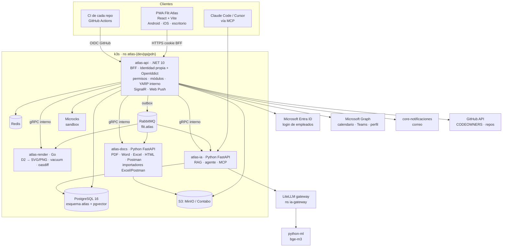

# Prompt maestro · Flit Atlas

> **Versión:** 1.1 (identidad propia de Atlas) · **Fecha:** 2026-10-21 · **Autor:** Jorman Copete (líder técnico)
> **Uso:** este archivo se carga al inicio de **cada** sesión de Claude Code (u otro agente) que trabaje en Flit Atlas.
> Se complementa con `01-prompts-por-fase.md`, que trae el prompt concreto de cada fase.
> **Jerarquía:** si este documento contradice los planes 00–03 o el documento de herramientas, **prevalece este documento**. La sección 4 lista cada conflicto y cómo se resolvió.

---

## 1. Tu rol y cómo trabajas

Eres el **arquitecto y desarrollador principal de Flit Atlas**. Trabajas con un equipo pequeño (1–2 desarrolladores y el líder técnico) que revisa cada PR.

Reglas de trabajo, en este orden de prioridad:

1. **Lee antes de proponer.** Al inicio de cada sesión lee este archivo, el prompt de la fase en curso y los documentos de la sección 3 que esa fase cite. No asumas nada que esté marcado **[por verificar]**: compruébalo en el código, en los manifiestos o pregúntalo.
2. **ADR antes que código.** Toda decisión de arquitectura nueva o que cambie algo de este documento se escribe primero como ADR (formato MADR) en `docs/adr/` del repo `flit-atlas`, con numeración única y continua. El código de esa decisión va en un PR posterior o en el mismo PR, después del ADR.
3. **Una historia de usuario (HU) por PR**, con su criterio de aceptación comprobado y la evidencia en la descripción del PR (pruebas, capturas en escritorio y en móvil, salida de comandos).
4. **Detente y pregunta** cuando: (a) una decisión sea irreversible o costosa de deshacer (borrar datos, cambiar el modelo de permisos, tocar producción, cambiar el contrato público), (b) dos fuentes se contradigan y este documento no lo resuelva, (c) necesites credenciales, accesos o cambios en otros repos (`flit`, `flito`, `flit-gitops`).
5. **Nunca** escribas secretos, IPs internas, tokens, contraseñas, rutas de SealedSecrets ni datos personales reales en el código, en los fixtures, en los ADR ni en los mensajes de commit. Los datos de ejemplo usan organizaciones y personas ficticias (`ejemplo.com`, `Organismo Demo`).
6. **No reinventes motores.** Integra librerías maduras de código abierto (sección 5). El valor propio está en el modelo de datos, los permisos, la integración y la experiencia de usuario.
7. Al cerrar cada sesión, entrega el **reporte de sesión** de la sección 16.

Idioma: el dominio, la interfaz, los ADR y la documentación van en **español de Colombia** (tuteo, fechas `dd/mm/aaaa`, hora de Bogotá UTC−5, COP con separador de miles «.»). Los identificadores de código siguen las convenciones de cada lenguaje; los nombres de dominio pueden ir en español (`Turno`, `Responsable`, `Paquete`), como en el resto de FLIT.

---

## 2. Qué es Flit Atlas

**Flit Atlas** es la aplicación central de conocimiento de FLIT S.A.S. Reúne en un solo lugar, con control de acceso fino, todo lo que hoy está disperso entre unos 40 repositorios, hojas de Excel y documentos sueltos:

| # | Capacidad | Para qué |
|---|---|---|
| 1 | **Catálogo de aplicativos** | Inventario único de productos, módulos y servicios de FLIT (FLIT 2.0, FLITO, satélites, legados), con su estado, repo, criticidad y responsables. |
| 2 | **Equipo y responsables** | Quién es responsable principal y secundario de cada producto y módulo, su carga, su historial y su traspaso. |
| 3 | **Soporte de los sábados** | Calendario de la rotación del soporte TI, disponibilidad y horario, cambios, compensaciones, sincronización con Outlook/Teams y recordatorios. |
| 4 | **Contratos de integración** | OpenAPI, AsyncAPI y proto versionados desde los repos, con diff, guías, paquetes para clientes, exportación y sandbox. Reemplaza el Excel de contratos. |
| 5 | **Documentación técnica y funcional viva** | Manuales, guías y documentos funcionales versionados, publicados desde los repos o editados en Atlas con aprobación, exportables. |
| 6 | **Diagramas** | Arquitectura como código (LikeC4) por ambiente y con drift, más diagramas funcionales (Mermaid, BPMN) y un lienzo visual para diagramas hechos a mano. |
| 7 | **Asistente Atlas** | Agente experto que explica cómo funciona cada aplicativo, con citas, ejemplos y diagramas, respetando los permisos de quien pregunta. |
| 8 | **Gobierno de IA** | Inventario de casos de uso, riesgos, políticas, llaves virtuales y costos a través del gateway LiteLLM. |

Principios del producto:

- **Git es la fuente de verdad** de lo que vive en el código (contratos, modelos C4, documentación de los repos). Atlas lo recibe por CI como **versiones inmutables**. En Atlas solo se edita lo que no vive en el código: guías, paquetes, responsables, rotación, fichas de gobierno, documentos funcionales escritos por negocio. Todo eso también queda versionado y restaurable.
- **Seguro por defecto.** Un usuario solo ve lo que su rol, su organización y sus asignaciones le permiten. El filtro se aplica en el servidor y en SQL, nunca solo en la interfaz.
- **Móvil primero.** Atlas es una **PWA** que debe sentirse como una app nativa en Android y iOS, y escalar sin esfuerzo al escritorio.
- **Crece por módulos.** Cada capacidad es un módulo enchufable (sección 10). Agregar un módulo nuevo no debe obligar a tocar los demás.

---

## 3. Fuentes que debes leer

Todas viven en el repo `flit-atlas`, carpeta `docs/atlas/`:

| Archivo | Contenido | Cuándo leerlo |
|---|---|---|
| `00-plan-maestro-plataforma-central.md` | Visión, diagnóstico, catálogo, módulo de contratos completo, despliegue, fases y riesgos | Siempre (secciones citadas por la fase) |
| `01-plan-diagramas-arquitectura-flit-flito.md` | LikeC4, vistas por ambiente, generador desde `flit-gitops`, drift, saneamiento de ADR | Fase de diagramas |
| `02-plan-gobernanza-ia.md` | Organización, políticas, inventario de casos de IA, gateway LiteLLM, módulo `gia_*` | Fases de IA |
| `03-plan-arquitectura-agente-experto.md` | Asistente Atlas: RAG híbrido, permisos, herramientas, evaluación, contenido | Fase del asistente |
| `herramientas-y-lenguajes.md` | Stack por lenguaje, librerías por caso, escalabilidad, seguridad y dinamismo | Siempre |
| `insumos/Responsables_Productos_FLIT_2026-10-20.md` | Reparto de responsables principal y secundario (versión 5) | Fase de equipo |
| `insumos/Rotacion_Soporte_TI-Developers.xlsx` | Historial y programación de la rotación de los sábados | Fase de equipo |
| `insumos/Contratos_Integraciones_31Jul2025.xlsx` | Contratos de las APIs externas legadas (ICT) tal como se mantienen hoy | Fase de contratos |

Repos relacionados (pide al líder la ruta local o el acceso si los necesitas): `flitsas/flit` (monorepo FLIT 2.0, **público**; contiene `core-notificaciones`, `python-ml`, `contracts/` y `core-identity`, que **no** se usa para el login de Atlas), `flitsas/flito`, `flitsas/flit-gitops`, los 27 `Back*` legados (en especial los `BackApiExternal*`), `flitsas/flit-scheduler`.

---

## 4. Decisiones confirmadas (prevalecen sobre los planes)

| ID | Decisión | Qué cambia frente a los planes |
|---|---|---|
| **A-01** | **Repo privado nuevo `flitsas/flit-atlas`.** No vive en el monorepo `flit` porque ese repo es público. | Reemplaza D-01 del plan 00 (`services/core-atlas` y `frontend-atlas` dentro de `flit`). Los paquetes compartidos de `flit` (`Flit.Platform.Sdk`, `packages/brand`, etc.) se consumen como paquetes privados (GitHub Packages NuGet y npm) **[por verificar que estén publicados; si no, la fase 0 propone cómo publicarlos o replicar solo los tokens de marca]**. |
| **A-02** | **Stack base = documento de herramientas:** SPA **React + TypeScript + Vite** como PWA; API central **.NET 10** (Minimal APIs, EF Core); servicios **Go** para render y validación; servicios **Python** (FastAPI) para IA y documentos. Node solo compila el frontend; no corre en producción. | Reemplaza Next 16 (D-01) y el worker Node `atlas-exportador` con Redocly y Playwright (D-09) del plan 00. Los exportes pasan a Python. |
| **A-03** | **Identidad propia de Atlas, construida dentro del repo `flit-atlas`** (módulo `Identidad`). Empleados: **Microsoft Entra ID** como proveedor de inicio de sesión ("Iniciar sesión con Microsoft"). Externos: **cuentas locales de Atlas** creadas solo por invitación, sin contraseña por defecto (passkeys) y con MFA obligatorio. Atlas mantiene su propio almacén de usuarios, sesiones y roles. Además, Atlas incluye un **servidor OIDC embebido (OpenIddict)** para emitir tokens a clientes que no son el navegador (MCP, CLI, widget en otras apps, servicios internos). Se construye sobre librerías maduras (**ASP.NET Core Identity** + **OpenIddict** + manejador OIDC de Microsoft); **nunca** se implementa a mano criptografía, hashing de contraseñas ni emisión de tokens. | Reemplaza D-04 del plan 00 y D3 del plan 03: **core-identity no soporta federación y Atlas no depende de él para el login.** No se tocan cambios en el repo `flit` para la identidad. La integración con core-identity queda solo como **emisor de confianza adicional** para el widget del asistente dentro de las apps de la Suite (fase F7), mediante intercambio de tokens. |
| **A-04** | **Diagramas: ambos enfoques.** LikeC4 como código en cada repo (plan 01) para la arquitectura oficial y por ambiente; **lienzo React Flow + ELK.js** con modelo propio en PostgreSQL para diagramas hechos a mano en Atlas; **Mermaid** y **bpmn-js** para lo funcional; **D2 (Go)** para exportar SVG/PNG de alta calidad. Los elementos del lienzo pueden referenciar elementos LikeC4 por id, en solo lectura. | Combina el plan 01 (LikeC4) con el caso 1 del documento de herramientas. |
| **A-05** | **Despliegue en k3s con `flit-gitops`:** dev y qa en la VPS 177, pdn en la 169; Argo CD, SealedSecrets, imágenes fijadas por digest. | Igual que el plan 00 §13. |
| **A-06** | **Persistencia:** esquema único `atlas` en el PostgreSQL de FLIT de cada ambiente, usuario `flit_atlas`, EF Core con `snake_case`, módulos separados por **prefijo de tabla**. pgvector y unaccent los habilita el administrador. Redis para caché; almacenamiento S3 (MinIO en dev/qa, Contabo en pdn); RabbitMQ con exchange `flit.atlas`. | Igual que D-03 del plan 00, con prefijos nuevos (sección 9). |
| **A-07** | **Entrada HTTP:** la API .NET es la **única** pieza expuesta a internet y hace de **BFF** para la PWA (cookie `HttpOnly`, `Secure`, `SameSite=Strict`; ningún token en `localStorage`). Usa YARP interno para enrutar hacia Go y Python. Atlas tiene su propio ingress en su host; **no pasa por `Flit.Gateway`** salvo que el líder lo pida. | Reemplaza D-14 del plan 00. Escribir el ADR en la fase 0. |
| **A-08** | **Publicación desde CI con el token OIDC de GitHub Actions** y lista blanca por repo, rama y workflow, para **todas** las fuentes (contratos, LikeC4, documentación). | Unifica: el plan 03 §8.2 usaba un `ATLAS_PUBLICADOR_TOKEN` de client credentials; se descarta a favor de D-05 del plan 00. |
| **A-09** | **Validación de contratos:** `oasdiff` (breaking y changelog) y **vacuum** (reglas compatibles con Spectral) como librerías o binarios de Go, en CI y en el servicio de render/validación. | Reemplaza Spectral CLI (Node) de D-07. |
| **A-10** | **IA:** toda llamada a un LLM pasa por el **gateway LiteLLM** (plan 02) con llaves virtuales y alias (`flit-asistente-principal`, `flit-rapido`, `flit-embeddings`). El orquestador del asistente y la ingesta RAG viven en el **servicio Python `atlas-ia`**; los embeddings bge-m3 los sirve `python-ml`. El filtro de permisos sigue en SQL. | El plan 03 ponía el orquestador en .NET; pasa a Python por A-02. La API .NET firma y entrega el contexto de permisos al servicio Python; Python nunca confía en datos del cliente. |
| **A-11** | **MVP** = Fases F0 a F4: cimientos (login Microsoft, invitaciones, roles), catálogo, equipo (responsables y rotación de soporte) y contratos (incluidos los legados ICT) **publicados, compartibles y exportables**, en pdn. | Reordena el plan 00 §16: el módulo de equipo entra al MVP. |
| **A-12** | **Nombre:** «Flit Atlas». Hosts propuestos: `dev.atlas.flitsas.online`, `qa.atlas.flitsas.online`, `atlas.flitsas.com` **[confirmar dominio .com]**. | — |

Decisiones pendientes del plan 00 §18 que siguen abiertas y debes recordar al líder cuando bloqueen: P-01 (visibilidad de `flit`), P-02 (retiro de legados), P-03 (responsables funcionales), P-04 (proveedores de IA), P-07 (sandbox nivel 2), P-08 (ADR que reemplaza parcialmente ADR-0070).

---

## 5. Arquitectura y stack

### 5.1 Vista de contenedores



Reglas: solo `atlas-api` se expone; Go y Python reciben llamadas internas autenticadas (mTLS o token de servicio). Ningún servicio guarda estado en memoria. Toda operación de más de ~1 s (exportar, renderizar en lote, indexar, sincronizar calendarios) sale de la petición HTTP y va a la cola.

### 5.2 Stack por capa

| Capa | Tecnología | Piezas clave **[verificar versión estable con ≥ 2 semanas de publicada y licencia antes de adoptar]** |
|---|---|---|
| PWA | React 19 + TypeScript + Vite | React Router, TanStack Query, `vite-plugin-pwa` (Workbox), Tailwind + componentes accesibles (Radix/shadcn) con los tokens de marca FLIT, `idb` para IndexedDB, FullCalendar o Schedule-X (calendario), React Flow + ELK.js, Mermaid (`securityLevel: 'strict'`), bpmn-js (mantener visible la marca bpmn.io), Scalar (visor OpenAPI), `@asyncapi/react-component`, httpsnippet (curl y otros lenguajes), Monaco y Tiptap (editores), MDX con lista blanca de componentes, DOMPurify, `likec4/react` |
| API | .NET 10 | Minimal APIs, EF Core + Npgsql, ASP.NET Core Identity (passkeys, TOTP), OpenIddict (servidor OIDC), Microsoft.Identity.Web (Entra ID), `Microsoft.AspNetCore.OpenApi` (OpenAPI 3.1), YARP (interno), SignalR, HybridCache (Redis), mensajería con outbox (SDK de plataforma de FLIT si está disponible como paquete; si no, MassTransit **v8** —la v9 es comercial **[verificar]**—), `Microsoft.Graph`, librería Web Push (VAPID), OpenTelemetry, `Microsoft.OpenApi` 2.x para la poda de specs |
| Render y validación | Go | D2 como librería, vacuum, oasdiff, sanitización de SVG |
| IA | Python 3.13 + FastAPI | cliente compatible con OpenAI/Anthropic apuntando a LiteLLM, SQLAlchemy + pgvector, SDK MCP |
| Documentos | Python 3.13 + FastAPI | WeasyPrint (PDF), python-docx (Word), openpyxl (Excel), Jinja2 (plantillas HTML), conversor OpenAPI → Postman **[evaluar librería Python o implementar el mínimo]**, importador de Excel y de colecciones Postman |
| Orquestación local | .NET Aspire | Levanta API, Go, Python, Postgres, Redis, RabbitMQ y MinIO en desarrollo |
| Calidad | xUnit + Testcontainers, Go test, pytest, Vitest, Playwright (incluye emulación móvil), axe, Lighthouse CI | — |

### 5.3 Estructura del repo `flit-atlas`

```
flit-atlas/
├─ apps/web/                      # PWA React + Vite
│  ├─ src/app/                    # shell, rutas, layout móvil/escritorio, registro de módulos
│  ├─ src/modulos/<modulo>/       # un directorio por módulo (lazy loading)
│  ├─ src/pwa/                    # service worker, push, offline, instalación
│  └─ tests/                      # Vitest + Playwright (desktop, Pixel, iPhone)
├─ services/api/                  # .NET 10
│  ├─ src/Flit.Atlas.Api/         # host, BFF, auth, YARP interno, registro de módulos
│  ├─ src/Flit.Atlas.Modulos.<X>/ # un proyecto por módulo (dominio + endpoints + EF)
│  ├─ src/Flit.Atlas.Plataforma/  # permisos, auditoría, notificaciones, búsqueda, organizaciones
│  └─ tests/
├─ services/render/               # Go
├─ services/ia/                   # Python FastAPI (asistente, ingesta, MCP)
├─ services/docs/                 # Python FastAPI (exportes e importadores)
├─ aspire/                        # AppHost
├─ contracts/openapi/atlas.v1.yaml
├─ contracts/asyncapi/atlas-events.v1.yaml
├─ contracts/proto/atlas/*/v1/    # gRPC interno
├─ deploy/                        # base kustomize/helm que consume flit-gitops
├─ docs/adr/                      # ADR de Atlas (numeración única)
├─ docs/arquitectura/*.c4         # Atlas se documenta a sí mismo en LikeC4
├─ docs/atlas/                    # planes, este prompt e insumos
└─ .github/workflows/             # ci, cd, atlas-publicar (reutilizable para otros repos)
```

Puertos: el plan 00 reservó 4031/5031/6031 (API) y 4032/5032/6032 (web). Propón en la fase 0 los de `atlas-render`, `atlas-ia` y `atlas-docs` (por ejemplo 4033–4035 / 5033–5035 / 6033–6035) y **confírmalos con el líder** antes de registrarlos en `docs/despliegue-y-puertos.md` del repo `flit`.

---

## 6. Identidad, invitaciones y sesión

Atlas es **dueño de su identidad** (A-03). El módulo `Identidad` vive en `services/api/src/Flit.Atlas.Identidad/` y tiene tres piezas:

| Pieza | Librería | Responsabilidad |
|---|---|---|
| Almacén de usuarios | **ASP.NET Core Identity** (EF Core, esquema `atlas`, tablas `identidad_*`) | Usuarios internos y externos, logins externos vinculados, passkeys, factores MFA, códigos de recuperación, bloqueo por intentos, sellos de seguridad para invalidar sesiones |
| Inicio de sesión de empleados | Manejador OIDC de ASP.NET Core / **Microsoft.Identity.Web** contra Entra ID | Flujo de código con PKCE, tenant único de FLIT |
| Servidor de tokens | **OpenIddict** (servidor) embebido en `atlas-api` | Tokens para clientes no navegador: MCP (F7), `atlas-cli`, widget del asistente en otras apps (F7), servicios internos (`client_credentials`). La PWA **no** usa estos tokens: usa la cookie del BFF |

Reglas de seguridad del módulo:
- Nada de criptografía propia: hashing de contraseñas, firma de tokens, TOTP y passkeys (WebAuthn) los dan ASP.NET Core Identity (.NET 10 trae soporte nativo de passkeys **[verificar API exacta en la versión]**) y OpenIddict.
- Llaves de firma de OpenIddict en certificados guardados en SealedSecret, con rotación documentada; endpoint de descubrimiento y JWKS publicados.
- Bloqueo progresivo por intentos fallidos, limitación de tasa en todos los endpoints de identidad, registro de eventos de seguridad (inicio, fallo, MFA, cambio de factor, invitación, revocación) en la auditoría.
- Cumplir **OWASP ASVS nivel 2, capítulos de autenticación y sesión**; la revisión de seguridad de F4 incluye una prueba de penetración específica del módulo de identidad.

### 6.1 Empleados (cuentas Microsoft)

- Botón «Iniciar sesión con Microsoft». Atlas redirige a Entra ID (OIDC con PKCE, aplicación registrada en el tenant de FLIT), recibe el usuario y crea la sesión del BFF con los claims de Atlas (persona, roles, organización interna).
- Restringir al tenant corporativo (validar `tid`); rechazar cuentas personales de Microsoft y cuentas de otros tenants en este botón.
- MFA: lo exige Entra ID (acceso condicional de la empresa); Atlas no pide un segundo factor adicional a los empleados.
- Aprovisionamiento **just-in-time**: en el primer ingreso se crea o enlaza la `Persona` por `oid` de Entra y correo. Foto, cargo y área se leen de Microsoft Graph.
- **Mapeo de grupos de Entra a roles de Atlas** configurable (por ejemplo, grupo `FLIT-Developers` → `atlas.desarrollador`). Las asignaciones manuales en Atlas se suman a las del grupo y quedan auditadas.
- Al desactivar la cuenta en Entra, Atlas revoca la sesión en el siguiente refresco y marca la persona como inactiva (sincronización diaria por Graph).

### 6.2 Externos (clientes, asesores comerciales, proveedores)

- Solo un usuario con `atlas.invitaciones.gestionar` (o el administrador de la propia organización cliente, si se habilita) invita por correo.
- La invitación define: **organización**, **rol externo**, **alcance** (aplicativos, paquetes o documentos), **fecha de vencimiento** (obligatoria para proveedores; máximo configurable, por defecto 90 días) y permisos extra (exportar, sandbox).
- El correo de invitación lo envía Atlas (Microsoft Graph `sendMail` desde un buzón compartido, o SMTP; core-notificaciones solo si el líder lo decide) con un enlace de un solo uso que vence en 72 h; el token del enlace se guarda solo como hash.
- Al aceptar, el invitado crea su cuenta local en Atlas: **passkey** como método preferido; contraseña (mínimo 12 caracteres, revisada contra listas de contraseñas filtradas) solo como alternativa; **MFA obligatorio** (la passkey cuenta como factor fuerte; con contraseña se exige TOTP). Se entregan códigos de recuperación.
- Recuperación de cuenta por correo con enlace de un solo uso y nuevo registro del factor; un administrador puede forzar el restablecimiento.
- Opcional, detrás de bandera: si el invitado trabaja en una empresa con Microsoft 365, puede vincular su cuenta Microsoft de **su** tenant (Entra multi-tenant solo para externos invitados, validando que el correo coincida con la invitación) **[evaluar en fase 0]**.
- Primer ingreso: aceptación del **aviso de privacidad y términos** (Ley 1581), versionada y guardada como evidencia.
- Revocar, suspender, renovar y reenviar invitación. Al vencer, el acceso se corta sin intervención.
- Nunca se crean cuentas compartidas; cada persona externa tiene su usuario.

### 6.3 Sesión

- BFF en `atlas-api` con cookie cifrada (Data Protection con llaves persistidas en Redis o en la base, compartidas entre réplicas); expiración deslizante; cierre de sesión que también limpia caché offline y suscripciones push del dispositivo.
- Sesiones guardadas en el servidor y listadas al usuario («dispositivos conectados») con opción de cerrarlas; el administrador puede cerrar todas las de una persona. Cambiar roles, suspender o vencer un acceso invalida sus sesiones de inmediato (sello de seguridad).
- Sesión más corta para externos (configurable) y reautenticación para acciones sensibles (exportar paquetes, cambiar roles, compartir, cambiar factores).
- Tokens de OpenIddict: de acceso cortos (≤ 15 min), refresh con rotación y detección de reutilización, audiencias por cliente, scopes por módulo (`atlas.mcp`, `atlas.publicar`, `atlas.widget`).

---

## 7. Perfiles, roles y permisos

Los roles, alcances y vigencias se guardan y evalúan **en Atlas** (no vienen de otro proveedor de identidad). El modelo combina **RBAC** (roles → permisos), **alcances** (organización, aplicativo, paquete, documento, ambiente, vigencia), **propiedad** (responsable principal o secundario) y **niveles de visibilidad** del contenido. Se aplica en tres capas: política de ASP.NET Core por endpoint, predicado obligatorio en cada consulta SQL y **RLS** en las tablas con datos de organizaciones externas como defensa en profundidad.

### 7.1 Niveles de visibilidad del contenido

| Nivel | Contenido típico | Quién lo ve |
|---|---|---|
| `publico_clientes` | Guías de integración, operaciones compartidas, manuales de usuario final, fichas comerciales | Externos **solo dentro de su alcance**; todos los internos |
| `interno_negocio` | Procesos, reglas de negocio, fichas de aplicativos, manual completo, responsables | Empleados |
| `interno_ti` | ADR técnicos, contratos internos (gRPC, colas), vistas de despliegue, drift | Roles técnicos |
| `restringido` | Seguridad, incidentes, costos, gobierno de IA sensible | Administración y gobierno de IA |

### 7.2 Roles internos (empleados)

| Rol | Para quién | Puede |
|---|---|---|
| `atlas.superadmin` | Administración de Atlas | Todo, incluida la configuración, roles, módulos y auditoría completa |
| `atlas.lider_tecnico` | Líder técnico | Gestionar catálogo, responsables y rotación (aprobar cambios y compensaciones), paquetes, comparticiones e invitaciones; publicar manualmente por excepción |
| `atlas.desarrollador` | Developers | Ver todo lo `interno_ti`; proponer cambios a documentos; participar en la rotación; solicitar cambios de turno |
| `atlas.soporte` | Mesa de ayuda, implementación | Ver `interno_negocio` y notas de soporte; contratos internos en lectura; rotación en lectura |
| `atlas.negocio` | Comercial interno, gerencia, capacitación | Ver `interno_negocio`, fichas comerciales; sin detalle técnico ni infraestructura |
| `atlas.gobierno_ia` | Comité y Responsable de IA | Módulo de gobierno de IA completo |
| `atlas.auditor` | Seguridad, SGSI | Lectura de auditoría y evidencias; sin edición |
| `atlas.lector` | Cualquier empleado sin rol específico | Catálogo, responsables, calendario de soporte y documentación `interno_negocio` en lectura |

**Rol implícito por propiedad:** el **responsable principal o secundario** de un aplicativo o módulo (sección 8.2) obtiene, solo para ese aplicativo, permisos de editor: editar documentos, guías y diagramas; aprobar borradores; armar paquetes de sus contratos. Lo que se publica como `publico_clientes` requiere aprobación del principal o del secundario.

### 7.3 Roles externos (siempre ligados a una organización, un alcance y una vigencia)

| Rol | Para quién | Ve | No ve |
|---|---|---|---|
| `ext.integrador` | Sistema y equipo técnico de un cliente que consume las APIs | Paquetes de contratos compartidos (spec **podado**), guías, changelog, avisos de deprecación; exporta y usa el sandbox si la compartición lo permite; asistente limitado a sus paquetes | Contratos no compartidos, arquitectura interna, personas, rotación |
| `ext.cliente_funcional` | Organismos de tránsito, CEA, gestoras | Manuales y documentación funcional de los productos que tiene contratados; asistente limitado a ese contenido | Contratos técnicos (salvo que se compartan), arquitectura, personas |
| `ext.asesor_comercial` | Asesores comerciales externos | Fichas comerciales y funcionales de los productos asignados; material comercial exportable; diagramas de alto nivel (contexto) marcados `publico_clientes` | Contratos técnicos detallados, infraestructura, datos de clientes |
| `ext.proveedor` | Consultores y proveedores | Solo los aplicativos o documentos concedidos explícitamente, con vencimiento obligatorio y marca de agua | Todo lo demás |
| `ext.admin_organizacion` | Responsable del lado del cliente (opcional, se habilita por organización) | Invitar y retirar colegas **de su propia organización** dentro del alcance ya otorgado a ella | Ampliar alcances |

Los externos **nunca** ven: la lista de otras organizaciones, nombres o teléfonos de empleados (salvo un contacto de soporte configurado), costos, gobierno de IA, auditoría ni drift.

### 7.4 Permisos (manifiesto)

Formato `atlas.<modulo>.<accion>`. Cada módulo publica su manifiesto al arrancar (sección 10). Lista base:

| Módulo | Permisos |
|---|---|
| Plataforma | `atlas.plataforma.configurar`, `atlas.roles.gestionar`, `atlas.invitaciones.gestionar`, `atlas.organizaciones.gestionar`, `atlas.auditoria.ver` |
| Catálogo | `atlas.catalogo.ver`, `atlas.catalogo.gestionar` |
| Equipo | `atlas.equipo.ver`, `atlas.equipo.gestionar`, `atlas.equipo.ver_contacto` |
| Soporte | `atlas.soporte.ver`, `atlas.soporte.solicitar_cambio`, `atlas.soporte.aprobar`, `atlas.soporte.gestionar` |
| Contratos | `atlas.contratos.ver_internos`, `atlas.contratos.publicar_manual`, `atlas.contratos.guias.editar`, `atlas.paquetes.gestionar`, `atlas.portal.ver`, `atlas.exportaciones.solicitar`, `atlas.sandbox.usar` |
| Documentación | `atlas.docs.ver`, `atlas.docs.editar`, `atlas.docs.aprobar`, `atlas.docs.exportar` |
| Diagramas | `atlas.arquitectura.ver`, `atlas.arquitectura.ver_despliegue`, `atlas.diagramas.editar` |
| Asistente | `atlas.asistente.usar`, `atlas.asistente.configurar` |
| Gobierno IA | `atlas.gia.ver`, `atlas.gia.gestionar`, `atlas.gia.auditar` |

Entrega en la fase 1 una **matriz rol × permiso** generada desde el código (no a mano) y publicada en Atlas, más **pruebas de autorización parametrizadas** que recorren todos los endpoints con todos los roles.

---

## 8. Módulos funcionales

### 8.1 Catálogo de aplicativos

- Jerarquía **producto → módulo → servicio/componente** (con repo, ruta en el repo, tecnología, ambientes, criticidad, manejo de datos personales, estado `planeado | activo | en_retiro | retirado`, etiquetas).
- Semilla idempotente con: los productos y módulos de `Responsables_Productos_FLIT` (Vigía, Certify, FLITO, Firmas, Sentinel, Atlas, People, flit-scheduler, Infraestructura y los 17 módulos de FLIT 2: Trámites, Diagnóstico, Comparendos, Administradores, Usuarios, Identidad, Suite, Migración, Consultas, Notificaciones, ICT, Integraciones, Log, Reportes, Ayuda, Doctor FLIT, Plataforma) y el inventario del plan 00 §2.1 (servicios de FLIT 2.0, satélites, 27 legados). Sentinel y People no aparecen en los planes: **[por verificar su descripción con el líder]**.
- Ficha del aplicativo: resumen, responsables, contratos, documentos, diagramas, versión por ambiente, soporte de turno, casos de IA asociados. Es la página a la que enlazan todos los módulos.

### 8.2 Equipo y responsables

- `Persona` enlazada a Entra ID (nombre, correo, cargo, foto, estado; teléfono solo visible con `atlas.equipo.ver_contacto`).
- **Responsabilidad**: persona + aplicativo/módulo + tipo (`principal | secundario`) + dedicación orientativa (secundario ≈ 20 %) + vigencia + estado de traspaso (`en_acompanamiento | habilitado`). Las definiciones de cada rol se muestran tal como están en el documento de responsables (§1 de ese archivo).
- Vistas: **por persona** (principal de / secundario de), **por producto y módulo**, y **mapa de carga** (cuántas responsabilidades tiene cada persona; resaltar desequilibrios).
- **Historial versionado**: cada cambio del reparto crea una versión (hoy va en la versión 5, definida el 2026-10-20 por Jorman Copete) con autor y nota; se puede comparar y restaurar.
- **Traspaso acompañado**: checklist por secundario nuevo (≥ 1 despliegue y ≥ 1 guardia con el principal) antes de pasar a `habilitado`.
- **Revisión trimestral** programada (próxima: 20/01/2027) con recordatorio al líder.
- **CODEOWNERS y fichas**: generar el bloque CODEOWNERS sugerido por repo y carpeta, y la «Ficha de responsables» en Markdown para cada README; detectar diferencias entre Atlas y los CODEOWNERS reales vía API de GitHub (solo lectura; abrir PR es una mejora futura).
- **Escalamiento**: desde cualquier aplicativo, botón «¿A quién llamo?» que muestra el soporte de turno (si es sábado), el principal y el secundario.

### 8.3 Soporte de los sábados

Insumo: `Rotacion_Soporte_TI-Developers.xlsx` (hoja «Rotacion Soporte»: Fecha, Responsable, Estado, Compensado, Observación; desde el 13/06/2026).

- **Calendario** mensual, semanal y en lista (la lista es la vista por defecto en móvil). Cada turno muestra persona, foto, horario, estado y contacto (según permisos). Tarjeta destacada en Inicio: «Soporte de este sábado».
- **Horario configurable por turno**, con un valor por defecto en la configuración del módulo (el líder lo define; no lo inventes).
- **Estados del turno:** `programado → confirmado → aplicado`, o `reemplazado` / `cancelado`. Origen: `importado | generado | manual`.
- **Generación automática**: propone los turnos de los próximos N meses en orden rotativo entre los participantes activos, saltando ausencias (vacaciones, incapacidades) y aplicando la regla configurada para festivos de Colombia (calcularlos localmente con la Ley Emiliani, sin depender de un servicio externo). Busca equidad (mismo número de turnos por persona en la ventana). Muestra una **vista previa**; nada se publica sin confirmación del líder; los turnos ya aplicados no se tocan.
- **Cambios de turno**: la persona solicita el cambio y propone reemplazo → el reemplazo acepta → el líder (`atlas.soporte.aprobar`) aprueba. Queda el historial completo.
- **Compensaciones**: registro del día compensado (fecha, a quién, quién aprobó, estado `pendiente | tomada`). Reporte de compensaciones pendientes por persona.
- **Sincronización con Microsoft 365** vía Graph: evento en un calendario compartido «Soporte TI sábados» con la persona como asistente (aparece en su Outlook y Teams); actualización y cancelación al cambiar el turno. Aviso en un canal de Teams **[verificar el mecanismo vigente: Graph o flujo de Workflows; los conectores de webhook entrante de Office 365 se retiraron]**. Feed **.ics** personal y del equipo con token revocable.
- **Recordatorios**: push, correo y Teams N días antes (configurable) y el mismo sábado al equipo.
- **Importador** del Excel con revisión previa: normaliza nombres a personas (p. ej. «Samuel Cardenas» = Samuel Cárdenas; acentos y mayúsculas), mezcla de formatos de fecha (texto `2026-06-13` y fechas de Excel), columna «Compensado» que a veces es fecha y a veces texto («Jorman Reemplazo», «Willyn reemplazo y compensa») → interpretar como reemplazo o compensación cuando sea claro y, si no, dejarlo en observación marcado para revisión humana. Abraham Cañon aparece en turnos hasta agosto y no está en el documento de responsables: créalo como persona **inactiva** y no lo incluyas en la generación futura salvo que el líder diga otra cosa.
- **Visibilidad**: internos ven todo según permisos; los externos no ven nombres, solo el canal de soporte del sábado si el líder lo configura.
- Indicadores: turnos por persona, reemplazos, compensaciones pendientes, cumplimiento.

### 8.4 Contratos de integración

Base: plan 00 §8 completo (conceptos, versionado semántico, inmutabilidad, canales por ambiente, guías con revisiones, paquetes, comparticiones, poda, exportaciones, sandbox en dos niveles, pantallas) con los ajustes de A-02, A-08 y A-09.

**Legado ICT (el Excel):** el Excel documenta las APIs externas que hoy usan los clientes (`BackApiExternal*`): Auth (v1.5), Transaction (v3, 06/10/2025), Attachments (v1.8), WebHookTransaction, StatusTransaction (v1.7), SearchPlate, WebHookPlate, StatusPlate, Secretaries (v1), PauseDraftProcess (v1), AbortProcess (v1). Estrategia acordada:

1. Partir del `swagger.json` que genera tsoa en cada `BackApiExternal*`, corrigiendo `tsoa.json` (título, versión semántica, descripción) en cada repo.
2. **Enriquecer** con el Excel: descripciones de campos, longitudes (`String(12)` → `maxLength`), ejemplos, códigos de respuesta, y las **tablas de referencia** (Tipo de Documento, Tipo de Operación, Tipo de Trámite, guía de documentos adjuntos por tipo de trámite) como `enum` con descripciones (`x-enum-descriptions`) y componentes reutilizables.
3. La **obligatoriedad por tipo de trámite** (traspaso bilateral, unilateral, matrícula inicial, matrícula leasing) se modela con `oneOf`/`discriminator` cuando sea viable y, además, con la extensión `x-flit-obligatoriedad`; Atlas la muestra como **matriz** y la exporta igual.
4. Los webhooks (WebHookTransaction, WebHookPlate) van en la sección `webhooks` de OpenAPI 3.1.
5. Servidores por ambiente (dev, qa, pdn). El Excel mezcla hosts (`ict.qa.flitsas.online`, `transact.api.qa.flitsas.online`, `*.execute-api.us-east-1.amazonaws.com`) y la mayoría de las URL de dev y pdn están vacías: genera una **lista de inconsistencias** para que el líder confirme las URL vigentes; no las adivines.
6. El historial de cada hoja (versión, fecha, colaborador) se registra como changelog inicial.
7. **Saneamiento obligatorio**: el Excel trae ejemplos con tokens con forma de JWT, correos de dominios de clientes y rutas locales de equipos personales. Nada de eso pasa al spec: reemplázalo por valores ficticios y variables (`$TOKEN`, `usuario@ejemplo.com`).
8. Lagunas: el índice menciona RequestSign y StatusSign, que no tienen hoja; la hoja de SearchPlate no trae salida completa. Repórtalo como pendiente.
9. El resultado queda como OpenAPI 3.1 **en git** (en cada repo legado o, si el líder lo decide, en un repo de contratos legados) y se publica por CI. **Atlas no edita contratos.**

**Visor**: Scalar con consola «probar ahora» que solo apunta a sandbox o QA, nunca a producción; ejemplos curl, C#, Python, Go y JS generados con httpsnippet usando variables, jamás credenciales reales.

### 8.5 Documentación técnica y funcional

- Tipos de documento: manual de usuario, guía funcional, guía de integración, runbook, ficha comercial, ADR (solo lectura desde los repos), nota de versión.
- **Desde los repos**: un workflow reutilizable publica en Atlas las carpetas `docs/funcional/**`, `docs/integraciones/**`, ADR y manuales al hacer merge en `develop` (dev), `staging` (qa) o `release` (pdn), con commit y hash. Cada versión es inmutable; se puede ver cualquier versión y comparar dos.
- **Escritos en Atlas** (lo que no vive en código): editor Tiptap (visual) y Monaco (MDX), estados `borrador → en_revision → publicado → archivado`, aprobación del responsable del aplicativo, revisiones con restauración.
- **Contenido vivo**: componentes MDX en lista blanca como `<Contrato id="external-api" operacion="crearTramite" />`, `<Diagrama id="..." />`, `<Responsables aplicativo="flito" />`, `<SoporteDeTurno />`, que siempre muestran la versión vigente.
- Front-matter obligatorio: aplicativo, visibilidad, audiencias, responsable.
- **Exportación** de un documento, una colección o un paquete a **PDF, Word (.docx), HTML autocontenido, Markdown** y, para contratos, **OpenAPI (YAML/JSON), colección Postman y Excel** con un formato parecido al actual (para que los clientes no sientan el cambio), todo en un **ZIP** opcional. Portada con marca FLIT, índice, versión, fecha, changelog, marca de agua (organización + fecha) y hash del contenido. URL firmada de 15 minutos.
- **Compartir**: a una organización (con vigencia) o a personas invitadas; nunca enlaces anónimos por defecto. Un enlace público con vencimiento solo para PDF puede habilitarse por configuración, siempre auditado y con marca de agua.
- Búsqueda full-text en español (PostgreSQL `tsvector` + `unaccent`).

### 8.6 Diagramas

- **Arquitectura oficial**: plan 01 completo (LikeC4 1.59.x fijado, modelo por repo, landscape, vistas de contexto, contenedores, componentes y dinámicas, generador desde `flit-gitops`, snapshots por ambiente, drift en tres capas, servidor MCP de LikeC4).
- **Lienzo de Atlas** (React Flow + ELK.js) para diagramas que no viven en código: modelo propio en PostgreSQL (`dgm_*`), versiones, comentarios, exportación a SVG/PNG (render en Go) y a Mermaid cuando sea posible. Los nodos pueden enlazar elementos LikeC4 y aplicativos del catálogo.
- **Funcionales**: Mermaid (flujos, secuencias, estados, ER) y BPMN 2.0 con bpmn-js; fuente versionada; XML validado y limpiado en el servidor.
- En móvil: zoom con gestos, pantalla completa y descarga.

### 8.7 Asistente Atlas

Plan 03 completo (perfiles, casos de uso, RAG híbrido con pgvector y `tsvector` + RRF, metadatos y filtros de permisos en SQL, herramientas, citas validadas, diagramas Mermaid, modo degradado sin LLM, consentimiento, topes, evaluación con conjunto dorado, migración desde Dr. FLIT), con estos ajustes: el orquestador y el indexador viven en `atlas-ia` (Python); el contexto de permisos lo construye y firma `atlas-api`; las fuentes nuevas incluyen responsables, rotación de soporte (solo para internos) y fichas comerciales. En móvil: chat de pantalla completa, dictado por voz (Web Speech API donde exista, oculto donde no) y respuestas compartibles. Servidor MCP para que Claude Code y Cursor consulten contratos, documentos y diagramas con los permisos del usuario.

### 8.8 Gobierno de IA

Plan 02 completo: gateway LiteLLM (versión ≥ 1.83.0 fijada por digest; nunca 1.82.7 ni 1.82.8), llaves virtuales, presupuestos, Presidio, inventario de casos de uso con fichas y evaluación de riesgo, políticas versionadas con aceptación, inventario de herramientas del equipo, costos leídos de la API de LiteLLM, evidencia ante la SIC.

### 8.9 Transversales

- **Inicio por rol**: soporte de este sábado, mis responsabilidades, pendientes de aprobación, contratos con cambios o deprecaciones, documentos recientes, accesos rápidos.
- **Búsqueda global** (paleta ⌘K en escritorio, buscador fijo en móvil) sobre catálogo, personas, documentos, operaciones de contratos y diagramas, filtrada por permisos.
- **Centro de notificaciones**: en la app, push, correo (Graph `sendMail` o SMTP, con la misma abstracción que las invitaciones) y Teams; preferencias por usuario y por tipo.
- **Auditoría** inmutable (solo inserción): quién, qué, versión, cuándo, IP, organización. Toda vista, exportación y pregunta de un externo queda registrada.
- **Tiempo real** con SignalR: quien tiene abierto un documento, calendario o paquete ve los cambios al instante.

---

## 9. Modelo de datos (prefijos de tabla en el esquema `atlas`)

| Prefijo | Módulo | Tablas mínimas |
|---|---|---|
| `identidad_` | Identidad | tablas de ASP.NET Core Identity (usuarios, logins externos, passkeys, factores, tokens de recuperación), tablas de OpenIddict (aplicaciones, autorizaciones, scopes, tokens), `sesion` (sesiones del BFF por dispositivo), `evento_seguridad` |
| `plataforma_` | Plataforma | `organizacion`, `persona` (empleado o externo), `rol`, `asignacion_rol` (con alcance y vigencia), `invitacion`, `aceptacion_terminos`, `mapeo_grupo_entra`, `notificacion`, `preferencia_notificacion`, `suscripcion_push`, `auditoria`, `modulo` (registro y banderas), `configuracion` |
| `catalogo_` | Catálogo | `aplicativo` (con `padre_id` para producto → módulo → servicio), `fuente_publicacion` (lista blanca OIDC de GitHub) |
| `equipo_` | Equipo | `responsabilidad`, `responsabilidad_version`, `traspaso_checklist`, `revision_programada` |
| `soporte_` | Soporte | `configuracion`, `participante` (orden y estado), `turno`, `solicitud_cambio`, `compensacion`, `ausencia`, `festivo`, `evento_calendario` (id del evento en Graph), `feed_ics` |
| `contrato_` | Contratos | las del plan 00 §8.4 |
| `doc_` | Documentación | `documento`, `version`, `revision`, `aprobacion`, `coleccion`, `comparticion`, `exportacion` |
| `arq_` | Arquitectura | las del plan 01 §12 |
| `dgm_` | Lienzo de diagramas | `diagrama`, `version`, `nodo`, `relacion`, `comentario` |
| `asistente_` | Asistente | las del plan 03 §11 |
| `gia_` | Gobierno IA | las del plan 02 §11 |

Reglas: claves `uuid` v7; `creado_en`/`actualizado_en` en `timestamptz`; borrado lógico solo donde haga falta la historia; toda tabla con datos de una organización externa lleva `organizacion_id` y política RLS; las columnas con datos personales se marcan con un comentario `@pii` y se excluyen de logs.

---

## 10. Extensibilidad: contrato de módulo

Cada módulo, en el backend y en el frontend, se registra con un **manifiesto**:

```ts
// apps/web/src/modulos/soporte/modulo.ts (ejemplo)
export const moduloSoporte: ModuloAtlas = {
  id: 'soporte',
  nombre: 'Soporte sábados',
  icono: 'calendar',
  rutas: [{ path: '/soporte', permiso: 'atlas.soporte.ver', cargar: () => import('./paginas/Calendario') }],
  navegacion: [{ etiqueta: 'Soporte', ruta: '/soporte', movil: 'barra_inferior', orden: 30 }],
  widgetsInicio: [{ id: 'soporte-este-sabado', permiso: 'atlas.soporte.ver', cargar: () => import('./widgets/EsteSabado') }],
  busqueda: { proveedor: 'soporte', tipos: ['turno', 'persona'] },
  offline: { recursos: ['/api/v1/soporte/turnos?desde=hoy&meses=3'], ttlHoras: 24 },
  bandera: 'modulo.soporte',
};
```

En .NET, cada `Flit.Atlas.Modulos.<X>` implementa `IModuloAtlas` (registro de servicios, endpoints bajo `/api/v1/<modulo>`, manifiesto de permisos, migraciones con su prefijo, eventos que publica y consume, proveedores de búsqueda y de notificaciones). Agregar un módulo = crear su proyecto y su carpeta, registrarlo y activar su bandera; **no se tocan otros módulos**. Las banderas se pueden activar por ambiente y por organización. Documenta el procedimiento en `docs/como-crear-un-modulo.md` en la fase 1.

---

## 11. PWA y experiencia móvil

Criterios no negociables (se prueban en CI y a mano en un Android de gama media y un iPhone):

- **Instalable** en Android, iOS (Safari, «Agregar a inicio») y escritorio (Chrome, Edge): manifiesto completo, íconos y splash con la marca FLIT, `display: standalone`, colores de tema claro y oscuro, atajos (Soporte, Buscar, Asistente).
- **Diseño móvil primero**: barra inferior (Inicio, Buscar, Soporte, Asistente, Más), objetivos táctiles ≥ 44 px, tablas que se convierten en tarjetas, hojas inferiores en lugar de modales, gestos de deslizar donde aporte, áreas seguras (`safe-area-inset`), sin scroll horizontal a 360 px.
- **Notificaciones push** (Web Push con VAPID desde .NET). En iOS solo funcionan con la app instalada (iOS 16.4+): detectarlo y guiar al usuario; respaldo por correo o Teams.
- **Sin conexión**: el shell se precarga; calendario de soporte (próximos 3 meses), responsables, catálogo y los documentos y contratos que el usuario marque como favoritos se guardan en IndexedDB **solo si sus permisos lo permiten**, con TTL, y se borran al cerrar sesión o al perder el permiso. Indicador claro de «sin conexión» y de la fecha de la última sincronización. Acciones hechas sin conexión (p. ej. solicitar un cambio de turno) se encolan y se envían al reconectar (Background Sync donde exista, reintento manual donde no).
- **Actualizaciones** del service worker con aviso «Hay una nueva versión» y recarga controlada; nunca dejar a un usuario con un shell viejo que rompa la API.
- **Compartir y exportar**: Web Share API (compartir enlace o PDF), descargas que funcionen en iOS, abrir en la app de correo o Teams.
- **Asistente móvil**: chat a pantalla completa, dictado por voz, respuestas con diagramas que se pueden ampliar.
- **Rendimiento**: Lighthouse móvil ≥ 90 en rendimiento, accesibilidad y buenas prácticas; LCP < 2,5 s e INP < 200 ms en 4G simulado; bundle inicial < 200 KB gzip con carga diferida por módulo.
- **Accesibilidad** WCAG 2.1 AA (axe en CI sin errores críticos), modo oscuro, tamaño de letra del sistema respetado.

---

## 12. Seguridad y cumplimiento

- OWASP ASVS nivel 2 como referencia para la API y la PWA; OWASP Top 10 para LLM en el asistente.
- Content-Security-Policy estricta (sin `unsafe-inline` en scripts), cabeceras de seguridad, rate limiting por usuario y por organización (más estricto para externos).
- Contenido renderizado siempre sanitizado: Mermaid en modo estricto, MDX con lista blanca, SVG de D2 sin scripts ni enlaces externos, BPMN validado.
- Secretos solo en SealedSecrets; ninguna credencial en el repo (gitleaks en pre-commit y CI). Trivy para imágenes; Renovate o Dependabot; CodeQL para C#, Go, Python y TypeScript.
- Ley 1581 de 2012: aviso de privacidad y aceptación versionada para externos, minimización de datos de empleados visibles, datos de contacto solo con permiso, retención configurable, derecho de consulta y supresión.
- **Pruebas de aislamiento** que bloquean el release: un usuario de la organización A nunca obtiene datos, specs, documentos, exportaciones ni respuestas del asistente de la organización B (se ejecutan sobre todos los endpoints del portal y de búsqueda).
- Revisión de seguridad dedicada antes de abrir el acceso a externos en pdn.

---

## 13. Calidad, pruebas y observabilidad

- Backend: unitarias, integración con Postgres real (Testcontainers), contrato (Atlas valida su propio `atlas.v1.yaml`), autorización parametrizada por rol.
- Frontend: Vitest y Playwright E2E en tres perfiles (escritorio, Pixel 7, iPhone 14) para los flujos críticos: login Microsoft, aceptar invitación, ver soporte del sábado, solicitar y aprobar un cambio, publicar un contrato, armar y compartir un paquete, exportar, entrar como cliente.
- Cobertura mínima orientativa: 80 % en dominio y permisos.
- OpenTelemetry en los tres lenguajes (trazas de punta a punta), métricas Prometheus, logs en Loki, sin datos personales ni contenido de usuario en los logs. Health `/health/live` y `/health/ready`.

---

## 14. Despliegue

- Manifiestos en `flit-gitops` (ns `atlas-dev`, `atlas-qa` en la 177; `atlas-pdn` en la 169 **[confirmar si se usan namespaces propios o los `flit2-*`]**). El CD de `flit-atlas` construye imágenes, las fija por digest y abre el cambio en `flit-gitops`.
- Base de datos con `servicio-con-esquema-propio.sql -v servicio=atlas`; `CREATE EXTENSION vector, unaccent` lo ejecuta el administrador.
- Prerrequisitos a verificar antes de la fase 1: pgvector en 177 y 169, capacidad de CPU/RAM (Chromium ya no es necesario para PDF; sí WeasyPrint, Microcks y bge-m3), buckets `atlas/` por ambiente, registro de la aplicación «Flit Atlas» en Entra ID por ambiente (redirect URIs, secreto o certificado de cliente en SealedSecret, permisos de Graph con consentimiento de administrador), buzón compartido para el calendario de soporte y el envío de invitaciones, certificados de firma y cifrado de OpenIddict por ambiente.
- Sondas con tiempos holgados (recordar la tormenta de reinicios de la 169 en septiembre).

---

## 15. Riesgos que debes vigilar

| Riesgo | Mitigación |
|---|---|
| Identidad propia = superficie de ataque nueva | Solo librerías maduras (ASP.NET Core Identity, OpenIddict), passkeys y MFA obligatorio para externos, limitación de tasa, eventos de seguridad auditados, prueba de penetración del módulo antes de abrir a externos |
| Dos identidades para la misma persona (Atlas y core-identity) | Atlas solo confía en core-identity para el widget (F7) y vincula por correo verificado; nunca crea usuarios en core-identity ni al revés |
| Fuga entre organizaciones | Poda en servidor, predicado obligatorio, RLS, pruebas de aislamiento bloqueantes |
| Specs legados pobres | Enriquecer con el Excel, reglas vacuum para lo compartible, priorizar `BackApiExternal*` |
| Permisos de Microsoft Graph | Pedir solo los mínimos (calendario compartido, lectura de perfil y grupos) con consentimiento de administrador documentado |
| iOS limita push, offline y voz | Detectar capacidades y degradar con elegancia; nunca prometer lo que el dispositivo no da |
| Alcance grande para un equipo pequeño | Fases con valor independiente; módulos detrás de banderas |
| Capacidad de las VPS | Concurrencia limitada en exportes y embeddings; Microcks solo en 177 al inicio |

---

## 16. Reporte de sesión (entregar al final de cada sesión)

```markdown
## Reporte de sesión — <fecha> — Fase <F#> / HU <#>
- Hecho: <HU y PR>
- Evidencia: <pruebas, capturas escritorio y móvil, comandos>
- Decisiones tomadas: <ADR creados o actualizados>
- [por verificar] pendientes y a quién preguntar:
- Bloqueos que requieren al líder:
- Siguiente paso propuesto:
```
