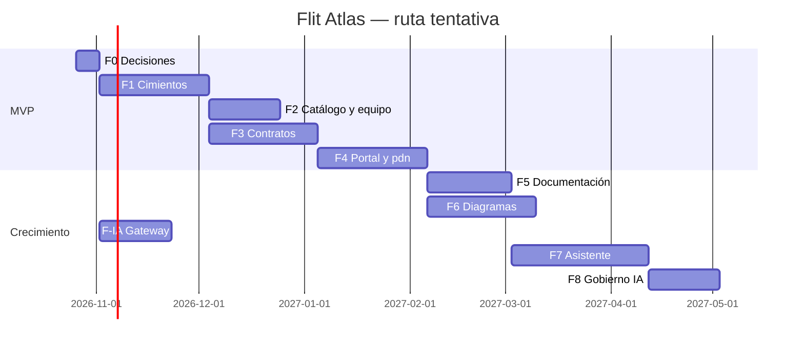

# Prompts por fase · Flit Atlas

> **Versión:** 1.1 (identidad propia de Atlas) · **Fecha:** 2026-10-21
> Cada fase tiene un bloque listo para pegar en una sesión nueva de Claude Code abierta en la raíz del repo `flit-atlas`.
> Todas las fases **presuponen** el prompt maestro (`docs/atlas/prompts/00-prompt-maestro-flit-atlas.md`). No lo repiten.
> El **MVP** son las fases F0 a F4 (decisión A-11). F-IA corre en paralelo y es prerrequisito de F7.

## Mapa de fases

| Fase | Nombre | Entrega usable | Estimación orientativa* |
|---|---|---|---|
| F0 | Decisiones y preparación | ADR firmados, repo creado, prerrequisitos verificados | 1 semana |
| F1 | Cimientos | Identidad propia (Microsoft + externos invitados), roles, PWA instalable en dev | 4–5 semanas |
| F2 | Catálogo y equipo | Catálogo, responsables y rotación de soporte (con Outlook/Teams) | 3 semanas |
| F3 | Contratos internos y legado ICT | Contratos versionados por CI, incluidos los del Excel | 4–5 semanas |
| F4 | Portal de clientes, exportes y salida a pdn | **MVP en `atlas.flitsas.com`** | 4–5 semanas |
| F5 | Documentación viva | Manuales y guías versionados, aprobación, exportes | 3–4 semanas |
| F6 | Diagramas | LikeC4 por ambiente, drift, lienzo, Mermaid y BPMN | 4–5 semanas |
| F-IA | Gateway de IA (paralela) | LiteLLM con llaves virtuales y presupuestos | 3 semanas |
| F7 | Asistente Atlas | Agente experto con RAG, citas y MCP | 5–6 semanas |
| F8 | Gobierno de IA en Atlas | Inventario, riesgos, políticas y costos | 3 semanas |

\* Con 1–2 desarrolladores y Claude Code. Se recalibra al cerrar F1.



---

## Prompt de arranque (cualquier sesión)

```text
Vas a trabajar en Flit Atlas.
1. Lee completo docs/atlas/prompts/00-prompt-maestro-flit-atlas.md. Es la fuente que prevalece.
2. Lee el bloque de la fase <F#> en docs/atlas/prompts/01-prompts-por-fase-flit-atlas.md.
3. Lee las secciones de los planes y los insumos que esa fase cita.
4. Antes de escribir código, dime en una lista corta: qué HU vas a hacer en esta sesión, qué archivos vas a crear o cambiar,
   qué ADR necesitas y qué [por verificar] encontraste. Espera mi visto bueno solo si hay un ADR nuevo o algo irreversible;
   si no, arranca.
5. Al terminar, entrega el reporte de sesión (sección 16 del prompt maestro).
Fase de esta sesión: <F#>, HU <lista>.
```

---

## F0 · Decisiones y preparación

```text
Fase F0 de Flit Atlas: decisiones y preparación. No escribas código de producto en esta fase.

Lee: prompt maestro completo; plan 00 §4, §13, §15 y §18; documento de herramientas completo; plan 01 §1 y §13.

Entregables:
F0.1  Crear el repo privado flitsas/flit-atlas con la estructura del prompt maestro §5.3 (carpetas vacías con README),
      protección de ramas develop/staging/release, CODEOWNERS inicial (Jorman Copete principal, Samuel Cárdenas secundario,
      según el documento de responsables), gitleaks pre-commit y en CI, plantilla de PR con sección de evidencia móvil.
      Copiar los planes, el documento de herramientas, los insumos y estos prompts a docs/atlas/.
F0.2  ADR (formato MADR, docs/adr/) para A-01 a A-12 del prompt maestro, más:
      - ADR de identidad propia (prompt maestro A-03 y §6): ASP.NET Core Identity + Entra ID para empleados +
        cuentas locales por invitación para externos (passkeys, MFA) + OpenIddict como servidor de tokens para
        clientes no navegador. Incluye: modelo de datos identidad_*, claims de la sesión (sub, persona_id,
        tipo_principal, organizacion_id, roles, alcances), ciclo de vida de sesiones, llaves de firma y rotación,
        recuperación de cuenta, amenazas (STRIDE) y controles ASVS nivel 2. core-identity NO participa en el login;
        documenta solo cómo se confiará en sus tokens para el widget de F7 (intercambio de tokens).
      - ADR del BFF y de la entrada HTTP propia (A-07).
      - ADR de mensajería (SDK de plataforma de FLIT como paquete vs MassTransit v8; verifica licencias).
      - ADR de consumo de paquetes compartidos de flit (NuGet/npm privados) o réplica de tokens de marca.
      - ADR del contrato de módulo (prompt maestro §10).
F0.3  Propuesta de puertos para atlas-api, web, render, ia y docs en dev/qa/pdn, y de namespaces. Solo propuesta.
F0.4  Checklist de prerrequisitos con estado verificado o "por verificar" y responsable:
      pgvector y unaccent en Postgres 177/169; capacidad de VPS; buckets atlas/; registro de la aplicación en Entra ID
      (aplicación "Flit Atlas" por ambiente, redirect URIs, certificado de cliente; permisos de Graph mínimos: User.Read,
      lectura de usuarios y grupos para la sincronización, Calendars.ReadWrite sobre el calendario compartido de soporte,
      Mail.Send desde el buzón compartido de invitaciones, envío a Teams) con consentimiento de administrador y, si es
      posible, restringidos a esos buzones con una política de acceso de aplicaciones;
      buzones compartidos "Soporte TI sábados" e "Invitaciones Atlas"; certificados de firma y cifrado de OpenIddict
      por ambiente; GitHub App de solo lectura para CODEOWNERS.
F0.5  Lista de preguntas abiertas para el líder (P-01..P-08 del plan 00 y las nuevas), cada una con tu recomendación.

Criterios de aceptación:
- El repo existe, es privado, tiene protección de ramas y CI mínimo en verde (lint de Markdown, gitleaks).
- Todos los ADR están en estado "Propuesto" con alternativas descartadas y consecuencias.
- El checklist F0.4 no tiene ítems sin responsable.
Detente al terminar y espera la aprobación de los ADR antes de pasar a F1.
```

---

## F1 · Cimientos

```text
Fase F1 de Flit Atlas: cimientos. Lee: prompt maestro §4–§7, §9–§14; plan 00 §6 y §14; ADR aprobados en F0.

HU 1.1  Esqueleto ejecutable con .NET Aspire: atlas-api (.NET 10), web (React + Vite), render (Go), ia y docs (Python),
        Postgres con pgvector, Redis, RabbitMQ y MinIO. `dotnet run` en aspire/ levanta todo.
        CA: health de los cinco servicios en verde; sin variables requeridas, cada servicio falla al arrancar nombrando
        las que faltan; pipeline CI compila y prueba los tres lenguajes y el frontend.
HU 1.2  Persistencia: esquema atlas con migraciones EF Core (snake_case, uuid v7), tablas plataforma_* del §9,
        outbox/inbox y auditoría solo-inserción.
        CA: migraciones idempotentes; prueba de integración con Testcontainers; una escritura auditada no se puede
        actualizar ni borrar con el usuario de la aplicación.
HU 1.3  Módulo Identidad — base y empleados: proyecto Flit.Atlas.Identidad con ASP.NET Core Identity sobre el esquema
        atlas (tablas identidad_*); BFF con cookie HttpOnly/Secure/SameSite=Strict y Data Protection compartida;
        "Iniciar sesión con Microsoft" directo a Entra ID (OIDC con PKCE, tenant único, validación de tid);
        aprovisionamiento JIT de Persona con datos de Graph; mapeo de grupos de Entra a roles; cierre de sesión completo.
        En dev, un proveedor simulado detrás de bandera permite probar sin Entra (nunca habilitable en qa ni pdn).
        CA: un empleado entra con su cuenta Microsoft en dev; una cuenta personal de Microsoft o de otro tenant es
        rechazada; no hay tokens en localStorage ni sessionStorage (prueba E2E); la bandera del proveedor simulado no
        arranca fuera de dev.
HU 1.3b Módulo Identidad — sesiones y seguridad: sesiones en servidor por dispositivo («dispositivos conectados» con
        cierre remoto), sello de seguridad que invalida sesiones al cambiar roles o suspender, reautenticación para
        acciones sensibles, bloqueo progresivo, limitación de tasa, eventos de seguridad en la auditoría.
        CA: suspender a un usuario corta su sesión activa en menos de 1 minuto; 10 intentos fallidos bloquean la cuenta;
        cada evento de seguridad queda auditado.
HU 1.3c Módulo Identidad — servidor de tokens: OpenIddict embebido (descubrimiento, JWKS, authorization code + PKCE,
        client_credentials, refresh con rotación y detección de reutilización), certificados desde SealedSecret,
        registro de clientes por configuración (atlas-cli, mcp, servicios internos), scopes por módulo.
        CA: un cliente de servicio obtiene un token con client_credentials y llama a un endpoint protegido por scope;
        reutilizar un refresh ya usado revoca la cadena completa; pruebas con la suite de conformidad básica de OIDC
        o equivalente [verificar herramienta].
HU 1.4  Roles y permisos: manifiesto de permisos por módulo, roles internos y externos del §7, asignaciones con alcance y
        vigencia, mapeo grupos de Entra → roles, rol implícito por propiedad (interfaz preparada; se llena en F2),
        políticas de ASP.NET Core, predicado obligatorio y RLS en tablas con organizacion_id.
        CA: matriz rol × permiso generada desde el código y visible en Atlas; pruebas de autorización parametrizadas
        recorren todos los endpoints con todos los roles; un rol externo vencido pierde acceso sin intervención.
HU 1.5  Organizaciones e invitaciones: CRUD de organizaciones (interna/cliente), invitación de externos con rol, alcance,
        vencimiento y permisos extra; correo enviado por Atlas (Graph sendMail desde el buzón compartido, o SMTP);
        enlace de un solo uso (72 h, guardado como hash); creación de la cuenta local con passkey (preferido) o
        contraseña + TOTP; códigos de recuperación; recuperación de cuenta por correo; aceptación versionada de términos
        y aviso de privacidad; reenviar, suspender, renovar, revocar; ext.admin_organizacion habilitable por organización.
        CA: flujo E2E completo de invitar → aceptar → registrar passkey → entrar → vencer, en escritorio, Android e iOS;
        un enlace usado o vencido no sirve; una cuenta externa sin MFA no puede entrar; todo queda en auditoría.
HU 1.6  Shell PWA móvil primero: manifiesto, íconos y splash FLIT, barra inferior en móvil y lateral en escritorio,
        tema claro/oscuro, registro de módulos con lazy loading y banderas, Inicio por rol con widgets, búsqueda global
        (estructura), centro de notificaciones, Web Push (VAPID) con suscripciones por dispositivo, aviso de nueva
        versión del service worker, indicador sin conexión.
        CA: instalable en Android, iOS y escritorio; Lighthouse móvil ≥ 90 en rendimiento, accesibilidad y buenas prácticas;
        sin scroll horizontal a 360 px; axe sin errores críticos; push de prueba llega a Android y a iOS instalado.
HU 1.7  Contratos de Atlas: contracts/openapi/atlas.v1.yaml generado desde el código (OpenAPI 3.1) y
        contracts/asyncapi/atlas-events.v1.yaml; lint con vacuum en CI.
HU 1.8  Despliegue en dev por GitOps (flit-gitops), host dev.atlas.flitsas.online, imágenes por digest, SealedSecrets,
        OpenTelemetry. Deja en el PR los pasos de VPS que requieren al líder.
        CA: Argo Synced y Healthy; health público responde; trazas visibles de punta a punta.
HU 1.9  docs/como-crear-un-modulo.md con un módulo de ejemplo "hola" que se agrega sin tocar otros módulos.
```

---

## F2 · Catálogo y equipo

```text
Fase F2 de Flit Atlas: catálogo, responsables y soporte de los sábados.
Lee: prompt maestro §8.1–§8.3 y §9; insumos/Responsables_Productos_FLIT_2026-10-20.md; insumos/Rotacion_Soporte_TI-Developers.xlsx;
plan 00 §2.1 y §7.

HU 2.1  Catálogo: jerarquía producto → módulo → servicio, CRUD con permisos, ficha del aplicativo (estructura con
        pestañas que los demás módulos llenan), semilla idempotente con los productos y módulos del documento de
        responsables y el inventario del plan 00 §2.1. Marca "[por verificar]" en la ficha de Sentinel y People.
        CA: la semilla se puede correr dos veces sin duplicar; búsqueda y filtros por grupo, estado y criticidad.
HU 2.2  Personas: sincronización diaria con Graph (nombre, cargo, foto, estado), teléfono solo con atlas.equipo.ver_contacto.
HU 2.3  Responsables: importar el documento de responsables (versión 5, 2026-10-20, Jorman Copete) a responsabilidades
        principal/secundario por producto y módulo; vistas por persona, por producto y mapa de carga; historial versionado
        con comparación y restauración; traspaso acompañado con checklist; revisión trimestral (próxima 20/01/2027) con
        recordatorio; rol implícito de editor para principal y secundario.
        CA: las tablas 2, 3.1 y 3.2 del documento se reproducen exactamente desde los datos; cambiar un responsable crea
        la versión 6 con autor y nota; restaurar la 5 crea la 7 igual a la 5.
HU 2.4  CODEOWNERS y fichas: generar bloque CODEOWNERS por repo/carpeta y la ficha de responsables en Markdown; leer
        CODEOWNERS reales con la GitHub App y mostrar diferencias.
HU 2.5  "¿A quién llamo?": en cada ficha de aplicativo, soporte de turno (si aplica), principal y secundario, con
        contacto según permisos.
HU 2.6  Soporte — modelo y calendario: configuración (horario por defecto, que define el líder; reglas de festivos;
        aprobadores; anticipación de recordatorios), participantes y orden, turnos con horario propio por turno, estados
        y origen; vistas mes, semana y lista (lista por defecto en móvil); widget "Soporte de este sábado" en Inicio.
HU 2.7  Soporte — importador del Excel con pantalla de revisión: normaliza nombres a personas, unifica fechas,
        interpreta la columna Compensado (fecha → compensación; texto con "reemplazo" → turno reemplazado con la persona
        mencionada) y deja lo ambiguo en observación marcado para revisión. Abraham Cañon como persona inactiva.
        CA: los 26 registros del Excel quedan importados; el informe lista cada interpretación hecha y cada caso ambiguo;
        reimportar no duplica.
HU 2.8  Soporte — generación automática: rotación equitativa para los próximos N meses, con ausencias y festivos de
        Colombia calculados localmente (Ley Emiliani), vista previa, confirmación del líder; los turnos aplicados no cambian.
        CA: pruebas unitarias de equidad (diferencia máxima de 1 turno por persona en la ventana), de festivos de 2026 y 2027
        y de ausencias.
HU 2.9  Soporte — cambios y compensaciones: solicitud → aceptación del reemplazo → aprobación del líder; registro y
        reporte de compensaciones pendientes; historial completo; funciona sin conexión (se encola y se envía al reconectar).
HU 2.10 Soporte — Microsoft 365: evento en el calendario compartido con la persona como asistente; actualización y
        cancelación al cambiar el turno; aviso en el canal de Teams (verifica el mecanismo vigente); feed .ics personal y
        de equipo con token revocable.
        CA: aprobar un cambio de turno mueve el evento del Outlook de una persona al de la otra en menos de 1 minuto.
HU 2.11 Soporte — recordatorios push/correo/Teams N días antes y el mismo sábado; preferencias por usuario.
HU 2.12 Offline de F2: calendario (3 meses), responsables y catálogo disponibles sin conexión según permisos; se borran
        al cerrar sesión.
        CA: en modo avión, un desarrollador ve su próximo turno y los responsables de FLITO.
```

---

## F3 · Contratos internos y legado ICT

```text
Fase F3 de Flit Atlas: contratos de integración (vista interna) e incorporación del legado ICT.
Lee: prompt maestro §8.4; plan 00 §8 completo (conceptos, versionado, flujo CI, modelo de datos, API, pantallas, cobertura);
insumos/Contratos_Integraciones_31Jul2025.xlsx (todas las hojas).

HU 3.1  Validador del token OIDC de GitHub Actions y lista blanca catalogo_fuente_publicacion (repo, rama, workflow, tipos).
        CA: repo o rama fuera de la lista → 403; token vencido → 401; pruebas con JWT firmados de prueba.
HU 3.2  POST /publicaciones/contratos con inmutabilidad (201, 200 idempotente, 409 hash distinto, 422 spec inválida) e
        índice de operaciones/canales (contrato_operacion), para OpenAPI, AsyncAPI y proto.
HU 3.3  Workflow reutilizable atlas-publicar.yml: vacuum + oasdiff breaking contra la versión de pdn + changelog;
        publicación con OIDC. CA: un PR con breaking sin subir MAJOR falla; subiendo MAJOR pasa y publica.
HU 3.4  Canales por ambiente (PUT /canales/{ambiente}) llamados desde el CD; pantalla Consolidado con versión por
        ambiente, desfases y breaking pendientes.
HU 3.5  Diff entre dos versiones (oasdiff en atlas-render, cacheado). CA: coincide con la CLI.
HU 3.6  Pantalla Contrato: Scalar (consola solo hacia sandbox/QA), AsyncAPI, vista proto, ejemplos con httpsnippet
        (curl, C#, Python, Go, JS) con variables, línea de tiempo de versiones, diff, guías, paquetes que lo usan, canales.
        Vista móvil usable (operaciones como lista, detalle en hoja inferior).
HU 3.7  Guías con revisiones, comparación y restauración (crea revisión nueva), auditadas.
HU 3.8  Legado ICT — conversión: script reproducible (en services/docs) que toma el swagger.json de tsoa de cada
        BackApiExternal* y el Excel, y produce OpenAPI 3.1 enriquecido según el §8.4 del prompt maestro (tablas de
        referencia como enums con descripciones, matriz de obligatoriedad con x-flit-obligatoriedad y oneOf donde sea
        viable, webhooks, servidores por ambiente, changelog inicial desde versión/fecha/colaborador de cada hoja,
        saneamiento de tokens, correos y rutas locales). Genera además:
        - informe de inconsistencias (hosts mezclados, URL de dev/pdn vacías, RequestSign/StatusSign sin hoja,
          salidas incompletas, nombres con errores como "Transacction");
        - PR propuesto en cada repo legado con tsoa.json corregido y el workflow de publicación.
        CA: el OpenAPI resultante pasa vacuum con las reglas de lo compartible (incluida la de ejemplos obligatorios);
        cada campo del Excel aparece en el spec o en el informe; ninguna credencial ni ruta local sobrevive (prueba).
HU 3.9  Componente "Matriz de obligatoriedad" y "Tablas de referencia" en la vista del contrato (escritorio y móvil).
HU 3.10 Publicar los contratos de FLIT 2.0 (5 OpenAPI, 5 AsyncAPI, 13 proto) y los BackApiExternal* desde sus CI.
        CA: se ven todos en el Consolidado con su versión por ambiente.
```

---

## F4 · Portal de clientes, exportes y salida a pdn (cierre del MVP)

```text
Fase F4 de Flit Atlas: portal para externos, exportaciones y despliegue en producción.
Lee: prompt maestro §6.2, §7.3, §8.4, §8.5 (exportación y compartir), §11, §12; plan 00 §6, §8.6–§8.9 y §16 F4.

HU 4.1  Paquetes con revisiones (asistente de 3 pasos: contratos y versiones estables; operaciones con filtro por
        etiqueta o x-public; guías), publicar y fijar revisión anterior; auditado.
HU 4.2  Poda de specs OpenAPI y AsyncAPI (cierre transitivo de $ref, sin x-internal, servers públicos).
        CA: pruebas de propiedades con external-api, core-api y los specs legados; ningún $ref roto ni schema huérfano.
HU 4.3  Comparticiones con organizaciones (vigencia, exportar sí/no, sandbox sí/no) y alcance de los roles externos
        (ext.integrador, ext.cliente_funcional, ext.asesor_comercial, ext.proveedor).
HU 4.4  Portal: Inicio del cliente (sus aplicativos, paquetes, avisos de deprecación), contrato compartido podado,
        guías; experiencia móvil completa.
        CA: pruebas de aislamiento en todos los endpoints del portal y de búsqueda pasan (bloquean el release).
HU 4.5  Exportaciones en atlas-docs (cola): OpenAPI YAML/JSON podado, Postman, HTML autocontenido, PDF (WeasyPrint),
        Word (python-docx), Excel con formato parecido al actual (una hoja por servicio con URL por ambiente, headers,
        método, parámetros, obligatoriedad, ejemplos, salida y tablas de referencia) y ZIP; portada, índice, changelog,
        marca de agua (organización + fecha) y hash; URL firmada de 15 minutos; aviso push al terminar.
        CA: exportar el paquete ICT genera los 7 formatos; el Excel abre sin errores y un cliente reconoce la estructura;
        la URL vence; se audita.
HU 4.6  Compartir desde el móvil: Web Share API, descarga que funcione en iOS.
HU 4.7  Sandbox nivel 1 con Microcks (spec podado); las operaciones no compartidas responden 404.
HU 4.8  Avisos de deprecación a las organizaciones afectadas (correo, push, en la app).
HU 4.9  Offline de F4: contratos y guías marcados como favoritos disponibles sin conexión, solo si el usuario tiene permiso.
HU 4.10 Endurecimiento: CSP, rate limiting por organización, revisión de seguridad dedicada que incluye una prueba de
        penetración del módulo de identidad (registro, MFA, recuperación, sesiones, tokens), prueba de carga
        (20 usuarios concurrentes + 2 exportaciones simultáneas sin degradar), runbook de operación en flit-gitops/docs.
HU 4.11 Despliegue en qa y pdn (atlas.flitsas.com); invitación del primer cliente piloto.
        CA: revisión de seguridad sin hallazgos altos; Argo Synced/Healthy en 169; el piloto entra, ve solo su paquete,
        exporta y prueba en el sandbox.
```

---

## F5 · Documentación viva

```text
Fase F5 de Flit Atlas: documentación técnica y funcional versionada.
Lee: prompt maestro §8.5; documento de herramientas, caso 3 (manuales dinámicos); plan 03 §8.1 y §18 (estrategia de contenido).

HU 5.1  Modelo doc_* con versiones inmutables (desde repos) y revisiones (escritos en Atlas), estados y aprobación del
        responsable del aplicativo; publicar como publico_clientes exige aprobación del principal o del secundario.
HU 5.2  Workflow reutilizable que publica docs/funcional/**, docs/integraciones/**, ADR y manuales al hacer merge
        (develop → dev, staging → qa, release → pdn) con OIDC de GitHub; front-matter validado.
HU 5.3  Editor: Tiptap (visual) y Monaco (MDX) con vista previa, Mermaid incluido; componentes MDX en lista blanca
        (<Contrato/>, <Diagrama/>, <Responsables/>, <SoporteDeTurno/>, <Alerta/>, <Pestanas/>).
HU 5.4  Lector: navegación por aplicativo, índice, versión seleccionable, comparación entre versiones, lectura cómoda en
        móvil, favoritos offline.
HU 5.5  Búsqueda full-text en español (tsvector + unaccent) integrada a la búsqueda global.
HU 5.6  Exportar documento o colección a PDF, Word, HTML y Markdown; compartir con organizaciones o personas.
HU 5.7  Flujo de borradores asistidos: la IA (vía gateway, si F-IA ya está) redacta un borrador funcional desde el código
        o desde una guía técnica; un responsable funcional lo revisa y aprueba. Sin gateway, la HU queda detrás de bandera.
HU 5.8  Tiempo real con SignalR (quién está viendo; cambios publicados aparecen al instante). Edición colaborativa con
        Yjs queda como mejora posterior; deja el ADR.
```

---

## F6 · Diagramas

```text
Fase F6 de Flit Atlas: arquitectura como código, vistas por ambiente, drift y diagramas visuales.
Lee: prompt maestro §8.6; plan 01 completo; documento de herramientas, casos 1 y 2.

HU 6.1  Saneamiento de ADR en los repos (carpeta única y renumeración, plan 01 §13) — coordinado con el líder; Atlas usa
        la ruta como clave para no depender de números duplicados.
HU 6.2  LikeC4 fijado (1.59.x): specification compartida, landscape, modelos de flit y flito según el plan 01 §6,
        validación en CI y publicación a Atlas con OIDC.
HU 6.3  Vistas en Atlas con likec4/react: landscape, contexto, contenedores, componentes y dinámicas; enlaces de cada
        elemento a su ficha del catálogo, contratos y ADR; zoom con gestos en móvil.
HU 6.4  Generador desde flit-gitops: snapshot JSON y modelo de despliegue por ambiente y clúster, versionado por sha de
        gitops; comparación entre snapshots; los datos sensibles (IP, secretos) solo viven en Atlas, nunca en git.
HU 6.5  Drift en tres capas (modelo vs gitops vs Argo CD) con alertas al líder técnico y a los responsables.
HU 6.6  Lienzo React Flow + ELK.js con modelo dgm_*, versiones, comentarios, referencias a elementos LikeC4 y al catálogo.
HU 6.7  Mermaid y BPMN (bpmn-js) con fuente versionada, validación y limpieza del XML en el servidor.
HU 6.8  Exportar a SVG/PNG con D2 en atlas-render (SVG sanitizado, caché por hash).
HU 6.9  Servidor MCP de LikeC4 disponible para el asistente (F7) y para el equipo.
```

---

## F-IA · Gateway de IA (paralela)

```text
Fase F-IA: gateway LiteLLM. Lee: plan 02 §6.3, §6.4, §9, §10, §14 y §16; prompt maestro A-10.
Esta fase vive principalmente en flit-gitops (ns ia-gateway) y la ejecuta el Responsable de IA con apoyo tuyo.

HU IA.1  ADR que reemplaza parcialmente ADR-0070 (P-08). Sin ADR aprobado no se despliega nada.
HU IA.2  LiteLLM ≥ 1.83.0 fijado por digest (nunca 1.82.7 ni 1.82.8), Trivy, red de salida restringida, master key en
         SealedSecret, UI no expuesta.
HU IA.3  Alias flit-asistente-principal, flit-rapido, flit-ocr, flit-embeddings (→ python-ml bge-m3); Kimi y DeepSeek
         fuera de pdn (P-04).
HU IA.4  Llaves virtuales atlas-ia-{dev|qa|pdn} con presupuesto y límites; Presidio con reconocedores colombianos.
HU IA.5  Endpoint de embeddings en python-ml (bge-m3, 1024 dimensiones) con prueba de carga.
CA: una llamada desde atlas-ia sale por el gateway, queda registrada sin contenido, respeta el presupuesto y enmascara
una cédula de prueba.
```

---

## F7 · Asistente Atlas

```text
Fase F7 de Flit Atlas: agente experto. Lee: prompt maestro §8.7 y A-10; plan 03 completo.
Requisitos: F-IA en dev; F3 y F5 publicando contenido.

HU 7.1  Tablas asistente_* y contexto de permisos firmado por atlas-api y verificado por atlas-ia.
HU 7.2  Indexador en atlas-ia consumiendo eventos atlas.*.publicada: extractores por tipo (Markdown, manual, OpenAPI por
        operación, AsyncAPI por canal, ADR con resumen de negocio, LikeC4 por elemento y vista, glosario, responsables y
        soporte solo para internos), fragmentación, hash, reutilización de vectores.
HU 7.3  Recuperación híbrida (tsvector + pgvector + RRF) con el filtro de permisos en SQL antes del ranking; RLS como
        segunda barrera.
HU 7.4  Orquestación con herramientas (buscar_conocimiento, obtener_operacion_contrato, obtener_vista_arquitectura,
        quien_es_responsable, soporte_de_turno, crear_caso_soporte con confirmación), máx. 5 rondas, streaming SSE,
        citas validadas contra lo recuperado, Mermaid validado.
HU 7.5  Chat en la PWA (escritorio y pantalla completa en móvil), dictado por voz donde exista, feedback 👍/👎,
        consentimiento Ley 1581 versionado, topes por usuario y por organización, modo degradado sin LLM.
HU 7.6  Widget embebible para las apps de la Suite y FLITO; plan de migración de Dr. FLIT con bandera (plan 03 §19).
        Autenticación del widget: intercambio de tokens (RFC 8693) en el servidor OpenIddict de Atlas, que acepta tokens
        de core-identity (Suite) o un token de servicio del backend de FLITO como emisores de confianza configurados y
        entrega un token de Atlas con scope atlas.widget y audiencias del manual; nunca crea usuarios en core-identity.
HU 7.7  Servidor MCP de Atlas (contratos, documentos, diagramas, responsables) con los permisos del usuario, autenticado
        con OAuth contra el servidor OpenIddict de Atlas (scope atlas.mcp).
HU 7.8  Evaluación: conjunto dorado (preguntas del plan 03 §5.3 más preguntas sobre responsables y soporte), pruebas de
        fuga entre organizaciones e inyección de prompt en CI.
        CA: ≥ 80 % de aciertos, 0 respuestas con contenido sin cita, 0 fugas.
```

---

## F8 · Gobierno de IA en Atlas

```text
Fase F8 de Flit Atlas: módulo de gobierno de IA. Lee: plan 02 §4, §6, §7, §8, §11, §12, §13 y §15; prompt maestro §8.8.

HU 8.1  Tablas gia_* e inventario de casos de uso con la ficha del plan 02 §7.1; carga de las fichas prellenadas CU-01..CU-13.
HU 8.2  Evaluación de riesgo (seis dimensiones, P × I, nivel por la peor dimensión) y EIPD con flujo de aprobación según
        el nivel (Responsable de IA, OPD, Comité).
HU 8.3  Políticas POL-SGSI-IA-01..07 versionadas con registro de aceptación por persona.
HU 8.4  Llaves virtuales gestionadas desde Atlas vía la API admin de LiteLLM (el valor se muestra una sola vez), costos por
        aplicación y ambiente, alertas al 80 % del presupuesto.
HU 8.5  Inventario de herramientas del equipo y asientos; incidentes de IA con severidad y playbooks.
HU 8.6  Reporte mensual automático al Comité y tablero de KPI del plan 02 §15.
```
